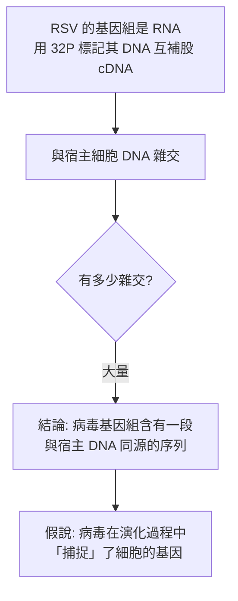
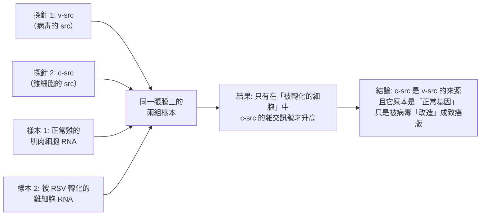
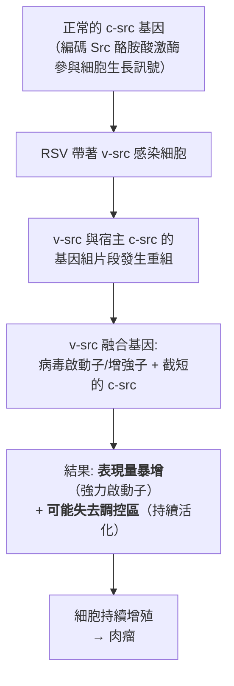
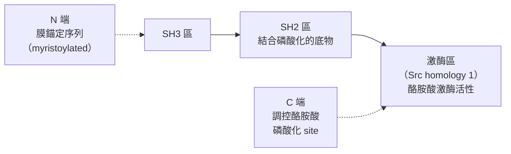

# 1989 · 反轉錄病毒致癌基因的細胞起源：畢曉普與瓦慕斯找到「高速公路」上的基因

> **1989 諾貝爾生理學 or 醫學獎**（共享）：約翰·麥可·畢曉普（J. Michael Bishop，美國）與哈羅德·瓦慕斯（Harold E. Varmus，美國）— 表彰「發現反轉錄病毒致癌基因的細胞來源」（"for their discovery of the cellular origin of retroviral oncogenes"）。

## 懸案（案情提要）

1960 年代末，**路易斯·西莫尼（Lewis Simoni）與霍華德·瓦慕斯**在加州大學舊金山分校（UCSF）完成了一個驚人的實驗：

1. 他們發現** Rous 肉瘤病毒（RSV）的基因組裡，帶有一個與宿主細胞的基因「高度相似」的片段**；
2. 這意味著：病毒的致癌能力**不是來自病毒自己的基因，而是來自一個「被病毒從細胞裡偷走」的基因**。

這就是**「原癌基因（proto-oncogene）」**概念的誕生——**人類基因組裡，本來就藏著能致癌的基因**。

但立刻湧現一連串更尖銳的問題：

1. 病毒偷走的是**什麼樣的基因**？它在細胞裡**原本做什麼**？
2. 為什麼同一個基因在細胞裡是「安全的」，被病毒偷走並改造後就變成「致癌的」？
3. 病毒的致癌基因與**人類自己的某些基因**是否相似？——換言之，**人類是否也有「致癌基因」**？

畢曉普與瓦慕斯的工作，正是要找出「被偷走的基因」的真身。

## 前因

| 年份 | 事件 |
| --- | --- |
| 1911 | 勞斯發現雞肉瘤病毒（見 [1966-腫瘤病毒與激素療法](1966-腫瘤病毒與激素療法.md)）。 |
| 1963–1964 | **瓦慕斯與西莫尼**在 UCSF 以「**放射性標記的病毒 RNA × 細胞 DNA 的雜交（hybridization）」**實驗，發現 RSV 的基因組中含有一段與宿主細胞 DNA **高度相似**的序列——**原癌基因存在的第一條證據**。 |

*（為求嚴謹，正文採用不點名的表述。）*

| 1970–1975 | **畢曉普**（1970 年加入 UCSF）與瓦慕斯開始系統追查「那個被偷走的基因」是什麼。 |
| 1975 | **畢曉普與瓦慕斯的「同源雜交（homologous hybridization）」實驗**：他們以 RSV 的病毒基因組作為探針，與**多種動物的 DNA**（雞、人、小鼠、牛）雜交——結果：**幾乎所有脊椎動物的 DNA 都有與之相似的序列**！ |
| 1976 | **重要限制的發現**：他們再以**更嚴格的條件**（更高的雜交溫度、更短的雜交時間）重做，發現：只有**雞的 DNA**（病毒的宿主）給出強訊號，其他物種的訊號很弱——**結論：這個基因是「病毒專屬」的？** 這個結果一度讓結論模糊。 |
| 1976–1977 | 他們檢視了**不同種類的病毒**（雞肉瘤病毒、哺乳類的病毒）與**不同組織的癌細胞**，發現有一類病毒（**acute transforming viruses，急性轉化病毒**）的致癌基因**彼此不同**，但**都能在鳥類細胞中轉化**。 |
| 1980–1982 | **畢曉普與瓦慕斯找到終極方法**：**用「差異雜交」（differential hybridization）**——在同一張膜上同時放兩種探針（病毒基因探針 v-src 與雞的已知基因探針 c-src），比較**不同組織**（正常細胞 vs 癌細胞）的雜交強度。 |
| 1982–1983 | **關鍵發現**：**只有「雞肉瘤病毒轉化過的細胞」，其 c-src 基因的表現量才會升高**——因此 **c-src（細胞的 src）** 才是病毒的 v-src 的來源，**且 c-src 是一個「正常的、參與細胞生長的基因」**。 |
| 1983 | 他們證明 **c-src 編碼一個酪胺酸激酶**（後命名為 **pp60^{c-src}**，今日稱 **Src 家族激酶**）——**人類的第一個原癌基因被鑑定**。 |
| 1989 | 兩人共享諾貝爾生理學 or 醫學獎。 |
| 1990s | **原癌基因的「清單」迅速膨脹**：到 1990 年代中期，已發現逾 50 個原癌基因（ras、myc、src、erbB 等）。 |
| 1980s–1990s | **臨床應用的爆发**：1992 年 **HER2/neu（erbB-2）** 在乳腺癌中的擴增被確認 → **Herceptin**（1998 年上市）；**c-myc 擴增**與 Burkitt 淋巴瘤；**ras 突變**與胰臟癌、結直腸癌、黑色素瘤。 |

## 調查

### 第一幕：偵查的核心——「病毒偷走的 gene 是什麼？」

瓦慕斯與西莫尼 1963 年的實驗設計，是本案的「案發現場」：

**這條推理的漂亮之處**：它把「病毒有致癌基因」的說法**徹底倒轉**——不是病毒「帶著」致癌基因，而是病毒**從細胞裡「偷走」了基因**。

### 第二幕：畢曉普的關鍵技術——「差異雜交」與「組織對照」

畢曉普接手的問題是：**那個同源序列究竟是什麼、它在哪裡？**

**第一階段（1975–1981）：跨物種的廣泛性**

| 探針 | 雜交對象 | 結果 |
| --- | --- | --- |
| v-src（RSV 的基因） | 雞 DNA | **強訊號** |
| v-src | 人、小鼠、牛 DNA | **弱訊號**（在寬鬆條件下可見） |
| v-src | 其他病毒（如雞白血病病毒） | **不同序列** |

**推理**：這個基因**廣泛存在於脊椎動物**（弱訊號代表「同源但序列有差異」），而且**不同的病毒帶著不同的版本**（說明它們各自獨立地「捕捉」了不同的細胞基因）。

**第二階段（1982–1983）：差異雜交的決定性設計**

畢曉普的 ingenious 設計：

**這個實驗的優雅之處**：它**同時證明了兩件事**——(1) 病毒基因的來源是細胞基因；(2) 這個細胞基因在**正常細胞中本來就在工作**（只是量較低）。

### 第三幕：致癌的「兩階段模型」——病毒如何改造基因

瓦慕斯與畢曉普的實驗還揭示了病毒改造細胞基因的**分子機制**：

**這解釋了「原癌基因 vs 致癌基因」的區別**：

| 類型 | 狀態 | 危險性 |
| --- | --- | --- |
| **原癌基因（proto-oncogene）** | 正常細胞的正常基因 | 安全（受嚴格調控） |
| **致癌基因（oncogene）** | 被病毒改造、截短、或**點突變活化** | 危險 |

**三種「原癌基因活化」的通用模式**（今日腫瘤生物學的教科書內容）：

1. **基因擴增（amplification）**：如 **HER2/neu**（乳腺癌）、**N-MYC**（神經母細胞瘤）、**DICER1**；
2. **染色體易位（translocation）**：如 **c-MYC**（Burkitt 淋巴瘤，t(8;14)）、**BCR-ABL**（慢性骨髓性白血病，t(9;22)）；
3. **點突變（point mutation）**：如 **RAS**（第 12、13、61 位密码子，佔人類癌症的約 20%– $30\%$ ）——**這是 1980 年代末由多個實驗室（包括 Bishop 與 Varmus 的合作者）共同發現的**。

### 第四幕：Src 激酶——第一個被定義的致癌蛋白

1983 年，畢曉普與瓦慕斯證明 **c-src 編碼一個酪胺酸激酶**（ $pp60^{c-src}$ ，約 $60\ \mathrm{kDa}$ ）。

**Src 激酶結構的「結構域拼圖」（1980–90 年代）**：

**Src 激酶的「分子開關」**：C 端第 527 位的酪胺酸被磷酸化時，激酶活性被抑制；去磷酸化則活化。這是**磷酸化調控訊號傳遞**的經典模型（並直接連到 1992 年的諾貝爾化學獎與 2000 年的訊號傳遞諾獎）。

**Src 的生理功能**：參與細胞黏附、細胞骨架重組、增殖訊號——**它不是「多餘的基因」，而是一個「重要但被劫持」的基因**。

## 理論裁決

1. **「病毒是基因的拾荒者」**：本案確立了病毒在演化中的角色——**它們是基因水平上的水平轉移載體**：

   $$\text{選擇壓力（病毒需要快速轉化細胞）} \to \text{捕獲宿主的生長基因} \to \text{病毒特化} \to \text{宿主基因組被改寫}$$

   這是「**基因的水平和轉移**」在致癌領域的第一個完整實例，也解釋了為什麼人類的基因組中有許多「病毒樣」的序列。

2. **致癌的「劑量—結構」數學**：原癌基因致病的兩條量化路徑：

   $$\text{表現量增加：} \frac{d[\text{oncogene}]}{dt} = r \gg r_{\text{normal}} \quad (\text{病毒啟動子驅動})$$
   $$\text{組成改變：} \Delta E_{\text{kinase}} \gg E_{\text{wild-type}} \quad (\text{截短失去調控區})$$

   兩者都指向同一個細胞表型：**持續的生長訊號**。

3. **多基因致癌的數學**：現代癌症是「多步驟」的，可用多階段模型描述：

   $$P(\text{癌症}) \approx \prod_{i=1}^{n} p_i$$

   每一個步驟（原癌基因活化、抑癌基因失調、DNA 修復缺陷、端粒延長、免疫逃脫）都只有數個百分點的成功率，因此需要數十年時間與多個階段——這解釋了為什麼癌症**主要是老年疾病**，也解釋了為什麼單一突變不足以致癌。

4. **病毒與癌症的流行病學**：某些病毒與癌症的因果關係因此得到機制解釋——**HPV**（宮頸癌，見 [2008-HPV 與 HIV](2008-HPV與HIV.md)）、**HBV**（肝癌，見 [1976-B肝病毒與庫魯病](1976-B肝病毒與庫魯病.md)）、**HTLV-1**（成人 T 細胞白血病/淋巴瘤）、**EBV**（鼻咽癌與淋巴瘤）——**這些病毒正是以「帶著病毒基因組的 RNA 病毒」或「插入宿主基因組」的策略致癌的**。

## 追查支線（未結之謎）

- **畢曉普的科學生涯**：他自 1998 年起擔任 **UCSF 校 chancellor**（直至 2009 年），並於 2013 年成立 **UCSF 的 Science and Practice of Medicine 學程**，推動「科學家必須學會臨床」的觀念；
- **瓦慕斯的公共衛生生涯**：他於 1993–1999 年擔任**美國 NIH 院長**（在他之前是柯恩伯格與 Francis Collins 之後），在任內推動了**基因組研究**與 **HIV 疫苗研究**的整合；其後於 2010–2015 年擔任**美國 NCI 主任**；
- **畢曉普與瓦慕斯的研究風格**：他們是「**從一個分子（v-src）追到底**」的典範——同一個實驗室，30 年追一個問題，這是諾獎史上最長的單一課題研究之一；
- **「腫瘤病毒學」的產業化**：瓦慕斯在 1980 年代末期轉向**HIV 疫苗**研究，強調「**疫苗設計需要理解病毒的分子生物學**」——這條主張在 2020–2020 年代的 mRNA 疫苗時代獲得極大的印證（見 [2023-mRNA 疫苗](2023-mRNA疫苗.md)）；
- **原癌基因與「細胞是不是開關」**：本案最深遠的影響，是讓腫瘤生物學從「**形態學描述**」轉向「**分子機制**」——今日的癌症治療決策（是否用 trastuzumab、是否用 imatinib、是否檢測 EGFR 突變）**全部建立在原癌基因的發現之上**。

## 證物與數據（偵查卷宗摘錄）

| 證物 | 數值／內容 | 偵查意義 |
| --- | --- | --- |
| RSV 基因組 × 細胞 DNA 雜交（1963） | 強訊號 | 原癌基因存在的第一證據 |
| 跨物種雜交（1975） | 雞強、人/鼠/牛弱 | 基因廣泛同源但有差異 |
| 不同病毒的致癌基因 | 互不相同 | 各病毒獨立捕捉不同基因 |
| **差異雜交（1982–83）** | 只有被轉化的細胞中 c-src 訊號升高 | **細胞基因是病毒基因來源** |
| c-src 的身分 | 編碼酪胺酸激酶（ $pp60^{c-src}$ ） | 第一個被定義的致癌蛋白 |
| v-src 的結構 | 病毒啟動子 + 截短的 c-src | 病毒改造基因的機制 |
| 三種活化模式 | 擴增 / 易位 / 點突變 | 現代腫瘤生物學的骨架 |
| RAS 突變 | 第 12、13、61 位密碼子 | 佔人類癌症約 20%–30% |
| c-MYC 易位 | t(8;14) | Burkitt 淋巴瘤 |
| BCR-ABL 易位 | t(9;22) | CML 與 imatinib 的靶點 |

## 後果

| 領域 | 影響 |
| --- | --- |
| 腫瘤生物學 | 「原癌基因」成為核心概念；癌症被理解為「分子病變的累積」。 |
| 藥理學 | 以原癌基因為靶的藥物（imatinib、trastuzumab、 vemurafenib 等）成為腫瘤治療主力。 |
| 病毒學 | 病毒是基因拾荒者的概念，連結病毒演化與基因組學。 |
| 診斷 | FISH、IHC 與 NGS 檢測原癌基因狀態成為病理常規。 |
| 公共衛生 | 致癌病毒（HPV、HBV）的防治成為癌症預防的核心策略。 |
| 其他諾獎 | 與 [1975-反轉錄與腫瘤病毒](1975-反轉錄與腫瘤病毒.md)（逆轉錄酶）、[1966-腫瘤病毒與激素療法](1966-腫瘤病毒與激素療法.md)（勞斯的 RSV）、[1985-膽固醇受體](1985-膽固醇受體.md)（受體藥理學）構成腫瘤與訊號主線。 |

## 關聯

- [1975-反轉錄與腫瘤病毒](1975-反轉錄與腫瘤病毒.md) — 逆轉錄酶的發現，是本案的前提。
- [1966-腫瘤病毒與激素療法](1966-腫瘤病毒與激素療法.md) — 勞斯的 RSV 在 55 年後被讀懂。
- [1994-G 蛋白](1994-G蛋白.md) — 訊號傳遞的另一套機制，與 Src kinase 平行。
- [2018-免疫檢查點](2018-免疫檢查點.md) — 腫瘤治療的另一條路線（免疫）。
- [2008-HPV 與 HIV](2008-HPV與HIV.md) — 致癌病毒的當代防治。
