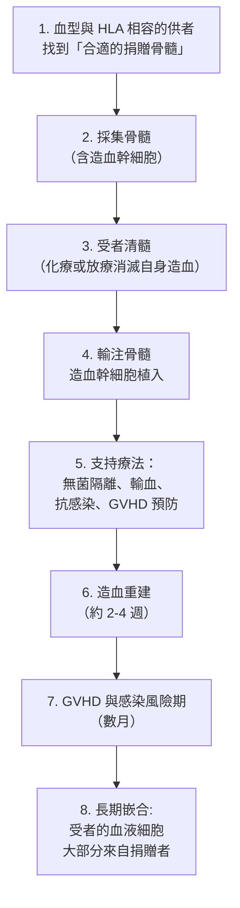

# 1990 · 器官與細胞移植：默里與托馬斯把「移植」從實驗變成療法

> **1990 諾貝爾生理學 or 醫學獎**（共享）：約瑟夫·默里（Joseph E. Murray，美國）— 表彰「發現應用於人類疾病治療的器官和細胞移植術」；唐納爾·托馬斯（E. Donnall Thomas，美國）— 同上。

## 懸案（案情提要）

1970 年代末，一個醫學夢想與一個醫學絕望同時存在：

**夢想**：把一個人的器官移植給另一個人——**腎臟、心臟、肝臟、骨髓**——以取代衰竭的器官。

**絕望**：

1. **免疫系統會攻擊移植物**（排斥反應，見 [1960-後天免疫耐受](1960-後天免疫耐受.md)）；
2. **最大的難題**：如何讓免疫系統「接受」外來的器官？
3. 即使解決了排斥，還有一個更根本的問題：**移植的器官能活多久？** 會不會因為「器官裡的細胞不是病人自己的」而被免疫系統慢慢消耗？
4. 反過來：**自體的骨髓**（造血的工廠）若被「自己的細胞」攻擊，會發生什麼？——**這就是自體免疫病的造血系統版本**。

默里與托馬斯，分別用兩條路徑回答了這些問題：**默里解決了「怎麼不排斥」**，**托馬斯解決了「怎麼用細胞治療」**。

## 前因

| 年份 | 事件 |
| --- | --- |
| 1902–1910 | 1902 年，**烏爾茲（Ernst Ullmann）** 在狗身上完成第一例**腎臟移植**；1905 年出現首例**異種移植**。 |
| 1933 | **Alexis Carrel**（見 [1912-血管縫合與器官移植](1912-血管縫合與器官移植.md)）進行了著名的**狗腎異體移植**，並以血管縫合術維持數月——事後被認為維持的是感染與血栓，而非真正的免疫學耐受。 |
| 1950s | 蘇聯與歐洲的移植先驅（包括 **Yu Yu（于有慧?）** 與 **Joseph Murray 的老師 **Owen (O.) Wangensteen**）推動了實驗動物移植研究；**1954 年，首例同卵雙生腎移植在紐約成功**。 |
| 1950–60 年代 | **抗代謝藥物 azathioprine（硫唑嘌呤）**與**類固醇**被引入以抑制排斥（azathioprine 的發現見 [1988-藥物治療原理](1988-藥物治療原理.md)）。 |
| 1963 年 1 月 | **約瑟夫·默里**在波士頓完成首例**非同卵雙生活體供者**的腎移植，病人存活數年——**移植從實驗走進臨床**。 |
| 1963–1966 | **托馬斯**在西雅圖的 Fred Hutchinson 癌症中心發展**骨髓移植**：確立血型與組織相容性前提，並建立支持療法以度過移植物抗宿主病的危險期。 |
| 1968 | 首例**骨髓移植治療白血病**成功，托馬斯的病人長期存活。 |
| 1970s | **抗淋巴細胞球蛋白（ALG）**與 **1980 年代的環孢素（cyclosporine）**問世——免疫抑制從「非選擇性毒性」走向「定向抑制」。 |
| 1980s | **HLA 配對**成為移植配型的標準（見 [1980-MHC 與血型抗原](1980-MHC與血型抗原.md)）；**骨髓移植成為白血病、淋巴瘤、再障與遺傳性疾病的標準療法**。 |
| 1990 | 兩人共享諾貝爾生理學 or 醫學獎。 |
| 1990s–2020s | **誘導耐受**的臨床應用（混合嵌合體、CAR-T）、**類器官與器官再生**（以 iPS 細胞製造肝臟、心臟細胞團簇的臨床試驗）、**異種移植**（2022 年首例豬心移植人體），皆是本案的現代延伸。 |

## 調查

### 第一幕：默里的難題——「如何讓免疫系統閉嘴？」

默里的實驗起點極為大膽：**如果移植的器官與受者的組織相容性差，唯一的希望就是「用藥把免疫系統壓下去」。**

**免疫抑制方案的演進**：

| 年代 | 方案 | 問題 |
| --- | --- | --- |
| 1950s | **全身 X 射線照射** | 骨髓抑制、感染、死亡率高 |
| 1960s | **azathioprine（硫唑嘌呤）+ 潑尼松** | 感染率高，排斥仍常發生 |
| 1970s | **ALG（抗淋巴細胞球蛋白）** | 異質性高、有過敏反應 |
| 1980s | **環孢素（cyclosporine）** | **突破**：選擇性抑制 T 細胞活化 |
| 1990s | **他克莫司（tacrolimus, FK506）** | 類似的機制，不同的靶點 |

**1963 年的關鍵突破**：默里在波士頓完成首例**非同卵雙生以外的活體腎臟移植**。**病人存活數年**——這證明了：

$$\text{若免疫系統被藥物壓制，器官移植在臨床上是可行的}$$

**這是移植醫學從「實驗室技術」變為「治療」的轉捩點**。

**默里的更深遠貢獻**：他把移植醫學變成一門**嚴謹的科學**——

1. **以「免疫抑制的劑量—反應曲線」取代「有或無」的嘗試**：不同病人需要不同劑量；
2. **以「組織相容性抗原（HLA）」的分級取代「血型相符」的二元標準**（與斯內爾、達塞的研究直接接軌，見 [1980-MHC 與血型抗原](1980-MHC與血型抗原.md)）；
3. **建立全國性的移植登記系統**：今日 **UNOS（美國器官共享網路）**與歐洲的器官分配系統，源自此。

### 第二幕：托馬斯的難題——「用別人的造血幹細胞重建一個人」

托馬斯的問題與默里**互為鏡像**：

- 默里面對的是：**宿主的免疫系統攻擊外來的器官**；
- 托馬斯面對的是：**外來的免疫細胞攻擊宿主的組織（GVHD）**。

**托馬斯的系統性解方**：



**托馬斯的關鍵貢獻**：

1. **確立「血型相容是必要條件」**：1960 年代初，許多骨髓移植因 **ABO 不合**而失敗——這促使托馬斯系統研究血型不相容移植的處理（漿細胞置換、降低抗 A/B 抗體等），使「血型不合也能移植」成為可能；
2. **建立 GVHD 的分級與預防**：以 **甲氨蝶呤（methotrexate）**預防 GVHD，並以 **抗胸腺細胞球蛋白（ATG）**治療；
3. **支持療法（supportive care）的體系化**：**無菌隔離病房**、抗生素、成分輸血、血小板輸注——**這些「輔助技術」實際上決定了移植的成敗**（他的名言：「移植的成敗取決於感染控制」）；
4. **確立適應症**：急性白血病（尤其是**急性骨髓性白血病 AML 的緩解期**）、淋巴瘤、再障、遺傳性免疫缺陷與代謝病。

### 第三幕：兩條路徑的交會——「造血幹細胞」

托馬斯的工作最終揭示了一個關鍵事實：**骨髓移植不是「器官移植」，而是「細胞移植」**——真正被移植並長期存活的是**造血幹細胞**：

$$\text{骨髓} \to \text{造血幹細胞} \to \text{所有血球系} \to \text{長期供血}$$

**「細胞移植」這條路徑，後來延伸到了幹細胞治療的全部領域**（見 [2012-iPS 細胞](2012-iPS細胞.md)）：

| 類型 | 移植的細胞 | 用途 |
| --- | --- | --- |
| **造血幹細胞移植（HSCT）** | 骨髓或外周血幹細胞 | 白血病、再障、免疫缺陷 |
| **CAR-T 細胞移植** | 病人自體 T 細胞（基因改造） | 血液癌症（見 [2018-免疫檢查點](2018-免疫檢查點.md)） |
| **間充質幹細胞** | 骨髓間充質細胞 | 移植抗宿主病、骨骼肌肉損傷 |
| **iPS 細胞衍生細胞** | 病人自身來源的 iPS 細胞 | 神經、心肌、胰島細胞再生 |

### 第四幕：免疫抑制的藥理學邏輯

默里的方案之所以能成功，是因為**免疫反應有幾個可被攻擊的環節**：

```mermaid
flowchart TD
    A[移植物抗原] --> B[受者 T 細胞活化<br>需三個訊號]
    B --> C1[訊號1: TCR 辨識 MHC<br>（移植的 MHC 即「異己」）]
    B --> C2[訊號2: 共刺激 CD28-B7]
    B --> C3[訊號3: 細胞激素 IL-2]
    D[環孢素 / 他克莫司] -->|結合 cyclophilin/FKBP<br>抑制 calcineurin| C3
    E[抗淋巴細胞球蛋白 ALG] -->|消耗 T 細胞| B
    F[類固醇 (prednisone)] -->|抑制發炎與<br>細胞激素基因表現| C3
    G[嗎啉 (MMF)] -->|抑制嘌呤合成<br>（淋巴細胞增殖）| B
    H[他克莫司 + 嗎啉 + 類固醇] --> I[現代標準方案]
```

**免疫抑制的邏輯**：**不殺死 T 細胞（那會導致感染與腫瘤），而是阻止其「被喚醒」**——這是 1990 年諾獎背後的藥理學進步。

### 第五幕：現代的延伸

1. **誘導免疫耐受**：不靠免疫抑制藥物，而靠**誘導受者對供者抗原的特異性耐受**（如混合嵌合體策略）；
2. **異種移植**：2022 年 3 月，美國進行了首例**豬心移植人體**（基因編輯豬，減少免疫原性），成為本案最前沿的延伸；
3. **類器官與器官再生**：以 iPS 細胞製造肝臟、心臟細胞團簇（2020 年代日本、中國的臨床試驗）；
4. **Machine perfusion（機器灌流）**：讓器官在移植前以含氧灌流液維持活性——這是卡雷爾的灌流泵（見 [1912-血管縫合與器官移植](1912-血管縫合與器官移植.md)）的現代回歸。

## 追查支線（未結之謎）

- **默里的傳記性**：他的故事被寫成《**The Knife in the Serum**》與《When the Heavens Could Fall》；他 17 歲時在一次狩獵事故中失去左手——**正是這段經歷讓他決心做外科**，並讓他對「用別人的器官救人」有深刻的個人理解；
- **默里在 1996 年**獲得了另一個頭銜：**世界移植recipient 的關係**——他與同卵雙生兄弟本人互為腎臟捐贈者（1984 年，兄弟將腎捐給他）；
- **托馬斯的科學與人道**：托馬斯於 1990 年獲獎，1990 年代末當選美國醫學協會會長；**1990 年代的「骨髓移植的倫理與供者招募」議題**（特別是**骨髓_registry 與少數族裔的代表性不足**）是他推動公共衛生的議題；他於 2020 年 3 月 9 日去世；
- **托馬斯的「耐心」**：他常說，移植醫學的進步「靠的不是 brilliance，而是**數千個病例的累積與記錄**」——他堅持建立**長期的追蹤登記**，這是「證據醫學」在外科的先聲；
- **移植的倫理與分配**：器官分配系統（UNOS 的「分配分數」）本身就是一個**價值的數學化**問題——「誰的肝臟更值得移植？」——這是生物醫學倫理最困難的問題之一。

## 證物與數據（偵查卷宗摘錄）

| 證物 | 數值／內容 | 偵查意義 |
| --- | --- | --- |
| 1954 年同卵雙生腎移植 | 首例成功 | 「自我」不排斥的證明 |
| 1950s 全身 X 射線免疫抑制 | 骨髓抑制、感染 | 過度抑制的失敗 |
| azathioprine + 類固醇 | 感染率高 | 雙重免疫抑制的嘗試 |
| 1963 年首例非identical 活體腎移植 | 病人存活數年 | **移植臨床化的轉捩點** |
| 環孢素（1980s） | 選擇性抑制 T 細胞 | 免疫抑制的突破 |
| HLA 分級配對 | 取代血型二元標準 | 配型的科學化 |
| UNOS 登記系統 | 全國器官分配 | 制度化 |
| 骨髓移植的 GVHD | 分級與預防 | 「反向排斥」的處理 |
| 支持療法 | 無菌隔離、輸血、抗感染 | 決定成敗的輔助技術 |
| 造血重建時間 | 約 2–4 週 | 移植的時間軸 |
| 嵌合現象 | 受者血液細胞多來自捐贈者 | 「細胞移植」的真相 |

## 理論裁決

1. **免疫抑制的「劑量—效應—毒性」三角**：移植的成敗可用一個三維判準表達：

$$\text{成功率} = f(\underbrace{\text{排斥抑制}}_{\text{足夠}}, \underbrace{\text{感染風險}}_{\text{可接受}}, \underbrace{\text{惡性腫瘤風險}}_{\text{低}})$$

**免疫抑制藥物的演進史，正是這三個角逐步被重新平衡的歷史**：X 射線 → 硫唑嘌呤 + 類固醇 → ALG → 環孢素 → 他克莫司 → 生物製劑。

2. **HLA 配對的數學**：供受者間的抗原差異數 $d$ 與排斥強度的關係可近似為：

$$R \propto \sum_{i \in \text{locus}} \delta_i, \qquad \delta_i = \begin{cases} 0 & \text{相符} \\ 1 & \text{不相符} \end{cases}$$

**匹配一個 HLA 位點約可使排斥風險下降數量級**——這是配對策略的量化基礎，也解釋了為何「6/6 匹配」的腎移植存活率顯著優於「2/6 匹配」。

3. **嵌合率的數學（為何必須傳代）**：注入的 ES 細胞對胚泡的貢獻是隨機的：

$$P(\text{某組織含修改細胞}) = 1 - (1 - p)^n$$

其中 $p$ 為參與機率、 $n$ 為參與細胞數。**若某組織的修改細胞比例低於表型顯現的門檻，就看不到表型**——這是「嵌合不等於遺傳」的數學原因，也是必須讓嵌合鼠**繁殖出純合子**的技術理由。

4. **骨髓移植的「造血重建時間常數」**：造血幹細胞在體內的定殖與增殖可用指數模型描述：

$$\text{粒血球數}(t) = \frac{N_0}{T_{50}} \cdot (t - t_0) \quad (t > t_0)$$

其中 $t_0$ 為骨髓輸注日、 $T_{50}$ 為達到 50% 恢復的天數（人體約 14–21 天）。**這段「無效期」正是感染與 GVHD 的高危窗口**，也是支持療法與感染的預防性抗微生物藥存在的理由。

5. **GVHD 的雙向性**：移植物的免疫細胞攻擊宿主（GVHD）與宿主的免疫細胞攻擊移植物（HVHD）是同一套機制的兩個方向：

$$\text{GVHD 風險} \propto \frac{\text{移植物中有功能的 T 細胞數}}{\text{宿主相容性}} \propto \frac{n_{T,\text{donor}}}{1 - \delta_{\text{HLA}}}$$

**這解釋了為何 T 細胞去除（TCI）能降低 GVHD，卻也削弱了移植物的抗腫瘤「移植物抗白血病（GVL）」效應**——這是移植醫學最核心的取捨。

## 後果

| 領域 | 影響 |
| --- | --- |
| 移植醫學 | 器官移植成為全球性的標準療法；免疫抑制藥物成為大類別市場。 |
| 血液學 | 骨髓移植成為白血病與遺傳性血液病的根治性手段。 |
| 藥理學 | 免疫抑制藥物（環孢素、他克莫司、嗎啉、ATG）成為免疫藥理學的核心。 |
| 幹細胞生物學 | 「細胞移植」的觀念，導向 iPS 細胞、CAR-T 與類器官。 |
| 倫理與政策 | 器官分配、供者管理與器官販運的全球性規範。 |
| 其他諾獎 | 與 [1960-後天免疫耐受](1960-後天免疫耐受.md)（耐受理論）、[1980-MHC 與血型抗原](1980-MHC與血型抗原.md)（配對的分子基礎）、[2012-iPS 細胞](2012-iPS細胞.md)（細胞移植的現代延伸）構成移植主線。 |

## 關聯

- [1912-血管縫合與器官移植](1912-血管縫合與器官移植.md) — 技術起點與「生物學障礙」的提出。
- [1960-後天免疫耐受](1960-後天免疫耐受.md) — 排斥的免疫學理論。
- [1980-MHC 與血型抗原](1980-MHC與血型抗原.md) — 配對的分子基礎。
- [2012-iPS 細胞](2012-iPS細胞.md) — 細胞移植與再生醫學的當代。
- [1950-腎上腺皮質激素](1950-腎上腺皮質激素.md) — 免疫抑制方案中的類固醇。
