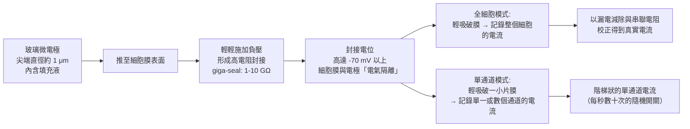
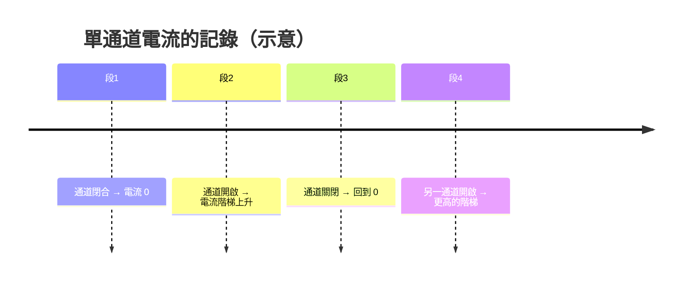

# 1991 · 單離子通道：內納與薩克曼用膜片鉗「聽見」單一通道的開關聲

> **1991 諾貝爾生理學 or 醫學獎**（共享）：厄溫·內納（Erwin Neher，德國）與伯特·薩克曼（Bert Sakmann，德國）— 表彰「發現細胞中單離子通道的功能」（"for their discoveries concerning the function of single ion channels in cells"）。

## 懸案（案情提要）

1963 年，Hodgkin 與 Huxley 建立了動作電位的定量模型（見 [1963-離子機制](1963-離子機制.md)），但那是一個**「黑箱模型」**：

1. 模型裡的 $g_{\text{Na}}(t)$ 、 $g_K(t)$ 是**純粹的參數**——它們隨時間如何變化，並沒有被直接觀察過；
2. 當時的「電流箝位（voltage clamp）」技術只能量測**整個膜的總電流**——那是**數百萬個通道電流的加總**；
3. 而 Hodgkin–Huxley 模型的核心假設——**通道是離散的、可獨立開關的單位**——從未被直接驗證過；
4. 更關鍵的是：**通道究竟有多少種？** 若鈉通道有「三種不同的亞型」分別負責不同成分，那麼藥理學上觀察到的複雜行為就需要完全不同的解釋。

這樁案件的答案，需要**聽見單一通道的開與關**。

## 前因

| 年份 | 事件 |
| --- | --- |
| 1949 | **Kenneth Cole 與 Howard Curtis** 發明**電壓箝位（voltage clamp）**，使得膜總電流可被測量（見 [1963-離子機制](1963-離子機制.md)）。 |
| 1950s–60s | 通道「是否存在」仍屬推論：當時的直覺認為通道可能是「小的孔」或「載體」，但無法直接驗證。 |
| 1972 | **Erwin Neher 與 Bert Sakmann** 合作：以**「超級阻擋（super-blocking）」實驗**發現單一通道的「點阻斷（point block）」——即**單一通道的電流是可被觀察的**。 |
| 1976 | 他們在神經纖維的**局部電流記錄（local current recording）**中首次看到**單一通道的階梯狀電流**（step-like deflections），但訊號小、易被雜訊淹沒。 |
| 1970s 末 | Neher 與 Sakmann 開始設計**「膜片鉗（patch clamp）」**：把一根玻璃微電極的尖端（直徑約 $1\ \mu\mathrm{m}$ ）**緊密貼住細胞膜**，形成高電阻的封接（seal），再輕輕吸破一小塊膜，形成**全細胞記錄（whole-cell）**。 |
| 1980 | **Erwin Neher 與 Bert Sakmann** 公開演示**膜片鉗技術**；同時 Neher 發展出**「封接電位（seal potential）」**與**「漏電減除（leak subtraction）」**的定量方法。 |
| 1980s | **Hamill 等人（1981）**發表《An improved technique for recording single channel currents from patches of membranes of whole cells》，把膜片鉗推向全球——**這是生理學史上被引用最多的論文之一**。 |
| 1980s | 應用爆發：**單通道的「跳躍式開關」被直接看見**（1980 年 Sakmann 與 Neher 在蛙的骨骼肌上錄得單通道的階梯電流）；**通道的「亞型」被證實**（例如鈉通道有多種亞型，各有不同的開關動力學）。 |
| 1991 | 兩人共享諾貝爾生理學 or 醫學獎。 |
| 1990s–2000s | **膜片鉗的後代技術**：**兩-electrode voltage clamp（1990s，Hodgkin 學派的傳統）**、**perforated patch（胞吐不中斷）**、**outside-out / inside-out patch**、**單分子生物學（smFRET、單分子磁力鉗）**。 |
| 2003 | **Roderick MacKinnon** 以**離子通道的晶體結構**獲得諾貝爾化學獎，與本案在結構層次完成接軌。 |

## 調查

### 第一幕：技術的設計——「如何把雜訊壓到比訊號小？」

膜片鉗的設計挑戰極為艱難：**單一通道的電流約 $1\text{–}10\ \mathrm{pA}$**（ $10^{-12}\ \mathrm{A}$ ），而細胞膜的漏電流、熱噪音與儀器噪音都可能更大。

**Neher 與 Sakmann 的三項關鍵設計**：

**「giga-seal」（吉級封接）**是整個技術的關鍵：當玻璃電極與細胞膜形成 $>1\ \mathrm{G}\Omega$ 的電阻時，**漏電流被降到極低**，細胞膜與電極之間形成電氣上的「壁壘」，使得微弱的通道電流得以浮現。

**三種膜片鉗模式的比較**：

| 模式 | 做法 | 記錄對象 | 典型用途 |
| --- | --- | --- | --- |
| **Cell-attached（貼附式）** | 封接但不破膜 | 單通道電流（膜電位未被破壞） | 通道的電壓依賴性 |
| **Whole-cell（全細胞）** | 破膜，電極液與細胞內相通 | **整個細胞的總電流** | 電壓箝位（重現 Hodgkin–Huxley 的實驗） |
| **Inside-out / Outside-Out** | 撕拉膜片 | 單通道，膜兩側溶液可自由控制 | 通道的配體、藥物與化學調控 |

### 第二幕：核心發現——「單通道是隨機開關的階梯」

1980 年，Sakmann 與 Neher 在**蛙骨骼肌的單一終板**（每個終板上的通道數極少）上，錄下了改變科學觀念的訊號：

**三項關鍵發現**：

1. **通道是「全或無」的二元開關**：單一通道的開啟產生固定的電流階梯（ $1\text{–}10\ \mathrm{pA}$ ），不是連續變化；
2. **開關是隨機的**：通道的開啟與關閉在時間上遵循**隨機過程**，其平均開啟概率為 $P_{\text{open}}$ ；
3. **通道的數目可被計數**：在低電壓（開啟概率極低）下，每次階梯的高度就是**單一通道的電流**，而記錄中不同階梯的高度分布即揭示了**通道數目**。

**「階梯的統計」是本案的定量核心**：

若通道數為 $N$ 、開啟概率為 $P$ ，則在時間 $t$ 內觀察到的開啟通道數 $n$ 服從**二項分布**：

$$P(n) = \binom{N}{n} P^n (1-P)^{N-n}$$

在 $P \ll 1$ 的極低電壓條件下， $P(n) \approx \lambda^n e^{-\lambda}/n!$ （泊松分布）， $\lambda = NP$ ——**這使得「通道數」與「開啟概率」可以被精確測量**。

### 第三幕：Hodgkin–Huxley 模型的直接驗證

膜片鉗最重要的科學貢獻，是**把 Hodgkin–Huxley 的「黑箱參數」變成可測量的實體**：

**（1）鈉通道的三個門控次單元被直接看見**：

Hodgkin–Huxley 模型假設 $g_{\text{Na}} = \bar{g}_{\text{Na}} m^3 h$ 。Neher 與 Sakmann 的單通道記錄顯示：

- 在**低電壓**下，鈉通道很少開啟，且**開啟的時間很短**（被快速失活）；
- 在**高電壓**下，通道的開啟時間顯著延長；
- 這直接對應了模型的**「啟動門 $m$ 」與「失活門 $h$ 」**兩個獨立過程。

**（2）模型的「全細胞電流」被重現**：膜片鉗的全細胞模式，使 Hodgkin 與 Huxley 1960 年代的實驗**在單一細胞上重現**，並且以更高的解析度證實了模型：

$$I_{\text{Na}}(t) = \bar{g}_{\text{Na}}\, m^3(t)\, h(t)\,(V_m - E_{\text{Na}})$$

**（3）模型的遺憾被修正**：膜片鉗顯示**真實的鈉通道並不是 Hodgkin–Huxley 假設的那樣**：

| Hodgkin–Huxley 假設 | 膜片鉗實測 |
| --- | --- |
| 鈉通道有 3 個獨立的啟動門 | **4 個**（1990 年代由岡崎（Sakmann 的學生 **Fukami** 等人證實） |
| 開啟與關閉是獨立的 | **開啟與關閉緊密耦合**（快速關閉型通道） |
| 單一通道只有一種動力學 | **存在多種亞型**，各有不同的電壓依賴與藥理學特性 |

**這是科學修正的典範**：一個被普遍接受的模型，在新技術下被**證實其核心、修正其細節**。

### 第四幕：通道「亞型」的發現——藥理學的解釋力

膜片鉗最直接改變了藥理學。過去在**全細胞電流**上觀察到的複雜行為（例如：某種藥使電流減少 $30\%$ ，究竟是阻斷了 $30\%$ 的通道，還是阻斷了所有通道的 $30\%$ ？）**無法回答**。單通道記錄可以：

1. **直接計數**：加入藥物後，觀察階梯的高度是否下降（**阻斷通道**）或階梯頻率下降（**降低開啟概率**）；
2. **區分「亞型」**：若某通道族群對藥物不敏感，會看到**兩群不同高度的階梯**——這直接解釋了為什麼藥物只能阻斷部分通道；
3. **建立「結合—通流（binding–throughflow）」關係**：測出每通道的藥物占據數與通流抑制的關係，確立受體結合與功能抑制的定量對應。

**這套方法立即產生了兩類重要的藥理學工具**：

- **受體的「逆向藥理學」**：由通道行為反推受體的亞型與結合位；
- ****「通道的化學門控（chemical gating）**：發現某些通道可被**胞內訊號分子**（如 NO、cGMP、ATP）直接調控——例如 **CFTR 氯通道**可被 **cAMP** 開啟（其缺陷造成囊腫性纖維化），**SK 通道**被胞內 $\mathrm{Ca}^{2}^{+}$ 調控。

## 理論裁決

1. **通道動力學的隨機過程模型**：單通道的開關被建模為**兩狀態馬可夫過程**：

   $$\mathrm{C} \rightleftharpoons \mathrm{O}, \qquad k_{\text{on}}(V), \ k_{\text{off}}(V)$$

   開啟概率：

   $$P_{\text{open}}(V) = \frac{k_{\text{on}}(V)}{k_{\text{on}}(V) + k_{\text{off}}(V)}$$

   這是 Hodgkin–Huxley 的 $m(V)$ 、 $h(V)$ 的**顯微版本**——模型從「總體描述」變成「單分子描述」。

2. **通道數目的直接量測**：在極低電壓（ $P \ll 1$ ）下，階梯的單一高度即為單通道電流 $i$ ；記錄的總電流與 $i$ 之比即為通道數 $N$ ：

   $$N = \frac{I_{\text{total}}}{i}$$

   這是 20 世紀生理學中最精確的一次「計數」（例如：海兔突觸的某通道每個突觸僅數十個）。

3. **膜電導的宏觀—微觀橋接**：全細胞電流 $I$ 與單通道電流 $i$ 的關係為：

   $$I = N \cdot i \cdot P_{\text{open}}(V)$$

   這條式子把 1960 年代的宏觀模型與 1980 年代的微觀觀測**首次縫合**，是本案最深刻的理論貢獻。

4. **噪聲分析**：單通道記錄的「點阻斷噪音（point blockage noise）」的功率譜密度，直接給出通道的**電導與開關速率**：

   $$S_I(f) = 4\,i^2\,N\,P_{\text{open}}(1-P_{\text{open}})\,\frac{k_{\text{on}}k_{\text{off}}}{k_{\text{on}}^2 + (2\pi f)^2}$$

   **噪聲分析成為 1980–90 年代測定通道動力學的標準方法**，甚至可用於**無法直接記錄的通道**。

5. **藥物作用的「單通道層級」量化**：受體占據數與通流抑制的關係：

   $$\text{通流抑制} = \frac{[I]_{\text{bound}}}{K_d + [I]_{\text{bound}}} \times \text{最大抑制}$$

   這使「阻斷比例」不再含糊，是現代**受體占據理論**的實驗基礎。

## 追查支線（未結之謎）

- **內納與薩克曼的科學道路**：兩人在 1970 年代初於 **Göttingen 的 Max Planck 研究所**相識（薩克曼是內納的學生），並在 1970 年代中期一起前往 **德國的兩處實驗室**（薩克曼在 Goettingen，內納在 Heidelberg），**利用半年的「遊學」期間發展出膜片鉗**——這段「出國進修」是他們得以完成突破的關鍵；
- **「德國模式」的科學**：這項工作是在**馬克斯·普朗克研究所**的體系下完成的——**基礎研究、裝置自製、長年耐心的技術攻關**，這是 1970 年代德國科學的典型樣貌；
- **膜片鉗的推廣**：Hamill 等人 1981 年的論文使技術走向全球；**1990–2000 年代，膜片鉗被用於研究心臟病、囊腫性纖維化、神經疾病、感覺生理等數百個領域**；**2000 年代之後，它更成為「離子通道病」診斷與藥物開發的核心工具**；
- **「通道」的產業**：膜片鉗揭示了**可藥物化的受體清單**——今日的「 ion channel 藥物」（鈣通道阻斷劑、鉀通道阻斷劑、鈉通道阻斷劑）構成數十億美元的市場；
- **內納的自傳**《《Nobel Prize in Physiology or Medicine 1991》（1992 年）與《From Membrane Patches to DNA Sequences》——他以極其自省的筆調記錄了科學生涯；
- **薩克曼的科學行政**：他曾任 **Max Planck 協會主席（1998–2002）**與 **Max Planck 醫學研究研究所所長**，是德國科學體制的核心人物之一。

## 證物與數據（偵查卷宗摘錄）

| 證物 | 數值／內容 | 偵查意義 |
| --- | --- | --- |
| giga-seal | $1\text{–}10\ \mathrm{G}\Omega$ | 電氣隔離，噪聲壓低 |
| 單通道電流 | 約 $1\text{–}10\ \mathrm{pA}$ | 可觀測的最小電流單位 |
| 開啟概率 | $P = k_{\text{on}}/(k_{\text{on}}+k_{\text{off}})$ | 兩狀態馬可夫模型 |
| 通道數 | $N = I_{\text{total}}/i$ | 通道的直接計數 |
| 二項/泊松分布 | 階梯數的統計 | 隨機開關的證據 |
| 鈉通道的門 | 模型 3 個 vs 實測 4 個 | 模型的修正 |
| 全細胞電流重現 | $I = N\,i\,P_{\text{open}}(V)$ | 宏觀—微觀的縫合 |
| 噪聲分析 | 功率譜給出 $i$ 與速率 | 難以直接記錄的通道也可測 |
| 通道亞型 | 兩群不同高度的階梯 | 藥理學的精確化 |
| cAMP 調控的 CFTR | 化學門控 | 訊號與通道的直接連結 |

## 後果

| 領域 | 影響 |
| --- | --- |
| 細胞生理學 | 從「總電流」進入「單通道」時代；膜運輸的機制彻底清楚。 |
| 藥理學 | 受體亞型、配體結合與功能抑制的定量連結；離子通道藥物成為主流類別。 |
| 神經科學 | 單通道記錄用於研究突觸傳遞、突觸可塑性與通道病。 |
| 臨床 | 囊腫性纖維化（CFTR）、長 QT 綜合症（ $K^+$ 通道）、心律不整離子機制的分子診斷。 |
| 方法學 | 膜片鉗成為 20 世紀最重要的生理學技術，衍生出數十種變體。 |
| 其他諾獎 | 與 [1963-離子機制](1963-離子機制.md)（Hodgkin–Huxley 模型）、[1994-G 蛋白](1994-G蛋白.md)、[2003-MRI](2003-MRI.md)（同一時代的技術革命）構成神經與生理學主線。 |

## 關聯

- [1963-離子機制](1963-離子機制.md) — 本案的直接前作，也是被本案的單通道資料所修正的模型。
- [1932-神經元功能](1932-神經元功能.md) — 全或無律的現象學背景。
- [1994-G 蛋白](1994-G蛋白.md) — 受體與酵素之間的訊號轉接器。
- [1985-膽固醇受體](1985-膽固醇受體.md) — 受體藥理學的另一個典範。
- [1996-MHC 限制性](1996-MHC限制性.md) — 細胞免疫的受體—配體交互。
