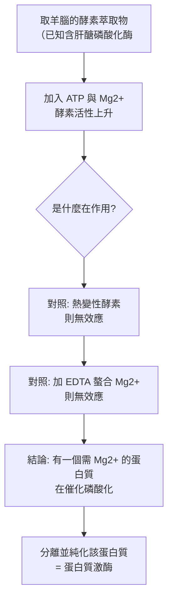

# 1992 · 可逆的蛋白質磷酸化：費舍爾與克雷布斯找到細胞的「蛋白質開關」

> **1992 諾貝爾生理學 or 醫學獎**（共享）：埃德蒙·費舍爾（Edmond H. Fischer，瑞士出生、美國籍）— 表彰「發現可逆的蛋白質磷酸化是一種生物調節機制」；愛德溫·G·克雷布斯（Edwin G. Krebs，英國）— 同上。

## 懸案（案情提要）

1950–60 年代的生物化學有一個巨大的「調控缺口」：

1. **酵素的活性必須能被快速調節**——否則細胞無法對環境變化做出反應（例如肝醣磷酸化酶必須在幾秒內開關，見 [1947-糖代謝與激素](1947-糖代謝與激素.md)）；
2. 但當時的酵素學，幾乎所有酵素在體外都以**恆定的最大活性**被研究——**「酵素的開關在哪裡？」**沒有人知道；
3. 而**細胞的訊號傳遞研究**已經知道激素與神經傳遞物質能改變酵素活性，但**機制完全不明**——它不是「增加酵素的量」（那要小時），而是「改變既有酵素的活性」（那要秒）。

**費舍爾與克雷布斯的答案：可逆的蛋白質磷酸化。**

## 前因

| 年份 | 事件 |
| --- | --- |
| 1930s | **Creighton** 在研究卵清蛋白的「磷酸化—去磷酸化」時注意到：**未經磷酸化的蛋白質完全無活性**，而去磷酸化後恢復活性——**這是「磷酸化可逆調節酵素活性」的第一條證據**。 |
| 1950s | **Earl Sutherland** 發現 cAMP（見 [1971-第二信使](1971-第二信使.md)），證明**激素的第二信使**能改變酵素活性——但機制仍不明。 |
| 1955–1958 | **克雷布斯**在研究**肝醣磷酸化酶**時發現：該酵素存在**兩種形式**（活性型 b 與非活性型 a），且**在 ATP 存在下可互相轉換**——**這是「共價修飾調節酵素」的發現**。 |
| 1958 | **費舍爾**在華盛頓大學（與 **Earl Sutherland** 合作）研究**磷酸絲胺酸（phosphoserine）的酵素水解**，發現磷酸化與去磷酸化都是酵素催化的可逆反應。 |
| 1959 | **Sutherland 與 Fischer** 發現：**cAMP 促使肝醣磷酸化酶由 b 型轉為 a 型**——**這是「第二信使 → 蛋白質磷酸化 → 酵素活化」的完整鏈條的第一次打通**。 |
| 1960s–70s | **蛋白質激酶（protein kinase）**與**蛋白質磷酸酶（protein phosphatase）**被相繼發現（費舍爾與克雷布斯各自獨立發現了**磷酸化酶**，並命名為「蛋白質激酶」與「蛋白質磷酸酶」）。 |
| 1970s | **「級聯放大」概念的成熟**：一個受體被激活 → 一個激酶 → 許多磷酸化底物 → 更多激酶被磷酸化 → **逐級放大**。 |
| 1980s | **Src 激酶**被克隆（見 [1989-原癌基因](1989-原癌基因.md)），**磷酸化酪胺酸**成為訊號傳遞的另一條主線；**cAMP 依賴性蛋白激酶（PKA）的結構**於 1990 年代被解析。 |
| 1992 | 兩人共享諾貝爾生理學 or 醫學獎（費舍爾當時 72 歲、克雷布斯 74 歲）。 |
| 1990s–2000s | 磷酸化被擴展為**「蛋白質組學（proteomics）」的核心讀出**；**磷酸化的可逆性**成為理解「表觀遺傳之外的另一層調控」的關鍵。 |

## 調查

### 第一幕：費舍爾的「磷酸化酶」——把共價修飾抓個正著

費舍爾的偵查起點是一個化學問題：**蛋白質上的磷酸基團，是被什麼酵素加上、又由什麼酵素移除？**

**實驗設計**：

**關鍵的化學證據**：費舍爾證明，磷酸化是**共價的酯鍵連結**（磷酸基團接在絲胺酸或蘇胺酸的羥基上），且**可以水解回來**——

$$\text{蛋白質}{-}\mathrm{O}{-}\mathrm{PO}_3^{2-} + \mathrm{H_2O} \xrightarrow{\text{磷酸酶}} \text{蛋白質}{-}\mathrm{OH} + \mathrm{P_i}$$

**這是「可逆性」的化學基礎**：磷酸化不是降解、不是聚合，而是**一個可隨時加上與移除的「標籤」**。

### 第二幕：克雷布斯的「a 型 / b 型」——酵素的兩種狀態

克雷布斯的貢獻是把現象**在酵素層次**定位：

**實驗的關鍵**：

1. 他發現肝醣磷酸化酶可被分離成**兩種形式**：
   - **b 型**：未磷酸化，**無活性**；
   - **a 型**：磷酸化，**有活性**；
2. 加入 ATP 與 $\mathrm{Mg}^{2}^{+}$ ，b 型會轉為 a 型；加入**磷酸酶**或**EDTA**，a 型會回到 b 型；
3. **這是一個「化學開關」**——酵素活性由一個共價修飾決定，而這個修飾本身由 ATP 的水解提供能量。

**這解釋了當時最困惑的問題：**

$$\text{激素} \to \text{cAMP} \to \text{蛋白質激酶} \to \text{磷酸化} \to \text{酵素活化} \to \text{代謝反應}$$

**這條鏈條把「神經內分泌的化學」與「酵素動力學」縫合了起來**——它回答了「激素如何在幾秒內改變細胞的代謝」這個問題。

### 第三幕：級聯放大的數學

磷酸化系統的關鍵特性是**級聯放大**。一個受體可活化一個激酶，一個激酶可磷酸化數百個底物，而**被磷酸化的底物又可能是另一些激酶**：

**放大倍數可達 $10^{5}\text{–}10^{8}$**——**這解釋了為何極低濃度的激素能產生巨大的細胞效應**（與 [1971-第二信使](1971-第二信使.md) 的放大計算相互印證）。

**磷酸化作為「可切換的分子開關」**：

$$\text{蛋白質}{-}\mathrm{OH} + \mathrm{ATP} \xrightarrow{\text{激酶}} \text{蛋白質}{-}\mathrm{O}{-}\mathrm{P} + \mathrm{ADP}$$

$$P_{\text{磷酸化的蛋白質}} = \frac{[\text{激酶}]}{[\text{激酶}] + K_m} \times \frac{[\text{ATP}]}{[\text{ATP}] + K_m'}$$

**磷酸化／去磷酸化的平衡決定了蛋白質的「狀態占比」**——這是今日**訊號傳遞網絡建模**的標準形式。

### 第四幕：從絲胺酸到酪胺酸——兩條平行的世界

1992 年的諾獎聚焦於**絲胺酸／蘇胺酸磷酸化**（蛋白質激酶 A 家族），但 1980–90 年代，**酪胺酸磷酸化**的世界被完全打開：

| 面向 | 絲胺酸/蘇胺酸磷酸化 | 酪胺酸磷酸化 |
| --- | --- | --- |
| 典型酵素 | 蛋白質激酶 A（PKA）、PKC、GSK3 | Src 家族激酶、EGFR、HER2 |
| 第二信使 | cAMP、cGMP、DAG、 $\mathrm{Ca}^{2}^{+}$ | 無小分子第二信使；**受體本身即激酶** |
| 典型效應 | 代謝酵素的開關 | 訊號傳遞的級聯、基因轉錄 |
| 代表機制 | **cAMP → PKA → CREB**（見 [1971-第二信使](1971-第二信使.md)） | **RTK → Grb2 → SOS → Ras → MAPK** |

**Src 激酶的雙向性（1980–90 年代的發現）**：

- **C 端第 527 位酪胺酸的磷酸化 = 抑制**（「分子開關的關閉」）
- **活化環第 419 位酪胺酸的磷酸化 = 活化**

同一個蛋白質上**兩個不同位置的磷酸化可以互相拮抗**——這是「**磷酸化密碼（phosphorylation code）**」概念的開端，也是今日「蛋白質修飾編碼」的先聲。

### 第五幕：磷酸酶的「鑰匙」——疾病與藥理

去磷酸化酵素（protein phosphatase）同樣有嚴格的專一性，而它們的失衡就是疾病：

| 磷酸酶 | 疾病 | 機制 |
| --- | --- | --- |
| **PP1** | **何興-多福症（myosin light chain kinase related）**、某些肌肉病 | 抑制磷酸酶活性 → 蛋白過度磷酸化 |
| **PP2A** | **肺癌（高活性、抑制腫瘤）** | 腫瘤抑制功能喪失 |
| **calcineurin（PP2B）** | 移植排斥（環孢素與他克莫司的靶點！見 [1990-器官與骨髓移植](1990-器官與骨髓移植.md)） | 抑制 T 細胞的活化 |
| **PTEN** | 腫瘤 | 去磷酸化 PIP3 → 阻斷 PI3K 訊號 |

此處最漂亮的一環是：**環孢素（cyclosporine）與他克莫司（FK506）**這兩個免疫抑制藥（支撐了整個移植醫學），其分子靶點正是**鈣調神經磷酸酶（calcineurin）**——一個絲胺酸／蘇胺酸磷酸酶。**移植醫學的免疫抑制，物理上就是「阻斷去磷酸化」。**

## 理論裁決

1. **可逆修飾作為「分子開關」的數學**：把酵素活性寫成磷酸化比例的函數：

   $$\frac{v}{v_{\max}} = \frac{f_{\text{ phosphorylated}}}{K_m + [S]}, \qquad f_{\text{phos}} = \frac{k_{\text{kinase}}[K]}{k_{\text{kinase}}[K] + k_{\text{phos}}[P]}$$

   這說明**細胞的「開／關」不是全有全無，而是連續可調的比例**——提供了比「有酵素／無酵素」更細緻的調控。

2. **ATP 的雙重角色**：ATP 既是**能量來源**，又是**磷酸基團的供應者**——這是生物體「**用同一個分子同時供給能量與資訊**」的漂亮設計，也是克雷布斯循環中 ATP 既是產物又是調節物的回饋邏輯（見 [1953-檸檬酸循環](1953-檸檬酸循環.md)）。

3. **磷酸化 cascade 的時間常數**：不同激酶有不同速率常數，形成**多時間尺度的調控層次**：

   $$\tau_{\text{fast}} < \tau_{\text{mid}} < \tau_{\text{slow}}$$

   這使得細胞能同時維持「秒級的代謝開關」與「分鐘到小時級的基因表現改變」——**時間尺度的分層，是複雜系統控制的通用策略**。

4. **「磷酸化密碼」的組合爆炸**：單一蛋白質上有 $n$ 個可能的磷酸化位點，其可能的狀態為 $2^n$ ——**一個蛋白質因此能作為「多元狀態的資訊處理單元」**，這正是今日「**蛋白質狀態空間**」研究的起點。

## 追查支線（未結之謎）

- **費舍爾與克雷布斯的科學傳奇**：兩人本不相識，卻在 1950 年代中期**同時獨立發現了蛋白質激酶**，並在 1958 年於華盛頓的會議上相遇、同意共享發現——**這是科學史上最著名的「共同發現與友誼」之一**；費舍爾在諾獎演講中說：「**我們的工作由兩條獨立的河流匯流而成**」；
- **費舍爾的長壽**：他於 2021 年 4 月 27 日去世，享年 **101 歲**，是當時最年長的諾貝爾獎得主；
- **克雷布斯的科學家素養**：他在華盛頓大學師從 **Earl Sutherland**（1961 年諾獎得主），這是諾獎得主的師生相傳的著名鏈條（並有 Crick→Sanger、Bertner→Krebs 等多條）；
- **磷酸化與「表觀遺傳學」**：今日的「**組蛋白磷酸化／乙醯化 / 甲基化**」構成「表觀遺傳密碼」，與 DNA 序列資訊**並行**地調控基因表現——這是把 1992 年的機制推廣到基因體層級的結果（見 [1992-蛋白質磷酸化](1992-蛋白質磷酸化.md) 與 2010 年代的組蛋白研究）；
- **磷酸酶抑制劑的臨床應用**：**FK506（他克莫司）**用於移植與自體免疫疾病；**雷帕黴素（rapamycin, mTOR 抑制劑）**用於器官移植與自體免疫；**伏立諾他**（SHP2 抑制劑）在腫瘤臨床試驗中——**磷酸化網絡成為藥理學的核心舞台之一**。

## 證物與數據（偵查卷宗摘錄）

| 證物 | 數值／內容 | 偵查意義 |
| --- | --- | --- |
| Creighton（1930s） | 去磷酸化後酵素恢復活性 | 可逆修飾的第一條證據 |
| 肝醣磷酸化酶 a/b 型 | b 無活性、a 有活性 | 酵素的「化學開關」 |
| ATP + $\mathrm{Mg}^{2}^{+}$ | b → a | 磷酸化的能源來自 ATP |
| 磷酸酶 + EDTA | a → b | 可逆性與金屬離子依賴 |
| cAMP 的作用（1959） | 促使 b → a | 第二信使鏈條打通 |
| 磷酸化反應 | 蛋白質-OH + ATP → 蛋白質-O-P + ADP | 共價修飾的化學 |
| 放大倍數 | 約 $10^{5}\text{–}10^{8}$ | 級聯放大的量化 |
| Src 的雙向磷酸化 | 527 號抑制、419 號活化 | 「磷酸化密碼」的先聲 |
| calcineurin | 環孢素與他克莫司的靶點 | 移植免疫抑制的分子機制 |
| 磷酸化狀態比例 | $f_{\text{phos}} = \frac{k_k[K]}{k_k[K]+k_p[P]}$ | 連續可調的開關 |

## 後果

| 領域 | 影響 |
| --- | --- |
| 訊號傳遞 | 「第二信使 → 蛋白質激酶 → 磷酸化」成為細胞訊號的通用模式。 |
| 藥理學 | 免疫抑制藥、mTOR 抑制劑、激酶抑制劑的核心機制。 |
| 代謝 | 肝醣代謝、脂肪酸代謝的酵素調控被完全解釋。 |
| 蛋白質組學 | 磷酸化組學（phosphoproteomics）成為研究細胞狀態的核心技術。 |
| 腫瘤學 | Src、EGFR、HER2 等酪胺酸激酶的磷酸化路徑，構成標靶治療的基礎。 |
| 其他諾獎 | 與 [1971-第二信使](1971-第二信使.md)（上游）、[1989-原癌基因](1989-原癌基因.md)（下游）、[1994-G 蛋白](1994-G蛋白.md)（中間的轉接器）構成訊號傳遞主線。 |

## 關聯

- [1971-第二信使](1971-第二信使.md) — cAMP 的發現，是磷酸化機制的直接上游。
- [1947-糖代謝與激素](1947-糖代謝與激素.md) — 肝醣磷酸化酶的舞台。
- [1989-原癌基因](1989-原癌基因.md) — Src 與酪胺酸磷酸化。
- [1994-G 蛋白](1994-G蛋白.md) — 受體與酵素之間的分子轉接器。
- [1990-器官與骨髓移植](1990-器官與骨髓移植.md) — 環孢素與他克莫司的臨床舞臺。
