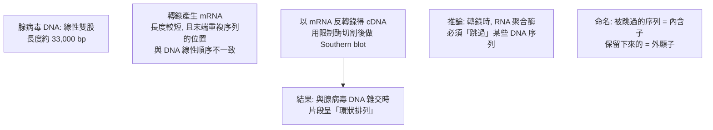
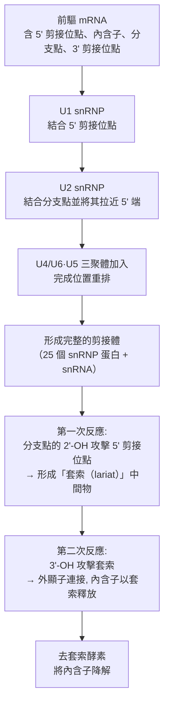

# 1993 · 斷裂基因：羅伯茨與夏普發現「基因被剪開了，而且剪法不一樣」

> **1993 諾貝爾生理學 or 醫學獎**（共享）：理查·約翰·羅伯茨（Richard John Roberts，英國）與菲利普·艾倫·夏普（Phillip Allen Sharp，美國）— 表彰「發現斷裂基因」（"for their discoveries of split genes"）。1988 年，美國冷泉港的冷泉港實驗室開會時，**諾貝爾委員會曾要求兩人合影留念，以確認他們彼此同意分享此發現**——這是諾獎史上最著名的「握手照」。

## 懸案（案情提要）

1970 年代末，分子生物學有一塊拼圖無法安放：

1. **電子顯微鏡與生化的證據指向：真核生物的 mRNA 與其基因組 DNA 的「對應關係」是錯位的**。具體說：
   - 高等生物的基因組**遠大於**其 mRNA；
   - 用**cDNA（由 mRNA 反轉錄而得）**作為探針，與基因組 DNA 雜交，得到**多個不連續的片段**（而非一個連續的區段）；
   - 用**總基因組 DNA** 作探針，則得到**單一連續的區段**。
2. 這意味著：**基因的編碼序列在基因組上是被「割裂」的**，而 mRNA 卻是連續的——中間那些片段去哪了？
3. 更驚人的是：**不同的 mRNA 可以來自同一個基因**，卻帶有**不同的蛋白質序列**——**同一份基因組，產出不同的蛋白質**。

夏普與羅伯茨的答案：**內含子（intron）與外顯子（exon）**，以及**選擇性剪接（alternative splicing）**。

## 前因

| 年份 | 事件 |
| --- | --- |
| 1969–1971 | 夏普（時任冷泉港的 CSHL 主任）與他的研究生**吉娜·巴爾（Gina Barsotti）**發現：**腺病毒的多聚 A mRNA** 與其基因組 DNA 雜交時，產生了**單一連續的雜交片段**，但 mRNA 本身卻呈**「環狀排列（circular permutation）」**。 |
| 1971 | 巴爾與夏普提出大膽假說：**病毒的基因組是線性的，但 mRNA 是「環狀排列」的**——即**轉錄時必須跳過某些序列**。這是「**剪接（splicing）**」概念的第一個證據。 |
| 1972 | 夏普與其同事發表《**Split genes in adenovirus**》（《腺病毒的斷裂基因》），明確提出「編碼序列被非編碼序列隔開」的模型。 |
| 1977 | 冷泉港召開著名的 RNA 剪接會議，**剪接機制的模式被確立**（U1、U2、U4/U6、U5 snRNP 的發現）。 |

| 1978 | **羅伯茨**（在冷泉港 CSHL，與夏普實驗室相鄰）以**酵母的 rRNA 基因**為材料，使用**Sanger 的 Sanger 法對 cDNA 定序**，發現：**rRNA 基因在 DNA 上被「內含子」隔斷，而轉錄出的前驅 RNA 被剪接移除**。 |
| 1979–1982 | **cDNA 與基因組 DNA 的系統性比較**技術成熟（**Southern blot + Northern blot** 的對照），「**斷裂基因**」的概念在多種基因上被反覆證實。 |
| 1982–1984 | **剪接機制被闡明**：snRNP（小核核糖核蛋白，U1/U2/U4/U5/U6）與 ** spliceosome（剪接體）** 的組裝被逐步釐清（1985 年的剪接體電子顯微鏡照片是里程碑）。 |
| 1985–1988 | **選擇性剪接（alternative splicing）**被發現是**真核生物基因表現的核心機制**——同一基因可產生多種蛋白質 isoform。 |
| 1993 | 兩人共享諾貝爾生理學 or 醫學獎。 |
| 1990s–2010s | **選擇性剪接**被證明是**細胞種類差異的主要來源**（神經元的特有剪接 isoform、肌肉與腦的差异）；**剪接體的結構**於 2000 年代被 X 光晶體與 cryo-EM 解析（**2009 年诺贝尔化學獎**頒給剪接體的結構研究）；**剪接異常**造成**多種遺傳病**（如 ** spinal muscular atrophy（SMN）**、**β-地中海貧血**、**囊腫性纖維化**）。 |
| 2024 | 夏普於 2024 年 4 月 8 日去世（享年 89 歲）；羅伯茨於 2024 年 10 月 6 日去世（享年 79 歲）——**同一年內，兩位得主相繼離世**。 |

## 調查

### 第一幕：夏普的「腺病毒環狀排列」實驗——第一道裂縫

夏普與巴爾的實驗，是分子生物學史上最精妙的一次「幾何推理」。

**這個實驗的巧妙之處**：它**用幾何學的線索**（末端重複序列的位置）推翻了「mRNA 是 DNA 的連續拷貝」這一當時的基本假設。**剪接的存在，是從「順序不符」中推導出來的。**

### 第二幕：羅伯茨的「酵母 rRNA 基因」——定序的決定性證據

羅伯茨的方法更直接：**他定序了 cDNA 與基因組 DNA**，然後**逐字比對**。

**關鍵的數據（1978 年，酵母的 rRNA 基因）**：

| 片段 | 位置 | 性質 |
| --- | --- | --- |
| **外顯子 A** | 基因組的 5' 端 | **編碼**（出現在成熟 rRNA 中） |
| **內含子 1** | 基因組中間 | **不編碼**（成熟 rRNA 中沒有） |
| **外顯子 B** | 基因組的 3' 端 | **編碼** |

**序列比對的結果是無可辯駁的**：

$$\text{基因組 DNA} = \underbrace{\text{外顯子 A}}_{\text{編碼}} + \underbrace{\text{內含子}}_{\text{不編碼}} + \underbrace{\text{外顯子 B}}_{\text{編碼}}$$

$$\text{成熟 mRNA} = \underbrace{\text{外顯子 A}}_{\text{保留}} + \underbrace{\text{外顯子 B}}_{\text{保留}}$$

**這第一次以「序列證據」證明了「基因被割裂」**——並且明確指出：**內含子不是垃圾，而是有功能的序列**（它們在演化上被保留，且參與剪接的調控）。

### 第三幕：剪接的機制——剪接體的組裝

1980 年代的剪接機制研究，是分子生物學最精細的「分子機器」解析之一：

**關鍵的化學**：剪接的兩步反應**完全沒有 ATP 的參與**（剪接是由**內含子本身的能量**驅動的化學重排）——這在生物化學中極為罕見，被稱為「**化學重排（chemical rearrangement）**」。

**剪接位點的共識序列**（幾乎所有真核內含子都有）：

- **5' 端**：GU（剪接位點必須以 **GU** 開始，這是剪接的絕對規則）
- **分支點**：A（腺苷，其 2'-OH 參與第一次反應）
- **3' 端**：AG（polypyrimidine tract + AG）

$$\text{5'-}\underbrace{\text{CAG/GTAAGT}}_{\text{外顯子}} \underbrace{\text{GU}}_{\text{5' 剪接位點}} \cdots \underbrace{\text{A}}_{\text{分支點}} \cdots \underbrace{\text{PY}_{n}\underbrace{\text{AG}}_{\text{3' 剪接位點}} - \text{外顯子}$$

### 第四幕：選擇性剪接——「同一基因，多種蛋白質」

這是本案最具衝擊力的發現：**同一份基因組 DNA，可以通過不同的剪接方式，產生多種不同的成熟 mRNA 與蛋白質**。

**經典案例**：

| 基因 | 選擇性剪接產物 | 功能差異 |
| --- | --- | --- |
| **Dscam**（果蠅） | 高達 **38,000** 種 isoform | 神經元的分子識別碼 |
| **troponin T** | 肌肉型 vs 腦型 | 組織特異的收縮調節 |
| **β-amyloid precursor protein（APP）** | **Aβ（致病）** vs **sAPPα（生理）** | 阿茲海默病的分子開關 |
| **exon 6 of **Bcl-x** | **Bcl-xL（抗凋亡）** vs **Bcl-xS（促凋亡）** | 細胞生存的開關 |
| **Insulin**（胰島素基因） | 胰島素 vs **胰島素樣肽（amylin）** | 糖尿病的相關胜肽 |
| **RNA editing（A-to-I）** | APOB 的第 2153 位 A → G | 產生 apoB48 而非 apoB100（腸道特異） |

**選擇性剪接的數學意義**：若一個基因有 $k$ 個可選剪接位點，其潛在 isoform 數可達：

$$N_{\text{isoform}} \approx \prod_{i=1}^{k} n_i$$

例如 $k = 10$ 、每個位點 3 種選擇 → $3^{10} \approx 59{,}000$ 種——**這解釋了為什麼人類只有約 20,000 個基因，卻能產生約 100,000 種蛋白質**。

### 第五幕：剪接的調控與疾病

**剪接的調控機制**：

1. **SR 蛋白與 hnRNP**：前者促進外顯子定義，後者促進內含子定義；
2. **外顯子定義 vs 內含子定義**：真核生物多為**外顯子定義**（外顯子兩端的剪接位點決定邊界），而酵母多為內含子定義；
3. **組織特異的剪接因子**（如 **Nova、PTBP1、Musk、RBFOX**）——它們的失調造成疾病。

**剪接異常與遺傳病**：

| 疾病 | 剪接異常 |
| --- | --- |
| **脊髓性肌萎縮症（SMA）** | **SMN1** 的外顯子 7 剪接錯誤 → 蛋白降解 |
| **β-地中海貧血** | β-珠蛋白基因的**剪接位點突變** |
| **囊腫性纖維化** | CFTR 的剪接調節因子的變異影響治療反應 |
| **癌症** | 異常剪接（如 **SF3B1、SF3B3、U2AF1** 的突變）——「**剪接體突變是腫瘤的驅動因素**」 |

## 理論裁決

1. **剪接的化學能量學**：兩步反應的能量收支——分支點的 2'-OH 形成的套索中間物釋放了剪接位點 5' 端下游的 5'-OH 的能量，第二步中 3'-OH 攻擊套索、釋出內含子套索的 3'-OH：

   $$\text{第一步：} \quad \text{分支點 A 的 2'-OH} + \text{5' 剪接位點} \to \text{套索-外顯子} $$
   $$\text{第二步：} \quad \text{3' 剪接位點的 3'-OH} + \text{套索} \to \text{外顯子-外顯子} + \text{套索內含子}$$

   **兩個羥基的「接力」**——這是生化學中少見的、由底物自身能量驅動的機制。

2. **剪接位點的「通訊序列」**：5'-GU、分支點 A、3'-AG 的高度保守性，使預測成為可能：

   $$P(\text{正確剪接}) \approx P(\text{位點共識}) \times P(\text{調控因子}) \times P(\text{時序正確性})$$

   這是今日**RNA 剪接預測工具**的基礎，也是理解**外顯子識別（exon definition）**與**剪接位點突變致病**的理論框架。

3. **剪接作為「基因表現的擴維器」**：剪接把「基因數」轉換為「蛋白質種類數」：

   $$\text{蛋白質種類} \approx \text{基因數} \times \text{平均 isoform 數}$$

   以人類為例： $20{,}000 \times 5 \approx 100{,}000$ ——**這解釋了「C 值悖論」與蛋白質組的複雜性**。

4. **組織特異性的分子基礎**：剪接因子（如 **PTBP1**）的組織特異表現，造成**同一蛋白質的不同版本**：

   $$\text{同一基因} \xrightarrow{\text{不同的剪接因子組合}} \text{組織特異的蛋白質}$$

   這是「**同一基因組如何產生神經元與肌肉細胞**」的答案——也是「**細胞命運決定**」在分子層次的一個關鍵機制（與 [1995-胚胎發育基因](1995-胚胎發育基因.md) 的轉錄調控互補）。

## 追查支線（未結之謎）

- **「握手照」的由來**：1988 年冷泉港的會議上，諾貝爾委員會要求兩人在台上**握手合影**，以確認彼此同意分享發現與榮譽——這張照片成為科學史上最著名的畫面之一。
| 1988–1993 | 兩人合作發表許多剪接相關的論文，並共同獲頒 **1989 年 Louisa Gross Horwitz 獎**；1988 年冷泉港會議的握手照片成為科學史上最著名的畫面之一。 |
| 1993 年 | 兩人因剪接的發現共同獲頒諾貝爾生理學或醫學獎。 |
| 2024 年 | 夏普於 4 月 8 日在波士頓去世；羅伯茨於 10 月 6 日去世——**同一年兩位得主相繼離世**。 |
| 剪接體結構的研究 | 2009 年諾貝爾**化學獎**頒給核糖體結構與功能的研究（Ramakrishnan、Steitz、Yonath）；**剪接體的高解析度結構**則由 2000 年代的 X 光與 cryo-EM 研究逐步揭曉。 |
| **剪接與疾病**：剪接因子突變是許多疾病的主因，且是**可藥理治療的**——例如 splicing modulators（以 intron 為標的的小分子）正在研發；**SMA 的基因治療（onasemnogene）於 2019 年獲批**，是首個改變剪接的療法之一。 |
| **「基因經濟學」**：剪接機制的演化意義是**「一個基因多用」**——真核生物以複雜剪接換取了基因組的相對簡潔，代的代價是**剪接錯誤的脆弱性**。 |

## 證物與數據（偵查卷宗摘錄）

| 證物 | 數值／內容 | 偵查意義 |
| --- | --- | --- |
| 腺病毒環狀排列雜交（1971） | 片段順序不符 | 剪接存在的第一證據 |
| 酵母 rRNA cDNA 定序（1978） | 外顯子 A + 內含子 + 外顯子 B | 序列層級的決定性證據 |
| Southern vs Northern 對照 | cDNA 多片段 vs 基因組單片段 | 「割裂」的系統性證據 |
| 剪接位點共識 | 5'-GU、分支點 A、3'-AG | 預測與突變致病 |
| 剪接體 | 25 個 snRNP 蛋白 + snRNA | 分子機器 |
| 兩步反應 | 分支點 2'-OH 攻擊 → 套索 → 3'-OH 攻擊 | 不需 ATP 的化學重排 |
| Dscam isoform | 最多約 38,000 種 | 選擇性剪接的上限 |
| 人類蛋白質數 | 約 100,000 種 vs 約 20,000 基因 | 剪接的擴維作用 |
| APP 剪接 | Aβ（致病）vs sAPPα | 阿茲海默病的分子開關 |
| SMA | SMN1 外顯子 7 剪接錯誤 | 剪接病的典型 |
| 1988 握手照 | 冷泉港會議 | 科學榮譽的分配儀式 |

## 後果

| 領域 | 影響 |
| --- | --- |
| 分子生物學 | 基因表現理論被徹底改寫；中心法則被加上「剪接」這一環。 |
| 基因組學 | 解釋了「基因少、蛋白質多」的悖論，開啟了轉錄組學（RNA-seq）的深層解讀。 |
| 臨床 | 剪接病（SMA、β-地中海貧血等）的分子診斷與治療（onasemnogene）。 |
| 腫瘤學 | 剪接體突變被確認為腫瘤驅動因素；剪接成為藥理新靶點。 |
| 演化 | 「一個基因—多種蛋白質」策略的真核生物演化意義。 |
| 其他諾獎 | 與 [1962-DNA 雙螺旋](1962-DNA雙螺旋.md)、[1968-遺傳密碼](1968-遺傳密碼.md)、[1987-抗體多樣性](1987-抗體多樣性.md) 構成分子生物學主線。 |

## 關聯

- [1962-DNA 雙螺旋](1962-DNA雙螺旋.md) — 剪接問題的結構前提。
- [1968-遺傳密碼](1968-遺傳密碼.md) — 剪接使「密碼」與「蛋白質」不再一一對應。
- [1995-胚胎發育基因](1995-胚胎發育基因.md) — 剪接與轉錄調控共同構成基因表現的雙軌。
- [2024-微RNA](2024-微RNA.md) — 基因表現調控的另一個分子層次（RNA 層級）。
- [1972-抗體結構](1972-抗體結構.md) — 剪接在免疫球蛋白基因表達中的角色。
