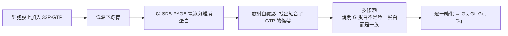
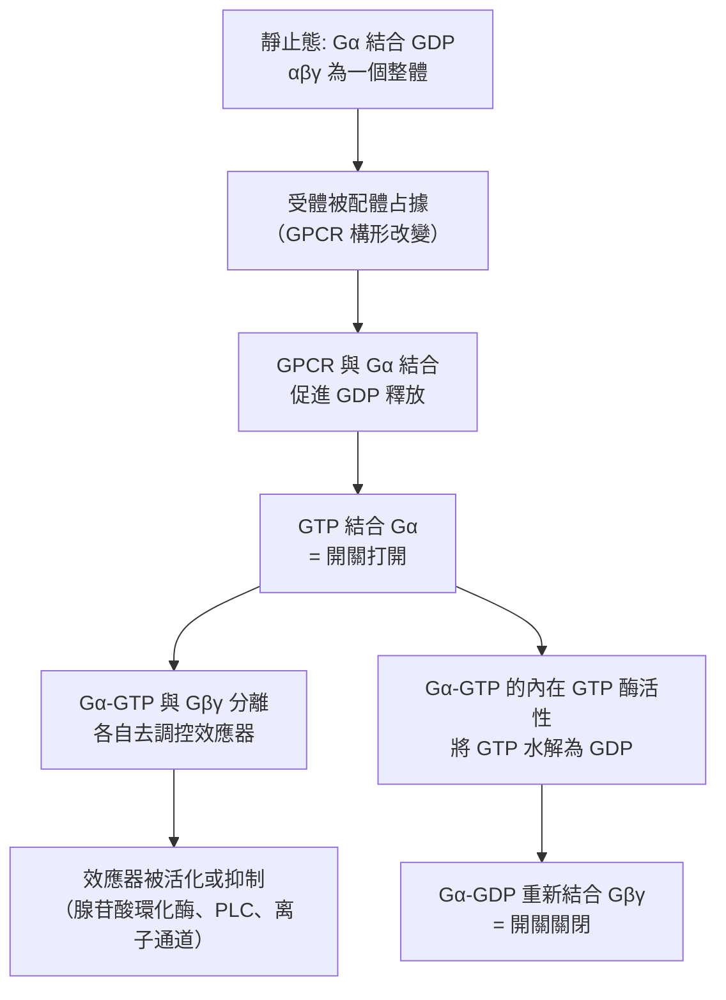

# 1994 · G 蛋白與細胞訊號傳遞：吉爾曼與羅德貝爾找到「分子開關」

> **1994 諾貝爾生理學 or 醫學獎**（共享）：阿爾弗雷德·古斯曼·吉爾曼（Alfred G. Gilman，美國）與馬丁·羅德貝爾（Martin Rodbell，美國）— 表彰「發現 G 蛋白及其在細胞訊號傳遞中的作用」（"for their discovery of G-proteins and the role of these proteins in signal transduction in cells"）。

## 懸案（案情提要）

1970–80 年代的訊號傳遞研究有一個明確的**機制缺口**：

1. **已知**：激素（腎上腺素、升糖素、胰高血糖素）、神經傳遞物質（去甲腎上腺素、5-HT、毒蕈鹼型 ACh）等**無法穿過細胞膜的胜肽/胺類訊號**，卻能在**幾秒內**改變細胞內的酵素活性；
2. **已知**：受體位於細胞膜上（受體酪胺酸激酶的機制已由 [1986-生長因子](1986-生長因子.md) 釐清）；
3. **未知**：**受體與細胞內酵素之間，是什麼東西在傳話？**

蘇德蘭的「第二信使」（cAMP，見 [1971-第二信使](1971-第二信使.md)）回答了「訊號在細胞內是什麼」，但留下了一個更基本的問題：**細胞如何「知道」該產生 cAMP？** 受體被占據之後，如何「點火」那個產生 cAMP 的酵素？

**吉爾曼與羅德貝爾的答案是：一族「分子開關」——G 蛋白。**

## 前因

| 年份 | 事件 |
| --- | --- |
| 1960s | **Martin Rodbell** 與 **Alfred Gilman** 各自獨立發現：受體被激活後，**細胞內有一種「可被 GTP 結合的蛋白質」**在分子之間傳遞訊號。 |
| 1970s | Rodbell 在**腎上腺皮質細胞**與**紅血球（擬制激素受體系統）**中發展出**「擬制受體系統（adenylate cyclase system）」**——這是一個可以在試管中重組的最小訊號傳遞系統。 |
| 1970 | **Sutherland** 發現 cAMP（見 [1971-第二信使](1971-第二信使.md)）。 |
| 1970–1977 | **Rodbell 的核心實驗**：他證明受體與**adenylate cyclase**（產生 cAMP 的酵素）之間，需要**至少兩個可互換的蛋白質因子**才能傳遞訊號——他稱之為 **N（nucleotide-binding）與 F（factor）**。 |
| 1977–1980 | **Gilman 的識別實驗**：他以**輻射標記的 GTP（ $\alpha$ -[$^{32}$ P]GTP）**作為「追蹤標記」，在細胞膜上進行**電泳分離**，找出能特異結合 GTP 的蛋白質——**G 蛋白的發現**。 |
| 1980 | **Gilman 命名**：他把這一族蛋白質命名為 **G protein（G protein）**，因為它結合 **G**uanosine nucleotide（鳥嘌呤核苷酸）。 |
| 1980–1984 | **「G 蛋白病」在人類被發現**：1982 年 **McGurk 與 colleagues** 在**假性甲狀腺功能低下（pseudohypoparathyroidism）**（Ia 型）患者身上發現 **Gs 蛋白的缺陷**——**第一個人類的 G 蛋白突變病**。 |
| 1984 | **G 蛋白的亞型被系統分類**：Gs（刺激腺苷酸環化酶）、Gi（抑制）、Gq（活化磷脂酶 C）、Gt（視覺傳遞）等。 |
| 1994 | 兩人共享諾貝爾生理學 or 醫學獎。 |
| 1988–1990s | **G 蛋白的結構研究**（Gα 的 GDP/GTP 結合結構於 1990 年代被解析）；**GPCR 的結構**於 2000 年代被解析（2000 年代初的 rhodopsin 結構，2011 年化學諾獎）。 |
| 1990s–2020s | **G 蛋白偶聯受體（GPCR）**成為**最大的藥物標的家族**（約占已上市藥物的三分之一）；**G 蛋白突變**造成一系列疾病（**McCune–Albright 綜合症**：Gs 的活化突變造成自體活化）。 |

## 調查

### 第一幕：羅德貝爾的「擬制系統」——把訊號傳遞拆成零件

羅德貝爾的偵查起點是一個極為漂亮的實驗想法：**在試管中重建整個訊號傳遞系統**，然後逐一「刪除」組件，看哪一個是必需的。

```mermaid
flowchart TD
    A[完整系統: 受體 + 細胞膜 + 腺苷酸環化酶<br>+ ATP + cAMP 產生]
    A --> B[逐步稀釋/透析: 某些組件被移除]
    B --> C[發現: 訊號傳遞失效<br>但加入外源蛋白可恢復]
    C --> D[分離出兩種必需的蛋白質:<br>N (核苷酸結合) 與 F (因子)]
    D --> E[命名: N = G protein 的 α 次單元<br>F = βγ 次單元]
```

**羅德貝爾的關鍵實驗（1968–1970 年代）**：

1. **GTP 的必要性**：他發現訊號傳遞需要 **GTP**——且不是作為底物，而是作為**「分子開關」的調節配體**；
2. **「洗掉 GTP」的實驗**：把膜製備物用**EDTA（螯合 $\mathrm{Mg}^{2}^{+}$ ）**處理，訊號傳遞停止；補回 **$\mathrm{Mg}^{2}^{+}$ 與 GTP**，訊號恢復——**這證明有一個 GTP 依賴的步驟**；
3. **因子交換實驗**：他發現**不同組織的膜製備物**可以「交換」訊號傳遞的因子——例如把**脂肪細胞的膜**與**腎上腺皮質的胞漿**混合，訊號可以傳遞。**這證明訊號傳遞的第二個組件是可溶的、可互換的蛋白質**——這就是 G 蛋白。

### 第二幕：吉爾曼的「放射性 GTP 追蹤」——把開關揪出來

吉爾曼的方法更直接、更漂亮：**用放射性標記的 GTP 當探針。**



**關鍵的量化**：**放射自顯影的強度直接正比於 GTP 的結合量**——這使得「測量 G 蛋白的活性」成為一項**定量的、可被藥物調節的測量**。

**吉爾曼實驗的決定性之處**：他**不是靠猜**，而是靠「**標記—分離—追蹤**」三步，把一整族蛋白質從膜上「抓」了出來。

### 第三幕：G 蛋白的三片段結構——分子開關的機制

三片段結構（ $\alpha$ 、 $\beta$ 、 $\gamma$ ）在 1980 年代被確立，其運作機制是本案最漂亮的理論貢獻：



**「分子開關」的定量**：Gα 的 GTP 酶活性決定了開關的「開啟時間」：

$$P_{\text{on}}(t) = P_{\text{on}}^{\text{max}}\left(1 - e^{-k_{\text{cat}} t}\right)$$

其中 $k_{\text{cat}}$ 是 GTP 水解速率常數。**GTP 酶缺陷**（如 **RAS 與 RAB 家族的某些突變**）會使開關「卡在開啟態」，造成持續的訊號——**這是腫瘤生物學中「致癌基因」的分子機制之一**（見 [1989-原癌基因](1989-原癌基因.md)）。

### 第四幕：G 蛋白的「分子開關」理論——跨物種的通用性

羅德貝爾的實驗最終揭示了一個**驚人的普遍性**：**從酵母到人類，從細菌到哺乳動物，訊號傳遞都使用同一套 G 蛋白系統**。

**最著名的例子——視覺**：

$$\text{光} \to \text{視紫紅質} \to \text{transducin（Gt）} \to \text{PDE} \to \downarrow \mathrm{cGMP} \to \text{CNG 通道關閉} \to \text{超極化}$$

**這條鏈條**（由 1950–70 年代的 Brown 與 Wald 等人建立，見 [1967-視覺過程](1967-視覺過程.md)）是**G 蛋白理論的第一個完整實例**，並在 1990 年代成為**羅德貝爾「擬制系統」的原型**。

**演化上的保守性**：**G 蛋白的序列在細菌、真菌與動物間高度保守**——**這說明「分子開關」是一個在真核與原核都出現過的古老演化發明**。

### 第五幕：GPCR——最大的藥物標的家族

G 蛋白偶聯受體（GPCR）是人體最大的受體家族（約 800 個成員，占人類受體的一半）：

| G 蛋白亞型 | 效應器 | 第二信使 | 代表受體與藥物 |
| --- | --- | --- | --- |
| **Gs** | 腺苷酸環化酶 ↑ | cAMP ↑ | β 受體（支氣管擴張劑）、TSH 受體 |
| **Gi** | 腺苷酸環化酶 ↓、 $\mathrm{K}^{+}$ 通道開啟 | cAMP ↓ | M 受體、 $\mathrm{α}_{2}$ 受體（可樂定） |
| **Gq** | 磷脂酶 C | $\mathrm{IP}_{3}$ + DAG、 $\mathrm{Ca}^{2}^{+}$ ↑ | $\mathrm{M}_{1}$ 受體、血管張力素受體 |
| **G12/13** | RhoGEF → Rho | — | thrombin 受體、血小板活化 |

**GPCR 的結構研究**（2000 年代由 Kobilka 與 Palczewski 等人完成，包括 2011 年的諾貝爾化學獎）揭示了「**配體結合 → 構形改變 → 與 G 蛋白耦合**」的結構機制——**今日 GPCR 藥物的設計完全建立在此**。

## 理論裁決

1. **「分子開關」的數學模型**：G 蛋白循環可用簡單的狀態機描述，其總流量（受體活化速率）與每一步的速率常數決定訊號的強度與時程：

   $$J = \frac{[R^*]\,[G]\,[GTP]}{K_d^G + [G]} \times k_{\text{cat}}$$

   這解釋了為何**過量表達 Gα 會抑制訊號**（ $G\alpha$ 累積 → 內源性 GTP 酶活性上升 → 整體上移至「封閉」態）——這是 1990–2000 年代**「G 蛋白過表達造成訊號抑制」**的現象，也是**異三聚體 G 蛋白的「信號平衡」模型**的來源。

2. **GTP 酶活性作為「計時器」**：開關的自動關閉時間由 $k_{\text{cat}}$ 決定：

   $$\tau_{\text{open}} \approx \frac{1}{k_{\text{cat}}} \sim \text{數百毫秒至數秒}$$

   **不同 G 蛋白的 GTP 酶速率差異**，決定了不同訊號途徑的持續時間（這在設計藥物時極為重要：長效的 GTP 酶缺陷型受體突變造成持續性訊號，如 McCune–Albright 綜合症）。

3. **受體的「催化型受體」觀**（Rodbell 的貢獻）：受體不是被動的「開關」，而是**催化型**——一個受體分子可以依次活化**多個** G 蛋白：

   $$\text{受體} + \text{G} \xrightarrow{k_1} \text{R}^*\text{G} \xrightarrow{k_2} \text{GDP-G} + \text{R}^*$$

   受體的**脫敏（desensitization）**（由 GRK 磷酸化受體、 $\beta$ -arrestin 結合造成）就是這套「催化循環」中「受體被回收」的機制——這解釋了為何持續給藥會產生耐受。

4. **訊號傳遞的「通量」思維**：當代訊號傳遞研究已從「on/off」轉向**「通量（flux）」**——一個細胞內有數百條訊號途徑並行，任何單一途徑的數值幾乎無意義；**現代藥理學因此以「網絡藥理學（network pharmacology）」取代單一標靶的思考**。

## 追查支線（未結之謎）

- **Gilman 與 Rodbell 的科學 rivalry 與致敬**：兩人是 1970 年代 McGovern-Danielson 委員會（Gilman 在其中擔任主席）的同事；Rodbell 曾說「我們在 1980 年代還爭論 G 蛋白是不是一個蛋白質」——**最終他們共同獲獎，而諾獎委員會特別讚揚了他們「分開卻互補」的研究風格**；
- **Gilman 的家族**：他的父親 Alfred G. Gilman Sr.（1908–1984）也是著名藥理學家，**父子皆為諾貝爾獎得主（1994 年）**；祖父是耶魯的內科教授。**Gilman 家族是諾獎史上最著名的學術家族之一**（另有父親的堂兄弟 Alfred Nobel 的後人相關的巧合討論）；
- **Gilman 的科學生涯低谷**：他曾於 1970 年代離開學界數年（**由於學術政治與資助問題**，他曾在 1970 年被排除在終身教職之外），後在 UT Southwestern 重啟實驗室——**這段經歷使他特別關注科學研究的自由度與科學家權益**；
- **Rodbell 的科學生涯同樣曲折**：他曾因經濟資助中斷而離開 NIH（1971 年），在 Buffalo 與 Worcester 基金會繼續研究，並曾嘗試**工業界（azelastine）與學術界的結合**；
- **G 蛋白的醫學意義**：**McCune–Albright 綜合症**（Gs 的活化突變）、**李家綜合症**（Gs 的失活突變，造成甲狀腺功能低下與多發性腺腫）、**GPR35/GPR65 的免疫調控**、**霍亂毒素與百日咳毒素**（以 ADP-核糖基化固定住 Gαs/Gαi，造成持續訊號）——**「分子開關被卡住」就是這些疾病的共同機制**。

## 證物與數據（偵查卷宗摘錄）

| 證物 | 數值／內容 | 偵查意義 |
| --- | --- | --- |
| 擬制系統（1970s） | 試管中重組的訊號傳遞 | 「刪除組件」的策略 |
| EDTA 實驗 | 螯合 $\mathrm{Mg}^{2}^{+}$ 使傳遞停止 | GTP 依賴步驟的存在 |
| 因子交換實驗 | 脂肪細胞膜 + 腎上腺皮質胞漿 | 訊號因子是可溶且可互換的 |
| ${}^{32}$ P-GTP 追蹤 | 電泳 + 放射自顯影 | G 蛋白的直接分離 |
| 三片段結構 | $\alpha$ 、 $\beta$ 、 $\gamma$ | 分子開關的組成 |
| GDP/GTP 循環 | 結合 → 活化 → 水解 → 關閉 | 開關的完整循環 |
| GTP 酶速率 | 決定開關的開啟時間 $\tau \approx 1/k_{cat}$ | 「計時器」模型 |
| Gs 病 | 假性甲狀腺功能低下（Ia 型） | 第一個人類的 G 蛋白突變病 |
| McCune–Albright | Gs 的活化突變 → 自體活化 | 「卡在開啟態」的疾病 |
| GPCR 數量 | 約 800 個成員 | 最大的受體家族 |
| 毒素機制 | 霍亂毒素使 Gαs 失去 GTP 酶活性 | 「開關卡死」的經典 |

## 後果

| 領域 | 影響 |
| --- | --- |
| 訊號傳遞 | 「分子開關」成為細胞生物學的核心概念；三種第二信使系統被統一。 |
| 藥理學 | GPCR 成為最大的藥物標的家族；約三分之一的現代藥物作用於 GPCR 途徑。 |
| 疾病機制 | G 蛋白突變造成 McCune–Albright、李家綜合症等；細菌毒素以 G 蛋白為靶。 |
| 結構生物學 | GPCR 結構與 GPCR–G 蛋白複合物的結構研究（2011 年化學諾獎）。 |
| 神經科學 | 視覺、嗅覺、味覺等感官生理的共同機制。 |
| 其他諾獎 | 與 [1971-第二信使](1971-第二信使.md)（下游）、[1992-蛋白質磷酸化](1992-蛋白質磷酸化.md)（效應器）、[1989-原癌基因](1989-原癌基因.md)（RAS 也是 G 蛋白）構成訊號傳遞主線。 |

## 關聯

- [1971-第二信使](1971-第二信使.md) — G 蛋白的下游效應器。
- [1992-蛋白質磷酸化](1992-蛋白質磷酸化.md) — 訊號傳遞的終點機制。
- [1967-視覺過程](1967-視覺過程.md) — transducin：第一個被完全闡明的 G 蛋白系統。
- [1989-原癌基因](1989-原癌基因.md) — RAS 是 G 蛋白家族的一員。
- [1998-一氧化氮](1998-一氧化氮.md) — 氣體性第二信使，訊號傳遞的另一支。
