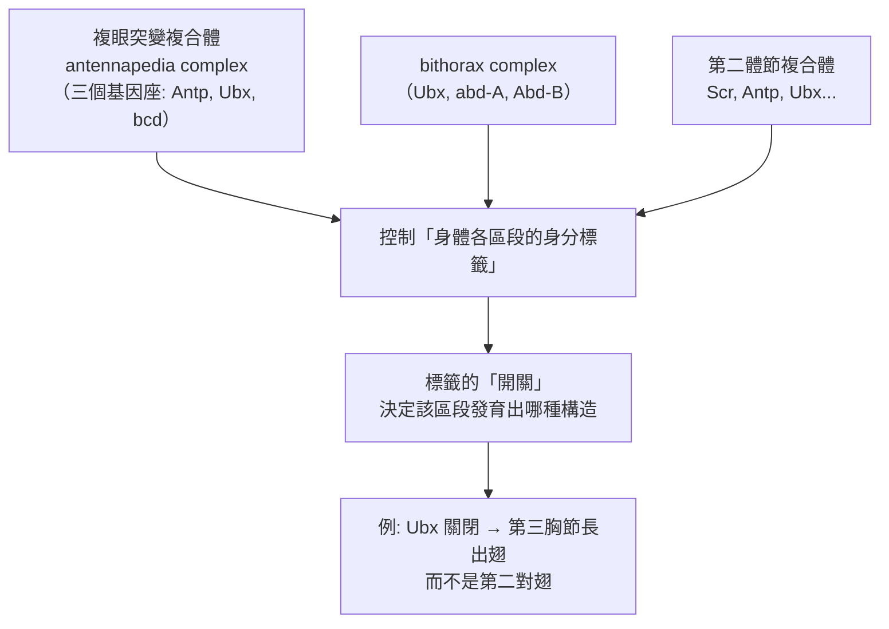
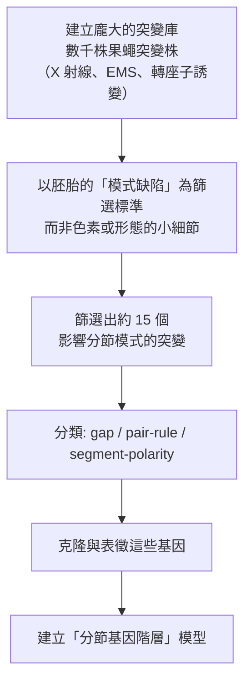
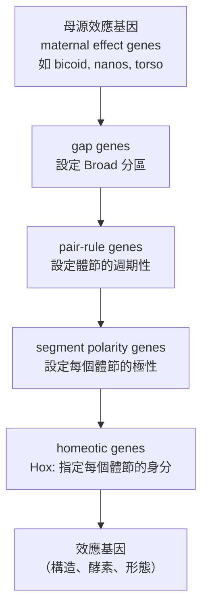

# 1995 · 早期胚胎發育的遺傳調控：路易斯、紐斯林-沃爾哈德與威斯喬斯的「果蠅家庭」

> **1995 諾貝爾生理學 or 醫學獎**（共享三人）：愛德華·B·路易斯（Edward B. Lewis，美國）— 表彰「發現早期胚胎發育中的遺傳調控機理」；克里斯汀·紐斯林-沃爾哈德（Christiane Nüsslein-Volhard，德國）與艾瑞克·F·威斯喬斯（Eric F. Wieschaus，美國）— 同上。

## 懸案（案情提要）

1980 年代的發育生物學有個巨大的「黑箱」：

1. **身體的每一個細胞都有完全相同的基因組**，但神經元與肝細胞的命運天差地別——**是什麼決定了細胞的命運？**
2. 這些決定是**何時**做出的？在胚胎的哪個階段？
3. 它是**不可逆的**，還是**可逆的**？若可逆，範圍有多大？
4. 更基本的：**若把某個基因「關掉」，胚胎會發生什麼？**——這需要**逐一檢視所有基因**，而人類有約 20,000 個基因。

**1995 年諾獎的三位得主，把這樁案子變成了可操作的系統。**

## 前因

| 年份 | 事件 |
| --- | --- |
| 1940s–1960s | 路易斯（Ed Lewis）在 Caltech 以**果蠅的「眼缺陷」突變**研究「**同源異形突變（homeotic mutant）**」——**觸角變成腿、翅變成腳**。 |
| 1953–1960s | 路易斯建立了**「同源異形突變的分為三类」**：影響身體構造的**同源異形基因（homeotic genes）**、影響身體**各部位特徵**的突變、以及影響器官形成的突變——**這是「發育的主控基因」概念的第一塊磚**。 |
| 1960s | **Nüsslein-Volhard 與 Wieschaus** 都在歐洲受過訓練：沃爾哈德曾在 **Heidelberg 的 Hans Spemann 實驗室**（見 [1935-胚胎組織者](1935-胚胎組織者.md)）受訓，威斯喬斯則在 Princeton 開始果蠅胚胎研究——**這條血緣直接連結了本案與斯佩曼的組織者理論**。 |
| 1970s | 威斯喬斯在 Princeton 開始以果蠅胚胎進行**「有系統的突變子篩選」**。 |
| 1978–1980 | **威斯喬斯與沃爾哈德在 EMBL（Heidelberg）與 Princeton 之間往返**，開始「**華盛頓與歐本海姆會議**」式的系統性合作。 |
| 1980–1984 | **「胚胎發育的系統性遺傳學分析」**：三人聯手對果蠅胚胎的每一個基因座逐一突變，篩選影響**胚胎模式（pattern）**的突變。 |
| 1984 | **關鍵論文發表**：威斯喬斯與沃爾哈德在《Nature》發表《Mutations affecting segment number and polarity in Drosophila》（《影響果蠅體節數與極性的突變》），報告 **約 15 個「分節基因（segmentation genes）」**；路易斯發表《Homeotic gene complexes and the genetic control of development》。 |
| 1988 | 三人獲**路易斯共享的 Louisa Gross Horwitz 獎**（路易斯 1988 年單獨獲獎）。 |
| 1995 | 三人共享諾貝爾生理學 or 醫學獎。 |
| 1990s–2010s | **分節基因被克隆**：**engrailed（en）**、**even-skipped（eve）**、**fushi tarazu（ftz）**、**hedgehog（hh）**、**wingless（wg）**、**gap genes**、**pair-rule genes**、**segment-polarity genes**；**1995 年之後**，**Hox 基因**（路易斯 1980 年代克隆）被證明是「**同源異形框（homeobox）**」轉錄因子家族的成員。 |
| 2010s–2020s | **同源異形框與「基因編輯」的結合**（CRISPR–Hox 用於設計動物形態）；**「動物形態的通用數學模型」**（reaction–diffusion 與 Turing pattern）。 |

## 調查

### 第一幕：路易斯的「同源異形突變」——身體的「藍圖開關」

路易斯的第一項核心工作，是**把「形態」這件事變成可遺傳的因子**。

**關鍵觀察**：

1. **果蠅的「觸角」與「足」**在發育上同源——它們由同一群細胞（**成蟲芽（imaginal disc）**）在不同的位置發育而成；
2. 突變可使觸角變成足、翅變成第二對胸足——**即「身體部位的身分」被改寫了**；
3. 路易斯以 **「三個基因群（three complexes）」** 的模型解釋：

**路易斯的關鍵洞見**：**「同源異形基因」是「身分」而非「構造」的基因**——它們不負責建造器官，而是**標記「這裡應該是什麼」**。這個概念在 1990 年代被轉錄因子家族（**Hox 基因**）的發現所證實。

### 第二幕：威斯喬斯與沃爾哈德的「系統性突變子篩選」——把發育生物學變成「篩選科學」

這是本案最具方法論革命性的部分。

**問題的量化**：果蠅胚胎的體節模式由數百個基因共同控制。要找出「哪些基因控制模式」，傳統方法是逐一研究已知基因——但那會永遠漏掉未知的。

**他們的策略：以「表型」為篩選條件，反向搜尋基因。**

**三類分節基因的層次**：

| 類別 | 突變表型 | 數目 | 代表基因 | 作用層次 |
| --- | --- | --- | --- | --- |
| **Gap genes（缺口基因）** | 缺失**連續的體節群** | 約 6 | hunchback, Krüppel, giant, knirps | 沿身體軸設定「 Broad 分區」 |
| **Pair-rule genes（成對規則基因）** | 缺失**每隔一個**體節 | 約 8 | even-skipped, fushi tarazu | 設定「分節的周期性」 |
| **Segment polarity genes（體節極性基因）** | 每一體節**內部**失去極性 | 約 10 | engrailed, wingless, hedgehog, patched | 維持每個體節的「前後軸」 |

**階層關係（經典模型）**：

**這是 20 世紀生物學最完整的「分子階層模型」之一**——一個信號傳遞的階層，從母源梯度一路到構造。

### 第三幕：沃爾哈德的「三條原則」——發育生物學的教科書

紐斯林-沃爾哈德把系統性篩選的成果，提煉成**三條具有普遍性的原則**（她的諾貝爾演講與後續教科書的核心）：

1. **「從複雜中尋找簡單」（Finding simplicity in complexity）**：複雜的形態模式，是由**少數**基因以**階層**方式建立的；
2. **「鄰近的命運」（Neighboring fates）**：**相鄰的細胞傾向於命運相似**——這意味著**局部的、漸變的訊號梯度**在起作用（而非全或無的開關）；
3. **「同源異形突變不是發育的異常，而是發育的變體」（Homeotic mutations are not distortions but variations）**：Hox 基因的突變不是「壞掉」，而是**把一個構造的身分換成另一個**——發育是一個**「身分指派」的過程**。

**第二條原則的深遠影響**：「鄰近的命運」意味著命運由**濃度梯度**決定——這把斯佩曼的組織者（見 [1935-胚胎組織者](1935-胚胎組織者.md)）與今日的**形態素（morphogen）梯度模型**（Nodal、Shh、BMP、FGF 等）連成一體。

### 第四幕：從果蠅到所有動物——保守性的證明

1995 年之後，「Hox 基因是發育的通用語言」的證據迅速累積：

| 物種 | 發現 | 意義 |
| --- | --- | --- |
| **果蠅** | Hox 複合體 8 個基因，分成兩個群（ANT-C、BC） | 原型 |
| **線蟲** | **線蟲的 Hox 基因決定其體節身分**（lin-39 等） | 保守性 |
| **脊椎動物** | **4 個 Hox 複合體、39 個基因（HOXA–D）** | 擴張 |
| **哺乳動物** | Hox 基因的**「空間共線性（spatial colinearity）」**：3' 端基因在身體前端表現，5' 端在後端 | **最深刻的發現** |
| **人** | 39 個 Hox 基因；**HOXA13 突變造成手腳畸形** | 臨床 |

**「空間共線性」的漂亮之處**：**Hox 基因在染色體上的物理位置，與它在身體上的表現位置，是對應的**——這是基因組與身體結構之間的「對稱」的絕妙例證。

### 第五幕：訊號通路的通用性

分節基因的下游訊號通路（同樣在多種動物中保守）：

| 通路 | 果蠅基因 | 脊椎動物對應 | 功能 |
| --- | --- | --- | --- |
| **Hedgehog** | hh | **Shh** | 模式化與肢芽誘導 |
| **Wnt** | wg | **Wnt1–16** | 細胞命運與增殖 |
| **Notch** | Notch | **Notch1–4** | **側向抑制**（決定細胞「不選同樣的命運」） |
| **BMP/Dpp** | dpp | **BMP2–7** | 中胚層誘導與骨形成 |
| **RA（視黃酸）** | — | 脊椎動物獨有 | 軸向模式化（後腦與脊髓的分節） |

**Notch 訊號的「側向抑制」尤其重要**——它是「鄰近命運不同」的直接機制（見下文數學）。

## 理論裁決

1. **分節的數學模型**：體節的形成可以用「反應—擴散系統」或「週期性基因振盪」描述：

   $$\frac{\partial u}{\partial t} = D_u \nabla^2 u + f(u,v), \qquad \frac{\partial v}{\partial t} = D_v \nabla^2 v + g(u,v)$$

   Turing 型的**反應—擴散方程**能自發產生**週期性模式**（週期 $\lambda$ 由擴散率比與反應速率決定）——這正是威斯喬斯的「pair-rule 基因每隔一段表達一次」的數學抽象，也是今日「**形態生成的 Turing 圖樣**」的基礎。

2. **側向抑制的數學**：Notch–Delta 系統能產生**棋盤格式的交錯命運**：

   $$\frac{d \Delta_i}{dt} = f(\Delta_i) - k\,\text{Notch}_i, \qquad \text{Notch}_i \sim \sum_{j \in N(i)} \Delta_j$$

   這個簡單的局部抑制規則，就足以讓相鄰細胞做出不同選擇——**「鄰近命運不同」的機制**。

3. **母源梯度的「形態素」數學**：母源效應基因的產物（如 Bicoid）沿卵軸形成**指數梯度**：

   $$[Bcd](x) = [Bcd]_0 \, e^{-x/\lambda}$$

   **濃度梯度即位置資訊**——細胞以「讀出濃度」的方式得知自己的位置（這正是斯佩曼組織者的定量版，見 [1935-胚胎組織者](1935-胚胎組織者.md)）。

4. **Hox 的「共線性」**：Hox 基因簇在染色體上的位置 $s$ 與其在身體軸上的表現位置 $x$ 之間，存在近似線性關係：

   $$x \approx \alpha s + \beta$$

   這意味著**染色體的物理結構本身攜帶了身體的空間圖譜**——一個基因組層級的「設計圖紙」，其解碼規則至今仍是發育生物學最迷人的謎題之一。

5. **分節計數的決定**：體節數不是「一個一個數出來」的，而是由**振盪器的週期**決定的（pair-rule 基因的表現呈週期性），其後由 segment polarity 基因維持每個體節的內部結構——**「先定頻率、再定相位」**的設計，是生物系統產生規律結構的通用策略。

## 追查支線（未結之謎）

- **三人都是「實驗的野外派」**：路易斯以果蠅的「異常突變」為線索；威斯喬斯與沃爾哈德以「大規模篩選」為武器——**諾獎委員會特別指出，這是「第一個系統性的發育遺傳學分析」**；
- **威斯喬斯與沃爾哈德的跨界路徑**：威斯喬斯原本研究**神經科學**，後轉向發育遺傳學；沃爾哈德則是**物理學出身轉向生物學**——**兩人的跨界路徑與諾貝爾的「跨界傳統」一致**；
- **「動物形態的物理學」**：威斯喬斯後來推動**與物理學家合作發展「動物形態的量化理論」**——這條線在 2020 年代催生了「**形態學的資訊理論**」（用資訊論與物理學解釋身體如何「計算」出形狀）；
- **Hox 與醫學**：Hox 基因與**先天畸形（syndactyly、synostosis、髖關節發育不良）**、**血液 cancers（HoxA 與白血病）**相關；**「Hox 基因的表觀遺傳調控」**是白血病研究的重點；
- **FlyBase 與果蠅基因組**：1980 年代的系統性篩選，使**果蠅成為第一個完成全基因組定序的動物之一（1995 年完成）**——**「以模式生物建立完整基因組」的典範**，直接影響了後來的人類基因組計畫與「功能基因組學」。

## 證物與數據（偵查卷宗摘錄）

| 證物 | 數值／內容 | 偵查意義 |
| --- | --- | --- |
| 觸角變腳 | Antp 突變的表型 | 身分基因的存在 |
| 三個基因複合體 | ANT-C、BC、Scr | 身分指派的組織 |
| 分節基因篩選 | 約 15 個分節基因 | 從表型反推基因 |
| Gap genes | 約 6 個，缺失連續體節群 | 第一層（Broad 分區） |
| Pair-rule genes | 約 8 個，隔一個體節缺失 | 第二層（週期性） |
| Segment polarity genes | 約 10 個，每體節內失去極性 | 第三層（體節內軸） |
| 母源效應基因 | bicoid、nanos、torso | 最上游的梯度 |
| Hox 基因數 | 果蠅 8 個；脊椎動物 39 個（4 群） | 保守與擴張 |
| 空間共線性 | 3' 端基因在身體前端表現 | 基因組與身體的對稱 |
| Turing 反應—擴散 | 週期由 $D_v/D_u$ 決定 | 模式自發產生 |
| Notch–Delta 側向抑制 | 局部抑制產生交錯命運 | 「鄰近命運不同」的機制 |
| Bicoid 梯度 | $[Bcd](x) = [Bcd]_0 e^{-x/\lambda}$ | 位置資訊的物理 |

## 後果

| 領域 | 影響 |
| --- | --- |
| 發育生物學 | 從描述性胚胎學轉為分子遺傳學；「身分指派」成為核心概念。 |
| 演化生物學 | Hox 的保守性成為「動物形態的共同藍圖」的證據。 |
| 遺傳學 | 系統性表型篩選成為功能基因組學的範式。 |
| 醫學 | Hox 與先天畸形、癌症的關聯；發育調控的病理學。 |
| 數學與物理 | 形態生成的反應—擴散模型、資訊論的應用。 |
| 其他諾獎 | 與 [1935-胚胎組織者](1935-胚胎組織者.md)（組織者的現代版）、[1993-斷裂基因](1993-斷裂基因.md)（基因表現機制）、[2023-mRNA 疫苗](2023-mRNA疫苗.md)（基因治療的技術）等構成發育與分子主線。 |

## 關聯

- [1935-胚胎組織者](1935-胚胎組織者.md) — 沃爾哈德的學術血緣直接來自斯佩曼的實驗室。
- [1973-動物行為](1973-動物行為.md) — 行為的「固定行為模式」與發育的固定模式。
- [1993-斷裂基因](1993-斷裂基因.md) — 基因表現調控的分子層次。
- [2012-iPS 細胞](2012-iPS細胞.md) — 命運可被重programming。
- [2020-C 肝病毒](2020-C肝病毒.md) — 基因編輯技術在當代的應用。
