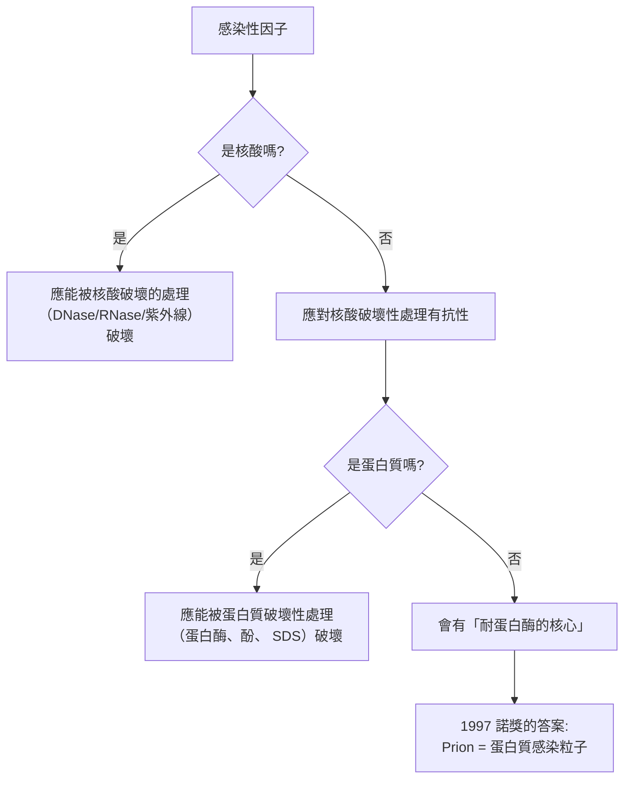
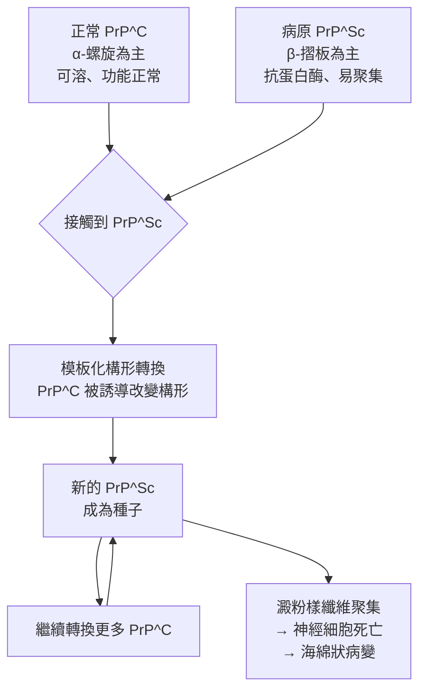

# 1997 · 朊毒體：普魯西納找到一種「不含核酸的傳染因子」

> **1997 諾貝爾生理學 or 醫學獎**（單獨獲獎）：史坦利·布魯希納（Stanley B. Prusiner，美國）— 表彰「發現普里昂蛋白——傳染的一種新的生物學原理」（"for his discovery of Prions - a new biological principle of infection"）。

## 懸案（案情提要）

1980 年代中期，神經科學界有一樁極為怪異的「案件」：

1. **羊搔癢症（scrapie）**——羊的腦與脊髓出現海綿狀空泡、行為異常、死亡；
2. **牛狂牛症（BSE，1996 年在英國爆發）**——人類食用受污染的牛肉後，出現**新型克羅伊茨費爾特-雅各布病（vCJD）**；
3. **庫魯病**—— Fore 部落的婦女在吃掉親人的腦後患病（見 [1976-B肝病毒與庫魯病](1976-B肝病毒與庫魯病.md)）；
4. 這些病的**傳播因子**已經被證明：
   - 能通過**能阻擋細菌與病毒的濾器**；
   - 對**紫外線**（破壞核酸）與**甲醛**（破壞核酸與蛋白質）高度敏感；
   - **但在細胞培養中無法繁殖**；
   - **在電子顯微鏡下看不到任何顆粒**。

**這違反了 20 世紀感染生物學的全部前提**：**所有感染性因子都必須含有核酸**（DNA 或 RNA）。除非——**有一種病原體的基因組不是核酸**。

普魯西納的答案：**朊毒體（prion）——一種能自我複製的錯誤摺疊蛋白質**。

## 前因

| 年份 | 事件 |
| --- | --- |
| 1954 | **Gajdusek 與 Gibbs** 在 Fore 部落證明庫魯病可由人傳人（見 [1976-B肝病毒與庫魯病](1976-B肝病毒與庫魯病.md)）。 |
| 1960s–1970s | 學界主流的**「慢病毒（slow virus）」假說**：認為庫魯病與 scrapie 是由一種繁殖極慢的病毒引起。但**「病毒」說無法解釋「對核酸破壞的處理高度敏感」與「無病毒形態」**這兩點。 |
| 1972 | **Stanley Prusiner** 在華盛頓大學（University of Washington）開始研究 scrapie。他使用**放射性標記的蛋白質**追蹤：注入感染腦的蛋白質部分後，在寄主體內尋找標記——**他發現標記出現在一種非 DNA/RNA 的高分子中**，並在 1982 年將其命名為 **prion（proteinaceous infectious particle，蛋白質感染粒子）**。 |
| 1982 | **Prusiner 發表《Novel proteinaceous infectious particles cause scrapie》**，並從感染腦中**部分純化出這種蛋白質（PrP）**。 |
| 1984 | **普魯西納與其合作者證明：抗蛋白酶的核心（ $\mathrm{PrP}^{\mathrm{Sc}}$ ）與正常蛋白（ $\mathrm{PrP}^{\mathrm{C}}$ ）在胺基酸序列上相同，差別在於構形**——**本案最核心的一條證據**。 |
| 1985–1986 | **Prusiner 的「構形轉換假說（conformational conversion hypothesis）」**：正常的 $\mathrm{PrP}^{\mathrm{C}}$ （細胞型，α-螺旋为主）可被病原性的 $\mathrm{PrP}^{\mathrm{Sc}}$ （scrapie 型，β-摺板为主）誘導轉為構形異常態；異常態又進一步誘導更多正常態轉變——**這就是「模板化構形轉換（templated conformational conversion）」**。 |
| 1986 | **Chesebro** 等人在**倉鼠**中發現 scrapie 病原的**異種屏障（species barrier）**可被**倉鼠的 PrP 基因**「適應」——**這是基因與疾病的直接關聯的第一條線索**。 |
| 1993–1996 | **Prusiner 與 Kocisko 等人**揭示了**「蛋白質晶體」**結構：scrapie 病原的 PrP 能形成**amyloid-like 的纖維晶體**——這是理解其複製機制的關鍵。 |
| 1997 | 普魯西納獲諾貝爾生理學 or 醫學獎（**他當時獨自獲獎，因為在 1995–1996 年英國的 BSE 危機中，政府曾拒絕批准對牛羊進行「人為感染」實驗**）。 |
| 1990s | **Gerstmann–Sträussler–Scheinker 綜合症（GSS）**患者的基因分析證明：**PRNP 基因的突變（遺傳性）可自發地使 PrP 偏向異常構形**——**基因 → 構形 → 疾病**的完整因果鏈建立。 |
| 2000s | **Kocisko 等人（2004）**在**無細胞系統**中實現了 PrP 的**體外轉化與繁殖**——**「蛋白質可以傳染」的最終證明**。 |
| 2010s–2020s | **CRISPR 與基因治療**帶來「**降低 PrP 表現**」的治療策略；**Aβ（阿茲海默的類澱粉蛋白）**成為第二個被質疑的「朊毒體樣」蛋白——**普林與蛋白聚集的關係**至今仍是爭議核心。 |

## 調查

### 第一幕：核心的偵查問題——「傳染因子的身分是什麼？」

普魯西納的方法極為系統，他建立了一張「排除清單」：

**關鍵的實驗**：

1. **放射性標記的蛋白質追蹤**：他把感染腦的可溶性部分（含病毒顆粒）用高度純化的酵素（DNase、RNase）處理，殺死所有核酸；然後把**放射性標記的蛋白質**注入健康動物——**動物仍發病，且注射物中的標記出現在寄主的多種組織中**，證明**一種蛋白質本身就能傳播**；
2. **蛋白酶的「部分抗性」**：感染腦的蛋白質經蛋白酶消化後，**大部分被分解，但留下少量對蛋白酶高度抗性的核心**——**這個核心在宿主体內能引發疾病**，這就是 $\mathrm{PrP}^{\mathrm{Sc}}$ ；
3. **「耐蛋白酶核心」的生物學身分**：他證明耐蛋白酶核心與細胞內的正常 PrP（ $\mathrm{PrP}^{\mathrm{C}}$ ）**具有相同的胺基酸序列**——**這是全套案例中最令人震驚的一條**：**病原與宿主蛋白是同一個分子，只差在摺疊方式**。

### 第二幕：構形轉換假說——本案最深刻的理論貢獻

普魯西納提出的模型，只需幾個假設就能解釋整個現象：

**這個模型的四個漂亮之處**：

1. **不需要任何核酸**：整個傳播過程只涉及蛋白質；
2. **解釋了「耐蛋白酶」**： $\beta$ -摺板的構形使蛋白質骨架緊密、蛋白酶難以進入；
3. **解釋了「生長速度」**：scrapie 的疾病進程緩慢（數月到數年），因為每一步轉換都需要時間；
4. **解釋了「異種屏障」**：外來蛋白的構形轉換效率因物種而異——**宿主 PrP 的序列影響轉換的效率**，這就是遺傳屏障的分子基礎。

### 第三幕：基因與疾病的接線——GSS 綜合症

1990 年代的決定性證據：

1. **GSS 綜合症**（家族性、致死性、共濟失調、痴呆）患者的**家族中有 50% 患病**——**顯性遺傳**；
2. **PRNP 基因的定序**：患者的 PRNP 基因帶有**點突變**（如 **P102L、Q217R**）；
3. **實驗證明**：把突變型 PrP 在試管中表現，**它自發地轉為異常構形**——**不需要任何外來病原**！

$$\text{PRNP 突變} \to \text{PrP 的構形偏好改變} \to \text{自發性錯誤摺疊} \to \text{疾病}$$

**這是遺傳學與感染學的橋樑**：朊毒體疾病**既是感染性的（可傳播），又是遺傳性的（家族聚集）**——這在 1990 年代之前被認為是邏輯上的不可能。

### 第四幕：無細胞系統的「體外繁殖」——終局證明

2004 年，**Kocisko 等人**在試管中實現了：

1. 把重組的 $\mathrm{PrP}^{\mathrm{C}}$ （野生型）與**少量 $\mathrm{PrP}^{\mathrm{Sc}}$ （種子）**混合，在適當條件下（**37 °C**、**涡流**、**聲波處理**以提供能量）孵育；
2. 數週後，**$\mathrm{PrP}^{\mathrm{Sc}}$ 的量增加到數百倍**；
3. 這些新產生的 $\mathrm{PrP}^{\mathrm{Sc}}$ **能再感染新的 $\mathrm{PrP}^{\mathrm{C}}$**——**完整的「蛋白質繁殖」循環被在試管中實現**。

**這是 20 世紀生物學最不可思議的實驗之一**：**蛋白質可以自我複製**（藉由模板轉換），完全不需要核酸。

### 第五幕：數學——「構形轉換的動力學」

若以 $\mathrm{PrP}^{\mathrm{Sc}}$ 的濃度 $x$ 描述模板化轉換過程：

$$\frac{dx}{dt} = k_{\text{conv}} \, x \, (x_{\text{total}} - x) \quad (\text{二次反應：需要模板})$$

或更精確地（聚合與成核的模型）：

$$\frac{dx}{dt} = k_{\text{nuc}} x^n + k_{\text{poly}} x\,(x_{\text{total}}-x)$$

- **成核（nucleation）項** $k_{\text{nuc}} x^n$ ：解釋「遲滯期」（lag phase）——為什麼感染後有一段無症狀期；
- **聚合（polymerization）項**：解釋「對數生長期」——一旦種子形成，轉換呈指數增長。

**這個模型直接解釋了朊毒體疾病的臨床行為**：

| 臨床現象 | 模型解釋 |
| --- | --- |
| 長潛伏期（數月–數年） | 成核項小，需要時間累積種子 |
| 發病後進展迅速 | 聚合項的指數增長 |
| 腦組織中聚集量極大 | 轉換效率高， $\mathrm{PrP}^{\mathrm{Sc}}$ 大量累積 |
| 異種屏障 | 不同物種的 $k_{\text{conv}}$ 差異極大 |

## 追查支線（未結之謎）

- **普魯西納的科學奮鬥**：他於 1982 年在《Science》發表朊毒體論文時，學界反應極為冷淡甚至敵視（許多人認為他是個「騙子」）；他曾說自己面臨「科學史上最孤立的處境」；他成立的私人實驗室（**Prusiner 私人診所與實驗室**）在 1990 年代曾因經費與人事問題幾乎關閉；
- **BSE 危機與科學決策**：1995–1996 年英國的 BSE 疫情期間，**英國政府以「人為感染牛羊的實驗可能導致新型 CJD」為由，拒絕批准 Prusiner 的實驗申請**——這使他能獲諾獎的研究無法在英國完成。**這樁「政治與科學的衝突」是普魯西納獲獎演說中最具批判性的段落**；
- **1996 年的「狂牛病」恐慌**：vCJD 的爆發使英國的牛肉出口全面崩潰，並造成 estimated 上百億英鎊的經濟損失——**這是朊毒體研究從基礎科學走到公共衛生的轉捩點**；
- **普林與阿茲海默病的爭論**：2010 年代，**Abeta（β-澱粉蛋白）**被部分研究者稱為「Alzheimer's 的 prion」——即一種**可誘導正常蛋白轉為異常構形、並在腦中傳播**的蛋白。**但多數神經科學家持反對意見**（普林本人亦反對），因為阿茲海默病的傳播機制與經典朊毒體不同（無高度傳染性）。**這是 21 世紀神經科學最激烈的一場辯論**；
- **家族性 CJD 比例**：約 10%–15% 的 CJD 病例為遺傳性（PRNP 突變），這是唯一能把「遺傳」與「感染」統一起來的模型；
- **普魯西納的醫學影響**：他的研究直接帶動了 **2010 年代神經退化疾病的「跨種傳播（vCJD）病源學」**研究，也刺激了 **BSE 與 TSE 的國際監測系統（OIE）**的建立。

## 證物與數據（偵查卷宗摘錄）

| 證物 | 數值／內容 | 偵查意義 |
| --- | --- | --- |
| 濾器與紫外線測試 | 通得過濾器、對核酸破壞敏感 | 排除病毒與細菌 |
| 蛋白酶處理 | 大部分被分解，剩「耐蛋白酶核心」 | 病原的蛋白質本性 |
| 放射性標記蛋白質 | 注入後標記出現在宿主組織 | 蛋白質本身可傳播 |
| $\mathrm{PrP}^{\mathrm{Sc}}$ vs $\mathrm{PrP}^{\mathrm{C}}$ | **胺基酸序列相同，構形不同** | 本案最核心的發現 |
| 構形差異 | $\alpha$ -螺旋 vs $\beta$ -摺板 | 抗蛋白酶與聚集的原因 |
| GSS 綜合症 | 家族性 50% 患病 | 遺傳性朊毒體病 |
| PRNP 突變 | P102L、Q217R 等 | 基因 → 構形的直接證明 |
| 異種屏障 | 倉鼠 PrP 使 scrapie 能在倉鼠傳播 | 序列影響轉換效率 |
| 體外繁殖（2004） | $\mathrm{PrP}^{\mathrm{Sc}}$ 產量增加數百倍並可再感染 | **蛋白質繁殖的終局證明** |
| 動力學模型 | $\dot{x} = k_{\text{nuc}} x^n + k_{\text{poly}} x (x_{\text{tot}}-x)$ | 遲滯期與指數生長 |

## 理論裁決

1. **構形轉換的動力學**：朊毒體的複製是**模板化構形轉換**，其速率可寫成：

$$\frac{dx}{dt} = k_{\text{nuc}} x^n + k_{\text{poly}} x\,(x_{\text{tot}} - x)$$

- **成核項** $k_{\text{nuc}} x^n$ ：解釋**遲滯期（lag phase）**——為何感染後有一段無症狀期；
- **聚合項**：解釋**對數生長期**——一旦種子形成，轉換呈指數增長。

**這正是細胞週期的 CDK 振盪方程的同型結構**（見 [2001-細胞週期](2001-細胞週期.md)）——**生物系統用同一套數學製造振盪**。

2. **種子效應與劑量—反應的 S 型**：若病原的臨床表現需要累積到某個閾值濃度：

$$P(\text{發病}) \propto \frac{x^t}{K^t + x^t} \quad (t > 1)$$

**這解釋了為何「感染量」與「發病」不是線性關係**，也解釋了為何 PrP 的**潜伏期**可以長達數十年而只有少數人發病。

3. **「蛋白質可以遺傳」對中心法則的挑戰**：本案把「資訊」的定義推廣了：

$$\text{中心法則（經典）}: \quad \text{DNA} \to \text{RNA} \to \text{蛋白質} \xrightarrow{\text{構形}} \text{異常蛋白} \xrightarrow{\text{模板}} \text{更多異常蛋白}$$

**這不是違反中心法則，而是擴充了「模板」的定義**——模板可以是核酸，也可以是**蛋白質的構形**。

4. **熱力學的解釋：摺疊漏斗與致病構形**：正常蛋白的摺疊遵循能量漏斗（folding funnel）：

$$F(x) \approx \alpha x^2 \quad (\text{單一最低點})$$

而致病突變（如 V30I、D178N）使漏斗**變平**，使蛋白更容易落入**局部最小值**（misfolded state）：

$$F_{\text{mutant}}(x) \approx \alpha' x^2 + \beta H(x - x_{\text{mis}})^{4}, \qquad \alpha' < \alpha$$

**這解釋了為何致病突變多是「穩定性降低」而非「功能喪失」**——它們讓蛋白「更容易走錯路」，而一旦走錯，就會**模板化地引導更多蛋白走錯**。

5. **流行病的數學（為何 prion 傳播緩慢）**：若 prion 在宿主內的擴增速率為 $r$ ，而個體在症狀出現前的時間為 $T$ ，則：

$$P(\text{發病}) \approx \int_0^T r\,x(t)\,dt \quad \text{（需要累積到閾值）}$$

**這解釋了為何食用受污染牛肉的感染率不高（需大量暴露），但一旦感染，發病後進展極快**——**prion 疾病的「低傳播效率、高致死率」特徵由此得到解釋**。

## 後果

| 領域 | 影響 |
| --- | --- |
| 感染生物學 | 「感染因子」的概念被擴張——傳染性可以沒有核酸。 |
| 神經科學 | 海綿狀腦病變與神經退化的蛋白聚集機制。 |
| 公共衛生 | BSE 與 vCJD 危機、食品追蹤系統、國際獸疫監測。 |
| 蛋白質生物學 | 「構形轉換」成為蛋白質生物學的核心概念，並與摺疊疾病（Alzheimer's、Parkinson's、ALS）相連。 |
| 分子生物學 | 對「中心法則」與「蛋白質為何不帶遺傳信息」的根本性反思。 |
| 其他諾獎 | 與 [1976-B肝病毒與庫魯病](1976-B肝病毒與庫魯病.md)（同一病原的前半段）、[1993-斷裂基因](1993-斷裂基因.md)（基因表現）、[2006-RNA 干擾](2006-RNA干擾.md)（RNA 調控的另一條路徑）構成感染與調控主線。 |

## 關聯

- [1976-B肝病毒與庫魯病](1976-B肝病毒與庫魯病.md) — 同一病原體的「非常规病毒」階段與最終身分。
- [1993-斷裂基因](1993-斷裂基因.md) — 基因表現與蛋白質生成的機制，是理解「序列相同、構形不同」的前提。
- [1995-胚胎發育基因](1995-胚胎發育基因.md) — 蛋白質構形與發育調控的關係。
- [2018-免疫檢查點](2018-免疫檢查點.md) — 蛋白聚集疾病與免疫治療的交叉。
- [2006-RNA 干擾](2006-RNA干擾.md) — 蛋白質與基因表現調控的另一條路徑。
