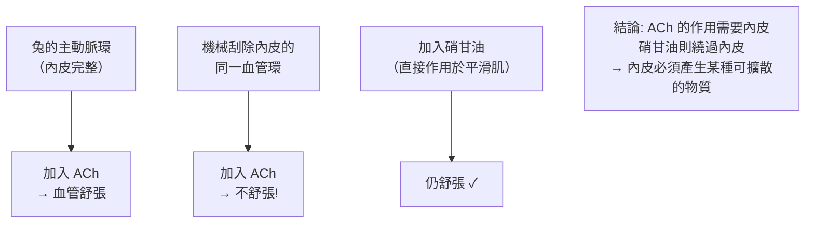
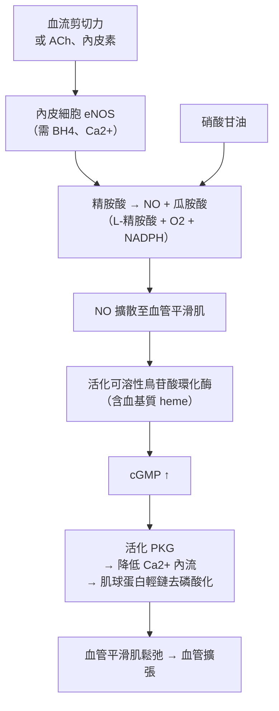

# 1998 · 一氧化氮作為訊號分子：佛契哥特、伊格納羅與慕拉德找到「氣體狀的維他命」

> **1998 諾貝爾生理學 or 醫學獎**（共享三人）：羅伯·佛契哥特（Robert F. Furchgott，美國）、路易斯·J·伊格納羅（Louis J. Ignarro，美國）與費瑞·慕拉德（Ferid Murad，美國）— 表彰「發現一氧化氮在心血管系統中起傳訊分子的作用」（"for their discoveries concerning nitric oxide as a signalling molecule in the cardiovascular system"）。

## 懸案（案情提要）

1980 年代的藥理學有一樁「解釋不了」的觀察：

1. **硝甘油（nitroglycerin）與硝酸鹽**是 19 世紀以來治療心絞痛的標準藥物——但**它們如何舒張血管，長期是個謎**；
2. 1970 年代的另一條線：**乙醯膽鹼**不僅是神經傳遞物質，也直接作用於**血管內皮**，使血管舒張——那麼，內皮細胞釋放的是什麼？
3. 而 1980 年代的另一發現：**「內皮衍生舒張因子（EDRF）」**的存在被確立，但它的身分不明。

**答案：內皮細胞釋放一氧化氮（NO）**，它擴散到血管平滑肌，活化可溶性鳥苷酸環化酶，使 cGMP 上升、血管舒張。**這是生物體內第一個被確認的「氣體狀訊號分子」。**

## 前因

| 年份 | 事件 |
| --- | --- |
| 1860s–1880s | **Murrell** 注意到有機硝酸鹽（如硝酸甘油）可擴張血管；20 世紀成為心絞痛標準藥。 |
| 1970s | **佛契哥特與其同事（Vane 等人）在 1970 年代確立「內皮衍生舒張因子（EDRF）」的存在**——血管舒張需要內皮參與的證據開始累積。 |
| 1980 | **Robert Furchgott** 發現關鍵的實驗方法：**「內皮去除實驗」**——去除血管內皮後，乙醯膽鹼**不再**引起血管舒張——證明內皮必須參與。 |
| 1980–1986 | **Ferid Murad** 發現：**硝酸甘油與硝基化合物釋放的物質能活化可溶性鳥苷酸環化酶**，提高 cGMP；後來證明該物質就是 **NO**。 |
| 1986 | **Louis Ignarro** 在實驗中證明：**從血管內皮釋放的舒張因子就是一氧化氮**——以化學方法（還原 NO 為 nitrosothiols、對 NO 的生物測定等）確認。 |
| 1980s | **NO 的生物測定技術**發展（NO 探測器、NO 選擇性電極）。 |
| 1987–1988 | **內皮型一氧化氮合成酶（eNOS）**被克隆——證明 NO 是由**酵素合成**的，而非分解副產物。 |
| 1992 | **NO 作為內皮舒張因子**的爭議被確認（**Moncada、Hogg 等人**在《Nature》上發表「NO 是內皮衍生舒張因子」的綜述，確認爭議結束）。 |
| 1998 | 三人共享諾貝爾生理學 or 醫學獎。 |
| 1990s–2020s | **NO 的應用**：**硝酸甘油**（心絞痛）、**硝酸異山梨酯**、**吸入性 NO**（新生儿肺高壓與 ARDS）、**西地那非（Viagra）**（抑制 PDE5 以延長 cGMP 訊號）、**硝酸銨與硝酸鹽的飲食與心血管健康**（2010–2020 年代的「硝酸鹽—血壓—運動」研究）；**NO 與細菌對人體的殺傷機制**（巨噬細胞用 NO 對抗病原）。 |

## 調查

### 第一幕：佛契哥特的「內皮去除實驗」——把懷疑變成證據

佛契哥特的偵查起點是一個臨床觀察：**乙醯膽鹼（ACh）能讓血管舒張，但在大動脈（主動脈）上卻不能**（因為大動脈的內皮較少或對 ACh 不敏感）。

**關鍵實驗（1980 年）**：

**這三組對照的邏輯極為乾淨**：

1. **B vs D**：ACh 的血管舒張需要內皮 → 內皮產生「某物」；
2. **F**（硝甘油在無內皮時仍有效）：硝甘油**直接作用於平滑肌** → **ACh 與硝甘油的作用途徑不同，但終點相同**；
3. 因此：**內皮產生的那個物質，必須能繞過內皮、直接作用於平滑肌，並與硝甘油殊途同歸**。

**佛契哥特的決定性推論**：「內皮衍生舒張因子（EDRF）」不是血管內皮產生的「舒張物質」，而是**平滑肌內產生的、但受內皮調控的**某種物質——**這是「NO 由內皮產生、擴散到平滑肌」模型的雛形**。

### 第二幕：慕拉德的「鳥苷酸環化酶」線索

慕拉德的偵查方向不同：從**藥物**出發。

**實驗**：

1. 他發現**硝甘油**（以及後來發現的**硝普鈉 sodium nitroprusside**）能活化**可溶性鳥苷酸環化酶（soluble guanylate cyclase）**：

   $$\text{硝基化合物} + \text{可溶性 GC} \to \text{cGMP} \uparrow \to \text{PKG 活化} \to \text{血管平滑肌鬆弛}$$

2. 這個發現的重要性在於：**它建立了「cGMP」與「血管舒張」的因果鏈**——而這條鏈正是蘇德蘭 cAMP 研究的對偶（見 [1971-第二信使](1971-第二信使.md)）；**cGMP 於是成為繼 cAMP 之後的第二個環狀核苷酸第二信使**；
3. 但當時仍有個缺口：**被硝甘油活化的那個酵素，其天然的活化因子是什麼？** 慕拉德猜測是**內皮產生的某種物質**。

**關鍵的化學推理**：慕拉德注意到，若內皮產生的物質是**含氮的**（如 NO），則它應能解釋硝基化合物的共同最終中間物——**硝基化合物分解產生 NO，NO 再活化 GC**。這是「**硝基化合物—NO—sGC—cGMP**」鏈條的早期版本。

### 第三幕：伊格納羅的「身分鑑定」——把 NO 與 EDRF 劃上等號

伊格納羅的任務是**最艱難的一步：化學身分鑑定**。

**他的實驗設計極為嚴謹**：

1. **生物測定系統的建立**：他發展出**以「內皮剝離的主動脈條」為組織的生物測定**——這個組織**只對 EDRF 反應**（因為平滑肌層保留了對 NO 的反應能力，而內皮被移除不會產生 EDRF）。這是一個極其靈敏的「檢測器」；
2. **化學驗證**：
   - 用**還原性物質（如還原型血紅蛋白）**處理：NO 會與血紅蛋白形成**亞硝基血基質（nitrosylhemoglobin）**，其吸收光譜特徵可用來確認 NO 的存在；
   - 用**硫醇捕捉**形成 **nitrosothiols**，並發現它們同樣有舒張血管的作用（提示 NO 可能是以 **S-亞硝基硫醇**的形式儲存與傳遞）；
   - **半衰期測定**：NO 在生理溶液中的半衰期僅數毫秒——**這解釋了它為何必須「在局部產生、局部作用」**；
3. **交叉驗證**：**硝普鈉（已知能釋放 NO）**在生物測定系統中產生的舒張效應，與真正內皮釋放的 EDRF **完全一致**——**這就是身分鑑定的決定性證據**；
4. 最終在 **1986 年**，**Ignarro、Furchgott 與 Murad 三人聯名在《Life Sciences》發表評論文章，確認「NO 是內皮衍生舒張因子」**，學界稱之為 **「三作者論文（the three-paper agreement）」**——這樁合作最終共享了 1998 年諾獎。

### 第四幕：完整的訊號鏈條

**合成反應式**：

$$2\,\mathrm{L\text{-}Arginine} + 3\,\mathrm{NADPH} + \frac{5}{2}\,\mathrm{O_2 + H_2O} \rightarrow 2\,\mathrm{NO} + 2\,\mathrm{Citrulline} + 3\,\mathrm{NADP}$$

**eNOS 的關鍵特徵**：它**不是**被受體直接激活的，而是通過 **$\mathrm{Ca^{2+}}$ ／鈣調蛋白（calmodulin）**被調控——因此它能對**剪切力**與**ACh**做出反應（見 [1971-第二信使](1971-第二信使.md) 的訊號邏輯）。

### 第五幕：藥理學的收穫——從實驗室到床頭

NO 研究的臨床應用，是 20 世紀藥理學最直接的轉化之一：

| 藥物 | 作用機制 | 適應症 |
| --- | --- | --- |
| **硝酸甘油** | 釋放 NO → sGC → cGMP ↑ | 心絞痛、急性心肌梗塞 |
| **硝酸異山梨酯** | 同上（作用較慢） | 心絞痛維持治療 |
| **Cialis（他達拉非）** | **抑制 PDE5**（阻止 cGMP 被分解） | 勃起功能障礙 |
| **吸入性 NO** | 對外源 NO 的利用 | **新生兒持續肺高壓、ARDS**（1990s–2000s 臨床應用） |
| **硝酸鹽飲食** | 飲食硝酸鹽 → 唾液硝酸鹽 → 細菌還原為 NO | 心血管健康（運動、菌群與 NO 的關係） |

**PDE5 抑制劑的機制**：抑制磷酸二酯酶 → **cGMP 的分解變慢 → NO 的效應被放大**——**這證明了「NO–cGMP」軸的臨床可用性**，也開啟了 PDE5 抑制劑的全球市場（同時帶來 1998 年的諾獎與藥廠的巨額銷售）。

## 理論裁決

1. **「氣體作為訊號分子」的範式轉變**：NO 的發現挑戰了一個基本假設——**訊號分子必須是穩定、可擴散、可被受體辨認的有機分子**。NO 是一個**雙自由基、極短壽命（數毫秒）、半徑僅 100+ nm** 的小分子：

   $$\text{NO 的擴散距離} \approx \sqrt{2Dt} \approx \sqrt{2 \times 10^{-5} \times 10^{-3}} \approx 4.5\ \mu\mathrm{m}$$

   **這意味著 NO 只能「就地」作用**——它必須**在被作用的細胞附近產生**。這開啟了「**旁分泌（paracrine）與自分泌（autocrine）**」的微調控概念。

2. **擴散與「空間特異性」**：NO 的作用範圍由**產生速率與局部濃度**決定，這解釋了為什麼**內皮產生 NO 影響鄰近的平滑肌，而不是遠處的組織**：

   $$[\mathrm{NO}]_{\text{target}} \sim \frac{J_{\text{prod}}}{4\pi D r}$$

   這是「**信號的空間編碼**」的第一個例子，今日在 NO 的「**nanodomain signaling**」研究中仍在延伸。

3. **可溶性鳥苷酸環化酶的「血基質依賴性」**：sGC 含有血基質，其 NO 結合需要**鐵的配位**——這解釋了**碳氧血基蛋白（COHb）能抑制 sGC**（一氧化碳中毒的部分機制）與**西地那非的作用位置**。

4. **可逆性的藥理學**：NO 訊號的終止由**磷酸二酯酶**與**血紅蛋白**（作為「清道夫」）完成——**這說明為何「促進生成」與「延緩分解」兩種策略都能增強訊號**（硝酸甘油 vs PDE5 抑制劑），這是「**訊號增益的兩條腿**」的藥理學應用。

5. **「氣體訊號」的家族**：NO 的發現開啟了氣體訊號分子的整個家族：

| 分子 | 性質 | 作用 |
| --- | --- | --- |
| **NO** | 自由基 | 血管舒張、訊號傳遞、免疫殺傷 |
| **$\mathrm{H_2S}$** | 氣體 | 血管調節、線粒體功能 |
| **CO** | 氣體 | 訊號、細胞保護（也可能是毒物） |

**「氣體性傳遞物質」的觀念，徹底改變了神經科學與免疫學的語言**。

## 追查支線（未結之謎）

- **三人的合作史**：佛契哥特、慕拉德與伊格納羅是**互不相識的三條平行線**（佛契哥特在紐約州立大學、慕拉德在芝加哥的伊利諾大學、伊格納羅在洛磯的科羅拉多大學），**最終在 1986 年的一篇聯合評論中「會師」**——這是科學史上最著名的「平行發現」之一；
- **普魯西納的「重複實驗」**：佛契哥特與慕拉德曾檢驗普魯西納的朊毒體結果，發現其**檢驗方法有技術問題**（普魯西納用未充分純化的製劑），一度引發爭議；普魯西納在 1997 年的諾貝爾演講中談及此事——**科學家的自我修正與辯護，是科學史上最坦誠的插曲之一**；
- **慕拉德的科學生涯**：他是 1990 年代**《Science》**雜誌的科學界領袖（1995–2000 年任主编），推動了「**科學的公共傳播**」；他在 2010 年代公開支持**「金雞素（methionine）」與 NO 的營養研究**；
- **NO 與高血壓的「硝酸鹽悖論」**：2010–2020 年代的研究顯示**飲食硝酸鹽（甜菜根汁等）能提高運動耐力並降低血壓**——這把 1900 年的藥理學發現接上了現代的**腸道菌群–NO–心血管**軸，是諾獎成果最有趣的「回歸」之一；
- **NO 與免疫**：巨噬細胞用 NO 與過氧硝酸鹽（ $\mathrm{ONOO^-}$ ）殺傷病原——這解釋了**長期吸入 NO 會增加感染風險**的臨床警告；
- **NO 的「雙面性」**：**吸入性 NO 曾被寄望用於 ARDS 與 COVID-19**，但 2020 年代的隨機試驗顯示**無統計顯著效益**——這是「機制合理」與「臨床有效」之間距離的又一課。

## 證物與數據（偵查卷宗摘錄）

| 證物 | 數值／內容 | 偵查意義 |
| --- | --- | --- |
| 內皮去除實驗（1980） | ACh 在無內皮時不舒張 | EDRF 必須由內皮產生 |
| 硝甘油對照 | 在無內皮時仍舒張 | 兩條路徑殊途同歸 |
| sGC 活化（Murad） | 硝基化合物提高 cGMP | cGMP 是下游效應器 |
| NO 生物測定 | 以剝離內皮的血管條檢測 | 極靈敏的化學檢測器 |
| 亞硝基血基質 | NO 與血紅蛋白的特徵光譜 | NO 的直接化學證據 |
| NO 半衰期 | 約數毫秒 | 只能就地作用 |
| 擴散距離 | 約 $4.5\ \mu\mathrm{m}$ | 微區域訊號 |
| 1992 年共識 | 「NO 是 EDRF」被接受 | 爭議終結 |
| eNOS 合成反應 | 精胺酸 + $\mathrm{O}_{2}$ + NADPH → NO | 酵素性合成 |
| PDE5 抑制劑 | 西地那非 | cGMP 分解的藥理阻斷 |
| 吸入性 NO | 新生兒肺高壓 | 氣體訊號的臨床應用 |

## 後果

| 領域 | 影響 |
| --- | --- |
| 藥理學 | 硝酸酯類與 PDE5 抑制劑；「氣狀訊號分子」的概念。 |
| 心血管醫學 | 缺血性心臟病的藥理基礎；NO 的生物標記（** exhaled NO 測量**用於哮喘監測）。 |
| 神經科學 | 突觸可塑性與學習記憶中的 NO（1990 年代的「逆行訊號」假說）。 |
| 免疫學 | NO 與過氧硝酸鹽的病原殺傷機制。 |
| 公共衛生 | 硝酸鹽飲食與運動、腸道菌群–NO–血壓軸。 |
| 其他諾獎 | 與 [1971-第二信使](1971-第二信使.md)（cGMP）、[1992-蛋白質磷酸化](1992-蛋白質磷酸化.md)、[1936-神經化學傳遞](1936-神經化學傳遞.md)（氣體傳遞物質的早鳥）構成訊號傳遞主線。 |

## 關聯

- [1971-第二信使](1971-第二信使.md) — cGMP 是繼 cAMP 之後的第二個環狀核苷酸。
- [1936-神經化學傳遞](1936-神經化學傳遞.md) — 勒維早在 1926 年就發現了 NO 對腸道與生殖器官的傳遞作用。
- [1994-G 蛋白](1994-G蛋白.md) — eNOS 的活化需要細胞內 $\mathrm{Ca}^{2}^{+}$ ／鈣調蛋白。
- [1956-心臟導管術](1956-心臟導管術.md) — 血管生理的臨床量測。
- [1989-原癌基因](1989-原癌基因.md) — NO 與腫瘤血管化的關係。
