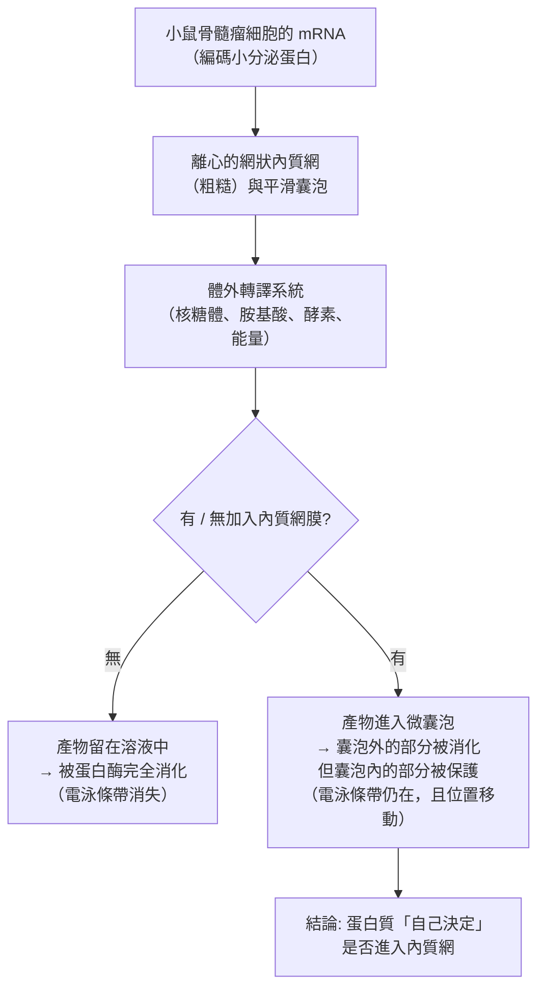
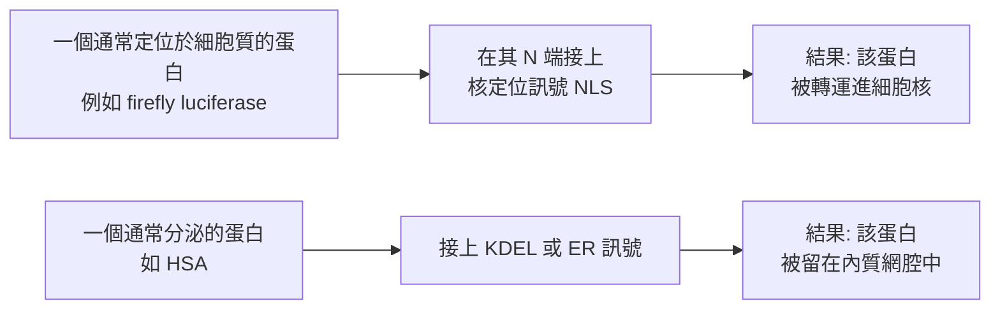

# 1999 · 蛋白質的內在訊號：布洛伯爾發現細胞如何「讀取」蛋白質的地址標籤

> **1999 諾貝爾生理學 or 醫學獎**（單獨獲獎）：古特·布洛伯爾（Günter Blobel，德國／美國）— 表彰「發現蛋白質具有內在訊號，控制其在細胞內的運輸和定位」（"for his discovery that proteins have intrinsic signals that govern their transport and localization in the cells"）。

## 懸案（案情提要）

1970 年代的細胞生物學有一個被忽略的日常問題：

1. 細胞製造了**數千種不同的蛋白質**——它們每一種都有特定的功能與目的地；
2. 蛋白質在細胞質裡被核糖體合成（見 [1974-細胞結構與功能組織](1974-細胞結構與功能組織.md)）；
3. 但它們必須**送到對的地方**——核內的蛋白質要留在核內；粒線體的蛋白質要進入粒線體的基質；分泌蛋白要進入內質網並分泌到細胞外；膜蛋白要插進膜裡；
4. **問題是：蛋白質本身不帶「地址」嗎？還是細胞用別的方式標記它們？**

布洛伯爾的答案是：**蛋白質本身帶著「地址標籤」——內在訊號序列（intrinsic signals）**。

## 前因

| 年份 | 事件 |
| --- | --- |
| 1971 | **Günter Blobel 與 David Sabatini** 提出**「信號假說（signal hypothesis）」**：分泌蛋白的 N 端帶有一段疏水性訊號序列，指導它被轉譯進內質網（見 [1974-細胞結構與功能組織](1974-細胞結構與功能組織.md)）。 |
| 1970s | **Milstein 與 Blobel 的實驗**：他們在小鼠骨髓瘤細胞的 mRNA 與分離的內質網膜進行**體外轉譯**，發現：**加上內質網膜後，產物比不加時小**——因為它被轉譯進了微囊泡。 |
| 1972 | **David Sabatini 與 Günter Blobel** 在電子顯微鏡下直接**看見**了「**轉譯中的核糖體附著於內質網膜**」的圖像——**信號假說的第一個視覺證據**。 |
| 1975 | **Blobel 與 Dobberstein** 以**兩種水溶性蛋白（小分泌蛋白與核內蛋白）**為材料，比較它們在有／無內質網膜的體外轉譯中的產物大小：**小分泌蛋白**加膜後產物被轉譯進微囊泡而抵抗蛋白酶消化；**核內蛋白**加膜後產物不變，仍留在溶液中被消化。 |
| 1975 | **這是信號假說的决定性實驗**：**「是否進入內質網」是由蛋白質自身決定的，而非由 mRNA 或核糖體決定**。 |
| 1980s | **信號序列被逐一鑑定**：核內蛋白的 **NLS（核定位訊號）**、粒線體蛋白的**轉運肽**、內質網的 **KDEL**（留在腔內的回收訊號）等陸續被發現。 |
| 1986–1989 | **Blobel 的實驗室以「信號序列置換」實驗證明了因果性**：把一個蛋白的訊號序列**移植到另一個蛋白上**，被移植的蛋白就會被送到新的目的地——**「地址標籤」是模組化的、可移植的**。 |
| 1999 | 布洛伯爾獲諾貝爾生理學 or 醫學獎（**他於 1989 年已獲得過 Louis-Jeantet Prize**）。 |
| 1990s–2020s | **訊號辨識受體（SRP）**、**輸入蛋白（importin）**、**核孔複合體**的結構與機制被完全釐清；**信號假說成為細胞生物學的教科書章節**；**蛋白質轉運的缺陷造成疾病**（例如 I-cell 病與 Hermansky–Pudlak 綜合症）。 |

## 調查

### 第一幕：Milstein–Blobel 實驗——「產物為什麼變小了？」

1970 年代初期的一個觀察極為詭異：在**無細胞系統**中進行蛋白質合成時，某些蛋白（尤其是**分泌蛋白**）的產物**比預期小**——因為它被**轉譯進了內質網衍生的小囊泡**，而囊泡外的部分被蛋白酶消化掉了。

**Milstein 與 Blobel 的決定性實驗設計**：

**這個實驗的精妙之處**：它把「轉譯是否在膜上進行」與「蛋白質的命運」分開來看——**同一份 mRNA、同一套轉譯系統，只因為加了膜，產物就不同**。

**1975 年的對照實驗（決定性）**：布洛伯爾與 **Bernhard Dobberstein** 選用了兩種蛋白：**小的分泌蛋白**與**大的核內蛋白**：

| 蛋白 | 加內質網膜 | 不加內質網膜 | 結論 |
| --- | --- | --- | --- |
| **分泌蛋白** | 進入微囊泡，受保護 | 在溶液中，被消化 | **有訊號 → 進入內質網** |
| **核內蛋白** | 留在溶液中，被消化 | 在溶液中，被消化 | **無訊號 → 不進入內質網** |

**這排除了「所有蛋白都會進入內質網」的可能**，證明**是蛋白質本身的性質決定了它是否被轉運**。

### 第二幕：「地址標籤」的證據——訊號序列的置換實驗

布洛伯爾的實驗室在 1980 年代做了一個極為乾淨的**因果實驗**：

**這是「地址標籤」概念的完成實驗**：**把訊號序列當作可以自由移植的「模組」來使用**——**這正是 20 世紀末「蛋白質工程」與「治療性融合蛋白」產業的技術基礎**。

### 第三幕：內在訊號的「種類學」

到 1990 年代末，已被鑑定的內在訊號形成了一張清單：

| 目的地 | 訊號序列 | 辨識受體 | 運輸機制 |
| --- | --- | --- | --- |
| **內質網腔** | N 端疏水性**訊號肽**（15–30 個胺基酸） | **SRP（訊號辨識顆粒）** + SRP 受體 | 共轉譯（cotranslational）轉位 |
| **內質網膜** | 內部訊號錨定序列（anchor sequence） | SRP | 共轉譯 |
| **內質網腔（回收）** | **KDEL**（C 端） | KDEL 受體（ERGIC） | **逆向運輸（retrograde）** |
| **細胞核** | **NLS**（SV40 病毒型：Pro-Lys-Lys-Lys-Arg-Lys；核蛋白型） | **importin-α/β** | 穿過**核孔複合體** |
| **細胞核（輸出）** | **NES** | exportin | 穿過核孔 |
| **粒線體基質** | **轉運肽**（富含 Arg/Leu/Ser/Thr，無酸性殘基） | TOM/TIM 複合體 | 穿過 TOM 與 TIM |
| **葉綠體** | 轉運肽（類粒線體） | TOC/TIC | 穿過 Tic/Toc |
| **過氧化體** | **PTS1**（C 端 SKL） | Pex5/Pex7 | 輸入後可「插入」膜中 |
| **溶酶體** | **甘露糖-6-磷酸（M6P）** | M6P 受體 | 經 trans-Golgi 分選 |
| **細胞膜** | **脂錨定序列**（C 端半胱氨酸 + 兩個脂肪酸） | 無（由合成時直接插入） | 共轉譯插入 |

**最精巧的一項是溶酶體的 M6P**：**這是蛋白質上唯一一個「化學修飾型的地址標籤」**——蛋白質在內質網腔的 N 寡糖上被**甘露糖-6-磷酸轉移酶（GlcNAc-1-phosphotransferase）**加上磷酸標記，之後在反式高基氏體網絡被 M6P 受體辨識並分選進溶酶體。

**而這個標記的「缺失」正是一種遺傳病**：**I-cell 病（黏脂贮積症 II 型）**——患者缺少轉運蛋白，導致 M6P 標記的酵素**被分泌到細胞外**而不是送進溶酶體，結果**溶酶體內堆積大量未降解的底物**。**這是一種「地址錯投」造成的疾病**，是本案的完美臨床印證。

### 第四幕：理論——「蛋白質的資訊不只在序列裡，也在構形與修飾裡」

布洛伯爾的貢獻在於**擴大了「遺傳資訊」的定義**：

$$\text{蛋白質的命運} = f(\text{一級序列中的訊號}, \text{構形暴露的訊號}, \text{轉譯後的化學修飾})$$

**三種「地址」的表現形式**：

1. **序列內的訊號**（NLS、訊號肽、KDEL）；
2. **構形隱藏與暴露**（某些訊號只在未折疊或特定構形時可被辨識——例如蛋白的 N 端若先被另一個蛋白的訊號占據，就「排他」地阻斷了自己的 NLS）；
3. **轉譯後修飾**（M6P 糖基化、磷酸化、乙醯化、泛素化）。

**這三種形式的並存，解釋了為何細胞能進行如此精細的「分選」**——**分選的資訊是分層的、分時的、可被覆寫的**。

## 理論裁決

1. **分選的動力學**：蛋白質進入內質網的「共轉譯」過程可寫為：

   $$\frac{d[\mathrm{SRP}\cdot\mathrm{RNC}]}{dt} = k_1 [\mathrm{SRP}][\mathrm{RNC}] - k_2 [\mathrm{SRP}\cdot\mathrm{RNC}]$$

   其中「 $k_2$ 是被 SRP 受體「拉」到膜上的速率」——**翻譯的速率與轉運的速率被耦合**，這解釋了為什麼內質網轉位幾乎不需要額外能量。

2. **KDEL 的「回收」邏輯**：內質網腔的蛋白質若帶有 KDEL，會被 KDEL 受體在高基氏體辨識並**送回內質網**。這是一個**「地址—郵戳」系統**：

   $$\text{ER} \xrightarrow{\text{高基氏體}} \text{Golgi} \xrightarrow{\text{KDEL 受體辨識}} \text{ER（循環）}$$

   **這解釋了為什麼許多分泌蛋白在細胞內有多個副本**——它們是被「循環」的。

3. **M6P 分選的化學邏輯**：地址標籤不是「序列」而是「修飾」，這在演化上極為精妙——**它讓同一個基因產生的蛋白可以被送往不同位置**（因為修飾發生在轉譯後、且由酵素決定）。

4. **分選的資訊學意義**：蛋白質的「目的地」資訊是**分散的、可組合的**，這與 DNA 序列資訊的「線性、集中」形成對比——**這是分子生物學中「分散式調控」的第一個完整模型**，並預告了今日 **「蛋白質組的分工與特化」**的研究方向。

## 追查支線（未結之謎）

- **布洛伯爾的科學生涯**：他在 Rockefeller 大學工作 30 餘年，1990 年成為**洛克菲勒大學的科學副校長**；他在 2000 年因在派對上摔傷導致腦部感染而去世（69 歲）；
- **1999 年諾貝爾委員會的措辭**：委員會特別指出「蛋白質的內在訊號」這個概念「**在醫學上的應用前景」**——這是對本案產業潛力的直接背書；
- **信號假說的產業化**：**重組胰島素**（1982 年上市的第一个人工重組治療蛋白，由 Genentech 與 Lilly 合作開發）是信號假說的第一次產業實踐；今日的**抗體藥物融合蛋白（ADC、bispecific）**、**蛋白質治療劑**全部以此為技術基礎；
- **地址標籤與基因治療**：**2020 年代的 mRNA 疫苗**之所以能在肌肉細胞中表達抗原，是利用了「5' UTR 的IRES或帽依賴翻譯」的機制——這在概念上是「給 mRNA 加一個翻譯地址」；
- **「蛋白質是機器」與人工設計**：布洛伯爾的訊號概念，啟發了**人工設計蛋白質模組**的研究（今日的 **「訊號肽替換工程」**用於把抗體導向特定細胞類型，如 **antibody–drug conjugate 的抗體部分可被改裝成帶有特定信號肽以改變分佈**）。

## 證物與數據（偵查卷宗摘錄）

| 證物 | 數值／內容 | 偵查意義 |
| --- | --- | --- |
| Milstein–Blobel 實驗 | 加膜後產物被「保護」 | 轉譯進內質網的證據 |
| 1972 年電鏡圖 | 核糖體附著於 RER 膜 | 信號假說的視覺證據 |
| 分泌蛋白 vs 核內蛋白 | 前者入膜、後者不入 | **蛋白質自身決定命運** |
| 訊號序列置換 | 把 NLS 接到另一蛋白上 | **地址標籤的可移植性** |
| NLS | 富含 Lys/Arg 的短序列 | 核定位訊號 |
| 訊號肽 | 15–30 個胺基酸的疏水序列 | ER 轉位 |
| KDEL | C 端四胺基酸 | ER 腔的回收訊號 |
| 轉運肽 | 無酸性殘基、富含 Arg/Leu | 粒線體定位 |
| PTS1 | C 端 SKL | 過氧化體定位 |
| **M6P** | N 寡糖上的甘露糖-6-磷酸 | **修飾型地址標籤** |
| I-cell 病 | M6P 標記的酵素被分泌到細胞外 | 「地址錯投」的疾病 |
| SRP 受體 | 核糖體與膜的接合點 | 共轉譯轉位的執行者 |

## 後果

| 領域 | 影響 |
| --- | --- |
| 細胞生物學 | 蛋白質分選成為核心概念；信號序列成為通用教材。 |
| 生物技術 | 重組治療蛋白、抗體藥物、mRNA 疫苗的分送與表達策略。 |
| 醫學 | I-cell 病等「分選缺陷病」的診斷。 |
| 蛋白質工程 | 以「模組化地址標籤」設計蛋白質功能。 |
| 演化生物學 | 「分散式調控」的典範。 |
| 其他諾獎 | 與 [1974-細胞結構與功能組織](1974-細胞結構與功能組織.md)（信號假說的提出）、[2012-iPS 細胞](2012-iPS細胞.md)（命運的重programming）同為本案主線，並連到 [2023-mRNA 疫苗](2023-mRNA疫苗.md)。 |

## 關聯

- [1974-細胞結構與功能組織](1974-細胞結構與功能組織.md) — 帕拉德的路徑與信號假說的提出。
- [1990-器官與骨髓移植](1990-器官與骨髓移植.md) — 細胞移植的技術前提。
- [2012-iPS 細胞](2012-iPS細胞.md) — 細胞命運可被重programming。
- [2023-mRNA 疫苗](2023-mRNA疫苗.md) — 給 mRNA 加「地址」的當代實踐。
- [1978-限制性內切酶](1978-限制性內切酶.md) — 分子工具箱的另一件。
