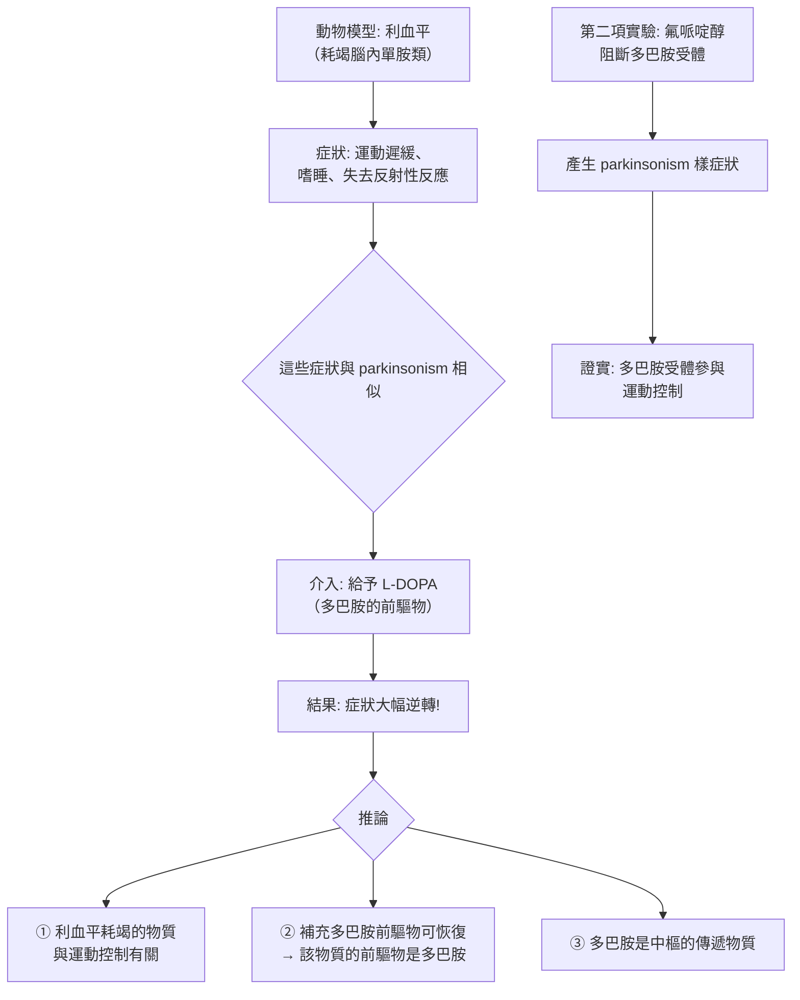
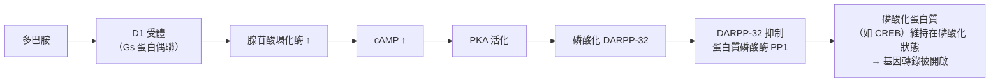
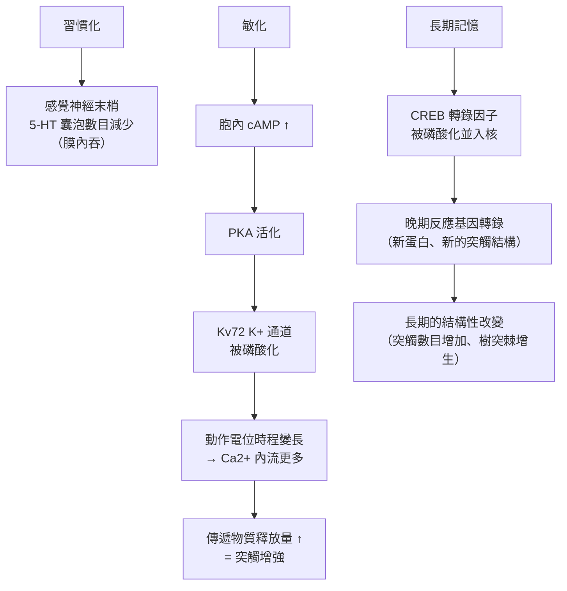

# 2000 · 神經系統中的訊號傳導：卡爾松、格林加德與坎德爾把「學習的分子機制」說清楚

> **2000 諾貝爾生理學 or 醫學獎**（共享三人）：阿維德·卡爾松（Arvid Carlsson，瑞典）— 表彰「發現神經系統中的訊號傳導」；保羅·格林加德（Paul Greengard，美國）與艾瑞克·坎德爾（Eric Kandel，美國）— 同上。

## 懸案（案情提要）

1990 年代的腦科學有一個核心謎團：

1. 腦由約 1000 億個神經元組成，每個神經元有數千個突觸——**如此複雜的系統，如何能產生「學習」與「記憶」這種有序的行為？**
2. **藥理學的線索**：多種精神科藥物（抗精神病藥、抗憂鬱藥、興奮劑）都作用於**突觸的化學傳遞**——但它們「改變了什麼」？
3. **一個被忽略的問題**：既然神經傳遞物質是「分子」，那麼**分子如何影響神經元的「狀態」？** 它們改了什麼，才使下一個神經元的行為不同？
4. 最後：**學習如何在分子層次被「存下來」？**——一個可持續數月的記憶，必然有某種長壽命的化學改變。

三位得主的分工極為清晰：**卡爾松**找到了**多巴胺作為獨立神經傳遞物質**並建立其臨床意義；**格林加德**發現**多巴胺與其他神經傳遞物質透過「第二信使」改變神經元狀態**；**坎德爾**把**記憶的存儲定位在突觸的可塑性上**。

## 前因

| 年份 | 事件 |
| --- | --- |
| 1950s | **von Euler（烏爾夫·馮·奧伊勒）**發現**多巴胺（dopamine）**是腎上腺髓質與中樞的活性物質（見 [1970-神經遞質](1970-神經遞質.md)）；**Carlsson** 在 1950 年代末用**氟哌啶醇（haloperidol）阻斷多巴胺**的實驗，證明多巴胺是**中樞神經系統的獨立傳遞物質**。 |
| 1958 | Carlsson 以**利血平（reserpine）**耗竭腦內多巴胺，觀察到動物運動遲緩、鎮靜——**第一個明確的「多巴胺不足」模型**；補充 L-DOPA 後症狀逆轉。 |
| 1960s | Carlsson 以**腦微透析與螢光組織化學**證明多巴胺神經元主要位於**中腦黑質**，投射至**紋狀體（nigrostriatal pathway）**。 |
| 1960s | **Paul Greengard** 在 Vanderbilt 研究**環腺苷酸（cAMP）**（見 [1971-第二信使](1971-第二信使.md)）作為神經元內訊號的作用機制。他發現**D1 型多巴胺受體**促進 cAMP，而 cAMP 經 **PKA** 磷酸化**DARPP-32** 蛋白——**這是第一個完整的「神經傳遞物質 → 第二信使 → 蛋白質磷酸化 → 功能改變」的神經元內鏈條**。 |
| 1960s–1970s | **Eric Kandel** 在紐約的 Woods Hole 與 Columbia 以**海兔（Aplysia）的**巨大神經元（每個直徑可達 1 mm）研究**突觸的敏感化（sensitization）與習慣化（habituation）**。 |
| 1971 | **Kandel 的「習慣化」的分子機制**：他證明**反覆的弱刺激使神經末梢的傳遞物質（5-HT）囊泡數目減少**——**突觸效能的下降**；而**強化的成對刺激（sensitization）則使傳遞物質的釋放量增加**。 |
| 1970s | **Kv72（ $\mathrm{K}^{+}$ 通道）與 CREB**：Kandel 的實驗室發現**感覺刺激會啟動特定基因的轉錄**（**cAMP response element-binding protein, CREB**），使晚期反應基因（late-response genes）表現——**這是記憶的長期鞏固的分子機制**。 |
| 1980s–1990s | **短程記憶（長期增強 LTP）**在**海馬迴的 Schaffer 側支路**被研究（**Bliss 與 Lømo，1983**）；**Morris 的水 maze 實驗**證明海馬對空間學習必要。 |
| 1990s | **Eric Kandel 的《In Search of Memory》（2006）**出版，把他的一生寫成一部科學自傳。 |
| 2000 | 三人共享諾貝爾生理學 or 醫學獎。 |

## 調查

### 第一幕：卡爾松的「藥理學偵探」——多巴胺是腦內的獨立傳遞物質

卡爾松的偵查起點是一個藥理學的謎：

1. 已知**抗精神病藥（phenothiazines、butyrophenones）**會引起**錐體外症狀（parkinsonism）**——肌肉僵硬、震顫、運動減少；
2. 當時的解釋是「它們阻斷了**乙醯膽鹼**受體」（因為 parkinsonism 也能用阿托品誘發）；
3. **但抗精神病藥的治療作用**（控制精神病）**並不**與抗膽鹼作用相關——**這兩件事被混為一談了**。

**卡爾松的關鍵實驗（1957–1958）**：

**這套「藥理工具 → 神經化學物質 → 臨床症狀」的推理，是 20 世紀神經藥理學的典範**。卡爾森的貢獻不只於發現多巴胺，更在於**建立了「用已知藥物的副作用追查神經傳遞物質」的方法論**——這套方法在日後被廣泛應用（見 [1957-抗組織胺藥物](1957-抗組織胺藥物.md)）。

**臨床意義的爆炸**：1967 年，卡爾森證明 **L-DOPA 能有效治療帕金森氏症**——**這是第一次有藥物能治療一種神經退化性疾病**，改變了帕金森病的預後（並在 1990 年代的「多巴胺受體激动劑與神經移植」時代進一步延伸）。

**多巴胺通路的解剖**：卡爾松以**螢光組織化學（fluorescence histochemistry）**顯示多巴胺神經元的分布，並確立**四大多巴胺通路**：

| 通路 | 起點 → 終點 | 功能 | 臨床 |
| --- | --- | --- | --- |
| **黑質-紋狀體（nigrostriatal）** | 中腦黑質 → 紋狀體 | 運動控制 | **帕金森氏症**（退化） |
| **中腦-皮質（mesocortical）** | 腹側被蓋區 → 前額葉皮質 | 認知、情緒 | **精神分裂症**（過多） |
| **邊緣系統（mesolimbic）** | 腹側被蓋區 → 伏隔核 | 動機、獎賞 | 成癮、精神病 |
| **漏斗-垂體（tuberoinfundibular）** | 下視丘 → 腦垂腺 | 抑制催乳素 | **抗精神病藥的高催乳素副作用** |

**這張表是今日精神科藥理學的骨架**——**抗精神病藥的「錨定」與「阻斷」的差異**，正是理解**錐體外症狀**與**高催乳素血症**的關鍵。

### 第二幕：格林加德的「神經元內的第二信使」

格林加德的問題極為精準：**神經傳遞物質作用於「樹突上的受體」，但樹突的膜與細胞體的膜是連通的**——那麼，**一個在樹突上產生的訊號，如何改變細胞體裡的基因表現？**

**格林加德的答案：第二信使 + 蛋白質磷酸化 + 蛋白質磷酸酶抑制蛋白（DARPP-32）**。

**DARPP-32 的角色是關鍵**：它是一個「**分子開關的開關**」——

$$\text{DARPP-32 磷酸化} \Rightarrow \text{PP1 被抑制} \Rightarrow \text{其他蛋白的磷酸化被維持} \Rightarrow \text{訊號被放大並持續}$$

**格林加德的三項貢獻**：

1. **證明 cAMP 在神經元內是「第二信使」**（不只是肝細胞與脂肪細胞）；
2. **發現 DARPP-32**，建立「**蛋白質磷酸酶抑制**」作為訊號調節的新層級；
3. **建立了「多巴胺—cAMP—基因表現」的完整鏈條**——這解釋了**為何神經傳遞物質能改變長期的神經元性質（塑形）**，而不只是引發毫秒級的電反應。

**格林加德的科學風格**：他堅持用「**生化的純粹性**」研究神經科學——**在神經元中直接測量 cAMP 的變化**——這在當時被許多人視為「太reductionist（過度還原論）」，但如今被視為神經科學方法論的範式。

### 第三幕：坎德爾的「海兔實驗」——學習的物理痕跡

坎德爾的偵查策略極為精妙：**他不是研究整個腦，而是研究一個神經元、一個突觸、一種行為**。

**海兔（Aplysia）的三種學習行為**：

| 行為 | 刺激模式 | 突觸機制 |
| --- | --- | --- |
| **習慣化（habituation）** | 反覆的無害弱刺激 | **感覺神經末梢的 5-HT 囊泡數目減少** → 傳遞物質釋放量下降 |
| **敏化（sensitization）** | 另一路徑的強刺激後接弱刺激 | **細胞內 cAMP ↑** → 突觸前末梢的 **$\mathrm{K}^{+}$ 通道（Kv72）磷酸化** → 動作電位時程變長 → **更多 $\mathrm{Ca}^{2}^{+}$ 流入** → 更多傳遞物質釋放 |
| **古典制約** | 配對刺激 | 感覺—運動突觸的增強 |

**坎德爾的三層證據鏈**：

1. **短期可塑性（毫秒–分鐘）**：既有蛋白的**磷酸化狀態改變**（Kv72）；
2. **中期可塑性（分鐘–小時）**：**基因轉錄**（CREB 啟動晚期反應基因）；
3. **長期可塑性（數天–數月）**：**突觸結構的改變**——**樹突棘的數目增加、突觸數目增加**。

**這三層的區分（數分鐘 vs 數小時 vs 數月）是記憶生物學的標準框架**，並與 Kandel 的實驗對應：

| 記憶階段 | 時間尺度 | 分子機制 | 實驗 |
| --- | --- | --- | --- |
| 短期記憶 | 秒–分 | 既有蛋白的磷酸化 | 海兔的敏化 |
| 中期記憶 | 分–小時 | 蛋白質合成 | 海兔的長期敏化 |
| 長期記憶 | 小時–月 | **基因轉錄 + 結構改變** | 海兔（持續刺激）與小鼠（水 maze） |

### 第四幕：從海兔到小鼠——哺乳動物的記憶

坎德爾與**Richard Morris** 的合作，把海兔的機制在哺乳動物中驗證：

1. **Morris 水 maze**：小鼠在迷宮中學會找隱藏的平台；**訓練後的動物在該位置的海馬細胞有顯著的放電增加**；
2. **海馬的必要性**：**損傷海馬**的小鼠無法形成空間記憶（但能學會簡單的**非空間**的任務如「被動迴避」）——**海馬是空間記憶的特定裝置**，這是 1950 年代 **Scoville 與 Milner 的 H.M. 病例**（見 [1953-檸檬酸循環](1953-檸檬酸循環.md) 同時代的臨床神經科學）在動物實驗中的確認；
3. **1990 年代的 fMRI 與功能性神經影像**（見 [1990-器官與骨髓移植](1990-器官與骨髓移植.md) 同時代的技術）在人類中確認海馬的參與。

**坎德爾的科學哲學**：**「記憶是由分子組成的」**——他的《In Search of Memory》把生命科學與回憶文學結合，是 20 世紀最動人的科學寫作之一。

## 理論裁決

1. **多巴胺受體的分型與功能**：卡爾松建立的藥理工具，直接導致了 **D1 與 D2 受體的分型**：

   $$\text{D1} \to G_s \to cAMP \uparrow \to \text{直接路徑} \qquad \text{D2} \to G_i \to cAMP \downarrow \to \text{間接路徑}$$

   **「直接路徑」與「間接路徑」**（via D2–[A2A] 腺苷受體與向下游神經元的多巴胺能傳遞）——**這套語言解釋了為什麼 D2 激动劑（普拉克索）與 D1/D2 拮抗劑（阿立哌唑）作用不同**。

2. **訊號的「時間結構」**：神經元內的訊號具有多個時間常數，它們共同決定了神經元對輸入的「計算」：

   | 成分 | 時間常數 | 功能 |
   | --- | --- | --- |
   | 受體與 G 蛋白 | 毫秒 | 快速開關 |
   | cAMP | 秒 | 中間整合 |
   | PKA 磷酸化 | 分鐘 | 持續狀態 |
   | DARPP-32 / PP1 | 分鐘–小時 | 「磷酸化維持」 |
   | 基因轉錄（CREB） | 小時–天 | 長期改變 |

   **這是多時間尺度的神經計算的物理基礎**。

3. **突觸可塑性的Hebbian 表述與坎德爾的量化**：海兔的敏化可以用一個簡單的「**共同活動**」規則表達：

   $$\Delta w \propto \underbrace{x_{\text{pre}}}_{\text{感覺輸入}} \times \underbrace{y_{\text{post}}}_{\text{突觸後放電}}$$

   這是 **Hebb 學習規則**（1949）的實驗實現——**「一起放電的細胞，連接會變強」**。

4. **記憶的「經濟學」**：把記憶的儲存看成一個資源分配的問題：

   $$\text{記憶容量} \sim \frac{\text{突觸數} \times \text{每突觸的可塑位元數}}{\text{編碼效率}}$$

   **短時記憶（容量 $7\pm 2$ 組塊）vs 長期記憶（巨大容量）的區分**，在神經科學中被解釋為「**不同的儲存格式**」（工作記憶 vs 長期記憶網絡）。

## 追查支線（未結之謎）

- **卡爾松的科學與社會影響**：他是**哥德堡大學的教授與副校長**，並在 1980–90 年代推動**哥德堡的「基因研究與細胞生物學中心」**；他長期擔任**瑞典皇家科學院**的職位，並推動**神經科學的基礎研究Funding**；
- **卡爾松與抗精神病藥的「歷史誤讀」**：他本人曾指出，抗精神病藥的**錐體外症狀**（與多巴胺 D2 阻斷有關）與其**治療作用**（與多巴胺轉訊遞的「過度」有關）**是兩件事**——**這是 1990–2000 年代精神分裂症「多巴胺假說」被修正的起點**（今日的版本是「多巴胺是『需要的信號』，多巴胺過量不是病因」）；
- **格林加德的「科學家單人實驗室」**：他在 Vanderbilt 的實驗室被形容為「**把神經科學做成化學的樣子**」——他堅持在神經元中直接測量 cAMP 與蛋白質磷酸化，這一「**reductionist 策略**」最終贏得了學界；
- **格林加德的個人歷史**：他是**移民第二代**（父母來自奧地利與愛爾蘭），是**同性戀者在 20 世紀美國科學界處境的代表人物**——1990 年代，他在《Science》發表的〈Equal for the homosexual community〉是重要的公共倡議文章；
- **坎德爾的科學傳記**：他的《In Search of Memory》（2006）獲得了多項文學獎；他的研究從海兔一路延伸到**阿茲海默病**（今日的抗 Aβ 抗體策略）；他與 **Carol Greider、Jack Szostak** 同為 **2009 年諾貝爾生理學 or 醫學獎**得主（端粒與端粒酶），**這是「同一個科學家學派」連續獲獎的罕見例子**；
- **2000 年之後的延伸**：**多巴胺的「獎賞路徑」與成癮**（VTA–NAc 迴路）、**D2 受體的部分激动劑**（aripiprazole）、**光遺傳學工具的引入**（2000 年代，使「哺乳動物神經迴路的因果操控」成為可能）——**這套工具直接建立在格林加德與坎德爾的方法論之上**。

## 證物與數據（偵查卷宗摘錄）

| 證物 | 數值／內容 | 偵查意義 |
| --- | --- | --- |
| 利血平模型 | 運動遲緩、嗜睡 | 「多巴胺耗竭」的動物模型 |
| L-DOPA 逆轉 | 症狀大幅改善 | **多巴胺參與運動控制**的證明 |
| 氟哌啶醇 | 產生 parkinsonism | D2 受體與運動控制的證明 |
| 1967 年 | L-DOPA 治療帕金森氏症 | 神經退化性疾病的第一種有效藥物 |
| 多巴胺的四大通路 | 黑質-紋狀體等 | 精神科的藥理骨架 |
| DARPP-32 | 抑制 PP1 | 「開關的開關」 |
| Kv72 磷酸化 | 動作電位時程變長 | 敏化的分子機制 |
| CREB | 轉錄因子入核 | 長期記憶的轉錄調控 |
| 海兔的 5-HT 囊泡 | 習慣化時減少 | 短期可塑性的機制 |
| 海馬損傷 | 空間記憶受損 | 海馬的特定功能 |
| Hebb 規則 | $\Delta w \propto x_{\text{pre}} y_{\text{post}}$ | 學習的基本形式 |
| 三層時間尺度 | 秒 / 小時 / 天 | 記憶的分層框架 |

## 後果

| 領域 | 影響 |
| --- | --- |
| 神經藥理學 | 多巴胺通路的確立，Parkinson's 與精神分裂症的藥理學基礎。 |
| 細胞神經科學 | 第二信使與蛋白質磷酸化在神經元中的角色。 |
| 學習與記憶 | 突觸可塑性作為記憶的物理基礎；CREB 與晚期反應基因。 |
| 臨床 | L-DOPA、抗精神病藥、抗憂鬱藥的現代應用；帕金森病的治療革命。 |
| 科學方法論 | 「從一個突觸、一種行為、一個分子」逐一破解的典範。 |
| 其他諾獎 | 與 [1970-神經遞質](1970-神經遞質.md)、[1971-第二信使](1971-第二信使.md)、[1992-蛋白質磷酸化](1992-蛋白質磷酸化.md)、[2009-端粒與端粒酶](2009-端粒與端粒酶.md) 構成神經科學主線。 |

## 關聯

- [1970-神經遞質](1970-神經遞質.md) — 神經傳遞物質的發現史，卡爾松的起點。
- [1971-第二信使](1971-第二信使.md) — 格林加德的神經元內 cAMP。
- [1992-蛋白質磷酸化](1992-蛋白質磷酸化.md) — DARPP-32 與 Kv72 的磷酸化開關。
- [2009-端粒與端粒酶](2009-端粒與端粒酶.md) — 坎德爾的學派在同一時代的另一座高峰。
- [1967-視覺過程](1967-視覺過程.md) — 感覺訊號處理的生理學背景。
