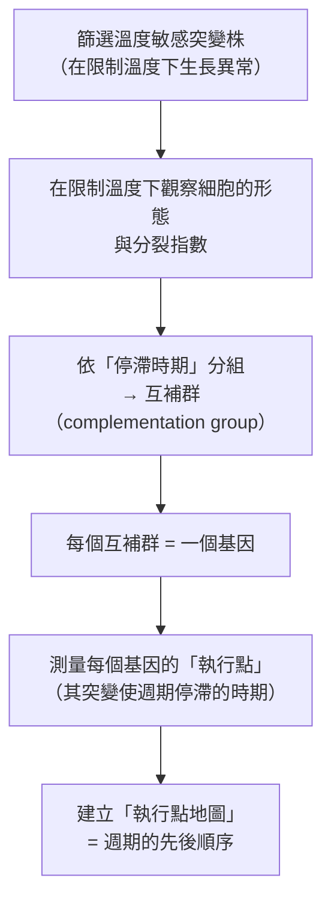
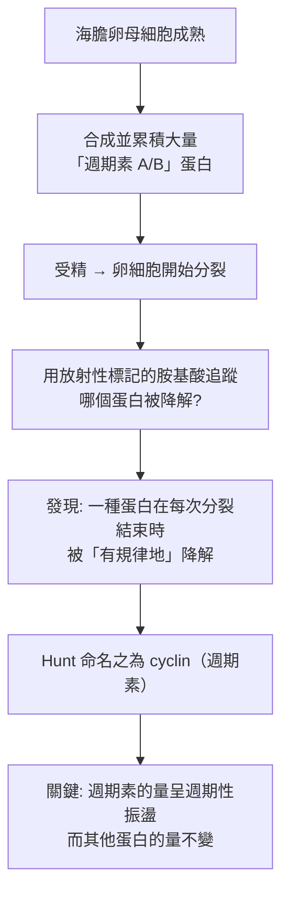
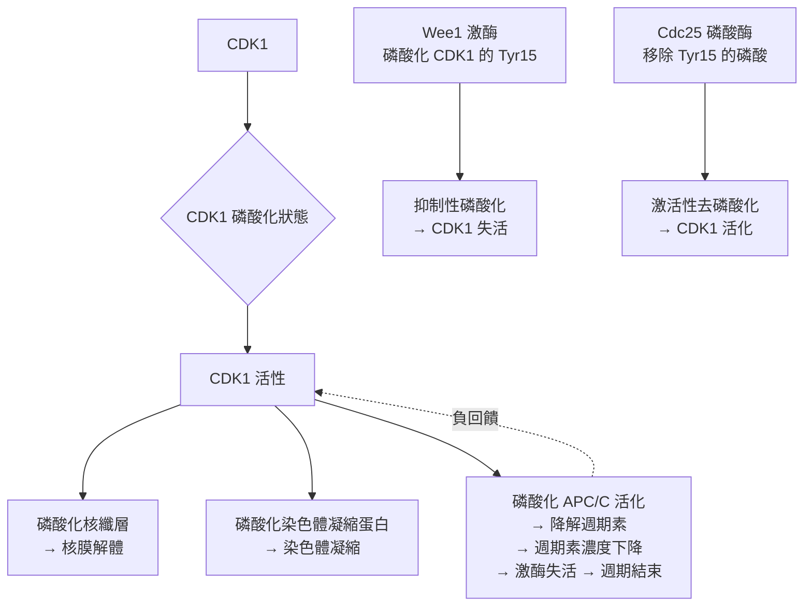

# 2001 · 細胞週期的關鍵調節因子：哈特威爾、亨特與納斯找到細胞的「行車記錄器」

> **2001 諾貝爾生理學 or 醫學獎**（共享三人）：利蘭·哈特威爾（Leland H. Hartwell，美國）— 表彰「發現細胞週期的關鍵調節因子」；蒂姆·亨特（Tim Hunt，英國）與保羅·納斯爵士（Sir Paul Nurse，英國）— 同上。

## 懸案（案情提要）

每當一個細胞要分裂，它必須先做出一個不可逆的決定：**現在分裂，還是等一等？**

這是一個極為重要的問題，因為：

1. **在高等生物中，細胞週期必須與 DNA 複製嚴格同步**——若在 DNA 複製完成前就分裂，子細胞會帶著不完整的基因組；
2. **檢查點（checkpoint）**的存在意味著：**若發現問題（例如 DNA 損傷），週期就必須暫停**，修復後才繼續；
3. 而當**檢查點失效**，細胞就會帶著受損的 DNA 分裂——**這正是癌症的定義性特徵之一**。

但在 2000 年之前，**「週期的檢查點」只是一個直覺性的概念**——沒有人知道它是由什麼分子執行的。

**三位得主的答案**：細胞週期由**一系列可週期性變化的蛋白質**控制——它們像「行車記錄器（odometer）」一樣，一格一格地前進，每一格都是一道關卡。

## 前因

| 年份 | 事件 |
| --- | --- |
| 1950s–60s | **Hartwell** 在 **Fred Hutchinson 癌症研究中心**以**酵母菌（Saccharomyces cerevisiae）**研究細胞週期；**Hartwell 的策略是「從溫度敏感突變株中找出在特定溫度下停滯的細胞」**——以溫度作為可逆的開關。 |
| 1970s | **Hartwell 建立了「cdc（cell division cycle）」突變株的系統分類**：他將數百株溫度敏感突變株，依其在限制溫度下停滯的時期，分為 **cdc1–cdc28** 等多個互補群（complementation groups）。 |
| 1980 | **Hartwell 與他的學生建立了「執行點（execution point）」概念**：每個 cdc 基因在週期中有一個特定的「執行時刻」——這直接預示了後來的「週期驅動機制」。 |
| 1982 | **Tim Hunt** 在 **Woods Hole 的海洋生物實驗室**，以**海膽（sea urchin）卵**研究細胞週期。他發現**一種蛋白質在卵母細胞成熟時大量累積，並在受精後以週期性的方式被降解與再合成**——**他命名它為「週期素（cyclin）」**。 |
| 1983 | **Hunt 的關鍵實驗**：他發現**兩種不同的週期素**（cyclin A 與 cyclin B）隨不同階段出現與消失——**「週期素」是一個「不斷被合成又被降解」的家族**。 |
| 1988 | **Paul Nurse** 發現**cdc2 基因**（酵母）編碼的蛋白質是一種**蛋白質激酶**，且它是**週期素依賴性**的——**「細胞週期激酶（cell cycle kinase）」的發現**。他把它命名為 **CDK1（cdc2）**。 |
| 1990s | **Hartwell 與納斯共同提出「檢查點（checkpoint）」的系統模型**：**G1/S、S/M（spindle assembly）** 等多個檢查點；**1996 年的「Rad53」與「Rad9」**等 DNA 損傷檢查點蛋白被發現。 |
| 2001 | 三人共享諾貝爾生理學 or 醫學獎。 |
| 2000s–2020s | **細胞週期成為抗癌藥物的最大靶點**：**CDK 抑制劑**（palbociclib、ribociclib、abemaciclib 用於乳癌）、**PLK1 抑制劑**、**Aurora 抑制劑**；**「檢查點失效」成為癌症的通用模型**（約 50% 的腫瘤含 TP53 突變）。 |

## 調查

### 第一幕：哈特威爾的「溫度開關」——把週期變成可暫停的實驗

哈特威爾的偵查策略極為精巧：**利用酵母的溫度敏感突變株，讓細胞週期「卡住」在特定時刻。**

**實驗設計**：

**哈特威爾的核心方法論**：「**互補試驗（complementation test）**」——兩個不同的溫度敏感突變株若**互補**（雙重突變的細胞恢復分裂），則它們是**不同基因**的突變。這是 1958 年貝德爾與塔特姆用於麵包黴的方法（見 [1958-一基因一酶](1958-一基因一酶.md)）在酵母中的應用，也是遺傳學「功能互補」的最經典應用之一。

**哈特威爾最重要的概念貢獻**：**檢查點（checkpoint）**。

他的論證極為漂亮：

1. 若一個細胞的 DNA 受損，它**不應該**分裂；
2. 那麼，**是誰**阻止它分裂？——必然是某個「監測 DNA 狀態」的機制；
3. 若是如此，**破壞這個機制應該讓帶有 DNA 損傷的細胞也進入分裂**——**這是可實驗的預測**。

**實驗（Rad52 突變體）**：在酵母中，若**同時**引入 DNA 損傷（用 MMS 處理）與**突變掉某個檢查點基因**（如 **rad52**），細胞會**帶著受損的 DNA 進入分裂**——**檢查點的存在被直接證明**。

### 第二幕：亨特的「週期素」——一個會消失的蛋白質

亨特的研究起點極為簡單：**他想找「在受精時被降解的蛋白質」**，因為他認為卵母細胞成熟時儲存的某種母源蛋白必須在受精後被清除。

**實驗設計**：

**這個發現的深遠意義**：**蛋白質的濃度可以像「時鐘」一樣週期性地升降**——**這是「週期由週期性變化的蛋白質控制」的第一個直接證據**。

亨特的循環實驗（**「兩海膽實驗」**）極為著名：他將**未受精的卵**（累積大量 cyclin）與**受精卵**（cyclin 被降解）**融合**，觀察到未受精卵的細胞核**開始進行核膜解體與染色體凝縮**——**這證明 cyclin 的存在就足以驅動細胞週期的事件**。

**這是「卵細胞提供 cyc 活性」的經典實驗**，也是細胞週期研究史上最漂亮的一次實驗之一。

### 第三幕：納斯的「cdc2 = CDK1」——把週期素接上磷酸化開關

納斯在 **Francis Crick Institute（MRC LMB）** 以**裂殖酵母（Schizosaccharomyces pombe）**研究——**這個菌的有絲分裂時序特別整齊**，非常適合做突變分析。

**他的核心發現**：

1. **cdc2 基因編碼一個蛋白質激酶**——**這是細胞週期的「主開關」**；
2. 這個激酶**只有在與週期素結合時才有活性**：

   $$\text{CDK1}_{\text{inactive}} + \text{cyclin} \rightleftharpoons \text{CDK1}\text{-}\text{cyclin}_{\text{active}}$$

3. 更關鍵的是：**週期素的「量」決定激酶的「活性」，而激酶的磷酸化狀態決定其活性**：

**這個「雙重正回饋—負回饋」架構，是 20 世紀生物學最精確的時序控制模型**：

- **正回饋**：CDK1 活化 → 磷酸化 Cdc25 → Cdc25 去抑制更多 CDK1 → **快速、不可逆的「點火」**（**switch-like**）；
- **負回饋**：CDK1 活化 → 降解週期素 → 活性下降 → **週期結束與重置**。

**不可逆性**是關鍵：細胞週期一旦點火，**必須走完**，否則染色體分配會出錯——**這就是為什麼「檢查點」必須存在**。

### 第四幕：三人的成果整合——週期的「階段圖」

三人的工作合成了一幅完整的圖景：

| 階段 | 週期素 | CDK | 事件 |
| --- | --- | --- | --- |
| **G1** | cyclin D、E | CDK4/6（pRb 磷酸化） | 細胞生長、**G1/S 檢查點** |
| **S** | cyclin E、A | CDK2 | **DNA 複製** |
| **G2** | cyclin A、B | CDK1 | 準備、**G2/M 檢查點** |
| **M** | cyclin B | CDK1 | 染色體凝縮、核分裂、**紡錘體組裝檢查點** |

**「檢查點」的現代分子基礎**：

| 檢查點 | 監控對象 | 關鍵蛋白 | 缺陷導致 |
| --- | --- | --- | --- |
| **G1/S** | DNA 損傷、細胞大小 | **p53 → p21 → 抑制 CDK** | **TP53 突變**（約 50% 的腫瘤） |
| **S 期** | DNA 複製進度 | **ATR/CHK1** | 複製壓力下的突變累積 |
| **G2/M** | DNA 完整性 | **ATM/CHK2** | 帶突變進入分裂 |
| **紡錘體組裝** | 染色體是否正確連接 | **MAD2、BUB1** | 染色體不分離 → **染色體非整倍體** |

**哈特威爾的「執行點」地圖，終於在分子層次被完全解讀**——這是「從概念到機制」的典範。

## 理論裁決

1. **週期的振盪方程**：週期素的合成與降解可用簡單模型表示：

   $$\frac{d[\mathrm{Cyc}]}{dt} = k_s - k_d[\mathrm{Cyc}]$$

   當 $k_d$ 在 M 期突然升高，週期素濃度呈**指數衰減**：

   $$[\mathrm{Cyc}](t) = [\mathrm{Cyc}]_0 e^{-k_d t}$$

   而 CDK 活性是週期素的**超線性函數**（因需兩個週期素才能完全活化），這造成「**switch-like**」的響應——**是「全或無」的分子根源**。

2. **「閾值化的酵素反應」**：細胞週期的不可逆性要求酵素活性對輸入呈**超線性（Hill 係數 $n > 1$ ）**：

   $$[\mathrm{CDK1}]_{\text{active}} \propto [\mathrm{Cyc}]^n, \qquad n \approx 2\text{–}4$$

   這解釋了為何細胞能「決定」而非「漸變」——**這是細胞週期控制的核心數學性質**。

3. **檢查點的「資訊檢查」邏輯**：檢查點可形式化為：

   $$\text{若 } \text{損傷}(t) > 0 \text{ 則 } \dot{x}_{\text{progress}} = 0, \quad \text{否則 } \dot{x}_{\text{progress}} = v$$

   這是一個**帶邏輯閘門的連續系統**——**哈特威爾正是第一個把「檢查點」作為獨立控制迴路提出並實驗驗證的人**。

4. **「週期性蛋白質」的通則**：週期素的概念被推廣——今日已知**數十種「週期性蛋白」**：cyclin B/C、Emi1（週期素降解的抑制者）、**Wee1**（週期素依賴性激酶的抑制者）等。**「用蛋白質的量來計時」是細胞最通用的時序策略**。

## 追查支線（未結之謎）

- **哈特威爾的「酵母外交官」**：他曾任 Fred Hutchinson 癌症研究中心的主席，並以「**科學與公共政策**」為終身事業；他也是 **「 Battling Battle Cancer」** 等倡議的推動者，並在 2000 年代推動**「複製性衰老（replicative senescence）」**與**幹細胞研究**的發展；
- **哈特威爾與諾貝爾委員會的「實驗室之辯」**：委員會曾問他「你的工作是找出 cdc 基因嗎？」，他回答「不，我的問題是**『細胞週期是如何被控制的？』**」——**他獲獎的成果是「檢查點」的概念框架，而不是任何單一基因**；
- **亨特的「兩海膽實驗」的年代背景**：他是在 1982 年於 Woods Hole 進行的，實驗極為簡單卻極為漂亮——**「週期素的量決定週期的進程」**這個結論，此后成為所有細胞週期研究的基礎；
- **納斯與「皇家學會」**：他於 1999–2009 年擔任英國皇家學會會長，是該職位歷史上第二位獲諾貝爾生理學 or 醫學獎的得主（第一位是 1895 年盧瑟福；他在任內大力推動**科學的公眾信任**與**公費科學Funding**）；
- **細胞週期的疾病**：除了癌症，**神經退行性疾病**（神經元的終止與再進入細胞週期）、**發育缺陷**（細胞週期的檢查點突變造成的多指/無指畸形）、**老化**（幹細胞的衰老）等，都與本案直接相關；2020 年代的 **CDK 抑制劑**已成為乳腺癌標準治療的一部分。

## 證物與數據（偵查卷宗摘錄）

| 證物 | 數值／內容 | 偵查意義 |
| --- | --- | --- |
| 溫度敏感突變株 | 數百株，限制溫度下停滯 | 可逆的「暫停開關」 |
| cdc 互補群 | cdc1–cdc28 等 | 功能互補的分類法 |
| 執行點地圖 | 每基因的停滯時期 | 週期的先後順序 |
| Rad52 雙突變 | DNA 損傷 + 檢查點失效 → 帶傷分裂 | **檢查點的直接證明** |
| Hunt 的兩海膽實驗 | 未受精卵 + 受精卵融合 → 核膜解體 | **週期素足以驅動週期** |
| 週期素的振盪 | 每個細胞週期降解並再合成 | 「週期性蛋白」的發現 |
| cdc2 = CDK1 | 蛋白質激酶 | 週期的主開關 |
| CDK1-週期素 | 需結合才有活性 | 開關的化學 |
| Wee1 / Cdc25 | 磷酸化 / 去磷酸化 | 雙重正回饋—負回饋 |
| 超線性激活 | Hill 係數 $n \approx 2\text{–}4$ | 「類開關」的數學 |
| 檢查點三層 | G1/S、S、G2/M、紡錘體 | 週期的安全閘門 |

## 後果

| 領域 | 影響 |
| --- | --- |
| 細胞生物學 | 細胞週期獲得完整的分子圖景（週期素＋CDK＋檢查點）。 |
| 癌症 | 「檢查點失效」成為癌症的通用模型；TP53 的地位確立。 |
| 藥理學 | CDK 抑制劑成為乳腺癌等的重要治療；週期性蛋白質的靶向策略。 |
| 發育生物學 | 細胞週期與細胞命運、終止、凋亡的關係。 |
| 老化研究 | 複製性衰老的機制（端粒—細胞週期—DNA 損傷檢查點）。 |
| 其他諾獎 | 與 [2002-程式性死亡](2002-程式性死亡.md)（細胞死亡）、[2009-端粒與端粒酶](2009-端粒與端粒酶.md)（複製的極限）構成細胞命運主線。 |

## 關聯

- [1958-一基因一酶](1958-一基因一酶.md) — 互補試驗與突變株分類的方法學母體。
- [2002-程式性死亡](2002-程式性死亡.md) — 線蟲的細胞死亡調控，同一套工具。
- [2009-端粒與端粒酶](2009-端粒與端粒酶.md) — 複製次數的計數器，與週期檢查點相接。
- [1986-生長因子](1986-生長因子.md) — 生長因子與細胞週期的交會。
- [2012-iPS 細胞](2012-iPS細胞.md) — 重編程與細胞週期的重置。
