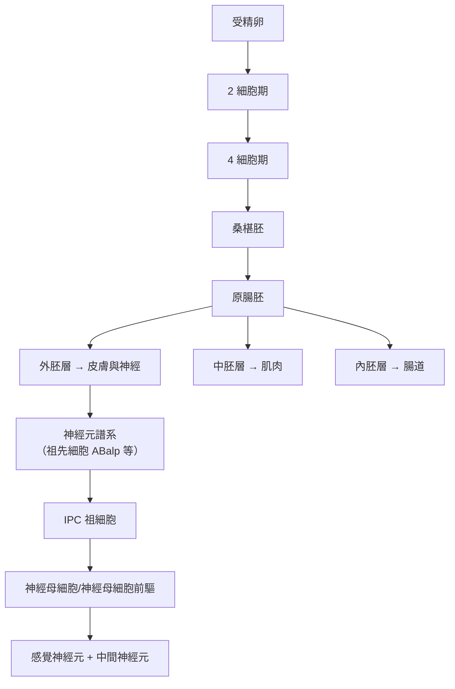

# 2002 · 器官發育與程式性死亡：布倫納、霍維茨與蘇爾斯頓用秀麗隱桿線蟲畫出細胞命運圖

> **2002 諾貝爾生理學 or 醫學獎**（共享三人）：雪梨·布倫納（Sydney Brenner，南非／英國）— 表彰「發現器官發育和細胞程式性死亡的遺傳調控機理」；H·羅伯特·霍維茨（H. Robert Horvitz，美國）與約翰·E·蘇爾斯頓爵士（Sir John E. Sulston，英國）— 同上。

## 懸案（案情提要）

發育生物學在 1990 年代有一個核心的「動物學謎題」：

1. 人的身體有約 **200 種細胞類型**——神經元、肌細胞、胰島素細胞等等——**它們全都來自同一個受精卵**；
2. 這意味著：**分化必然是基因表現的差異，而不是基因的差異**；
3. 但「什麼決定了命運」這個問題，**在哺乳動物中極難研究**——因為你不能把一個人類胚胎的某個細胞挖出來，看看它會變成什麼。

**秀麗隱桿線蟲（*Caenorhabditis elegans*）徹底改變了這一切**——因為它：**透明、只有約 959 個體細胞、每個細胞的命運都已被完整追蹤**。

**布倫納、霍維茨與蘇爾斯頓的答案**：命運由**細胞譜系（cell lineage）**決定，而其中**有一整套「程式性細胞死亡（programmed cell death, PCD）」的機器**——而這套機器，**與人類的疾病有直接的關聯**（癌症、神經退行性疾病、缺血傷害、免疫疾病）。

## 前因

| 年份 | 事件 |
| --- | --- |
| 1965–1970 | **Sydney Brenner** 在 Cambridge 的 MRC LMB 開始尋找「能以遺傳學方法研究發育的簡單生物」。 |
| 1974 | **Brenner 找到秀麗隱桿線蟲**：他原本想找的是能讓研究者「逐一追蹤每個細胞」的動物——線蟲的**透明身體與固定的細胞數（959 個體細胞，雄性 1031 個）**正合所需。 |
| 1976 | Brenner 發表《*C. elegans: A New Approach to the Study of Development*》——**線蟲成為發育生物學的標準模型**。 |
| 1970s–1980s | **Sulston 手工追蹤了線蟲胚胎的每一個細胞分裂**，畫出完整的**細胞譜系圖（cell lineage diagram）**——這是一項極為耗時的工作（耗時數年，觀察數千個胚胎），卻是**理解線蟲發育的基礎地圖**。 |
| 1980s | **Brenner 建立遺傳學工具**：以 **ethyl methanesulfonate（EMS）** 誘變 + **微晶體管「freeze-crack」法**（用玻璃毛細管在顯微鏡下壓碎線蟲以分離突變體）——**篩選突變體的能力大幅提升**。 |
| 1983–1988 | **Horvitz 以 EMS 誘變建立「不凋亡」突變體（nematode mutants that fail to die）**：他發現 **13 個互補群**的突變，使某些細胞**不執行正常的死亡**——**這是遺傳學第一次直接抓到「死亡機制」的基因**。 |
| 1988 | Horvitz 克隆了其中三個關鍵基因：**ced-9（細胞死亡基因）、ced-4、ced-3**；並證明 **ced-9** 的產物可**抑制細胞死亡**（即它是「存活基因」）。 |
| 1986 | Horvitz 發現 **ced-9 的產物與 **bcl-2**（B 細胞淋巴瘤基因）**同源**——**線蟲與人類的基因被直接連上了**。 |
| 1990s | **Sulston 與 Bob Waterston** 完成線蟲的**基因組定序（1998）**，成為**第一個完成全基因組定序的動物**；Sulston 也發起 **「人類基因組計畫」的公開參與**與 **「基因專利vs公共領域」**的倫理倡議。 |
| 1990s | **線蟲基因組定序**成為公共資源運動的試金石；**Sulston 與 Waterston** 完成定序（1998），Brenner 則在南非推動線蟲研究的方法論普及。 |
| 2002 | 三人共享諾貝爾生理學 or 醫學獎。 |
| 2004 | 線蟲的基因組定序完成（**WormBase** 資料庫成為發育生物學的核心資源）。 |
| 2010s–2020s | **細胞命運的「分子地圖」**延伸至其他模式生物；**CRISPR 篩選**使線蟲的功能基因組學進入大規模時代；**細胞死亡的免疫學面向**（**PANoptosis**，融合了凋亡、壞死與焦亡）。 |

## 調查

### 第一幕：布倫納的「選對生物」——線蟲的戰略價值

布倫納的選擇是 20 世紀生物學「選對模型」的最高範例：

| 特性 | 數值／內容 | 為什麼關鍵 |
| --- | --- | --- |
| **身體透明** | 可用相差顯微鏡直接觀察細胞 | **能「看見」細胞命運** |
| **細胞數固定** | 雌性 959 個體細胞；雄性 1031 個 | **每個個體的細胞命運完全相同** → 可重複 |
| **世代短** | 約 3 天 | 篩選突變體快 |
| **繁殖力強** | 每隻可產數百個後代 | 遺傳學分析可行 |
| **能冷凍保存** | 液氮冷凍 | 突變株的長期保存 |
| **透明** | 可做活體顯微 | 唯一的細胞標記需求 |

**更關鍵的是統計學上的理由**：布倫納認識到，若要研究**神經系統的發育**，就必須能**統計所有神經元**。線蟲雌性有固定的 **959 個細胞**，其中包括**固定的 302 個神經元**——**因此可以問「這個突變使神經元數從 302 變成多少？」，得到一個精確的數字答案**。這種「**計數生物學（counting biology）**」是布倫納帶來的新的科學典範。

### 第二幕：蘇爾斯頓的「譜系圖」——把發育變成一張地圖

蘇爾斯頓的工作，是一件極度耗時、需要耐心的「手工繪圖」：



**這張譜系圖的價值**：

1. **它是一個「參考座標系」**：任何突變若改變了細胞的命運，可以精確指出「在哪一步偏離了正常路徑」；
2. **它揭示了「細胞祖先（Cell Precursor）」的存在**：**命運不是隨機的，而是由祖先細胞的位置與其內在程式決定的**；
3. 它把「發育」從「過程」轉化為「**圖**」——**這是「發育生物學」變成「發育生物學 = 分子生物學 + 遺傳學 + 顯微解剖」的關鍵一步**。

**蘇爾斯頓還做了一件影響深遠的事**：他主張**線蟲的基因組資料應完全公開**，並因此在 1990 年代成為**人類基因組計畫**中「**公共領域 vs 基因專利**」辯論的重要發聲人。他的一句話成為該運動的口號：

> 「**基因屬於全人類，不該被任何人壟斷。**」

### 第三幕：霍維茨的「死亡突變株」——抓住殺手

霍維茨的偵查設計極為精巧：

**核心問題**：在線蟲的發育中，**有些細胞必須死亡**——例如在體細胞分裂時產生一個多餘的細胞，隨後必須被清除（這被稱為「**程序性死亡**」）。

**實驗設計**：

```mermaid
flowchart TD
    A[用 EMS 誘變線蟲] --> B[篩選「不凋亡」突變體<br>（某些應死的細胞存活了）]
    B --> C[互補試驗<br>（像哈特威爾在酵母中所做）<br>見 [2001-細胞週期](2001-細胞週期.md)]
    C --> D[得到 13 個互補群<br>（nematode cell death genes）]
    D --> E1[ced-9<br>（細胞死亡抑制基因）]
    D --> E2[ced-4]
    D --> E3[ced-3<br>（細胞死亡執行基因）]
    E1 --> F[證明 ced-9 的產物<br>可抑制細胞死亡]
    G[1986: 發現 ced-9 與<br>人類 bcl-2 同源] --> H[線蟲與人類<br>在分子層次直接接軌]
```

**關鍵實驗的邏輯**：

1. **「不凋亡」突變體的篩選**：在顯微鏡下掃描數千隻突變線蟲，尋找「本應死亡的細胞卻存活」的個體；
2. **互補試驗**：13 個互補群 → 13 個不同的基因參與細胞死亡；
3. **基因的定性**：
   - **ced-3** 與 **ced-4** 是「**執行者**」——它們的突變使細胞**不死亡**（即它們正常情況下**促進**死亡）；
   - **ced-9** 是「**抑制者**」——它的產物（CED-9 蛋白）**抑制細胞死亡**；
4. **最關鍵的實驗**：把 ced-9 基因轉入**哺乳動物細胞**，發現**它能抑制哺乳動物細胞的凋亡**——**跨物種的功能保守性被直接證明**；
5. **ced-9 = bcl-2**：**Bcl-2 基因**（B 細胞淋巴瘤基因 2）**與 ced-9 高度同源**——**這是「程式性細胞死亡是一個跨物種保守機制」的第一條證據**，也直接連到**淋巴瘤的發病機制**（Bcl-2 的過度表現 → 凋亡被抑制 → 淋巴瘤）。

**「死亡基因」的三種功能分類（今日的標準框架）**：

| 功能 | 線蟲基因 | 人類同源物 | 作用 |
| --- | --- | --- | --- |
| **執行者（effector）** | ced-3、ced-4 | **Caspase-9/3** | 切割細胞蛋白，執行死亡 |
| **抑制者（inhibitor）** | ced-9 | **Bcl-2、Bcl-xL** | 抑制 caspase |
| **啟動者（activator）** | — | **Bax、Bak** | 對抗 Bcl-2，促進 caspase |

**最著名的推論**（由 **H. Robert Horvitz** 與 **Sydney Brenner** 等人於 2002 年諾貝爾演講中提出，並被廣泛引用）：

> **「我們每個人體內的細胞，都是多細胞生物演化過程中『多細胞性』這個矛盾的產物——每一個細胞都帶著單細胞生存的程式，因此必須有一整套機制，在特定時候關掉那些『不應該活下去』的細胞。癌症，就是這套機制失效。」**

**這段話是 21 世紀癌症生物學最重要的綱領之一**——它把癌症從「增殖失控」重新定義為「**死亡程式失效**」。

### 第四幕：從線蟲到人類——疾病地圖

線蟲研究在 2000 年後直接轉化為人類疾病的理解：

| 線蟲發現 | 人類疾病 | 機制 |
| --- | --- | --- |
| **ced-9 ↔ bcl-2** | **淋巴瘤、白血病** | Bcl-2 過度表現 → 凋亡被抑制 |
| **ced-3/4 ↔ caspase** | 癌症、神經退行性疾病 | caspase 活性失調 |
| **細胞譜系圖** | **神經退行性疾病** | 特定神經元的死亡（ALS、亨頓舞蹈症） |
| **程序性死亡** | **缺血再灌流傷害** | 卒中後的神經元死亡 → 凋亡抑制劑的治療潛力 |
| **細胞數的固定性** | 發育缺陷 | 細胞數異常的疾病 |

## 理論裁決

1. **細胞命運的三種結局與概率**：同一個祖先細胞在不同的「位置」或「訊號」下，可以走向三種結局：

   $$\text{命運} = \begin{cases} \text{分化} & \text{概率 } p_1 \\ \text{分裂} & \text{概率 } p_2 \\ \text{凋亡} & \text{概率 } p_3 \end{cases}, \quad p_1+p_2+p_3=1$$

   霍維茨的遺傳學實驗，本質上就是**測量並調控這些概率**。

2. **凋亡的「級聯執行」**：caspase 級聯是一個**超線性的放大系統**：

   $$\text{起始 caspase} \xrightarrow{\text{裂解}} \text{執行 caspase} \xrightarrow{} \text{裂解數百種底物} \to \text{細胞死亡}$$

   **一旦啟動即不可逆**（與細胞週期的 CDK 開關類似——**這是「不可逆開關」的兩個經典範例**）。

3. **「多細胞性悖論」的數學**：多細胞生物的細胞必須抑制其「單細胞生存程式」（如凋亡），以避免癌化。這個矛盾可用一個簡單的演化模型表達：

   $$\text{多細胞收益} \propto N_{\text{cells}} \quad \text{vs} \quad \text{癌化風險} \propto P(\text{凋亡失效})$$

   **因此演化必須產生出「細胞之間協調執行死亡」的機制**——這正是 ced 與 Bcl-2 系統的角色。

4. **發育的「位置資訊」**：蘇爾斯頓的譜系圖顯示，命運取決於**祖先細胞的位置**（在胚胎的哪裡）與**內在程式**——**這是「位置＝命運」的經典證據**，與 [1935-胚胎組織者](1935-胚胎組織者.md)、[1995-胚胎發育基因](1995-胚胎發育基因.md) 遙相呼應。

## 追查支線（未結之謎）

- **布倫納的科學與教育事業**：他是 **MRC LMB** 的科學家，也是 **「分子生物學三巨頭」**之一（與 Crick、Sanger 齊名，Crick 與 Sanger 同獲 1962 與 1958 年的**化學獎**）；他於 1990 年代在**南非**創辦**Molecular Sciences Institute**，推動黑人群體的科學教育；他在 2000 年代推動 **「線蟲實驗室」模式**成為全球基礎研究的範本；
- **布倫納與「基因 vs 智慧」的辯論**：他在《*My Life in Science*》等書中主張「**我不需要 30,000 個基因來做研究**」——**這種「以單一模式生物窮盡遺傳學」的哲學**，是 20 末年生物學方法論的重要辯論；
- **蘇爾斯頓的公共立場**：他是**「人類基因組計畫」的重要倡議者**之一，在 1990 年代主張**基因組資訊應完全公開**，並加入了主張「基因不應被專利」的科學家陣營；
- **蘇爾斯頓的 honors**：他於 2001 年受封為爵士（Sir），並是 **Bioethics 的 chair（Institute for Science, Ethics and Innovation）**，是 2000 年代**生物倫理學**領域的重要公共人物；
- **線蟲研究的當代延伸**：**CRISPR 篩選**使線蟲的功能基因組學進入大規模時代（**WormBase** 收錄數萬筆表型）；**細胞譜系圖**擴展到其他模式生物（**神經元的「微連線圖（microwiring map）」**）；**PANoptosis**（融合凋亡、壞死、焦亡的細胞死亡形式）成為 2020 年代的熱門概念。

## 證物與數據（偵查卷宗摘錄）

| 證物 | 數值／內容 | 偵查意義 |
| --- | --- | --- |
| 線蟲的細胞數 | 雌性 959 個體細胞、302 個神經元 | 「計數生物學」的基礎 |
| 譜系圖 | 每個細胞的完整命運 | 發育的座標系 |
| EMS 誘變 | 高頻率誘變 | 篩選工具 |
| Freeze-crack 法 | 玻璃毛細管分離突變體 | 技術創新 |
| 「不凋亡」互補群 | 13 個 | 死亡基因的數目 |
| ced-3 / ced-4 | 死亡執行者 | 對應 caspase |
| **ced-9** | **死亡抑制者** | **對應 Bcl-2** |
| 跨物種實驗 | ced-9 抑制哺乳動物細胞凋亡 | 功能保守性 |
| 線蟲基因組（1998） | 第一個完成定序的動物 | 功能基因組學的起點 |
| 細胞命運概率 | $p_1 + p_2 + p_3 = 1$ | 命運決策的數學 |

## 後果

| 領域 | 影響 |
| --- | --- |
| 發育生物學 | 線蟲成為標準模型；譜系圖與「命運決定」的語言。 |
| 細胞生物學 | 程式性細胞死亡成為獨立學科；caspase 級聯。 |
| 癌症生物學 | 「癌症＝凋亡失效」的綱領；Bcl-2 家族與治療策略。 |
| 遺傳學 | 大規模突變篩選與互補試驗的範式。 |
| 生物倫理 | 基因組資料的公共領域運動。 |
| 其他諾獎 | 與 [2001-細胞週期](2001-細胞週期.md)（同一套工具）、[1958-一基因一酶](1958-一基因一酶.md)（互補試驗的方法學）、[2009-端粒與端粒酶](2009-端粒與端粒酶.md)（細胞壽命）構成細胞命運主線。 |

## 關聯

- [2001-細胞週期](2001-細胞週期.md) — 同一批科學家、同一套方法（酵母與線蟲互補試驗）。
- [1958-一基因一酶](1958-一基因一酶.md) — 互補試驗與「一基因一功能」的方法學祖師。
- [1935-胚胎組織者](1935-胚胎組織者.md) — 「位置決定命運」的古典版本。
- [1995-胚胎發育基因](1995-胚胎發育基因.md) — 果蠅的模式基因與線蟲的譜系圖互補。
- [2009-端粒與端粒酶](2009-端粒與端粒酶.md) — 細胞的壽命計時器。
