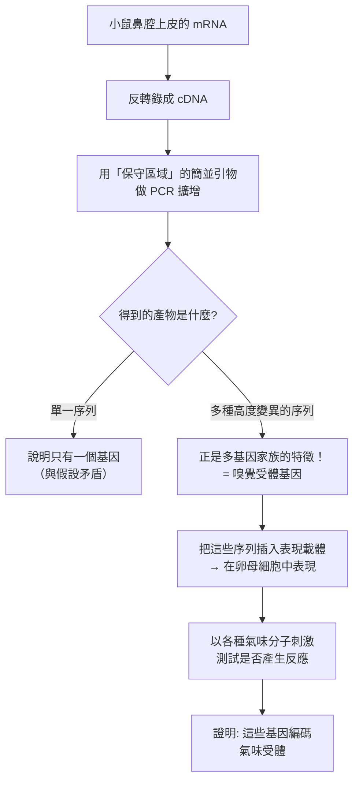
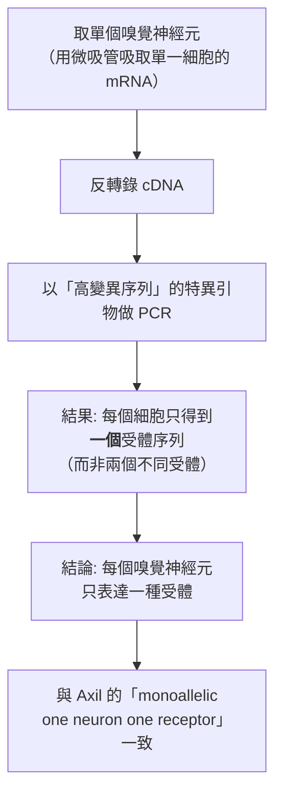
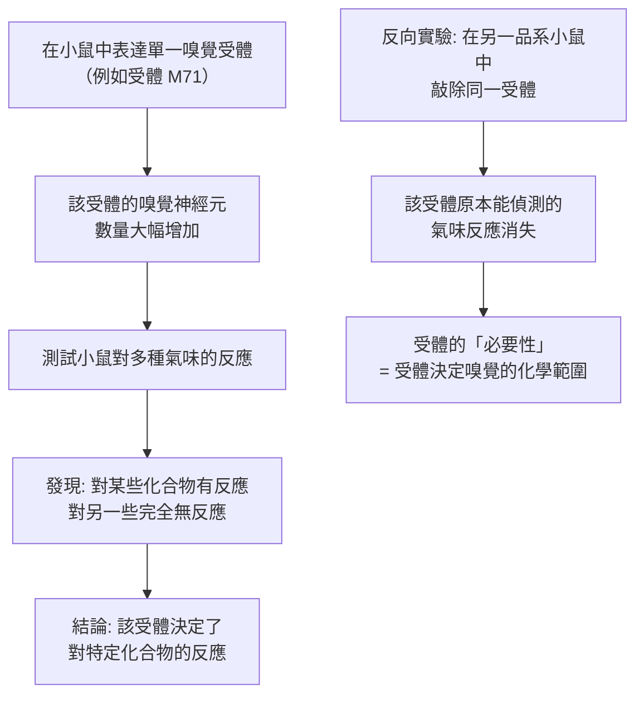

# 2004 · 嗅覺受體與嗅覺系統的組織：阿克塞爾與巴克找出「氣味的受體基因」

> **2004 諾貝爾生理學 or 醫學獎**（共享）：理查·阿克塞爾（Richard Axel，美國）— 表彰「發現嗅覺受體和嗅覺系統的組織方式」（"for their discoveries of odorant receptors and the organization of the olfactory system"）；琳達·B·巴克（Linda B. Buck，美國）— 同上。

## 懸案（案情提要）

感官科學在 2000 年代初有一個極不對稱的局面：

1. **視覺**：一個受體類型（視紫紅質）＋三原色理論＋清晰的訊號編碼，**分子的邏輯極為簡潔**；
2. **嗅覺**：已知人類能辨認**上萬種不同的氣味**——**若視覺只有 3 種受體，嗅覺需要多少種？**
3. 兩個極端的猜測：
   - 「**少量受體＋組合編碼（combinatorial coding）**」——像視覺與嗅覺都靠少量受體的不同組合？
   - 「**大量受體（每種氣味一個）**」——但人類的基因組只有約 20,000 個基因，總不可能有上萬個受體基因？
4. 核心謎題：**嗅覺受體的基因在哪裡？有幾個？它們如何編碼？**

**阿克塞爾與巴克的答案：至少有 1000 個嗅覺受體基因，而每個神經元只表達其中一個。**

## 前因

| 年份 | 事件 |
| --- | --- |
| 1826 | **Epicurus** 與後來的科學家已提出「嗅覺由「氣味原子（odorant molecules）」與受體結合」的觀念。 |
| 1875–1950 | 嗅覺的**心理物理學**研究進展迅速（如 Henning 的「嗅覺圓形圖」），但**分子層次停滯**——受體從未被分離，嗅覺被稱為「**最難破解的感官**」。 |
| 1900–1950 | 嗅覺的**心理物理學**研究進展迅速（**Henning** 的「嗅覺圓形圖」），但**分子層次停滯**——受體從未被分離。 |
| 1970s | 分子生物學的工具（**DNA 雜交、基因庫**）已成熟，但**不知道要找什麼基因**——這是典型的「**沒有探針的搜尋**」困境。 |
| 1973 | **Richard Axel** 在 Columbia 開始研究**小鼠的嗅覺**（他原本研究的是**小鼠的免疫學與神經發育**）；他轉向嗅覺的原因之一是**嗅覺受體的「未知性」**吸引了他。 |
| 1988–1991 | **Axel 的實驗室**建立了「**基因家族篩選法**」：他們假設嗅覺受體可能像**免疫球蛋白超家族**或**G 蛋白偶聯受體（GPCR）**那樣，屬於**多基因家族**，且其成員之間序列相似但已分化到**無法用低溫雜交探針交叉**的程度。 |
| 1991 | **Axel 與同事 Linda Buck（他的博士後研究員）** 建立了「**聚合酶連鎖反應（PCR）為基礎的簡並引物篩選**」策略：從小鼠鼻腔上皮中提取 mRNA → 反轉錄成 cDNA → 用**針對保守區域設計的簡並引物**做 PCR → 所得產物中有大量**「高度變異的序列」**——這就是**嗅覺受體基因**。 |
| 1991 | **Axel 與 Buck 在《Cell》發表《A novel multigene family of putative sensory receptors expressed in the rat olfactory epithelium》**——**嗅覺受體基因的存在被證實**。 |
| 1991–1994 | 兩人分別獨立地證明**「一個神經元只表達一個受體基因」**（**monoallelic expression** 與 **one receptor per neuron**），並解出**嗅覺受體與 G 蛋白偶聯**（**G_olf**）。 |
| 1994–1999 | **Axel 的實驗室**以基因敲除證明**受體的必要性**（敲除某嗅覺受體 → 動物對特定氣味的反應消失）；**Buck 的實驗室**以**轉殖小鼠**證明**受體的充分性**（把單一受體導入 → 賦予動物辨認新氣味的能力）。 |
| 2004 | 兩人共享諾貝爾生理學 or 醫學獎。 |
| 2000s–2020s | **嗅覺的「邏輯」被確立**：**「組合編碼」**——一個氣味分子活化一組受體，一個神經元群對特定組合反應，大腦據此解碼；**今日的嗅覺研究已進入「**嗅覺圖譜（odor map）**」的階段**。 |

## 調查

### 第一幕：阿克塞爾的策略轉向——「面對未知，只能用組合的方法」

阿克塞爾的偵查起點極為務實。他知道：

1. 若嗅覺受體是**單一基因**，就不會有「一個人能辨認上萬種氣味」的現象；
2. 若它是**像免疫球蛋白那樣的超家族**（見 [1984-單株抗體](1984-單株抗體.md)），成員之間序列相似，可用簡並引物找到；
3. 但更可能的可能是**GPCR 家族**（因為嗅覺是一種「化學感受」，且已知其他化學感受器——如味覺的甜/苦受體——都是 GPCR）。

**他的核心方法論突破是「用 PCR 取代雜交」**：

**為什麼「PCR + 簡並引物」是關鍵？** 因為傳統的**雜交（hybridization）**要求探針與目標有**高序列相似性**，而一個「已經分化」的受體家族，其成員之間的相似性可能低到無法雜交——**但 PCR 的簡併引物可以檢出「共有短motif、成員各異」的基因家族**。這是一個純粹的方法論突破：**從「找一個基因」到「找一族基因」**。

### 第二幕：巴克的獨立驗證——「一個神經元，一個受體」

**Buck 的貢獻**是在另一個實驗室（MIT）**獨立完成同一發現**，並且**在分子層次證明「一個神經元一個受體」的原則**。

**她的實驗設計**：

**「單細胞 mRNA」的技術細節是關鍵**：Buck 用顯微操作吸取**單一嗅覺神經元的細胞質**（含 mRNA），做反轉錄，再用針對**該神經元所表達的特定高變異序列**的引物做 PCR——**若一個細胞有多個受體，就會得到多個序列**。**結果只有一個**。

**這個「one neuron–one receptor」原則，是 2004 年諾獎的核心發現之一**，它解釋了：

1. **為什麼氣味能被辨識**：每個神經元只偵測少數氣味分子，但**整個Bulb（嗅球）有數百萬個神經元，各自有不同的受體**——**氣味的「神經表征」是分散式的**；
2. **為什麼嗅覺不像視覺那樣「簡潔」**：視覺的三原色是**一個受體家族**；嗅覺是**一千個受體**，每個神經元只挑一個——**組合編碼（combinatorial coding）**。

### 第三幕：受體的分子特性與「超敏的 GPCR」

**Axel 與 Buck 發現的嗅覺受體（OR）具有一系列獨特特徵**：

| 特徵 | 說明 | 意義 |
| --- | --- | --- |
| **七次穿膜** | 典型 GPCR 結構 | 嗅覺受體屬 GPCR 巨大家族 |
| **與 G_olf 偶聯** | 活化腺苷酸環化酶 III | 訊號通路的特化（見 [1971-第二信使](1971-第二信使.md)） |
| **基因數極多** | 小鼠約 1000 個，人約 350–400 個 | 「**一個基因一個受體**」的極端策略 |
| **高變異序列** | 跨物種不保守 → 難以用雜交找 | 為何需要 PCR 策略 |
| ****假基因**（pseudogene） | 約 30%–60% 的 OR 基因是無功能的 | 演化痕跡 |
| **單基因座聚集** | 70 個 OR 基因位於 chr 6q、另 25 個於 chr 16 | 基因組的「基因簇」 |

**演化上的深刻啟示**：氣味感受是**演化上最「新」的」感官**——陸生動物登陸時面對全新的化學環境，因此**嗅覺受體家族經歷了快速分化**（產生大量擬基因與高度變異），而視覺與聽覺則是古老的。

**一個對比性資料**：魚類只有約 5–10 個嗅覺受體（且主要是胺類與酸類的感受），而四足動物有數百個——**「化學環境的複雜度」直接塑造了「受體家族的規模」**。這是一條極為簡潔的演化定律。

### 第四幕：氣味的「邏輯」——組合編碼與「合成氣味」

**Axel 與 Buck 的實驗（1999）給出了最戲劇性的證據**：他們**製造了一種「不存在的氣味」**。

**這項「受體置換」（receptor swap）實驗是嗅覺研究史上最漂亮的一次實驗**——**它直接把「化學親和性」與「行為反應」對上了**。

**組合編碼的數學**：一個氣味分子活化的受體組合可寫成一個**稀疏的二元向量**：

$$\mathbf{v}(\text{氣味}) = \big(v_1, v_2, \ldots, v_{1000}\big), \qquad v_i \in \{0, 1\}$$

而嗅球的**嗅覺小節（glomerulus）**接收來自**具有相同受體**的神經元的輸入——因此：

$$\text{氣味的 Representations} = \text{受體活化的稀疏組合}$$

**「合成氣味」的實驗（2000 年代）**則證明：**氣味的品質並非由單一分子決定，而是由它的「分子組合」決定**——這開啟了**氣味數位化**（今日的「氣味資訊學」）與**嗅覺的機器學習**。

### 第五幕：從嗅覺到其他感官——「化學感受」的統一

**Axel 的洞察被推廣**：

| 感官 | 受體數 | 編碼方式 |
| --- | --- | --- |
| **視覺** | 3–5 種（視紫紅質） | 少量受體 + 組合編碼 |
| **嗅覺** | 約 350–1000 種 | **大量受體 + 每神經元一個 + 組合編碼** |
| **味覺** | 5 種（甜、酸、苦、鹹、鮮） | 少量受體 + 標籤線（labelled line） |

**「嗅覺是化學的視覺」的說法**，把感覺生理學從「每個感官有各自的規則」轉為「**統一的受體—神經元—中樞架構**」。

## 理論裁決

1. **組合編碼的資訊容量**：若一個人有 $n \approx 350$ 個嗅覺受體，每個神經元表達一個，而嗅球以稀疏方式組合，則單個神經元的**資訊量**很小，但**整體的鑑別能力**可估算為：

   $$N_{\text{percepts}} \sim \binom{n}{k} \quad (k = \text{每個氣味活化的受體數，通常 } 3\text{–}20)$$

   以 $n = 350$ 、 $k = 10$ 計， $\binom{350}{10} \approx 10^{20}$ ——**這個數字足以解釋「能辨認上萬甚至更多氣味」**，也解釋了為什麼**氣味幾乎無法用文字描述**（語言是離散的、而嗅覺是連續的高維組合）。

2. **「one neuron–one receptor」的稀疏編碼效率**：稀疏編碼在**能量效率**與**辨識度**上都優於密集編碼：

   $$\text{信息} = -\log_2 p(\text{某受體組合}) \quad \text{vs} \quad \text{密集編碼的冗餘}$$

   這是神經科學中「**稀疏編碼**」原則最成功的實例之一（Hubel 與 Wiesel 的視覺皮層是另一例，見 [1981-視覺皮層](1981-視覺皮層.md)）。

3. **受體的化學親和性分布**：每個嗅覺受體被設計成對**少數**化合物有反應（通常 $2\text{–}20$ 種），因此：

   $$P(\text{某受體對某分子反應}) \approx \frac{20}{n_{\text{odorants}}} \sim \frac{20}{400} \approx 5\%$$

   **5% 的稀疏命中率**是組合編碼能夠工作的數學前提。

4. **演化與化學環境的關係**：受體家族規模與環境化學複雜度成正比——這是一條可測的演化定律：

   $$\log N_{\text{receptors}} \propto \text{環境化學物的種類數}$$

   **它也解釋了為什麼水生動物的嗅覺受體少、陸生動物多**。

## 追查支線（未結之謎）

- **Axel 與 Buck 的科學風格差異與互補**：Axel 在 Columbia，Buck 在 MIT；Axel 偏向**基因層次**（發現家族、敲除實驗），Buck 偏向**神經元層次**（單細胞分析、轉殖實驗）——**兩人的拼合使完整的模型得以成形**；
- **Axel 的科學倫理風波**：2026 年 2 月，Axel 因過去與 **Jeffrey Epstein** 的關聯而辭去 Columbia Mind Brain Behavior Institute 的共同所長與 Howard Hughes Medical Institute 的職務，並公開道歉——**這是諾獎得主社會責任的當代案例**；
- **Axel 的第一篇論文**：《A sensory system in Drosophila》（1970）——他研究的是**果蠅的感覺受體**，而 21 年後他與 Buck 找到哺乳類的嗅覺受體，**這是一段「科班的嗅覺研究」到「分子嗅覺」的三分之一世紀旅程**；
- **Buck 的科學影響**：她的實驗室（Fred Hutchinson）成為**哺乳動物基因轉殖技術**的重要搖籃之一（第一隻基因轉殖小鼠「Laurie」於 1986 年在她的實驗室誕生）；
- **嗅覺科學的今日地位**：**「嗅覺是人類最後一個未被破解的感官」**——2020 年代的嗅覺研究聚焦於**嗅覺的可塑性（嗅覺可以「訓練」）、嗅覺與情緒/記憶的關係（邊緣系統直接投射）、嗅覺與阿茲海默病的早期嗅覺喪失（嗅覺測試作為早期生物標記）**；
- **氣味的產業**：調香工業長期依賴經驗；**「數位嗅覺」與 AI 生成的氣味配方**（2010–2020 年代）是今日的新興領域——它是「組合編碼」理論的產業化。

## 證物與數據（偵查卷宗摘錄）

| 證物 | 數值／內容 | 偵查意義 |
| --- | --- | --- |
| PCR 簡併引物篩選 | 大量高變異序列 | **嗅覺受體基因的發現** |
| 1991 年《Cell》論文 | 多基因家族 | 分子嗅覺的起點 |
| 單細胞 mRNA 分析 | 每個細胞只有一個受體 | **one neuron–one receptor** |
| 受體數 | 小鼠約 1000 個；人類約 350–400 個 | 「大量受體」策略 |
| 擬基因比例 | 約 30%–60% | 演化的痕跡 |
| 基因簇 | chr 6q 上約 70 個；chr 16 上約 25 個 | 基因組結構 |
| G_olf 偶聯 | 腺苷酸環化酶 III | 訊號特化 |
| M71 置換實驗 | 表達單一受體 → 產生新的化學反應 | **受體決定嗅覺範圍** |
| 敲除實驗 | 敲除受體 → 特定氣味反應消失 | 受體的必要性 |
| 組合編碼容量 | $\binom{350}{10} \approx 10^{20}$ | 氣味辨識能力的上界 |
| 命中率 | 每受體約對 20 種分子反應（ $\sim 5\%$ ） | 稀疏編碼的前提 |
| 演化對比 | 魚類 5–10 個 vs 四足類數百個 | 受體數與環境化學的關係 |

## 後果

| 領域 | 影響 |
| --- | --- |
| 感覺生理學 | 嗅覺的分子機制與「組合編碼」；統一了化學感受的架構。 |
| 演化生物學 | 「受體家族的規模反映環境的化學複雜度」這一規律。 |
| 神經科學 | 稀疏編碼原則的典範；嗅覺—情緒—記憶的邊緣系統研究。 |
| 臨床 | 嗅覺測試作為神經退化性疾病的早期標記；嗅覺與嗅覺障礙（COVID-19 後遺症）。 |
| 技術 | 「數位嗅覺」與氣味的演算法設計。 |
| 其他諾獎 | 與 [1967-視覺過程](1967-視覺過程.md)、[1981-視覺皮層](1981-視覺皮層.md)（另兩種感覺的分子機制）、[2011-先天免疫與樹突細胞](2011-先天免疫與樹突細胞.md)（受體—訊號的另一個系統）構成感覺與訊號主線。 |

## 關聯

- [1967-視覺過程](1967-視覺過程.md) — 化學轉導的另一種感官。
- [1981-視覺皮層](1981-視覺皮層.md) — 稀疏編碼與側抑制。
- [1971-第二信使](1971-第二信使.md) — G_olf–cAMP 訊號路徑。
- [1994-G 蛋白](1994-G蛋白.md) — 嗅覺受體的訊號轉接器。
- [2019-氧氣感知](2019-氧氣感知.md) — 感覺系統如何偵測環境的另一個例子。
