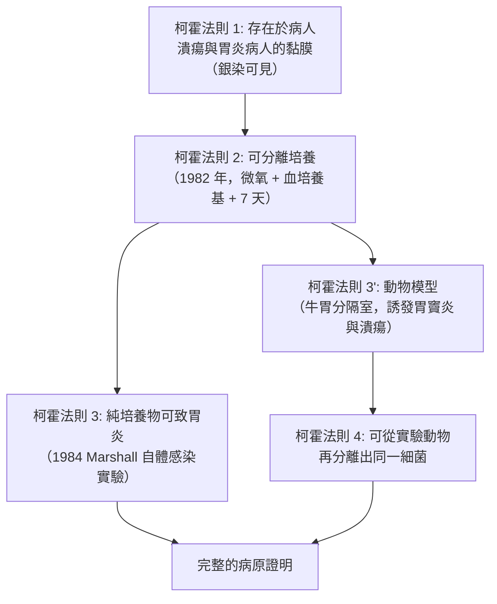
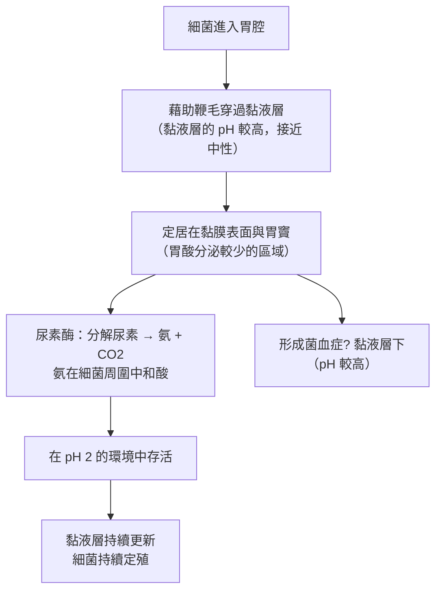

# 2005 · 幽門螺旋桿菌：馬歇爾與沃倫用「以身試菌」推翻消化性潰瘍的百年教條

> **2005 諾貝爾生理學 or 醫學獎**（共享）：巴里·馬歇爾（Barry J. Marshall，澳洲）— 表彰「發現幽門螺旋桿菌及其在胃炎和胃潰瘍中所起的作用」；羅賓·沃倫（John Robin Warren，澳洲）— 同上。

## 懸案（案情提要）

1980 年代，消化性潰瘍（胃潰瘍與十二指腸潰瘍）是全球最常見的疾病之一，也是醫學界**最根深柢固的迷思**所在：

1. **百年來的官方說法**：「潰瘍是**壓力**造成的（精神緊張）、加上**辛���食物**與**胃酸過多**」——這是「**應激—酸—潰瘍**假說」；
2. 這個說法有一個強大的「**經典實驗**」支撐：1940–50 年，**「冰凍的乳頭」與「壓力灌注」**在人類身上造成潰瘍；而 1950 年代的**「貝津胃泌素實驗」**（Sachs 的「幽門結紮 + 胃酸注入」在狗身上造成潰瘍，後被稱為「**幽門結紮實驗**」）被視為潰瘍模型的「金標準」；
3. 但**經典實驗無法解釋**：
   - 為什麼大多數潰瘍病人**沒有**明顯的壓力因素？
   - 為什麼 **O 型血的人**潰瘍風險較高？
   - 為什麼即使做了**貝津胃泌素實驗**，多數被手術切掉胃的患者**仍然會再發生潰瘍**（因為「胃酸被中和了，卻仍長潰瘍」——**這是整個酸假說最難解的反例**）？
4. 而**流行病學**長期顯示：**同一家庭成員的潰瘍發病率顯著偏高**（家族聚集性），且**幽門螺旋桿菌的感染**與潰瘍、胃癌的地理分布高度吻合。

**馬歇爾與沃倫的答案：潰瘍的元兇是細菌——幽門螺旋桿菌（*Helicobacter pylori*）。**

## 前因

| 年份 | 事件 |
| --- | --- |
| 1880s–1900 | 「胃酸與消化性潰瘍」的相關性被注意到，「胃酸學說」正式提出，確立了消化性潰瘍的主流解釋框架。 |
**「貝津胃泌素實驗」**（Sachs 的狗模型）被確立為潰瘍研究的標準實驗方法。 |
| 1954 | **J. Robin Warren** 在西澳洲的皇家 Perth 醫院，於**胃黏膜切片**中觀察到一條**彎曲的細菌**，位於**黏液層與上皮之間**——他把它報告給年輕的住院醫師 Barry Marshall，但他們**無法培養它**。 |
| 1982 | **Marshall 與 Warren 發表《Preliminary observations on the causative bacterium of campylobacter pyloridis gastritis》**——他們終於**成功分離**了這種細菌，並證明它**滿足柯霍法則**（見 [1905-結核桿菌與柯霍法則](1905-結核桿菌與柯霍法則.md)）：**存在於病人、從病人分離、可 induce 胃炎、並可從實驗動物再分離**。 |
| 1983 | Marshall 與 Warren 在《*The Lancet*》發表《**Campylobacter pyloridis and the pathogenesis of gastritis and peptic ulceration**》。 |
| 1984 | **自體感染實驗**：Marshall 為了證明「**這細菌真的會致病**」（而非只是「住在潰瘍附近的過客」），**喝下了含有幽門螺旋桿菌的培養液**——數天後發生**嚴重的胃炎**（噁心、嘔吐、腹痛），抗生素治療後痊癒。 |
| 1985 | **牛模型**：為克服「人體自體實驗的侷限」，Marshall 在**牛胃（分隔成多個胃室）**中**接種幽門螺旋桿菌**，成功誘發**胃竇炎與胃潰瘍**，並從牛胃中**再分離出同樣的細菌**——**柯霍法則的完滿實現**。 |
| 1987–1994 | **幽門螺旋桿菌與胃癌的關聯**被確立（**Warren 與 Marshall** 的流行病學研究）；**首例幽門螺旋桿菌疫苗的研發**開始（最終未上市）。 |
| 1994 | 美國 FDA 批准**三聯治療（抗生素 + PPI + 鉍劑）**用於幽門螺旋桿菌感染——**潰瘍治療從「抑制酸」轉向「殺死細菌」**。 |
| 1996–2000 | ** Maastricht 指南**建立「**根除治療（eradication therapy）**」的標準；**幽門螺旋桿菌感染被列為 I 類致癌物**（與胃癌、MALT 淋巴瘤相關）。 |
| 2005 | 兩人共享諾貝爾生理學 or 醫學獎。 |
| 2010s–2020s | **幽門螺旋桿菌的全基因組定序**（2000 年第一個完成定序的細菌）；**抗生素抗性**（特別是**Clarithromycin 抗性**）成為臨床難題；**COVID-19 與胃腸道菌群的關聯**成為新研究熱點。 |

## 調查

### 第一幕：沃倫的「切片中的一條蟲」——19 年的孤立觀察

Warren 的觀察極為簡單卻艱難：

1. 病人在**胃潰瘍手術後的切除組織**中，**胃黏膜表面覆蓋著黏液層**；
2. 在黏液層與上皮之間，他用**銀染（silver stain）**看見了**無數條彎曲的、有鞭毛的細菌**——**它們不在胃腔裡，而在黏液層中**（這正好解釋了為何「培養」失敗：它需要微氧環境，而常規培養是厭氧或需氧的）；
3. 他報告了，**但沒有Publication**：因為無法培養，就無法做柯霍法則要求的驗證。

**「觀察到但無法培養」的困境，是微生物學的經典卡脖子之處**。沃倫在 1980 年前後找遍了**所有已知的培養條件**，全部失敗。

### 第二幕：馬歇爾的「實驗室考古」——從失敗中找出條件

馬歇爾的破局來自一個**細微但關鍵的觀察**：

1. 他在顯微鏡下注意到，這些細菌**總是帶有鞭毛**；
2. **有鞭毛的細菌必定是能動的**——而**能動**意味著它們處於一個**適合它們的環境**（有營養、有適當的化學條件）；
3. 因此：**它們不是死掉的、也不是偶然附著的——它們是活的微生物**。

於是馬歇爾重新設計培養條件：

| 條件 | 傳統方法 | 馬歇爾的改變 |
| --- | --- | --- |
| **氧氣** | 需氧或厭氧 | **微氧（5% $\mathrm{O}_{2}$ ，10% $\mathrm{CO}_{2}$ ，85% $\mathrm{N}_{2}$ ）** |
| **培養基** | 普通的蛋白質培養基 | 加入**血液（提供 NADH 與 hemin）** |
| **培養時間** | 2–3 天 | **至少 5–7 天**（**它們生長極慢！**） |
| **環境** | 液體培養 | **微氧 + 濕潤 + 對數期** |

**結果**：1982 年，**菌落終於長出來了**——一種**革蘭氏陰性、螺旋狀、微需氧、有鞭毛的細菌**，命名為 ***Campylobacter pyloridis***（後依其形態學與同源性改名為 ***Helicobacter pylori***「幽門螺旋桿菌」）。

**「生長慢」這個發現本身，是後來臨床的關鍵**——因為它解釋了為何**抗生素需要療程 10–14 天**（而其他細菌感染只需 3–5 天）。

### 第三幕：柯霍法則的完滿實現——「從病人到牛再回到病人」

馬歇爾與沃倫在 1982–1985 年完成了全套證據鏈：

**1984 年的「以身試菌」實驗**，是科學史上最具戲劇性的自體感染實驗之一：

1. Marshall 在** conferences 期間的實驗室**（皇家 Perth 醫院）**飲下了一杯含有約 $10^9$ 個幽門螺旋桿菌的培養液**；
2. **幾天後**：出現**噁心、嘔吐、上腹痛**——**胃鏡檢查確認了嚴重的急性胃炎**；
3. **抗生素治療後**：症狀消失、**胃黏膜恢復正常**；
4. 這是**「實驗性幽門螺旋桿菌感染」的首次人體證明**——**從此確立了「幽門螺旋桿菌會引起胃炎」**。

**牛實驗（1985）** 則補上了「致病性」的另一半：

- 在**牛胃**上做**分隔手術**，形成多個獨立胃室（以避免胃液互相沖刷），分別接種細菌；
- 結果：**只有被接種的胃室發生胃炎與潰瘍**，未接種的正常；
- 且**從這些胃室中再分離出與人身上完全相同的細菌**。

### 第四幕：幽門螺旋桿菌如何活下來——「能在酸中生存」的機制

一旦確認病原，機制的問題就浮上水面：**胃酸的 pH 約 1–2，是絕大多數細菌的殺手**。幽門螺旋桿菌的策略極為精巧：

**關鍵酵素**：

| 酵素 | 功能 | 臨床意義 |
| --- | --- | --- |
| **尿素酶（urease）** | $\text{(NH}_2)_2\text{CO} + H_2O \to 2NH_3 + CO_2$ | **呼氣試驗（urea breath test）**的原理——口服 ${}^{13}\mathrm{C}$ -尿素，測呼氣中的 ${}^{13}\mathrm{CO}_{2}$ |
| **過氧化氫酶** | 清除有毒的 $\mathrm{H_2O_2}$ | 使細菌能在有氧環境存活 |
| **黏液酶（lipases）** | 分解黏液層的脂質 | 幫助細菌穿透黏液 |
| **cagA、vacA 等效應蛋白** | 損傷上皮、促進發炎 | 與胃癌、潰瘍出血的關聯 |

**尿素酶的臨床應用極為成功**：

$$\text{（NH}_2)_2\,{}^{13}\text{CO} + H_2O \xrightarrow{\text{urease}} 2\,{}^{13}\text{NH}_3 + {}^{13}\text{CO}_2 \xrightarrow{\text{肺}} \text{呼氣}$$

**呼氣試驗**因此成為全球最普及的幽門螺旋桿菌診斷方法（敏感性與專一性皆約 95%），加上**血清抗體**與**糞便抗原**檢測，形成完整的診斷體系。

### 第五幕：藥理學的革命——「從抑制酸到根除細菌」

**治療策略的轉向**：

| 時期 | 治療 | 結果 |
| --- | --- | --- |
| 1970–1980s | **H2 受體拮抗劑**（cimetidine，見 [1988-藥物治療原理](1988-藥物治療原理.md)）、**PPI** | 症狀緩解、復發率高（停藥即復發） |
| **1994 起** | **三聯/四聯根除治療**：PPI + 兩種抗生素（克拉黴素 + 阿莫西林/甲硝唑）+ 鉍劑 | **根治率 > 95%** |
| 2010s | **鉻劑四聯**、**左氧氟沙星方案**（用於克拉黴素抗性） | 應對抗藥性 |
| 2020s | **vonoprazan（鉀競爭性酸阻斷劑）** + 抗生素 | 新型酸抑制策略 |

**「根除治療」改變了消化性潰瘍的整體面貌**：**復發率從每年 20%–50% 降到 < 5%**，**併發症（穿孔、大出血、狹窄）大幅減少**，**外科治療的需求下降 60%**。

### 第六幕：從潰瘍到胃癌——預防醫學的巔峰

幽門螺旋桿菌與癌症的關聯，是 20 世紀末醫學最重要的預防性發現之一：

1. **流行病學**：幽門螺旋桿菌感染者的**胃癌風險增加約 3–6 倍**；**MALT 淋巴瘤**（黏膜相關淋巴組織淋巴瘤）幾乎 100% 與感染相關；
2. **機制**：感染 → 慢性胃炎 → 萎縮性胃炎 → 腸化生 → 異型增生 → **胃癌**（Correa 的「胃黏膜癌化級聯」模型）；
3. **臨床實踐**：**在胃癌高發地區（中國、日本、韓國）進行「根除幽門螺旋桿菌以預防胃癌」的隨機試驗**（如**中國的「胃癌防治三期研究（intervention trial）」**），結果顯示根除治療可**顯著降低胃癌發生率**——**這是 20 世紀最有力的「以病原控制預防癌症」的證據**；
4. **國際共識**：WHO 將幽門螺旋桿菌列為 **I 類致癌物**（1994）。

## 理論裁決

1. **「壓力—酸」假說的數學崩潰**：舊模型無法解釋「**在胃酸被中和（貝津實驗）後仍發生潰瘍**」——這是一個**決定性的反例**，它要求存在**一個不依賴酸的致病因子**。**一個好的假說不只要解釋支持它的證據，還要能解釋反例**——這是本案在科學方法論上的示範價值。

2. **「同一細菌解釋多種疾病」的奧卡姆剃刀**：

   | 疾病 | 幽門螺旋桿菌的關聯 |
   | --- | --- |
   | 慢性胃炎 | 幾乎 100% |
   | 胃潰瘍 | 80%–90% |
   | 十二指腸潰瘍 | 90%–95% |
   | 胃癌 | 風險增加 3–6 倍 |
   | MALT 淋巴瘤 | 幾乎 100% |

   **一個病原解釋了從良性到惡性的整條疾病譜**——這是 20 世紀感染生物學最漂亮的一個案例。

3. **感染劑量的效應**：幽門螺旋桿菌的致病性與**菌量**有關（重複感染增加風險），且與宿主因素（飲食含鹽、抽菸、飲食纖維）交互作用——這是一個**多因子的疾病模型**。

4. **「治療疾病」的範式轉變**：從「中和酸」到「殺死細菌」，**治療的標的從「宿主反應」轉向「病原」**——這與 [1943-維生素K](1943-維生素K.md)、[1952-鏈黴素](1952-鏈黴素.md)、[1968-遺傳密碼](1968-遺傳密碼.md) 同屬「**找到病原 = 找到治療**」的邏輯傳統。

## 追查支線（未結之謎）

- **馬歇爾的「以身試菌」是科學倫理史上的重要一環**：他在 1980 年代中期曾寫信給《Digestive Diseases and Sciences》期刊（後被退稿），尋求自體感染實驗的倫理許可；**最終他在未獲正式批准的情況下進行了實驗**，事後表示「**我當時面臨的最後期限是一年，我不能等待**」。這樁案例是 2016 年前「研究倫理審查（IRB）」制度尚未完善時期的歷史切片；
- **「幽門螺旋桿菌假說」被主流排斥的 20 年**：從 1982 年到 1990 年代中期，醫學界的主流觀點仍認為潰瘍是「酸與壓力」的問題；**Warren 與 Marshall 遭到同行的強烈質疑與排斥**，Warren 一度被辭去皇家 Perth 醫院的職位；直到**1994 年的 FDA 核准與 Maastricht 指南**，共識才完全翻轉。**這是「被排斥的正確發現」的教科書案例**；
- **抗生素抗性是今日的最大挑戰**：**克拉黴素抗性**在歐洲某些地區超過 20%；**甲硝唑抗性**普遍；這使得**當地的抗性圖譜（resistance map）成為治療選擇的必要依據**；
- **「菌—人—環境」的現代視角**：幽門螺旋桿菌的傳播途徑（口—口、糞—口、胃—胃）與**家庭聚集**、**社經地位相關的不平等**、**居住密度**相關；**2020 年代的 COVID-19 研究**顯示幽門螺旋桿菌的缺失與較輕的病情相關（可能是因為它降低 ACE2 表現）——**一場意料之外的跨疾病關聯**；
- **諾貝爾獎與「幽門桿菌」的命名史**：它曾被命名為 *Campylobacter pyloridis*（1982）、*Campylobacter pylori*（1985），最終依其**螺旋狀形態與 16S rRNA 序列**歸入新屬 ***Helicobacter***（1989），成為**醫學微生物學史上最著名的分類學變更**。

## 證物與數據（偵查卷宗摘錄）

| 證物 | 數值／內容 | 偵查意義 |
| --- | --- | --- |
| 銀染切片 | 黏液層與上皮之間的螺旋菌 | 19 年的孤立觀察 |
| 微氧培養 | 5% $\mathrm{O}_{2}$ 、10% $\mathrm{CO}_{2}$ 、85% $\mathrm{N}_{2}$ | 培養成功的關鍵 |
| 血培養基 | 提供 NADH 與 hemin | 營養需求 |
| 生長時間 | 至少 5–7 天 | 解釋長療程 |
| **1984 自體感染** | 喝下 $10^9$ 個菌 → 急性胃炎 | 病原性的人體證明 |
| **牛胃分隔實驗** | 僅接種的胃室發炎潰瘍 | 動物模型與再分離 |
| 尿素酶 | 尿素 → 氨 + $\mathrm{CO}_{2}$ | 中和酸的存活策略 |
| 呼氣試驗 | ${}^{13}$ C 尿素 | 全球普及的診斷法 |
| 胃鏡活檢 + 培養 | 診斷金標準 | 臨床路徑 |
| 三聯治療 | 根治率 > 95% | 治療範式轉變 |
| 復發率 | 從 20%–50% 降至 < 5% | 臨床影響的量化 |
| 胃癌風險 | 感染增加 3–6 倍 | 預防醫學的證據 |
| 國際共識 | 1994 年列為 I 類致癌物 | 政策層面的承認 |

## 後果

| 領域 | 影響 |
| --- | --- |
| 消化醫學 | 潰瘍治療從「抑制酸」改為「根除病原」；外科需求大幅下降。 |
| 預防醫學 | 「根除幽門螺旋桿菌以預防胃癌」成為可行的公共衛生策略。 |
| 微生物學 | 「難培養的病原」的培養策略（微氧、長培養期、特殊培養基）成為教科書內容。 |
| 藥理學 | 根除治療方案的演進與抗性管理。 |
| 科學方法論 | 「以身試菌」的倫理辯論與「反例的力量」的示範。 |
| 其他諾獎 | 與 [1905-結核桿菌與柯霍法則](1905-結核桿菌與柯霍法則.md)（柯霍法則的現代應用）、[1952-鏈黴素](1952-鏈黴素.md)（抗菌治療）、[1988-藥物治療原理](1988-藥物治療原理.md)（PPI 與抗生素的聯合）構成感染與治療主線。 |

## 關聯

- [1905-結核桿菌與柯霍法則](1905-結核桿菌與柯霍法則.md) — 本案直接使用的證據標準。
- [1952-鏈黴素](1952-鏈黴素.md) — 抗菌治療的另一個里程碑。
- [1988-藥物治療原理](1988-藥物治療原理.md) — PPI 與質子幫浦機制。
- [1976-B肝病毒與庫魯病](1976-B肝病毒與庫魯病.md) — 病毒性致癌的另一條路徑。
- [2008-HPV 與 HIV](2008-HPV與HIV.md) — 感染性致癌因子的當代防治。
