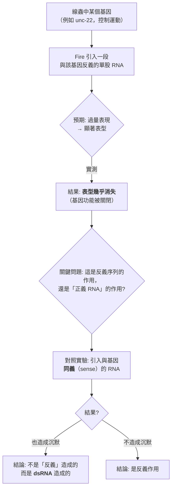
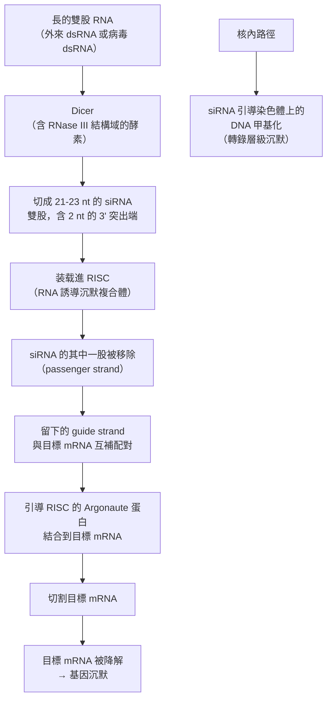
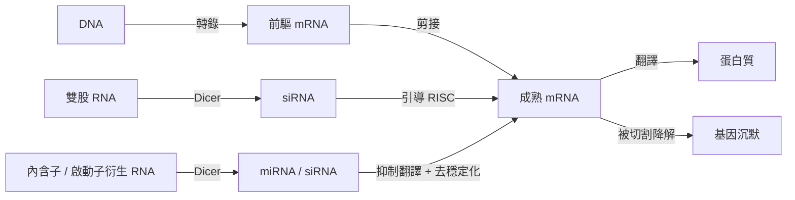

# 2006 · RNA 干擾：法厄與梅洛發現「雙股 RNA 可以關掉基因」

> **2006 諾貝爾生理學 or 醫學獎**（共享）：安德魯·法厄（Andrew Fire，美國）與克雷格·梅洛（Craig C. Mello，美國）— 表彰「發現 RNA 干擾——雙股 RNA 引發的沉默現象」（"for their discovery of RNA interference - gene silencing by double-stranded RNA"）。

## 懸案（案情提要）

1990 年代末，威斯康辛大學的 Fire 與 Mello 在線蟲（*C. elegans*）上做了一件極為反直覺的實驗，結果卻開啟了一整個新領域：

1. **背景**：當時的遺傳學主流是「**基因的表現由 DNA 序列決定**」——轉錄產生 mRNA、翻譯產生蛋白質；
2. **Fire 的實驗**：他引入**一段**與某個基因**互補的 RNA**，試圖「讓基因過量表現」以製造表型；
3. **驚人的結果**：**不是過量表現，而是基因被「沉默」了**——表型反而**消失**！
4. 而更關鍵的是：**沉默是「序列特異性」的**——只有與那段 RNA 互補的基因被關掉，其他基因不受影響；
5. 這意味著：**細胞存在一種「以 RNA 序列為靶、關閉特定基因」的機制**——這在當時的生物學裡**完全沒有對應的概念**。

**法厄與梅洛的發現：RNA 干擾（RNAi, RNA interference）。**

## 前因

| 年份 | 事件 |
| --- | --- |
| 1920s–30s | **「基因沉默」的現象已被零星描述**：1930 年代 **Spielman** 與 **Chase** 在小麥上發現「**對病毒的抗性可透過種子傳遞**」——「**轉導抗性**」；1940–50 年代，這個現象在植物與病原間被稱為「**轉移性抗性**」，但機制不明。 |
| 1950s–70s | **干擾素（interferon）**的發現（Isaacs 與 Lindenmann，1957）與抗病毒作用；**干擾素**曾被懷疑是「可傳遞的抗病毒物質」。 |
| 1980s | **反義 RNA（antisense RNA）**的概念興起——人工引入與 mRNA 互補的 RNA 可抑制其表現（**Lemerle 與 Murray，1980s**），但這被認為是「**與 DNA 序列無關的、人工的**」現象。 |
| 1988–1993 | **Fire 與 Mello** 在威斯康辛大學的實驗室合作，開始以線蟲研究「**引入反義 RNA 以製造基因過量表現**」。Fire 此前的研究主題是**免疫學**（他最早的論文是關於抗體形成的機制）。 |
| 1993 | **Fire 與 Mello 發表《*Mutagenic interference by double-stranded RNA in C. elegans*》**——他們發現：**引入雙股 RNA（dsRNA）會引發序列特異性的基因沉默**。 |
| 1995–1998 | 隨後的追蹤研究發現：**線蟲中有一個基因（**rde-1、rde-2**）是沉默機制的關鍵**；**Andrew Fire 與 Mello 的沉默**被發現**不需要植物或病毒的基因**——純粹的 dsRNA 就足夠。 |
| 1998–2000 | **Hamilton 與 Baulcombe（1999）**在植物中發現：引入**人工合成的「髮夾狀小 RNA（hairpin RNA）」**可以高效、特異地沉默基因——**這是 RNAi 技術化（RNAi）的起點**。 |
| 1998–1999 | **Fire 的團隊**發現，沉默由約 21–23 核苷酸的**小干擾 RNA（siRNA）**所媒介；並在線蟲中分離出 **RDE1**（RNA 誘導沉默缺陷基因），它是沉默機制的核心成分之一。 |
| 2000–2006 | **「核糖核酸酶 III（RNase III）」的關鍵角色**被發現——**Dicer** 酶把長的 dsRNA 切成約 21–23 nt 的小片段；**RISC（RNA 誘導沉默複合體）**被鑑定（**Hammond 與 Fire**）。 |
| 2006 | 兩人共享諾貝爾生理學 or 醫學獎。 |
| 2000s–2020s | **RNAi 技術的產業化**：用線蟲與果蠅做大规模篩選以找出疾病基因；**siRNA 藥物**（patisiran 等，用於肝臟疾病）；**CRISPR 的競爭與互補**；**miRNA 的發現**（見 [2024-微RNA](2024-微RNA.md)）。 |

## 調查

### 第一幕：反直覺的實驗——「過量表達」卻導致「沉默」

Fire 的實驗設計本身極為簡單：

**Fire 與 Mello 的關鍵對照實驗**：他們分別引入

1. **反義 RNA（antisense）**：與 mRNA 互補；
2. **正義 RNA（sense）**：與 mRNA 同序列（理論上應「增強」表現）；

**結果：兩者都造成了基因沉默！**——這是整個故事的轉折點，因為它排除了「反義雜合」的機制，並指向了「**雙股 RNA 的結構本身**」才是真正的兇手。

**「意外結果」的科學價值**：Fire 與 Mello 原本想製造一個「過量表現」的系統，卻得到完全相反的結果。**科學上「意外的結果」往往比「預期的結果」更有價值——因為它揭示了一個原本不在視野中的機制**。

### 第二幕：分清「沉默」的類型——Fire 的團隊的決定性實驗

Fire 的後續實驗把問題拆成兩半：

| 問題 | 實驗 | 結果 |
| --- | --- | --- |
| 是 **mRNA 被降解**，還是**不被轉譯**？ | 在沉默的細胞中測量 mRNA 量 | **mRNA 大量降解**（轉譯後沉默，post-transcriptional） |
| 需要**完全相同**的序列嗎？ | 用與靶基因**只有部分互補**的 dsRNA | **也能沉默**——只要有足夠的互補區段 |
| 需要**長的** dsRNA 嗎？ | 用長 dsRNA vs 短的 | **長 dsRNA 有效**，短的不行（提示需要被加工成小片段） |

**Fire 的團隊**發現，沉默由約 21–23 核苷酸的**小干擾 RNA（siRNA）**所媒介——沉默的「貨幣」被找到。 |

*（上述兩列為同一條線索的分述。）*

### 第三幕：Dicer 與 RISC——沉默機制的分子拆解

1999–2001 年，沉默機制被完全拆解成兩步：

**關鍵的分子細節**：

1. **Dicer**：把長 dsRNA 切成約 21–23 nt 的片段——**RNase III 家族的酵素負責**（**Drosophila 的 Dicer 由 Ambros 與 colleagues 在 2001 年克隆**，見 [2024-微RNA](2024-微RNA.md)）；
2. **RISC**：**Argonaute 蛋白**是核心催化成分——**它以 siRNA 為引導，與目標 mRNA 配對並切割之**（Hammond 等，2002）；
3. **放大效應**：**RISC 是一個「催化性酵素」，不是被消耗的試劑**——一個 siRNA 可以反覆切割多個目標 mRNA：

   $$\text{切割速率} \approx k_{\text{cat}} \cdot [\text{RISC}] \quad \text{遠高於化學試劑的消耗速率}$$

   **這是 RNA 干擾與反義寡核苷酸（ASO）藥物的關鍵差異**，也是 siRNA 藥物只需極低劑量的原因。

4. **核內途徑**：在植物與真菌中，siRNA 還能引導**DNA 甲基化**（轉錄層級沉默）——**這把基因沉默從「轉錄後」擴展到「轉錄層」**。

### 第四幕：技術化——RNAi 從發現到工具

**1998–2002 年的關鍵技術突破**：

1. **Hamilton 與 Baulcombe（1999）**：在植物中引入**人工合成的「髮夾狀 RNA」**（兩條反向互補的 RNA 序列摺成髮夾），即可高效、特異地沉默基因——**這是 RNAi 技術的雛形**；
2. **Fire 與 Mello 的線蟲工作**被廣泛應用於**大規模篩選**（RNAi 篩選 library）；
3. **2001–2002 年**：**「RNAi 篩選」在線蟲與果蠅中進行大規模功能基因組學**——C. elegans 與 D. melanogaster 的**全基因組功能註解**因此大幅加速；
4. **2004–2006 年**：**siRNA 藥物**進入臨床；
5. **2006 年後**：**「RNAi 療法」的興衰**——siRNA 藥物（patisiran、givosiran）獲 FDA 核准，但因「**递送系統（delivery）**」的瓶頸與後續的**siRNA 遞送技術**的進步，多數候選藥未能上市。

**「RNAi 藥物失敗論」與 CRISPR 的崛起**（2012 年）是科學史上一段耐人尋味的插曲：RNAi 曾被視為「**下一個藥物革命**」，但多數候選藥**失敗於遞送**（如何把 siRNA 送到正確的細胞裡）與**off-target 效應**（siRNA 的種子序列錯配會沉默不該沉默的基因）。**CRISPR 的迅速成功，讓 RNAi 在「基因沉默」的主戰場上退居次位**——但 RNAi 仍保有其獨特優勢（**不改變基因組、可重複使用、可逆**）。

### 第五幕：從「意外的沉默」到「基因表現的通用規則」

**RNAi 的發現，徹底改變了 1990 年代的中心法則的討論**：

**RNAi 帶來的三個新概念**：

1. **基因表現可以被「以核酸序列為靶」地關閉**——這是一種**序列特異性**的抑制，與「藥物抑制某個酵素」完全不同；
2. **「可移動的基因沉默訊號」**：siRNA 可以在細胞內**擴散**，甚至**在細胞間傳遞**（線蟲中 RNAi 可跨細胞、跨世代傳遞！）；
3. **基因組防禦的內源性機制**：**細胞用 RNAi 來對抗病毒與轉位子**（**這正是「轉座子防禦」的機制**，見 [1983-轉座子](1983-轉座子.md)）。

**而「跨細胞、跨世代傳遞」的發現**（Fire 的實驗室在線蟲中觀察到 RNAi 的沉默可透過**配子**傳到下一代），開啟了一整個「**表觀遺傳（epigenetic inheritance）**」的研究領域——**這條線最終通向 2024 年的微 RNA 諾獎與廣泛的表觀遺傳學革命**。

## 理論裁決

1. **序列特異性的數學**：RNAi 的核心是「**序列互補 → 精確辨識**」：

   $$P(\text{被沉默}) \propto P(\text{至少 } 15\text{ nt 互補配對})$$

   **siRNA 的種子序列（位置 2–8）** 是辨識的關鍵——**這解釋了「off-target 效應」的機制**（若目標 mRNA 的種子序列區域也互補，就會被誤沉默）——這是 siRNA 藥物開發中最核心的安全性問題。

2. **催化的沉默**：RISC 的催化性質意味著**放大倍數極高**：

   $$\text{放大} \approx \frac{[\text{siRNA}]_{\text{催化}}}{[\text{siRNA}]_{\text{消耗}}} \sim 10^{3}\text{–} 10^{6}$$

   **一個 siRNA 分子可以沉默數千至數百萬個 mRNA 分子**——這是它作為藥物的效率優勢。

3. **「基因沉默」的時空擴展**：RNAi 提供了**三種層級的沉默**：

   | 層級 | 機制 | 位置 |
   | --- | --- | --- |
   | **轉錄後沉默（PTGS）** | mRNA 被切割/去穩定化 | 細胞質 |
   | **轉錄層沉默（TGS）** | DNA 甲基化、組蛋白修飾 | 核內 |
   | **核內 RNA 引導的沉默** | 引導染色質改造複合體 | 核內 |

4. **網絡層級的調控**：**miRNA**（而非 siRNA）是內源性、單股、長度約 22 nt 的調控 RNA——**一個 miRNA 可同時調控數百個目標 mRNA**（因其種子序列只需部分互補），因此構成**「調控網絡」**：

   $$\text{一個 miRNA} \to \text{數百個目標基因} \to \text{整條功能路徑}$$

   **這是「組學時代」調控語言的核心**（見 [2024-微RNA](2024-微RNA.md)）。

## 追查支線（未結之謎）

- **Fire 的科學生涯**：他的父母來自以色列與愛爾蘭（在美國出生、父母來自以色列與愛爾蘭），他的學術之路起於**免疫學**（他最早的論文是關於抗體形成的），**在 35 歲時轉向線蟲的發育遺傳學**，並在 1990 年代末因歷史學者對「RNAi 發現歸屬」的爭議而退出公共視野——**他於 2010 年因癌症去世**（64 歲）；
- **歸屬之爭**：**RNAi 的發現曾有長期的優先權爭議**——Fire 與 Mello 的工作建立在**線蟲遺傳學前人（尤其是發現「轉移性抗性」的植物病理學家與瓊斯等人的工作）**之上。最終由諾貝爾委員會以「**共同獲獎**」的方式解決（2006 年兩人共享），並特別提及線蟲中 RNA 干擾的先驅研究；
- **Melio 的科學生涯**：Craig Mello 是**RNA 干擾研究的重要推廣者**；他在 2010 年擔任 **Nobel 委員會的常務秘書**（2010–2015）；
- **RNAi 與結核桿菌**：**結核桿菌的「報告基因（reporter gene）沉默」**是宿主抵抗細菌的一種防禦機制——**這把 RNAi 與細菌感染重新連結**；
- **RNAi 藥物的現況**：**patisiran（Onpattro）**（2018 年 FDA 核准，用於多發性神經病變）、**givosiran**、**inclisiran**（siRNA 降脂）——**siRNA 藥物成為 21 世紀最重要的藥物技術平台之一**；
- **CRISPR 與 RNAi 的分工**：CRISPR「改寫」基因組，RNAi「關閉」基因表現——**兩者是互補而非競爭**，今日的基因功能研究常並用兩者。

## 證物與數據（偵查卷宗摘錄）

| 證物 | 數值／內容 | 偵查意義 |
| --- | --- | --- |
| 反義 RNA | 也造成沉默 | 排除單股反義機制 |
| 正義 RNA | 也造成沉默 | **關鍵對照：dsRNA 才是兇手** |
| mRNA 測量 | 沉默時 mRNA 大量降解 | 轉錄後沉默 |
| 短 dsRNA | 無效 | 需要被加工 |
| siRNA 長度 | 21–23 nt，含 2 nt 3' 突出 | 沉默的「貨幣」 |
| Dicer | 含 RNase III 結構域 | 把長 dsRNA 切短 |
| RISC / Argonaute | 催化性沉默複合體 | 切割目標 mRNA |
| 放大倍數 | 約 $10^{3}\text{–}10^{6}$ | 催化性質 |
| 種子序列 | 位置 2–8 決定特異性 | off-target 的根源 |
| 線蟲的 RNAi 篩選庫 | 全基因組功能註解 | 功能基因組學的加速 |
| RNAi 的跨代傳遞 | 線蟲中經配子傳遞 | 表觀遺傳的開端 |

## 後果

| 領域 | 影響 |
| --- | --- |
| 分子生物學 | 「基因沉默」成為與轉錄並列的表現調控層級。 |
| 生物技術 | RNAi 篩選、基因功能研究、siRNA 藥物。 |
| 免疫學 | 抗病毒的內源性防禦機制。 |
| 表觀遺傳學 | RNAi 引導的 DNA 甲基化與染色質沉默。 |
| 醫學 | siRNA 藥物（肝臟疾病、血友病、膽固醇）；抗病毒與抗腫瘤的核酸藥物策略。 |
| 其他諾獎 | 與 [1983-轉座子](1983-轉座子.md)（轉座子的內源性防禦）、[1993-斷裂基因](1993-斷裂基因.md)（RNA 加工）、[2024-微RNA](2024-微RNA.md)（內源性的小 RNA）構成分子生物學主線。 |

## 關聯

- [1983-轉座子](1983-轉座子.md) — 細胞用 RNAi 對抗轉座子的防禦機制。
- [1993-斷裂基因](1993-斷裂基因.md) — RNA 加工的另一種方式。
- [2024-微RNA](2024-微RNA.md) — RNAi 的內源性 cousins，2024 年諾獎的內容。
- [1959-核酸生合成](1959-核酸生合成.md) — RNA 聚合酶與轉錄的機制。
- [2012-iPS 細胞](2012-iPS細胞.md) — 基因表現的重編程。
