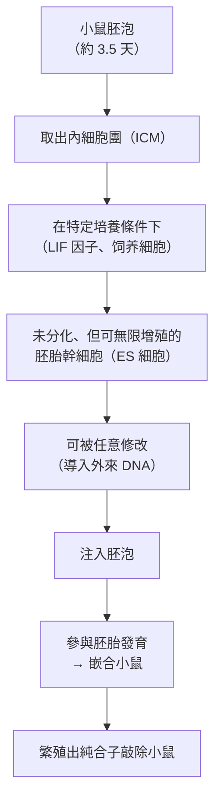
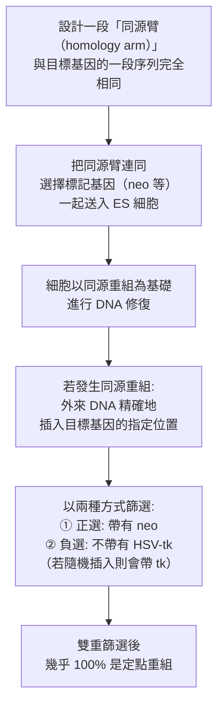
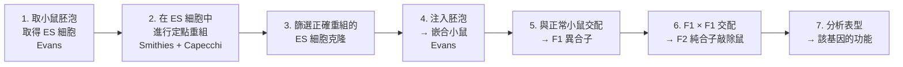

# 2007 · 胚胎幹細胞與基因敲除：卡佩奇、埃文斯與史密斯建立「可隨意關掉一個基因」的能力

> **2007 諾貝爾生理學 or 醫學獎**（共享三人）：馬里奥·卡佩奇（Mario R. Capecchi，義大利出生、美國籍）— 表彰「發現利用胚胎幹細胞引入特異性基因修飾的原理」；馬丁·埃文斯爵士（Sir Martin J. Evans，英國）與奧利弗·史密斯（Oliver Smithies，英國／美國）— 同上。

## 懸案（案情提要）

1980 年代的遺傳學有兩塊無法拼合的拼圖：

1. **胚胎幹細胞（ES 細胞）**——1981 年，埃文斯與 Kaufman 培養出了能在體外無限增殖、且**保持分化潛能**的 mouse 胚胎幹細胞。這意味著：**可以從胚胎取出一個細胞，在培養皿裡隨意修改它，再把它放回胚胎，讓它長成一整隻動物**；
2. **同源重組（homologous recombination）**——1980 年代末，史密斯在培養的細胞中發現：**外來 DNA 可以與細胞基因組中同源的位置發生互換**。這意味著：**可以「定點」地修改一個特定基因**。

**把兩者合起來，就是人類遺傳學歷史上最渴望的能力：「把某個特定基因關掉，看身體會怎樣。」**

這就是**基因敲除小鼠（knockout mouse）**。

## 前因

| 年份 | 事件 |
| --- | --- |
| 1974 | **Capecchi** 開始研究**哺乳動物的基因轉殖**；他在 1976–1980 年間建立了「**轉殖基因（transgenic）**」小鼠的技術（把外來 DNA 注入受精卵）。 |
| 1981 | **Martin Evans 與 Matthew Kaufman** 在 Cambridge 培養出**小鼠胚胎幹細胞（ES 細胞）**，並證明它們可以被注入胚泡、參與胚胎發育。 |
| 1984–1985 | **Oliver Smithies** 發現**在培養的 ES 細胞中，導入的 DNA 可以與基因組中的同源區段發生定點重組**（homologous recombination）——**「定點突變」技術的誕生**。 |
| 1986–1987 | **Capecchi 與 Smithies 分別獨立**實現了「**同源重組 + ES 細胞 + 胚泡注入**」的完整流程，產生了**第一隻基因敲除小鼠**（Capecchi 敲除 **HPRT**、Smithies 敲除 **transferrin 受體**）。 |
| 1988–1993 | **Evans** 建立了「**chimeric mouse（嵌合小鼠）**」與「**breeding（繁殖出純合子）**」的完整流程——**這一步是把「一隻嵌合鼠」變成「一個品系」的關鍵**。 |
| 1993 | **Krebs 與 Beermann** 等以「**Cre-loxP**」系統實現**條件性（conditional）基因敲除**——解決了「胚胎致死基因無法研究」的問題。 |
| 2007 | 三人共享諾貝爾生理學 or 醫學獎。 |
| 1990s–2020s | **基因敲除小鼠用於**：疾病模型（癌症、糖尿病、阿茲海默、帕金森）、藥物標靶驗證、**諾貝爾獎的機制驗證**（幾乎每一個諾貝爾生理學獎的成果都以敲除小鼠做過驗證）、**CRISPR 的動物模型**、以及**「功能基因組學」的大規模篩選**。 |

## 調查

### 第一幕：埃文斯的 ES 細胞——「可培養的胚胎」

埃文斯與 Kaufman 的 1981 年工作，要解決一個此前被認為不可能的問題：**胚胎的細胞一旦離開胚胎，就會「決定命運」並分化到底**（例如成纖維母細胞），於是**不可能在體外培養並操作它們**。

**ES 細胞的發現徹底改變了這件事**：

**ES 細胞的三個關鍵性質**：

1. **自我更新（self-renewal）**：在培養皿中無限增殖而不分化；
2. **多能性（potency）**：可分化為三個胚層（外、中、內）的任何細胞類型——**因此被稱為「多能性（pluripotent）」**；
3. **可被操作並回到胚胎**：這是「基因操作 + 胚胎發育」的橋樑。

**為什麼是小鼠？** 因為**小鼠胚胎幹細胞的培養技術先被建立**——**哺乳動物的 ES 細胞培養至今仍未普遍成功（人與猴的「胚胎幹細胞」的定義與安全性仍有爭議）**。這是 2007 年諾獎背後的一個重要限定。

### 第二幕：史密斯的「定點重組」——從「隨機插入」到「精準修改」

史密斯的方法論突破極為關鍵。

**傳統的隨機插入（random insertion）**：把 DNA 送入細胞，**它會隨機插到基因組的某個位置**。問題是：

- 插入的位置隨機 → **不知道它插到哪裡**；
- 若插入到重要的基因區域 → **會破壞那個基因**；
- 即使不破壞，也**無法確認目標基因是否被正確修改**。

**史密斯的策略**：

**「雙重選擇（double selection）」是史密斯的關鍵巧思**：

- **正選（positive selection）**：帶有 **neo**（新霉素抗性）→ 排除了完全沒有重組的細胞；
- **負選（negative selection）**：若發生的是**隨機插入**（而非同源重組），則 neo 與 **HSV-tk（對 ganciclovir 敏感）** 會一起插入；用 ganciclovir 處理 → **隨機插入的細胞被殺死**。

**結果：篩選效率從約 $10^{-6}$ 提升到接近 100%**——**這使「定點基因修改」從不可能變成例行工作**。

### 第三幕：卡佩奇的「定點插入」——雙向的突破

卡佩奇的工作方向與史密斯互補：

- **史密斯**：製造「**失去功能（loss-of-function）**」的突變——把基因**破壞掉**（knockout）；
- **卡佩奇**：製造「**獲得功能（gain-of-function）**」的突變——把一段序列**精確地插入基因组的指定位置**（knock-in）。

**卡佩奇的關鍵貢獻**：他證明了**「定點插入」與「同源重組」在哺乳動物細胞中可行**，並且**效率很高**——**他甚至證明了「定點插入」的頻率可以高達 10%–20%**（遠高於當時的普遍認識）。

### 第四幕：三人的拼合——完整的流程

**關鍵在第 5–6 步**：**「嵌合」不等於「遺傳」**——被修改的 ES 細胞只貢獻胚胎的一部分，因此必須讓它**經過生殖細胞**（通過生殖系）**傳給子代**。這個「**傳代篩選**」是埃文斯的關鍵貢獻。

**Cre-loxP 系統（1993）**：解決了「胚胎致死的基因無法研究」的問題：

| 元素 | 作用 |
| --- | --- |
| **floxed 基因**（兩側有 loxP） | 目標基因的「可刪除版本」 |
| **Cre 轉基因鼠** | 表現 Cre 酵素 |
| **Cre + floxed 交配** | 只有在 **Cre 表現的組織**中才刪除目標基因 |

**因此可以做到**：**「條件性敲除」**——例如只在肝臟或在成年後才關掉某個基因——**這使得研究人類疾病（許多致病基因在胚胎期致死）成為可能**。

### 第五幕：敲除小鼠的科學威力

**敲除小鼠在 2007 年之後的應用光譜**：

| 領域 | 應用 |
| --- | --- |
| **疾病模型** | 癌症小鼠（p53、Rb、Myc 敲除）、糖尿病（瘦素受體）、高血壓、阿茲海默（APP）、帕金森（α-synuclein）、囊腫性纖維化 |
| **藥物標靶驗證** | 每個藥物標點在敲除小鼠中的表型，可預測療效與副作用 |
| **諾貝爾獎的驗證** | **幾乎每一位諾貝爾生理學或醫學獎得主的成果，都以敲除小鼠做過最終驗證**——本案是科學驗證體系的基礎設施 |
| **功能基因組學** | 與 RNA 干擾篩選互補（RNAi 是「關掉表現」，敲除是「刪掉基因」） |
| **疫苗與藥物安全性** | 免疫缺陷小鼠（**nude mouse**）用於人類異種移植與腫瘤免疫研究 |

**一個統計上的震撼**：**在小鼠身上敲除約 20% 的基因會導致胚胎或胎兒死亡**（lethal knockout），其中約 20% 與人類已知疾病基因相關。**這解釋了為何許多基因不能被「整體敲除」研究**——從而催生了 Cre-loxP 與其他條件性系統。

### 第六幕：模式的傳播——「一個基因，一個表型」

敲除小鼠最深刻的影響，是讓生物學形成了一種**因果性思維**：

$$\text{基因 } X \text{ 敲除} \to \text{表型 } Y \quad \Longrightarrow \quad X \text{ 在 } Y \text{ 的因果鏈中}$$

**「表型的三個層次」**：一個基因敲除可能導致

1. **分子層次**：蛋白質或訊號的改變；
2. **細胞層次**：細胞的形態或功能；
3. **整體層次**：行為、生理、疾病風險。

**「從分子到整體」的完整鏈條**，是 20 後半葉生物學的核心方法論。而 2007 年諾獎委員會在頒獎詞中特別指出：**敲除小鼠技術「使幾乎所有生物醫學領域的研究得以進行」**——這是對一項**基礎設施性技術**的最高評價。

## 理論裁決

1. **同源重組的機制**：定點重組依賴**細胞的 DNA 修復系統**：

   $$\text{外來 DNA 的同源臂} \to \text{侵入（invasion）} \to \text{同源配對} \to \text{ Holliday 中間體} \to \text{解旋酶與連接酶完成整合}$$

   **哺乳動物細胞天生具備這個能力**——**基因打靶其實是在「借用」細胞自己的 DNA 修復機制**。

2. **基因型—表型映射的數學**：敲除實驗建立了**基因功能的大規模資料庫**：

   $$f: \text{基因集} \to \text{表型集}, \qquad |f| \approx 2 \times 10^{4}$$

   這正是**功能基因組學**的資料基礎，也是 2020 年代**人類基因功能註解計劃（gnomAD、Mouse Phenome Database）**的源頭。

3. **嵌合與嵌合率的數學**：注入的 ES 細胞對胚胎的貢獻是隨機的：

   $$P(\text{嵌合體中某組織含修改細胞}) \approx 1 - (1 - p)^n$$

   其中 $p$ 為 ES 細胞的參與機率、 $n$ 為參與細胞數。**當某組織的修改細胞比例低於某門檻時，就不會出現表型**——**這解釋了為何「嵌合」不等於「表型」**，也是必須做傳代的原因。

4. **基因劑量的數學**：一個等位基因被敲除後，另一個拷貝仍在：

   $$\text{表現量} \approx \frac{1}{2}\ \text{（雜合子）} \quad \text{vs} \quad 0 \quad \text{（純合子）}$$

   **雜合子通常無表型**（這是「隱性」的分子意義）——但**並非總是如此**：**基因劑量效應（dosage effect）**是許多疾病（**Tay–Sachs、Duchenne 肌營養不良、脆性 X 綜合症**）的致病機制。

## 追查支線（未結之謎）

- **三人的人生軌跡**：卡佩奇是**納粹時期的義大利移民後裔**（他於 1973 年離開義大利前往美國，此後**拒絕回國，直到 2013 年才訪問家鄉**）；史密斯是英國人，20 世紀 50 年代在北卡羅來納州以**澱粉支持介質的凝膠電泳**聞名（**Smithies 電泳**）——**他把自己的第一項成名技術與第二項諾獎工作串在同一個人生裡**；埃文斯是**英國劍橋的動物學家**；
- **諾貝爾委員會的措辭極為慷慨**：委員會特別提到**「允許對任何基因進行研究」**的可能性——**這是一段對「基礎設施」的致敬**；
- **「基因敲除小鼠」的倫理與實踐**：由於約 20% 的敲除會致死、且需要數代的繁育，**knockout mouse 的生產是極其耗時耗力的**（一個品系需 2–3 年、數萬美元）；今日由 **JAX（The Jackson Laboratory）** 與 **IMPC（國際小鼠表型 consortia）** 提供標準化品系；
- **「基因打靶」與 CRISPR 的世代交接**：2012 年 CRISPR-Cas9 出現後，**定點基因修改的成本從數月降到數天**——但**敲除小鼠技術仍是「基因功能因果驗證」的金標準**（knockout 是「刪掉」，CRISPR 是「編輯」，兩者互補）；
- **動物的「基因治療」與「基因打靶」**：**「體細胞基因打靶」**技術（以 CRISPR 在體細胞中做定點編輯）是治療鐮刀型貧血（**2023 年 12 月 FDA 核准的 Casgevy**）的基礎——**這條線從 2007 年的諾獎工作直通今日的基因治療藥物**；
- **「模式生物」的經濟學**：小鼠品系的價值極高（**一個 knockout 品系的專利價值可達數百萬美元**），這推動了 1990 年代的「**基因Trap（基因陷阱）**」與「**晶體庫（Copenhagen mutation library）**」等大規模資源的建立。

## 證物與數據（偵查卷宗摘錄）

| 證物 | 數值／內容 | 偵查意義 |
| --- | --- | --- |
| ES 細胞（1981） | 自我更新＋多能性 | 可操作的胚胎細胞 |
| 培養條件 | LIF 因子、飼養細胞 | ES 細胞的維持 |
| 同源重組 | 外來 DNA 與基因組同源段互換 | 定點修改的機制 |
| 雙重選擇 | 正選 neo + 負選 HSV-tk | 篩選效率接近 100% |
| 定點插入頻率 | 約 10%–20%（Capecchi） | 高效 knock-in |
| 首隻敲除小鼠 | HPRT（Capecchi）、transferrin 受體（Smithies） | 1986–87 |
| 傳代流程 | F1 × F1 → F2 純合子 | 從嵌合到品系 |
| Cre-loxP（1993） | 組織特異／時間特異的刪除 | 條件性敲除 |
| 致死敲除比例 | 約 20% | 為何需要條件性系統 |
| 人類疾病基因相關 | 約 20% 的致死敲除與已知疾病相關 | 跨物種的可比性 |
| 基因數 | 約 20,000 個 | 資料庫規模 |

## 後果

| 領域 | 影響 |
| --- | --- |
| 遺傳學 | 從「相關」走向「因果」；基因功能註解的標準方法。 |
| 醫學 | 疾病模型的建立；藥物標靶驗證；體細胞基因治療的技術源頭。 |
| 開發生物學 | 疾病模型成為藥物研發的基礎設施。 |
| 生物技術 | 重組 DNA 技術（見 [1978-限制性內切酶](1978-限制性內切酶.md)）的完整應用鏈條。 |
| 諾獎生態 | 「每一個諾獎都以敲除小鼠驗證」——科學驗證體系的標準化。 |
| 其他諾獎 | 與 [1978-限制性內切酶](1978-限制性內切酶.md)（工具）、[1995-胚胎發育基因](1995-胚胎發育基因.md)（發育基因的因果驗證）、[2001-細胞週期](2001-細胞週期.md)（同一套工具）、[2002-程式性死亡](2002-程式性死亡.md) 構成基因功能研究主線。 |

## 關聯

- [1978-限制性內切酶](1978-限制性內切酶.md) — 重組 DNA 工具箱。
- [1995-胚胎發育基因](1995-胚胎發育基因.md) — 果蠅模式基因在哺乳動物中的驗證。
- [2001-細胞週期](2001-細胞週期.md) — 酵母與線蟲的篩選方法學。
- [2002-程式性死亡](2002-程式性死亡.md) — 同一套模式生物系統的另一條線。
- [2006-RNA 干擾](2006-RNA干擾.md) — 「關閉基因表現」與「刪除基因」的互補。
