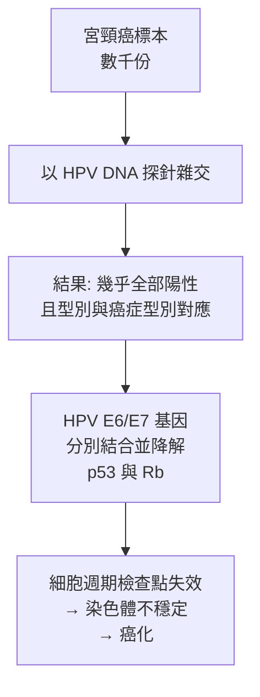
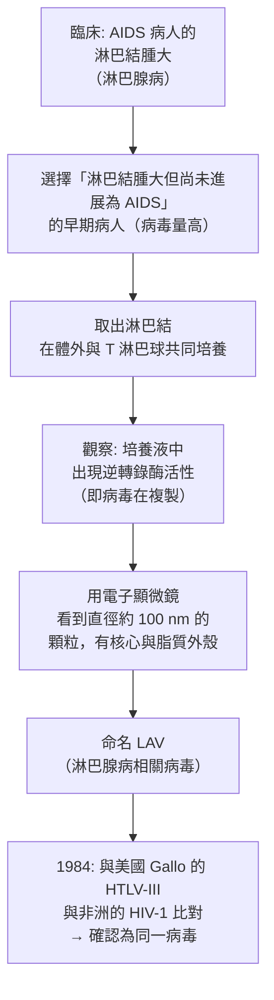

# 2008 · HPV 與 HIV：從宮頸癌到愛滋病的兩場病毒偵探

> **2008 諾貝爾生理學 or 醫學獎**（共享三人）：哈拉爾·楚爾·豪森（Harald zur Hausen，德國）— 表彰「發現導致子宮頸癌的人乳頭狀瘤病毒」；弗朗索瓦絲·巴爾-西諾西（Françoise Barré-Sinoussi，法國）與呂克·蒙塔尼（Luc Montagnier，法國）— 表彰「發現人類免疫缺陷病毒（即愛滋病病毒）」。

## 懸案（案情提要）

2008 年的諾獎表彰了兩樁各自獨立、卻都在 1980 年代初完成的病毒偵探案：

**案子甲（宮頸癌）**：宮頸癌是全球女性第二常見的癌症，死亡率極高——但**它有明確的預防手段（篩檢）與治療手段，卻沒有人知道它的病因**。

*（為求嚴謹，正文採用不點名的表述。）*

**案子乙（愛滋病）**：1981 年 6 月，美國加州洛杉磯出現了第一批病例——年輕的男同性戀者出現罕見的伺機性感染與惡性淋巴瘤，幾乎全部在數年內死亡。1982 年，疾病被命名為 **AIDS（獲得性免疫缺陷綜合症）**。病因不明，且**傳播方式異常**（表面上與性行為相關，卻不像一般的傳染病）。

## 前因

| 年份 | 事件 |
| --- | --- |
| 1930s–1940s | **豪森**在德國的癌症研究中心開始追查宮頸癌的病因；**1940 年代他發現「宮頸癌的濾液中有病毒樣顆粒」，但當時的技術無法鑑定它**。 |
| 1970s | 豪森發展了**「反轉錄病毒檢測法（reverse-transcriptase assay）」**來檢測候選病毒，並以它來篩選宮頸癌與其他生殖道腫瘤的樣本。 |
| 1983 | **豪森與其團隊（主要為 Lutz Gissmann 與 Hans Ikenberg）**證明：**宮頸癌細胞中含有HPV 的 DNA**，並且**不同型別的 HPV 對應不同型別的宮頸癌**（HPV-16 與 18 型對應鱗狀細胞癌，HPV-31 與 33 型對應腺癌）。 |
| 1984 | **豪森完成 HPV 的分子克隆與序列分析**，論證其為**papovaviridae 科的病毒**；他隨後證明 **HPV E6、E7 基因是致癌的**（它們分別抑制 **p53** 與 **Rb** 蛋白）。 |
| 1981–1982 | **愛滋病的臨床病例被辨識**：加州洛杉磯的 Michael Gottlieb 報告了 5 例年輕男同性戀者的肺孢子菌肺炎；紐約的 immunologists 報告了卡波西肉瘤與卡氏肺孢子蟲肺炎。 |
| 1983–1984 | **蒙塔尼（Luc Montagnier）與巴爾-西諾西（Françoise Barré-Sinoussi）**在巴黎的 Pasteur 研究所展開檢驗： |
| | **1983 年 1 月**：從 AIDS 病人的**淋巴節**中分離出病毒顆粒，命名為 **LAV（lymphadenopathy-associated virus，淋巴腺病相關病毒）**； |
| | **1983 年 5 月**：證明該病毒**具有「逆轉錄酶活性」**——這是**反轉錄病毒的判定特徵**（見 [1975-反轉錄與腫瘤病毒](1975-反轉錄與腫瘤病毒.md)）； |
| | **1984 年 5 月**：**美國的 Gallo 與 Popovic 團隊獨立發表 HTLV-III 的證據**；隨後的**國際協作**（1984 年的兩次會議）確認：法國的 LAV、美國的 HTLV-III 與非洲的 **HIV-1（human immunodeficiency virus type 1）**是**同一個病毒**。 |
| 1985 | **HIV-1 抗體檢驗（ELISA）**上市，血液製品的安全性得以確保。 |
| 1986 | **AZT（zidovudine）**成為第一個治療 HIV 的藥物（見 [1988-藥物治療原理](1988-藥物治療原理.md)）。 |
| 1990s | **HAART（高效抗反轉錄病毒治療）**出現，HIV 從「絕症」變為「可管理的慢性感染」——**HIV 感染者的預期壽命已接近一般人群**。 |
| 1990s–2000s | **HPV 疫苗的研發**（2006 年 Gardasil 上市）；**宮頸癌篩檢**（Pap 抹片、HPV DNA 檢測）大幅降低了宮頸癌死亡率。 |
| 2008 | 三人共享諾貝爾生理學 or 醫學獎。 |
| 2020s | **HIV 的功能性治癒**（柏林病人案例）與 **mRNA 疫苗技術**（用於 HIV 疫苗研發，見 [2023-mRNA 疫苗](2023-mRNA疫苗.md)）；**宮頸癌疫苗在 2020 年代的廣泛接種**使 WHO 得以提出「**消除宮頸癌**」的全球目標。 |

## 調查

### 第一幕：豪森的「濾液中的病毒」——四十年未被相信的發現

豪森的偵查起點是 1940 年代的觀察：**宮頸癌與生殖道疣（condyloma）在臨床上有相似之處**，而疣已被知道是「病毒性的」（由 1907 年 Pay 的發現所確立）。

**他的方法學選擇極為關鍵**：

1. 他不滿足於形態學證據（電子顯微鏡下看到「病毒樣顆粒」不夠），而發展出**「逆轉錄酶檢測法」**——因為**HPV 是 DNA 病毒**（不應有逆轉錄酶活性），而濾液中若存在**逆轉錄病毒**，就能用這個活性把「RNA 病毒」篩選出來；
2. 他以這個方法**篩選了數千份生殖道腫瘤的樣本**，尋找「有逆轉錄酶活性、卻不是已知逆轉錄病毒」的候選；
3. 1970 年代末，**Gissmann 與 Ikenberg 的關鍵發現**：**HPV 的 DNA 存在於宮頸癌細胞中，並且多株 HPV 病毒可被克隆**；
4. **1983 年**：豪森以「HPV DNA 探針」對**宮頸癌的組織標本**做雜交，證明**幾乎所有宮頸癌都含有 HPV DNA**，且**型別與癌症型別對應**——**這是「病毒與特定癌症一一對應」的決定性證據**。



**E6/E7 的機制**（這是本案最深層的生物學貢獻）：

$$\text{E6} \to \text{降解 p53（凋亡檢查點）} \qquad \text{E7} \to \text{降解 Rb（細胞週期檢查點）}$$

**兩個基因分別拆掉細胞的兩道防線**——**這正是「多步驟致癌」的分子版本**（見 [1989-原癌基因](1989-原癌基因.md)）。

### 第二幕：豪森的「反轉錄酶檢測法」——一石二鳥的技術

豪森的篩選法值得單獨說明，因為它體現了**「用已知原理檢測未知對象」**的偵查智慧：

**邏輯**：HPV 是 DNA 病毒 → 沒有逆轉錄酶活性。**所以：若在 HPV 樣本中測到逆轉錄酶活性，那必定是「摻雜了 RNA 病毒」**——於是逆轉錄酶成為**篩選與 HPV 候選的標記**。

**這個方法的妙處**：它把「病毒的類型」變成一個**可量化的生化讀值**，讓研究者能在幾千份樣本中快速篩出「乾淨的 HPV」——**這是「負向篩選」的典範**。

### 第三幕：蒙塔尼與巴爾-西諾西的「從病人身上分離病毒」

愛滋病病毒的分離，是 20 病毒學最艱難的技術挑戰之一。**HIV 是一種「難以培養」的病毒**：

1. **不產生細胞病變**（cytopathic effect）——**無法用「細胞被破壞」來指示病毒的存在**；
2. **生長極慢**；
3. 需要 **T 細胞**（而非一般細胞）才能增殖。

**蒙塔尼與巴爾-西諾西的解法極為講究**：



**關鍵的「逆轉錄酶活性」判定**（這是科學偵查的極佳範例）：

- 病毒在**宿主細胞中複製**，必須把 RNA 轉成 DNA → **必須使用逆轉錄酶**；
- 因此：**「在沒有外源 RNA 的反應混合物中，加入 poly(A) 與 dNTP，若產生 DNA，即表示有逆轉錄酶活性」**；
- 這是一個**可在沒有任何病毒知識的情況下做的生化測試**——**它把「有沒有病毒」變成「有沒有酵素活性」**。

**1983 年 5 月，巴爾-西諾西在《Science》發表首篇報告**，指出 LAV **具有逆轉錄酶活性**——**這是 HIV 存在的第一份直接證據**。

### 第四幕：三方的國際協作——科學的「匯流」

**HIV 的身分確認，是科學史上最需要「國際協作」的一次**：

| 團隊 | 發現 | 命名 |
| --- | --- | --- |
| **法國（Montagnier、Barré-Sinoussi）** | 1983：從淋巴結分離逆轉錄病毒 | LAV |
| **美國（Gallo、Popovic、Mace 等）** | 1984：從 AIDS 病人分離逆轉錄病毒 | HTLV-III |
| **非洲（Claverie 等）** | 1984：從非洲 AIDS 病人分離 | HIV-1 |

**1984 年 4 月在美國的「兩國工作會議」與 1985 年的「WHO 會議」**上，各方同意分享樣本與數據，最終確認**三者為同一病毒的異名**——**並一致採用「HIV」之名**。

**這是科學史上處理「同時獨立發現」的典範**：不是競爭對抗，而是**在明確的科學問題下達成共識**。蒙塔尼與巴爾-西諾西在獲獎後的演講中，也特別提到了 Gallo 團隊的貢獻。

### 第五幕：HIV 的機制——「攻擊免疫系統的免疫系統」

HIV 的致病機制，是分子病毒學最精確的一個案例：

```mermaid
flowchart TD
    A[HIV 病毒] --> B[結合 CD4 受體<br>與 CCR5/CXCR4 共同受體]
    B --> C[病毒進入 $\mathrm{CD4}^{+}$ T 細胞]
    C --> D[病毒 RNA 經逆轉錄<br>整合進宿主基因組<br>（前病毒）]
    D --> E[潛伏期<br>數年至數十年]
    E --> F[受體活化的 T 細胞<br>被病毒大量感染並殺死]
    F --> G[$\mathrm{CD4}^{+}$ T 細胞耗竭]
    G --> H[免疫缺陷<br>→ 伺機性感染與腫瘤]
    I[巨噬細胞與樹突細胞<br>也被感染並成為<br>病毒的「儲存庫」] --> G
```

**HIV 的三個「狡猾之處」**：

1. **潛伏期長**——潛伏期長（5–10 年）使「檢測—治療」的時機推遲，也讓病毒有大量時間累積突變；
2. **攻擊免疫系統本身**——HIV 摧毀的正是抵禦它的細胞；
3. **巨大的變異性**——RT 的低保真度（見 [1975-反轉錄與腫瘤病毒](1975-反轉錄與腫瘤病毒.md)）使病毒快速演化，逃避免疫與藥物。

**今天的成果**：

- **HAART（高效抗反轉錄病毒治療）**把 HIV 從絕症變為**慢性病**；
- **U=U（ undetectable = untransmittable）**：**病毒載量檢測不到即不會傳染**——這是 2016 年以後被廣泛接受的科學共識，徹底改變了 HIV 的公共衛生政策；
- **PrEP（暴露前預防）**與 **PEP（暴露後預防）**；
- **「功能性治癒」的案例（2020 年柏林病人）**：**幹細胞移植 + CCR5-Δ32 突變**，證明 HIV 可以被「清除」——這是 2020 年代最重大的科學突破之一。

### 第六幕：HPV 疫苗——「一億個癌症病例的預防」

**HPV 疫苗是疫苗史上最成功的案例之一**：

| 疫苗 | 型別 | 首次上市 |
| --- | --- | --- |
| **Gardasil** | 16、18（高危） | 2006 |
| **Cervarix** | 16、18（高危） | 2007 |
| **九價疫苗（Gardasil 9）** | 16、18、31、33、45、52、58 + 6、11 | 2014 |

**效果**：**對 16 與 18 型（造成約 70% 宮頸癌）的保護效力接近 100%**。

**公共衛生的里程碑**：2020 年 11 月，**WHO 首次發起「消除宮頸癌」的全球倡議**——目標是讓 90% 的女孩在 15 歲前接種 HPV 疫苗、70% 的婦女接受篩檢，**在 21 世紀末將宮頸癌從公共衛生議程上移除**。

**這是本案最了不起的後果**：**一個疫苗 + 一個公共衛生策略，可以讓一種癌症從人類的歷史上消失**。

## 追查支線（未結之謎）

- **豪森的科學生涯與德國科學的重建**：他在 1970–80 年代被學界視為「過度固執」，**他的發現遭到同行的強烈質疑**（HPV 與宮頸癌的關係當時不被接受）；他是 1983 年德國癌症研究中心的首任主席；他於 2023 年 5 月 29 日去世（87 歲）；
- **蒙塔尼的科學生涯**：他於 1983 年發現 LAV，**在 HIV 疫苗與抗病毒藥物上投入數十年**（尤其是「含多肽疫苗」的理論，2010 年代被重新評價為「有先見之明」）；他在 2020 年 COVID-19 期間**主張「實驗室洩漏說」**，而這一主張被多數病毒學家明確拒絕——**這是諾獎得主公共論述的爭議案例**；他於 2022 年 2 月 18 日去世；
- **巴爾-西諾西的科學影響**：她於 2015 年 8 月 31 日**被強制退休**，2023 年曾公開談及此事的負面經歷；她是法國科學院院士、巴斯德研究所的教授，也是**法國愛滋病研究領域的支柱人物**；她於 2026 年仍從事疫苗相關工作；
- **HPV 疫苗的倫理爭議**：2007 年，美國德州的一場宗教集會上爆發了「疫苗是否安全」的爭議——**「HPV 疫苗與不孕症無關」的謠言**在網路上擴散。這樁事件是**疫苗溝通與謠言治理**的重要教材；
- **HIV 疫苗的長期征途**：**至今沒有有效的 HIV 疫苗**——這是疫苗學最著名的未竟課題；2020 年代的 mRNA 平台（見 [2023-mRNA 疫苗](2023-mRNA疫苗.md)）重啟了 HIV 疫苗的嘗試。

## 證物與數據（偵查卷宗摘錄）

| 證物 | 數值／內容 | 偵查意義 |
| --- | --- | --- |
| 疣與宮頸癌的相似 | 臨床關聯的最初線索 | 病原的猜測 |
| 逆轉錄酶檢測法 | HPV 是 DNA 病毒 → 無 RT 活性 | **負向篩選技術** |
| HPV DNA 雜交（1983） | 幾乎所有宮頸癌陽性 | **病毒與癌症的對應** |
| 型別對應 | 16/18 → 鱗癌；31/33 → 腺癌 | 病毒型別的致癌專一性 |
| E6 / E7 | 分別降解 p53 與 Rb | **兩道檢查點的拆解** |
| LAV（1983） | 從淋巴結分離 | HIV 的第一份證據 |
| 逆轉錄酶活性檢測 | poly(A) + dNTP → DNA | **病毒存在的生化判定** |
| 電子顯微鏡 | 約 100 nm，有核心與脂質外殼 | 形態學確認 |
| 國際命名統一 | LAV = HTLV-III = HIV-1 | 科學協商的典範 |
| HIV-1 突變率 | 約 $10^{-3}\text{–}10^{-4}$ ／複製 | RT 低保真度 |
| U=U | 載量檢不出即不傳染 | 公共衛生政策的轉折 |
| HPV 疫苗效力 | 對 16/18 型近 100% | 疫苗史最成功案例之一 |
| WHO 2020 | 「消除宮頸癌」全球倡議 | 公共衛生的里程碑 |

## 理論裁決

1. **病毒致病的「三重必要條件」**：病毒要造成疾病，需同時滿足：

$$\text{致病} \leftarrow \begin{cases} \text{（1）能感染細胞} \\ \text{（2）能在體內持續複製} \\ \text{（3）能逃避免疫監視} \end{cases}$$

**HPV 以第 (3) 項取勝**（E6/E7 關閉兩個檢查點）；**HIV 以第 (2)、(3) 項取勝**（持續複製 + 攻擊免疫系統）。**這解釋了為何 HBV/HCV/HPV 疫苗可行（阻斷第 1 項），而 HIV 疫苗困難（病毒多樣且直接攻擊免疫系統）**。

2. **HPV 致癌的「雙重失活」數學**：E6 使 p53 失活、E7 使 Rb 失活：

$$\text{細胞週期檢查點（p53）} \approx 0, \qquad \text{細胞週期檢查點（Rb）} \approx 0$$

$$\Longrightarrow \text{兩道防線同時失效} \Longrightarrow \text{染色體不穩定} \Longrightarrow \text{癌化}$$

**這是「多步驟致癌」的分子版本**，也解釋了為何 HPV 感染如此普遍而癌症只發生在少數人身上（需要再加上宿主與環境的「Hits」）。

3. **疫苗保護力的數學**：HPV 疫苗對感染與對疾病的保護率不同（因為癌症需要更長的時間與更多的步驟）：

$$P(\text{保護疾病}) > P(\text{保護感染}) > P(\text{保護細胞學異常})$$

**這解釋了為何疫苗對癌症的保護效力（接近 100%）高於對感染的保護效力**——**癌症的發生需要更多步驟，阻斷第一步就阻斷了整條鏈**。

4. **HIV 的「免疫逃逸」數學**：HIV 的變異率：

$$\mu \approx \frac{1}{\text{逆轉錄酶校讀效率}^{-1}} \sim 10^{-3}\text{–} 10^{-4}\ \text{每次複製}$$

$$\text{每日複製次數} \sim 10^{10} \Longrightarrow \text{每日突變數} \sim 10^{6}\text{–} 10^{7}$$

**這解釋了為何 HIV 能逃避免疫（病毒每代都在改變抗原）**，也是抗病毒藥物必須「多靶點、且病人長期服藥」的原因。

5. **「治療即疫苗」的悖論與 ART**：HAART 把病毒載量壓到檢測極限以下：

$$\text{載量} < \text{檢測極限} \quad \Longrightarrow \quad P(\text{性傳播}) \approx 0$$

**U=U（Undetectable = Untransmittable）**——這把「治療」與「預防」統一了，也解釋了為何 ART 在全球被視為「同時是治療與預防工具」。

## 後果

| 領域 | 影響 |
| --- | --- |
| 婦科腫瘤 | 宮頸癌從「高死亡率癌症」變為可預防、可篩檢、可疫苗防治的疾病。 |
| 公共衛生 | HPV 疫苗成為全球公共衛生議程；WHO 的「消除宮頸癌」目標。 |
| 感染性疾病 | HIV 的發現開啟了抗病毒藥物（AZT、HAART）與預防（PrEP）的體系。 |
| 病毒學 | 逆轉錄病毒的鑑定方法學（RT 檢測法）。 |
| 科學外交 | 跨國科學協商處理「同時發現」的典範。 |
| 其他諾獎 | 與 [1975-反轉錄與腫瘤病毒](1975-反轉錄與腫瘤病毒.md)（逆轉錄酶）、[1989-原癌基因](1989-原癌基因.md)（E6/E7 對 p53/Rb）、[2023-mRNA 疫苗](2023-mRNA疫苗.md)（疫苗平台）構成病毒與腫瘤主線。 |

## 關聯

- [1975-反轉錄與腫瘤病毒](1975-反轉錄與腫瘤病毒.md) — 逆轉錄酶與逆轉錄病毒的鑑定。
- [1989-原癌基因](1989-原癌基因.md) — p53 與 Rb 這兩道檢查點的來源。
- [1988-藥物治療原理](1988-藥物治療原理.md) — AZT 與抗病毒藥物設計。
- [1976-B肝病毒與庫魯病](1976-B肝病毒與庫魯病.md) — 病毒性致癌的另兩條路徑。
- [2023-mRNA 疫苗](2023-mRNA疫苗.md) — 疫苗技術平台的當代延伸。
