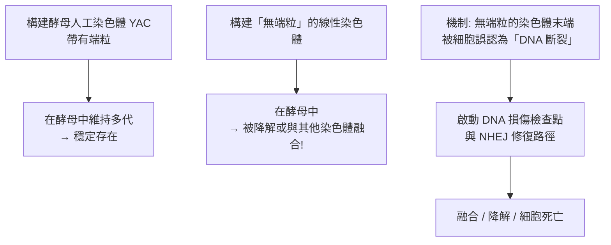
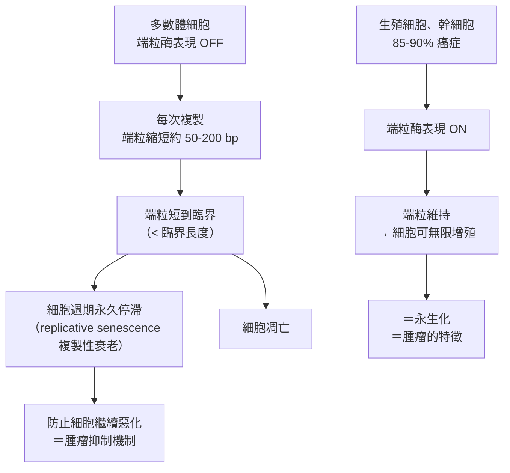

# 2009 · 端粒與端粒酶：布萊克本、格雷德與肖斯塔克解決「染色體的計時器」

> **2009 諾貝爾生理學 or 醫學獎**（共享三人）：伊麗莎白·海倫·布萊克本（Elizabeth H. Blackburn，澳洲／美國）— 表彰「發現端粒和端粒酶如何保護染色體」；卡羅琳·W·格雷德（Carol W. Greider，美國）與傑克·W·肖斯塔克（Jack W. Szostak，美國）— 同上。

## 懸案（案情提要）

1980 年代，細胞生物學有一個被稱為「**細胞生物學的兩大謎題之一**」的問題：

1. **端粒（telomere）**是線狀染色體的兩端。問題是：
   - 染色體的末端是「DNA 末端」，而 DNA 複製需要**引子（primer）**；
   - RNA 引子在複製後會被移除，而**移除後的那一段沒有引子可接**——**因此每一次複製，染色體都會縮短一點**；
   - 縮短的結果是**染色體末端的重要基因會逐漸流失**——**那麼，一個細胞怎麼能無限分裂？**
2. 而更神祕的是：**許多生物的染色體末端根本不是「平直」的**——它由**數百上千個串聯重複的短序列**構成，這些序列**不編碼任何蛋白質**。它們的功能是什麼？

**答案是：端粒既是「計時器」，也是「保護帽」。而讓「計時器」可以回捲的酵素，是端粒酶（telomerase）。**

## 前因

| 年份 | 事件 |
| --- | --- |
| 1930s | **Barbara McClintock** 在玉米研究中发现染色體末端存在「重複序列」，並稱之為「**端粒（telomere）**」；當時的遺傳學界認為這是「無意義的廢料」。 |
| 1930s–40s | **Alex Maury 與 Dmitry Ivanov** 描述了染色體末端的「末端重複（terminal repeats）」現象，為端粒的概念提供了形態學基礎。 |

| 1978 | **Elizabeth Blackburn 與 Carol Greider（當時是研究生）**在 Berkeley 研究**四膜蟲（Tetrahymena）的染色體末端**——她們發現端粒是由**一段重複的 DNA 序列（TTAGGG）串聯數百次**構成的。 |
| 1982 | **Greider 與 Blackburn** 用**四膜蟲的核糖核酸酵素**進行體外實驗，發現了一種能**延長 DNA 末端的酵素活性**——**端粒酶（telomerase）被發現**。 |
| 1983 | **Greider 與 Blackburn** 發表《** telomerase: a ribonucleoprotein that synthesizes telomeric DNA**》與《**The telomere proteins bind and protect the ends of telomeres**》——**端粒酶的生化特性與端粒結合蛋白（保護蛋白）的存在被確立**。 |
| 1984–1989 | **Jack Szostak 在 Harvard**研究**酵母菌（*Saccharomyces cerevisiae*）的端粒**——他發現**端粒是「保護帽」**：沒有端粒的染色體會被細胞誤認為「DNA 斷裂」，從而引發**DNA 損傷反應**並被降解或融合。 |
| 1989 | **Szostak 與 Blackburn** 在 **Yeast（酵母）人工染色體（YAC）**上證明：**端粒可以讓一條人工線性染色體在酵母中穩定維持**——**這是「端粒可被移植」的第一次實驗**，也是「人工染色體」技術的起點。 |
| 1990s | **端粒與細胞衰老、癌症的關聯**被確立（**Blackburn、Greider 等**發現：**多數體細胞的端粒酶是關閉的** → 端粒逐漸縮短 → 最終觸發**細胞衰老（senescence）**或**凋亡**——**這就是「複製性衰老」的分子機制**）；而**85%–90% 的癌症細胞重新啟動了端粒酶**以維持無限增殖。 |
| 2006 | **Carol Greider** 與 **Elizabeth Blackburn** 因端粒與端粒酶的研究獲 **Albany 醫學獎**；同年 **Jack Szostak** 與 Blackburn 獲 **Louisa Gross Horwitz 獎**。 |
| 2009 | 三人共享諾貝爾生理學 or 醫學獎。 |
| 2010s–2020s | **端粒酶的結構**（2013 年 NPT 複合體的 cryo-EM 結構）；**端粒干擾劑**；**端粒與免疫、與神經退行性疾病、與心臟病**的關聯研究；**端粒長度的人類遺傳變異**（TERT 啟動子多型性與壽命、癌症風險的關聯）。 |

## 調查

### 第一幕：麥克林托克的「重複序列」——40 年前的伏筆

這樁案子的起點其實要回到 1930 年代的玉米田：

1. **Barbara McClintock** 在研究玉米染色體時發現：**染色體的末端有一段重複的序列**，位置可變、數目可變——她稱之為「**端粒（telomere）**」（見 [1983-轉座子](1983-轉座子.md)）；
2. 當時的遺傳學界認為：這是「**無意義的廢料（junk）**」；
3. **但麥克林托克自己提出了另一個可能**：**也許染色體末端有某種「保護」的功能**——**她寫道：「端粒或許使染色體末端免於攻擊……端粒的性質或許是保護性的。」**（她因此在 1983 年獲諾獎後說：「我在 1940 年代就看到了端粒。」）

**四十年後，這句話被證實了。**

### 第二幕：布萊克本的實驗——「端粒是什麼？」

布萊克本的偵查起點極為幸運：**四膜蟲（*Tetrahymena*）**的染色體末端有**極大量的重複序列**（約 10,000 個重複，每個 6 bp：TTAGGG）——**這讓它成為研究端粒的理想材料**。

**她的實驗設計**：

```mermaid
flowchart TD
    A[四膜蟲染色體<br>末端有 (TTAGGG)ₙ 重複] --> B[用四膜蟲的核糖核酸酵素<br>在體外進行轉錄反應]
    B --> C{產物有什麼?}
    C -- 觀察到 --> D[一條<strong>單股</strong> DNA，<br>其序列為 (CCCTAA)ₘ 的<strong>互補</strong>，<br>且<strong>末端有一小段單股</strong>尾巴]
    D --> E[推論: 存在一種酵素<br>能在染色體末端<br>「合成」新的重複序列]
    E --> F[Greider 與 Blackburn 命名:<br>telomerase（端粒酶）]
```

**關鍵的觀察**：**產物是單股的，而且末端帶有一小段單股的「突出端（3' overhang）」**——**這就是端粒的結構特徵**。

### 第三幕：格雷德的「催化 RNA」發現——RNA 可以是酵素

Greider 的工作把本案推向最深處。她的實驗揭示了**端粒酶的化學本質**：

1. 她把酵素的樣本做各種**化學處理**（或用高鹽、或用核酸酵素、或用蛋白質酵素），觀察哪種成分是必需的；
2. **結果令人吃驚**：
   - **用 RNase（核酸酵素）處理 → 酵素活性喪失**；
   - **用蛋白質酵素（蛋白酶）處理 → 活性保留**；
3. **結論：端粒酶是一個「核糖核酸酵素（ribozyme）」——它的催化活性來自 RNA，而不是蛋白質！**

**這是生物學史上極為重大的發現之一**——它是「**RNA 世界假說（RNA world hypothesis）**」最有力的實驗證據之一（見 [1968-遺傳密碼](1968-遺傳密碼.md)）。

**而這也解釋了端粒酶為何長得「像」tRNA**：**端粒酶的 RNA 部分與 tRNA 高度同源**（它攜帶一個結合序列，並且它的 3' 末端帶有可延伸的模板序列）——**端粒酶在演化上可能是從 tRNA 演化而來的**。

### 第四幕：肖斯塔克的「端粒是保護帽」

肖斯塔克在酵母菌中的工作，回答了「端粒的功能」這個問題。

**他的實驗（1989）**：



**這是「端粒保護功能」的直接實驗**，並帶來一個深刻的概念轉變：

> **染色體末端在物理上與化學上與 DNA 內部「看起來不一樣」**——因此細胞的 DNA 損傷監控系統**不會**把它們當成斷裂。端粒因此被稱為染色體的「**保護帽（protective cap）**」。

**更精確的機制（1980s–90 年代）**：

1. 端粒結合蛋白（**TRF1、TRF2、POT1、TIN2**）形成 **shelterin（庇護複合體）**；
2. **TRF2** 促進端粒形成 **T-loop（端粒環）**——端粒的 3' 單股突出端「侵入」雙股區域，與另一條單股配對，形成一個環，**因此染色體末端不再是「裸露的 DNA 末端」**；
3. **POT1** 結合單股突出端，阻止它被 DNA 損傷修復系統（如 **MRN 複合體**與 **ATM**）識別；
4. 結果：**端粒既物理上封閉，又化學上被遮蔽**——雙重保護。

**「染色體末端不會被 DNA 損傷檢查點看見」這個發現的深遠意義**：它解釋了為什麼**幾乎所有癌症與基因治療的副作用（插入位置效應）都與染色體末端無關**，但**基因組內部的隨機插入則極其危險**。

### 第五幕：端粒生物學的「兩難」與它的解

**核心悖論**：

$$\text{端粒必須夠短，才能讓細胞數得清自己複製了幾次（mitotic clock）}$$
$$\text{端粒又必須夠長，才能保護染色體末端不被當作 DNA 損傷}$$

**細胞的解法**：



**這解釋了兩件看似矛盾的事**：

1. **為什麼正常細胞不會無限增殖**——因為端粒在倒數；
2. **為什麼 85%–90% 的癌症細胞能無限增殖**——因為它們**重新啟動了端粒酶**（**TERT 啟動子突變**是癌症中最常見的非編碼突變之一）。

**「端粒酶是癌細胞的特徵，不是原因」**——這個區分極為重要，也是今日**「端粒酶抑制劑」**（如 **imetelstat**，2024 年 FDA 核准用於骨髓纖維化）的作用邏輯：**只對端粒酶陽性、且不太依賴端粒的其他功能的細胞有效**。

### 第六幕：端粒與「衰老的計時器」

**端粒長度與生物年齡的相關性**：

$$L_{\text{telomere}} = L_0 - k \cdot (\text{分裂次數})$$

**實測數據**：**胎兒臍帶血細胞的端粒比 70 歲老人的長約 10–20 kb**；而**端粒酶活性**（如 **端粒酶-reverse transcriptase, TERT** 的啟動子多型性）與**壽命長短、癌症風險**有關聯——這是**遺傳學與「老化生物學」的交會**。

**現代的挑戰**：「**表觀遺傳時鐘**」（基於 DNA 甲基化的時鐘）與**端粒時鐘**給出的年齡估計**並不完全一致**——這說明「生物年齡」不是單一的量。

## 理論裁決

1. **端粒酶是一個「特殊的逆轉錄酶」**：它**用自身的 RNA 作模板**合成 DNA——**這是生物體中唯一一個「RNA → DNA」且以 RNA 為內在模板的常規機制**（HIV 的 RT 用的是**病毒基因組的 RNA**，模板是外來的）：

   $$\text{端粒酶} = \underbrace{\text{TERC（模板 RNA）}}_{\text{提供模板}} + \underbrace{\text{TERT（逆轉錄酵素）}}_{\text{催化}} + \text{其他蛋白質}$$

   **「RNA 作為模板」的必然性**，是演化史的強烈線索——**支持 RNA 世界假說**。

2. **序列專一性的難題**：端粒酶**只延伸特定的序列（人類為 TTAGGG）**，但它的模板 RNA 只有 1.5 圈——**它必須「滑動」（telomerase is a sliding clamp）**：

   $$\text{模板 RNA 與新合成 DNA 的配對} \xrightarrow{\text{轉位}} \text{下一圈模板}$$

   **這個「滑動機制」在 2013 年由結構研究揭示**（NPT 複合體的 cryo-EM 結構）。

3. **「複製性衰老」的數學**：端粒的逐次縮短提供了一個**細胞分裂次數的計數器**：

   $$n_{\max} \approx \frac{L_0 - L_{\text{crit}}}{\Delta L} \approx \frac{5000\ \mathrm{bp}}{50\text{–}200\ \mathrm{bp/次}} \approx 25\text{–}100\ \text{次}$$

   **這就是「Hayflick 極限」的分子解釋**（1961 年，Hayflick 發現人類纖維母細胞在培養中只能分裂約 50 次）。

4. **癌症的「永生化」代價**：端粒酶的重新啟動讓細胞逃過衰老，但也帶來**複製性危機（replication crisis）**的代價——**端粒過短會造成染色體末端融合（端粒危機）**，這是「**染色體不穩定 → 突變累積 → 癌症**」的因果鏈：

   $$\text{端粒酶 OFF} \to \text{端粒縮短} \to \begin{cases} \text{衰老/凋亡（抑癌）} \\ \text{端粒危機} \to \text{染色體融合} \to \text{基因組不穩定} \to \text{癌化} \end{cases}$$

## 追查支線（未結之謎）

- **布萊克本的科學生涯**：她是**第一位獲諾貝爾生理學 or 醫學獎的澳洲女性**；她與 **Carol Greider** 一起在 Berkeley 的「**端粒與端粒酶的實驗室**」工作——**這是一段極為罕見的「導師—研究生—共同獲獎」三人組**；**2004 年她被布希政府的「生命倫理委員會」解職**（因她對幹細胞研究的倫理意見與政府相左），**170 位科學家聯署公開信支持她**——這是科學家公民勇氣的著名案例；
- **格雷德的科學發現**：她的**核糖核酸酵素發現**（1984）是她研究生時期的工作；她也是**「RNA 世界假說」最熱心的倡議者之一**；她在 2014 年（Greider 的實驗室）證明**端粒酶可以延長細胞的壽命**（端粒酶基因治療的早期試驗）；
- **肖斯塔克的科學事業**：他曾任 **哈佛醫學院教授**（1991–2004），之後因**麻省理工的歧視訴訟**（2004 年）而辭職，這樁事件成為美國學術界性別歧視的著名案例；他於 2009 年獲諾獎；**他也是「RNA 世界」與神經系統「軸突再生」研究的推動者**（他的實驗室證明 **telomerase 的活化可促進脊髓損傷後的軸突再生**）；
- **端粒與神經退行性疾病**：**端粒縮短與阿茲海默、帕金森的關聯**是 2020 年代的研究熱點（雖然機制仍有爭議）；
- **端粒與免疫**：**T 細胞的端粒長度決定其克隆擴增能力與「免疫壽命」**——這解釋了為什麼年輕人的免疫反應較好，也解釋了**疫苗反應隨年齡下降**的現象；
- **2020 年代的延伸**：**端粒長度已可透過「端粒酶免疫測定（TELIS-qPCR）」**在一般血液樣本中測量，**成為生物老化研究的熱門指標**；而 **2024 年 FDA 核准的端粒酶抑制劑 imetelstat** 標誌著端粒研究從「基礎科學」正式進入「藥物開發」。

## 證物與數據（偵查卷宗摘錄）

| 證物 | 數值／內容 | 偵查意義 |
| --- | --- | --- |
| 麥克林托克的端粒（1930s） | 玉米染色體末端重複序列 | 40 年前的伏筆 |
| 四膜蟲端粒 | $(TTAGGG)_n$ ，約 10,000 重複 | 端粒的結構 |
| 端粒酶（1982–84） | 在體外延長染色體末端 | **酵素的發現** |
| **RNA 酵素性** | RNase 破壞活性、蛋白酶不破壞 | **RNA 世界假說的證據** |
| 端粒酶結構 | TERC + TERT + 蛋白質 | 「滑動」機制的解謎 |
| T-loop | 3' 突出端侵入形成環 | 端粒的保護機制 |
| shelterin | TRF1/TRF2/POT1/TIN2 等 | 端粒的保護複合體 |
| 無端粒染色體 | 被降解或融合 | **保護帽功能的直接實驗** |
| YAC | 帶端粒可穩定維持 | 端粒可被移植 |
| 每次複製縮短 | 約 50–200 bp | 計時器的刻度 |
| Hayflick 極限 | 約 50 次分裂 | 端粒短的細胞學對應 |
| 端粒酶在癌症 | 85%–90% 的腫瘤重新啟動 | 永生化的分子標記 |
| 端粒長度隨年齡 | 臍帶血比 70 歲長約 10–20 kb | 老化計時器的數據 |

## 後果

| 領域 | 影響 |
| --- | --- |
| 細胞生物學 | 端粒—端粒酶系統成為染色體生物學的核心；複製性衰老的機制。 |
| 腫瘤生物學 | 「端粒酶是永生化的標記」；端粒酶抑制劑的開發。 |
| 老化研究 | 端粒時鐘與表觀遺傳時鐘並列的生物年齡度量。 |
| 免疫學 | 端粒長度與免疫應答能力、疫苗反應。 |
| 演化生物學 | RNA 世界假說最有力的證據之一（核糖核酸酵素）。 |
| 其他諾獎 | 與 [1983-轉座子](1983-轉座子.md)（麥克林托克的伏筆）、[1968-遺傳密碼](1968-遺傳密碼.md)（RNA 世界）、[2001-細胞週期](2001-細胞週期.md)（細胞週期檢查點與端粒危機）構成染色體與細胞命運主線。 |

## 關聯

- [1983-轉座子](1983-轉座子.md) — 麥克林托克在 1930 年代就提出端粒的保護功能。
- [1968-遺傳密碼](1968-遺傳密碼.md) — RNA 世界假說與自由飄蕩假說的提出背景。
- [2001-細胞週期](2001-細胞週期.md) — DNA 損傷檢查點與端粒危機的交會。
- [1975-反轉錄與腫瘤病毒](1975-反轉錄與腫瘤病毒.md) — 端粒酶作為逆轉錄酵素的對照。
- [2017-晝夜節律](2017-晝夜節律.md) — 細胞的「時間」與「壽命」的另一種度量。
