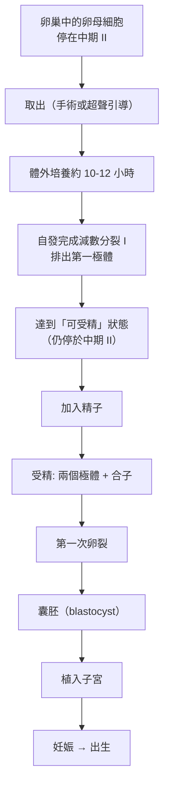

# 2010 · 試管嬰兒：愛德華茲把「體外受精」變成人類醫學的常規

> **2010 諾貝爾生理學 or 醫學獎**：羅伯特·傑弗里·愛德華茲（Robert Geoffrey Edwards，英國）— 表彰「因為在試管嬰兒方面的研究獲獎」（"for the development of in vitro fertilisation"）。

## 懸案（案情提要）

1950 年代末，醫學界有一個長久以來被視為「不可逾越」的障礙：

1. **受精**是生物學中最不可複製的過程之一——**一個精子進入一個卵細胞，兩套基因組融合，並啟動一整套精密的發育程式**；
2. 過去的嘗試（例如 1930 年代的「試管受精」）**全都失敗**——哺乳動物的卵細胞一旦離開輸卵管，就難以正常成熟；
3. 而「**無法生育**」是一個巨大的醫療與社會問題：**約 15% 的育齡夫妻面臨生育困難**；
4. 核心疑點：
   - **哺乳動物的卵能在體外成熟嗎？**
   - **精子需要什麼「啟動訊號」才能完成受精？**
   - **受精卵能正常分裂並形成囊胚嗎？**
   - **囊胚能植入子宮並發育成孩子嗎？**

**愛德華茲的答案是：只要解決「卵的體外成熟」，其餘問題都可以用最簡單的方式解決。**

## 前因

| 年份 | 事件 |
| --- | --- |
| 1930s–40s | 數以百計的「試管受精」嘗試失敗；** Gardner（1949）**在兔子上成功，但哺乳類仍不可複製。 |
| 1951 | **Robert Edwards** 在倫敦的 National Institute for Medical Research 開始研究哺乳動物的卵母細胞生理。 |
| 1959 | **Patrick Steptoe 與 Robert Edwards** 取得人類卵巢的卵母細胞，並發展**超聲引導的卵巢取卵（laparoscopy/laparotomy）**技術。 |
| 1960s | 愛德華茲與**婦產科醫師 Patrick Steptoe** 建立長期合作：Steptoe 提供臨床取卵與胚胎植入的技術平台，愛德華茲提供實驗室的受精與培養。 |
| 1962 | **Edwards 完成了哺乳動物卵母細胞的體外成熟**——**關鍵突破**：從卵巢取出的卵母細胞，在體外培養約 10–12 小時後，**自發完成減數分裂的第一減數分裂**（排出第一極體），達到「 metaphase II」的受精前狀態。 |
| 1963 | **Edwards 與他的同事（Bayliss、Purves）**發現：**在體外培養中，加入某種「使輸卵管上皮細胞條件化」的培養基成分後，精子能成功穿透卵細胞並發生受精**——**「受精素（fertility factor）」的概念**。後來知道，關鍵成分是**孕酮**（progesterone）。 |
| 1969 | **Steptoe 與 Edwards** 在 Edwards 的實驗室完成第一批人類體外受精的案例（當時使用的是「自體受精」以避免倫理問題）。 |
| 1977 | **第一例由 IVF 產生的嬰兒出生**（Louise Brown，1978 年 7 月 25 日出生，英國 Oldham）——**這是本案的核心事件**。 |
| 1978 | 愛德華茲發表《**In vitro fertilization and the replacement of human embryos**》（《體外受精與人類胚胎的替代》），完整記錄方法。 |
| 1980s–1990s | IVF 技術快速擴散：**ICSI（卵胞內單精子注射）**、**囊胚培養**、**玻璃化冷凍**、**胚胎植入前基因檢測（PGT）**。 |
| 1992 | **「第三代試管嬰兒」**：**在胚胎植入前取樣胚胎細胞做基因檢測**，並只移植沒有致病突變的胚胎——**「胚胎選擇」的倫理與技術議題由此誕生**。 |
| 2006 | 愛德華茲獲 **Lasker 獎**；2010 年獲諾貝爾生理學 or 醫學獎（**他於 2010 年 9 月 4 日去世，享年 87 歲**；諾獎由其妻子 Jeanne 代替領取）。 |
| 2010s–2020s | **胚胎幹細胞的誘導分化**（見 [2012-iPS 細胞](2012-iPS細胞.md)）與 IVF 的結合；**「胚胎模型（embryoid）」**（不需精子的胚胎）；**隔離基因轉殖嬰兒（2018 年，賀建坤）**引發的全球倫理爭議。 |

## 調查

### 第一幕：愛德華茲的第一個關鍵實驗——「把時間倒轉」

愛德華茲的偵查起點極為精準：**哺乳動物的卵母細胞在排卵時是「停住」的**——它在卵巢濾泡中就已完成了減數分裂的**前期 I**，並停在**中期 II**（metaphase II），等待受精的訊號。

**在體外，這個「等待」會結束**：卵母細胞離開濾泡的抑制環境後，會**自發地**繼續減數分裂並**排出第一極體**——**這就是「體外成熟」**。

**愛德華茲的關鍵洞察**：**「讓卵自發成熟」比「試圖阻止它成熟」容易得多**——他不需要逆轉生理過程，只需要**提供適當的培養環境並給予時間**。

**人類卵的體外成熟，比兔子的更難**——人類卵母細胞對培養條件極其敏感（顆粒細胞層的移除時機、培養基的成分、pH、滲透壓）。愛德華茲花了十年建立這套條件。

### 第二幕：精子為什麼需要「條件化培養基」？

**第二個謎題**：在體外培養皿中，精子往往**無法穿透卵細胞**——它會失去活力，或不發生頂體反應（acrosome reaction）。

**愛德華茲的實驗（1963 年）**：

1. 他把**人類輸卵管的上皮細胞**放入培養基中，然後加入精子；
2. 結果：**精子獲得了穿透卵細胞的能力**；
3. 這證明：**輸卵管不僅提供「位置」，還提供「化學訊號」**。

**後來的研究**（1980–90 年代）找到了那個訊號：

- **孕酮（progesterone）**：由輸卵管上皮細胞分泌，促進精子的** capacitation（容能）**——使精子的細胞膜發生修飾，獲得穿透卵的能力；
- **白蛋白、雌二醇、輸卵管的 cAMP 訊號**等也參與；
- **容能（capacitation）**如今被理解為：**精子的表面脂質被膽固醇與血清白蛋白的交換所改變**，使受體與 $\mathrm{Ca}^{2}^{+}$ 訊號機制就緒。

**這個發現的深遠意義**：它說明「**受精不只是精子與卵的相遇，還需要『環境的許可』**」——這在 30 年後的**體外受精優化**中持續扮演角色（如時間釋放 fertilization、**HCG 觸發排卵**等）。

### 第三幕：從「受精」到「孩子」——把每一步都變成可重複的

愛德華茲與 Steptoe 的工作在 1970 年代完成了一條完整的「製造流程」：

| 步驟 | 技術突破 | 難題 |
| --- | --- | --- |
| **1. 取卵** | **超聲引導的經陰道卵巢取卵**（取代開腹手術） | 必須避免損傷卵巢 |
| **2. 體外成熟** | 卵母細胞自發成熟（前述） | 培養基的每一個成分都要調對 |
| **3. 受精** | 加入精子並提供「容能」條件 | 精子的活力與受精率 |
| **4. 卵裂** | 受精卵在體外分裂成 2、4、8 細胞 | 培養基的更新頻率 |
| **5. 囊胚** | 發育至約 100–150 細胞的囊胚 | 哪個階段植入成功率最高（囊胚期 vs 卵裂期） |
| **6. 植入** | 在子宮內膜「著床窗」時植入 | 內膜的同步化（用激素控制） |
| **7. 妊娠** | **黃體支持**（黃體酮） | 早期黃體功能不足 |

**「著床窗」的發現是一個重要的醫學貢獻**：**子宮內膜只在特定的時間窗（排卵後 6–7 天，囊胚階段）允許著床**——這意味著**胚胎的時程必須與子宮的週期精確同步**，這是 IVF 用激素方案控制排卵與黃體支持的依據。

**「人類受精」的另一個重大進展**：**1992 年的 ICSI（卵胞內單精子注射）**——直接用顯微注射針把一個精子注入卵細胞，繞過了受精的全部自然過程。**這使得「只要有一個活精子就能得到孩子」**——這對**男性無精症**的治療是革命性的。

### 第四幕：數學——「成功率」這個問題

IVF 的臨床應用，必須回答一個統計問題：

$$P(\text{活產}) = P(\text{取到卵}) \times P(\text{成熟}) \times P(\text{受精}) \times P(\text{卵裂}) \times P(\text{植入}) \times P(\text{妊娠維持})$$

**Edwards 早期（1970 年代）的數據極為艱難**——因為那時 IVF 主要用於「輸卵管阻塞」等嚴重不孕症患者（成功率極低），而今日的主要适应症已轉為**高齡與輕度男性因素**，成功率大幅提高。

**今日的數據（全球）**：

| 指標 | 數值 |
| --- | --- |
| 全球每年 IVF 週期數 | 超過 200 萬 |
| 每週期的活產率 | 約 25%–35%（隨年齡下降） |
| 35 歲以下累積活產率 | 可超過 70%–80% |
| 40 歲以上 | 顯著下降 |
| 試管嬰兒占全球新生兒比例 | 約 1%（部分國家更高） |

**這些數字本身就是本案最重要的後果**：**它把「不孕」從一個命運變成了一個可被工程化處理的問題**。

### 第五幕：技術的延伸——從「受精」到「基因」到「胚胎模型」

**IVF 技術平台使以下原本不可能的事成為可能**：

1. **胚胎植入前基因檢測（PGT）**：取囊胚的滋養層細胞做基因檢測 → 選擇健康胚胎移植——**這是「胚胎選擇」的技術基礎**；
2. **染色體篩查（PGT-A）與植入前基因檢測（PGT-M）**：分別針對染色體數目異常與單基因病；
3. **「胚胎模型（stem-cell based embryo models, 胚體）」**：**用幹細胞在體外培養出「類囊胚」的結構**，2020 年代由**山中伸彌與 Zernicka-Goetz 等人**發展；**
4. **2021 年後的「體外配子（in vitro gametogenesis）」**：從 iPS 細胞產生精子與卵細胞——**這是愛德華茲的技術與山中伸彌的技術的交會點**。

## 追查支線（未結之謎）

- **愛德華茲與 Steptoe 的合作與摩擦**：Steptoe 是劍橋的婦產科醫師，愛德華茲是生理學家——**兩人的合作極為密切，但也有摩擦**（Steptoe 曾因研究方法與倫理問題與愛德華茲的團隊產生爭執）；**1972 年，愛德華茲的第一位胚胎研究助理辭職**，一度使研究停擺，這也是「科學團隊的人事脆弱性」的著名案例。
- **諾貝爾委員會的決定與遺憾**：委員會在愛德華茲去世後仍決定授獎——**這在諾獎史上是罕見的情形**（因為諾獎通常不追溯授予已故者，但委員會認為「獎項應頒給正確的人」）；他的妻子 Jeanne Edwards 代替他領獎，並在典禮上發表動人演說；
- **宗教與倫理的抗辯**：**天主教教會**（教宗保羅六世）與部分哲學家曾反對 IVF（認為製造胚胎涉及「生命的干預」），但最終在**「不對人類胚胎進行實驗」的倫理限制**下獲得認可——**這種「方法可行 + 倫理邊界」的協商模式**成為今日胚胎研究的通用框架；
- **2018 年賀建坤事件**：中國的 **He Jiankui（賀建坤）**宣稱利用 **CRISPR 編輯 CCR5 基因**製造了**「基因編輯嬰兒」（露露與娜娜）**——**這是科學史上最嚴重的倫理事件之一**，引發全球醫學界的譴責與中國的監管改革；**2019 年，賀建坤被中國法院以「非法行醫罪」判處有期徒刑三年**——**這是本案技術延伸的黑暗面，也是必須記錄的警告**；
- **全球 IVF 產業**：**全球每年超過 200 萬個 IVF 週期**，涉及約 750 萬個胚胎；**冷凍胚胎的保存數量已超過數千萬個**——**這帶來了「胚胎的法律身分」「跨境代孕與卵母細胞買賣」等一整片新倫理議題**。

## 證物與數據（偵查卷宗摘錄）

| 證物 | 數值／內容 | 偵查意義 |
| --- | --- | --- |
| 卵母細胞體外成熟 | 約 10–12 小時 | 核心技術突破（1962） |
| 減數分裂狀態 | 從中期 I 前 → 完成減數分裂 I → 中期 II | 「讓它自己走完」 |
| 輸卵管上皮條件化培養基 | 使精子獲得穿透能力 | **「容能」訊號的發現（1963）** |
| 關鍵成分 | 孕酮（後被確認） | 環境「許可」受精 |
| 首例 IVF 出生 | 1978-07-25（Louise Brown） | 里程碑 |
| ICSI（1992） | 顯微注射單一精子 | 繞過受精的天然過程 |
| 囊胚培養 | 100–150 細胞 | 著床的最佳階段 |
| 著床窗 | 排卵後 6–7 天 | 胚胎—子宮同步化 |
| 全球週期數 | 超過 200 萬／年 | 臨床規模 |
| 活產率 | 約 25%–35%／週期 | 現代水準 |
| 新生兒占比 | 約 1% | 人口學的影響 |

## 理論裁決

1. **IVF 的多步驟成功率乘積律**：每一次治療的活產率是各步驟成功的乘積：

$$P(\text{活產}) = P(\text{取到卵}) \times P(\text{體外成熟}) \times P(\text{受精}) \times P(\text{卵裂}) \times P(\text{囊胚}) \times P(\text{著床}) \times P(\text{妊娠維持})$$

**這個乘積律解釋了為何「單步驟成功率已經很高」的現代 IVF 仍只有約 30% 的成功率**——**任何一步的低成功率都會被乘進來**。因此**改善任一步的效率都會成比例地提高總成功率**，這是 IVF 過去 40 年進步的數學邏輯。

2. **「窗口」理論：時間的同步**：胚胎與子宮必須精確同步：

$$\text{著床窗：排卵後} \approx 6\text{–} 7\ \text{天}, \qquad \text{胚胎階段：囊胚（100–150 細胞）}$$

$$\Longrightarrow \text{因此必須用激素方案（GnRH 激動劑 + hCG 觸發排卵 + 黃體酮支持）來「對齊」兩個週期}$$

**這解釋了 IVF 治療中「為何要打那麼多針」**——**它是時間同步的工程學**。

3. **容能（capacitation）的動力學**：精子需經過時間依賴的「容能」過程才能受精：

$$P(\text{受精能力}) = 1 - e^{-t/\tau_{\text{cap}}}, \qquad \tau_{\text{cap}} \sim \text{數小時}$$

**這解釋了為何「洗淨後立即受精」成功率較低**（精子尚在容能過程中），而**在含輸卵管上皮條件化因子的培養基中孵育一段時間**則可大幅提高受精率。

4. **胚胎的「all-or-none」發育律**：在胚胎發育的早期，**一個細胞的命運決定似乎具有二元性**（一個細胞分裂為兩個，或發生凋亡），因此：

$$N_{	ext{細胞}} \approx 2^n \quad (n = \text{分裂次數})$$

**這解釋了為何胚胎在桑椹胚前的分裂是「幾乎同步」的**，也解釋了為何胚胎嵌合（部分細胞帶有不同基因型）在人類中極罕見（**人類胚胎的細胞分裂是同步的**）。

5. **ICSI 對「受精率」與「妊娠率」的分離**：顯微注射繞過了受精的化學步驟，因此**受精率可達 80%**，但**妊娠率仍受限於著床與胚胎品質**：

$$\text{受精率} \uparrow \text{（ICSI）} \qquad \text{vs} \qquad \text{活產率} \uparrow \text{（取卵與胚胎篩選）}$$

**這解釋了為何 ICSI 對男性因素不育是重大突破，但對一般族群（非男性因素）的活產率提升有限**——**它解決的是鏈條中的一環，不是整條鏈**。

## 後果

| 領域 | 影響 |
| --- | --- |
| 生殖醫學 | 不孕治療從「無望」變為常規；人工生殖成為醫學的常態技術。 |
| 胚胎生物學 | 體外胚胎培養開啟了「胚胎學」的實驗研究（受體、訊號、發育的機制）。 |
| 幹細胞生物學 | IVF 技術（超聲取卵、體外成熟、玻璃化冷凍）成為 iPS 細胞與胚胎幹細胞研究的基礎設施。 |
| 遺傳學 | PGT 使「胚胎層級的遺傳篩選」成為常規；也帶來「設計嬰兒」的倫理挑戰。 |
| 醫學倫理 | 全球最大的倫理規範建構（胚胎的權利、跨境生殖、基因編輯的紅線）。 |
| 其他諾獎 | 與 [2012-iPS 細胞](2012-iPS細胞.md)（技術交會）、[2015-青蒿素與阿維菌素](2015-青蒿素與阿維菌素.md)（以人工技術對抗熱帶疾病）、[2023-mRNA 疫苗](2023-mRNA疫苗.md)（細胞與核酸技術的延伸）構成生殖與生物技術主線。 |

## 關聯

- [2012-iPS 細胞](2012-iPS細胞.md) — 細胞命運可被重編程，與 IVF 技術交會。
- [1935-胚胎組織者](1935-胚胎組織者.md) — 胚胎發育的調控原理。
- [1995-胚胎發育基因](1995-胚胎發育基因.md) — 細胞命運的分子機制。
- [2001-細胞週期](2001-細胞週期.md) — 早期胚胎的細胞週期與幹細胞的自我更新。
- [2023-mRNA 疫苗](2023-mRNA疫苗.md) — 生殖醫學與核酸技術的當代延伸。
