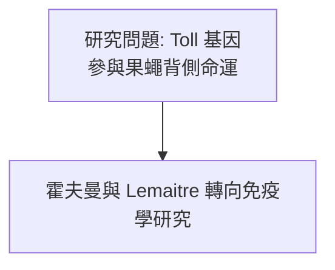
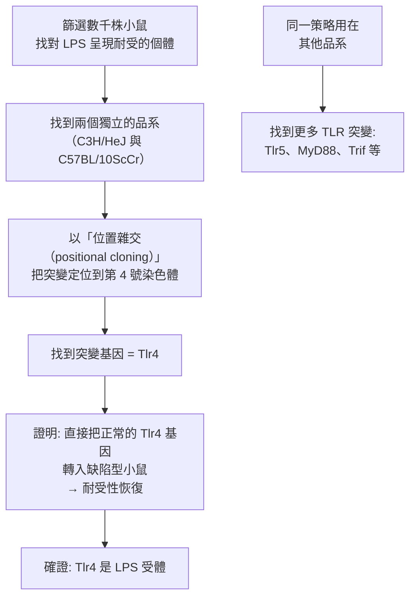

# 2011 · 先天免疫的激活與樹突細胞：霍夫曼、比特勒與斯坦曼補上免疫系統的第一道防線

> **2011 諾貝爾生理學 or 醫學獎**（共享三人，其中斯坦曼於頒獎前去世）：朱爾·阿方斯·霍夫曼（Jules A. Hoffmann，盧森堡／法國）與布魯斯·比特勒（Bruce Alan Beutler，美國）— 共享一半獎金，表彰「發現先天免疫的激活」；拉夫·M·斯坦曼（Ralph M. Steinman，加拿大／美國）— 共享另一半，表彰「發現樹突細胞及其在適應性免疫中的作用」。**斯坦曼於 2011 年 9 月 30 日去世，10 月 3 日被諾貝爾委員會宣布獲獎——這是諾獎史上第一例「死後獲獎」。**

## 懸案（案情提要）

免疫學在 2000 年代有一個被許多人心照不宣地迴避的問題：

1. **教科書把免疫系統分成兩大部分**：「**先天（innate）**」與「**適應性（adaptive）**」；
2. **適應性免疫**在 1960 年代後被破解得很漂亮（抗體結構、重排機制、MHC 限制性，見 [1972-抗體結構](1972-抗體結構.md)、[1987-抗體多樣性](1987-抗體多樣性.md)、[1996-MHC 限制性](1996-MHC限制性.md)）；
3. **先天免疫卻像一個「黑箱」**：它確實存在（吞噬細胞、發炎、補體、自然殺手細胞），但**它如何「辨認」病原？** 尤其——**它如何辨認數以萬計的不同病原分子，卻只用少數分子？**
4. 而更尖銳的問題：**先天免疫與適應性免疫如何「對話」？** 沒有這個對話，疫苗就不可能運作（疫苗的本質是「借用先天免疫來啟動適應性免疫」）。

**2011 年諾獎的答案**：**Toll 樣受體（TLR）**是先天免疫的「辨認器」；**樹突細胞**是兩套系統之間的「翻譯者」。

## 前因

| 年份 | 事件 |
| --- | --- |
| 1980s | **霍夫曼**在法國 Strasbourg 研究**果蠅胚胎的背腹軸命運決定**，發現 **Toll 基因**參與其中——當時完全不知道它與免疫有關。 |
| 1985–1986 | **Bruno Lemaitre 與 Jules Hoffmann** 發現：**若果蠅的 Toll 基因突變，注入真菌後會死亡**（正常果蠅能抵抗真菌感染）——**Toll 基因其實是「抗真菌的免疫受體」**。這是先天免疫受體生物學的開端。 |
| 1990s | **Shizuo Akira** 在 Osaka 大學克隆出**哺乳動物的 Toll 樣受體（TLR4）**，並證明 **TLR4 是細菌脂多醣（LPS） 的受體**。 |
| 1996 | **Beutler** 在 **UT Southwestern** 發現兩個**對 LPS 呈現耐受的小鼠品系**，其突變基因是 **Tlr4**——**第一個人類的 TLR 突變（人類的 TLR4 變異與敗血症的易感性有關）**。 |
| 1999 | **Beutler 團隊**發現 **Tlr4 突變的「缺陷型（LPS 低反應）」小鼠**，並以**位置雜交（positional cloning）**定位了突變基因——這是「從表型到基因」的正向遺傳學的漂亮案例。 |
| 1970s | **Ralph Steinman** 在 Rockefeller 研究所（Zanvil Cohn 的實驗室）研究**小鼠脾臟**，發現了一類**新的細胞**：它們能**活化 T 細胞**的能力遠超巨噬細胞——他命名為**樹突細胞（dendritic cell）**。 |
| 1973 | **Steinman 發表首篇樹突細胞論文**——當時幾乎無人注意；**「樹突細胞」這個名稱來自他在顯微鏡下看到的細胞突起**。 |
| 1980s–2000s | **樹突細胞的地位逐步確立**：它們是**最強的抗原呈現細胞（APC）**，是**唯一能活化「初始 T 細胞（naïve T cell）」的細胞**——這是免疫啟動的關鍵；**1990 年代的 $\mathrm{CD4}^{+}$ $\mathrm{CD8}^{+}$ -DC 與 cDC1/cDC2 的分類**使其機制更清楚。 |
| 2001–2006 | **Steinman 與其同事**證明樹突細胞源自骨髓、並在感染部位從單核細胞分化而來；他也確立了「樹突細胞的免疫調節作用」與「抑制自身免疫」的角色。 |
| 2008–2011 | **樹突細胞與疫苗的關係**成為免疫學最活躍的領域（DC 疫苗、化學佐劑理論）；同時，**「樹突細胞在自身免疫中的角色」**（避免自身反應）也被確立。 |
| 2011 年 10 月 3 日 | **諾貝爾委員會宣布斯坦曼獲獎**；斯坦曼已於 9 月 30 日因大腸癌與肺癌去世。**諾貝爾委員會表示，此事將不影響授獎，並指出該獎項頒發時他「在不知情的狀況下」無法接受。** |
| 2018 | **諾貝爾委員會正式取消「已故者不得獲獎」的規則**（此規則自 1974 年起適用）。 |

## 調查

### 第一幕：霍夫曼的「果蠅的抗真菌防線」——從背側命運到免疫

霍夫曼的研究起點是一個「不相干」的問題：**果蠅胚胎的背腹軸如何決定？** 他在 1980 年代發現 **Toll 基因**參與其中。

**1985–1986 年的轉折**：



*（改以正文敘述。）*

| 步驟 | 內容 |
| --- | --- |
| 1 | 霍夫曼與 **Bruno Lemaitre** 發現：**Toll 突變的果蠅在注射真菌（*Candida albicans*）後死亡** |
| 2 | 而正常果蠅能抵抗真菌感染 |
| 3 | 對照：**Toll 突變果蠅在注射細菌後仍能存活** → Toll 專門對抗**真菌** |
| 4 | 推論：**Toll 是一個「病原感受器」**，而非單純的發育基因 |

**這個發現的科學意義極大**：它第一次證明**「先天免疫」有特異性的分子辨認機制**——**不是「貪吃一切」，而是「辨認特定類别的病原分子」**。

### 第二幕：TLR 家族的建立——「病原的分子指紋」

**Akira 的哺乳動物 TLR4 克隆**（1990 年代）開啟了整個家族：

```mermaid
flowchart TD
    A[細菌 LPS<br>革蘭氏陰性菌外膜] --> TLR4
    B[細菌鞭毛蛋白] --> TLR5
    C[細菌肽聚醣] --> TLR2（TLR2/TLR6）
    D[酵母甘露聚糖<br>細胞壁成分] --> TLR2/TLR1
    E[病毒雙股 RNA] --> TLR3
    F[細菌 CpG DNA] --> TLR9
    G[尿路致病菌的鞭毛蛋白] --> TLR11（小鼠）
    H[內源性 DAMPs<br>（熱休克蛋白、HMGB1、尿酸結晶）] --> TLR2/4/7/9
```

**TLR 的辨認邏輯非常漂亮**：

$$\text{TLR 的 LRR 結構} \xrightarrow{\text{直接辨認}} \text{病原的分子指紋}$$

**TLR 與 IL-1 受體（IL-1R）共享胞內的 **TIR 結構域**——這是**訊號傳遞的共同接口**：

$$\text{TLR} \to \underbrace{\text{MyD88} \to \text{IRAK} \to \text{TRAF6}}_{\text{共同路徑}} \to \underbrace{\text{NF-}\kappa\mathrm{B} \to \text{I}\kappa\mathrm{B} \text{降解} \to \text{NF-}\kappa\mathrm{B} \text{入核}}_{\text{發炎基因表現}}$$

**TLR 的識別還有第二條路徑——TRIF → IRF3 → 干擾素 I 型**——這解釋了為何 TLR3（dsRNA）主要誘發干擾素而非 NF-κB。

### 第三幕：比特勒的「兩個耐受小鼠品系」——正向遺傳學的漂亮應用

比特勒的偵查起點極為實際：**1970–80 年代，人類的「敗血症（sepsis）」研究陷入僵局**——知道 LPS 會引起休克，但不知道細胞如何「看到」它。

**他的策略是「從表型反推基因」**：



**「基因轉入救援實驗」是因果性的鐵證**——**這與「敲除小鼠」互補**（見 [2007-胚胎幹細胞](2007-胚胎幹細胞.md)）：敲除是「拿掉看表型」，救援是「放回去看恢復」。

**「位置雜交」的數學**：利用連鎖分析，把突變基因定位到染色體的一段：

$$\text{連鎖} \Rightarrow \text{候選區段} \xrightarrow{\text{細化}} \text{單一基因}$$

**這套方法在 1990–2010 年代被用於數百個免疫基因的發現**——**它是免疫遺傳學的工業化方法**。

### 第四幕：斯坦曼的樹突細胞——「翻譯者」

斯坦曼的發現是本案在「細胞生物學」一側的關鍵：

**他的實驗設計**：

1. 他在小鼠脾臟中尋找「能活化 T 細胞」的細胞；
2. 發現一類細胞，其**表面分子（ MHC II + 共刺激分子 B7）** 表達量**遠高於巨噬細胞**；
3. 關鍵測試：**把 T 細胞與不同細胞混合，測量其增殖反應**——

| 細胞類型 | 活化初始 T 細胞的能力 |
| --- | --- |
| 巨噬細胞 | 弱（需大量抗原） |
| B 細胞 | 弱（且有抗原專一性） |
| **樹突細胞** | **強，且無需預先致敏** |

4. **他在顯微鏡下看到這些細胞有大量樹枝狀突起**——**「樹突細胞」之名由此而來**。

**樹突細胞的生物學意義**：

```mermaid
flowchart TD
    A[病原入侵<br>或組織損傷] --> B[未成熟的樹突細胞<br>在周邊組織駐留<br>（如皮膚）]
    B --> C[攝取抗原<br>並感知「危險訊號」<br>（DAMPs、PAMP、感染）]
    C --> D[成熟:<br>① 遷移到淋巴結<br>② 上調 MHC 與共刺激分子<br>③ 分泌細胞激素]
    D --> E[在淋巴結中<br>以三個訊號活化初始 T 細胞<br>（見 [1996-MHC 限制性](1996-MHC限制性.md)）]
    E --> F1[產生效應 T 細胞<br>（細胞毒/輔助）]
    E --> F2[產生 B 細胞反應<br>（藉由 T 依賴性輔助]
    F1 --> G[免疫應答<br>＋ 免疫記憶]
    F2 --> G
    H[未受刺激的樹突細胞<br>呈現自身抗原但缺乏共刺激] --> I[→ 耐受 / 免疫調節<br>（防止自身免疫）]
```

**樹突細胞的「雙重角色」是 2011 年諾獎最深刻的洞見**：

| 情境 | 結果 |
| --- | --- |
| **病原信號 + 損傷信號** | 成熟 → **活化 T 細胞**（免疫啟動） |
| **只有自身抗原，無危險信號** | 不成熟 → **耐受**（免疫耐受，防止自身免疫） |

**「危險模型（danger model）」**（由 **Peter Medawar** 提出，見 [1960-後天免疫耐受](1960-後天免疫耐受.md)）在此獲得了細胞基礎：**免疫系統不只認「非我」，更認「危險」**。

### 第五幕：為什麼樹突細胞的存在讓斯坦曼的獎特別

**2011 年諾獎委員會的公告有一段著名的說明**：

> 「斯坦曼先生發現了一種新的免疫細胞類型，並揭示了它的功能。**樹突細胞活化 T 細胞的能力，構成了免疫應應的啟動點**。」

**更關鍵的是**：樹突細胞**不僅啟動免疫，還主動抑制不該發生的免疫**——這解釋了**「免疫耐受」與「自身免疫」**的平衡機制。

**斯坦曼的科學生涯與他的遺憾**：

- 他在 1973 年發表樹突細胞論文時，**學界基本沒有反應**（許多人認為這是「技術假象」）；
- 他花了 30 年時間建立這個領域；
- 他於 **2011 年 9 月 30 日**因大腸癌與肺癌去世，**三天後（10 月 3 日）諾貝爾委員會宣布他獲獎**；
- **諾貝爾委員會當時不知道他已去世**，並在公告中說明「斯坦曼先生自己也不知道他被授予了諾貝爾獎」；
- 委員會隨即決定**仍照常頒獎**，並在 2012 年的補頒儀式上向他的家人致意；
- **2018 年，委員會正式廢除了「已故者不得獲獎」的規則**（此前自 1974 年起適用）——**這樁案例直接推動了規則的改變**。

## 理論裁決

1. **先天免疫的「模式辨認」數學**：TLR 的辨認不是「隨機」，而是**「分子指紋的比對」**：

   $$P(\text{被辨認}) \approx f(\text{結構特徵的匹配程度})$$

   演化上的邏輯是：**病原的分子結構（ peptidoglycan、LPS、flagellin、dsRNA）是保守的**——它們是「病原的通用標誌」，而宿主細胞的表面沒有這些。因此**以這些結構為靶的受體，能在不需事先適應的情況下立即辨認病原**。**這就是「先天」的含義：不需要免疫記憶，硬編碼在基因組裡。**

2. **先天—適應的「翻譯」模型**：樹突細胞把「先天偵測」翻譯成「適應性啟動」：

   $$\text{PAMP} \xrightarrow{\text{TLR}} \text{NF-}\kappa\mathrm{B}\text{ 活化} \xrightarrow{\text{DC 成熟}} \text{MHC + 共刺激} \xrightarrow{} \text{T 細胞活化}$$

   **如果沒有這一步，疫苗就無效**——因為適應性免疫需要「共刺激信號」，而這個信號是由樹突細胞提供的。**這解釋了為何「佐劑（adjuvant）」有效**（佐劑的作用就是「激活樹突細胞」）。

3. **危險判定的邏輯**：免疫啟動需要**兩個信號**（這是 1990 年代的「兩信號模型」）：

   $$\text{信號 1（抗原-MHC）} + \text{信號 2（共刺激 / 危險信號）} \Rightarrow \text{活化}$$

   **缺乏信號 2 → 耐受**。這解釋了：為何**腫瘤抗原不會引起免疫反應**（缺乏危險信號）、為何**自身抗原在正常情況下不引起反應**、為何**疫苗需要佐劑**。

4. **「TLR 劑量—效應」的雙相性**：**TLR 的活化並非越強越好**——過度活化會造成「免疫病理」：

   $$\text{適度 TLR 活化} \to \text{保護} \qquad \text{過度 TLR 活化} \to \text{敗血症、器官損傷}$$

   這解釋了**敗血症的病理機制**：不是感染本身殺死病人，而是**宿主對感染的反應**殺死病人——今日的免疫調節治療（免疫抑制 vs 免疫刺激的精確平衡）正建立在此。

## 追查支線（未結之謎）

- **斯坦曼與「死後獲獎」的倫理討論**：他的家人得知獲獎後**極為感動**（他生前一直認為自己會被提名但不會獲獎）；委員會主席在致詞中表示「他的逝世使這次頒獎帶上了一層特別的憂傷與光榮」；**2018 年的規則改革**使這樁案例成為分水嶺；
- **霍夫曼的科學教育投入**：他在 Strasbourg 建立了實驗室，並推動**昆蟲免疫學**作為學科；他也發起了**「科學與社會」**的倡議（他曾當選法國科學院主席 2007–2008 年）；
- **比特勒的科學生涯**：他曾在 **Scripps（Rockwell, 1980s）**與 **UT Southwestern** 工作；他是**先天免疫遺傳學**的奠基人；他也推動**「人類 TLR 多型性與感染易感性」**的人類學研究；
- **TLR 與人類疾病**：**TLR4 的多型性**與**敗血症、結核、瘧疾的嚴重程度**相關；**TLR7/9 與紅斑狼瘡**（TLR9 缺陷小鼠會得狼瘡）；**TLR 與過敏、哮喘**；
- **樹突細胞疫苗**：2010 年代的 **Sipuleucel-T（前列腺癌疫苗）**是首個以樹突細胞為基礎的獲批療法——**它把斯坦曼 40 年前的工作直接轉化為藥物**；
- **「危險信號（DAMP）」研究的興起**：細胞死亡釋放的內源性分子（**HMGB1、尿酸、ATP、組蛋白、細胞 DNA**）作為「危險信號」的發現，把免疫學與細胞死亡（見 [2002-程式性死亡](2002-程式性死亡.md)）連接起來。

## 證物與數據（偵查卷宗摘錄）

| 證物 | 數值／內容 | 偵查意義 |
| --- | --- | --- |
| Toll 突變果蠅 | 注射真菌後死亡 | **先天免疫受體的存在** |
| 對照 | 注射細菌後仍存活 | 辨認的「類別特異性」 |
| TLR4 克隆 | 哺乳動物 TLR4（Akira） | 家族的形成 |
| LPS 耐受小鼠品系 | C3H/HeJ 與 C57BL/10ScCr | 「從表型到基因」的樣本 |
| 位置雜交 | 突變定位於第 4 號染色體 | 遺傳學方法 |
| Tlr4 轉入救援 | 耐受性恢復 | **因果性的鐵證** |
| TLR 的配體 | LPS、flagellin、dsRNA、CpG | 「病原指紋」 |
| TIR 結構域 | 與 IL-1R 共享 | 訊號傳遞的共同接口 |
| MyD88 路徑 | IRAK → TRAF6 → NF-κB | 發炎基因表現 |
| TRIF 路徑 | IRF3 → 干擾素 I 型 | 抗病毒的第二路徑 |
| 樹突細胞命名 | 顯微鏡下的樹枝狀突起 | 1973 年的發現 |
| 初始 T 細胞活化 | 唯一能有效活化 naïve T 細胞的 APC | **免疫啟動的關鍵** |
| 危險信號 | DAMPs（HMGB1、尿酸、細胞 DNA） | 「危險模型」的細胞基礎 |
| 死亡與獲獎 | 2011-09-30 去世；10-03 宣布 | 死後獲獎的第一例 |

## 後果

| 領域 | 影響 |
| --- | --- |
| 免疫學 | 先天免疫從「模糊的背景」升格為「有受體、有機制、有遺傳學的主學科」。 |
| 感染性疾病 | 敗血症的機制被理解為「宿主反應失調」，開啟了免疫調節治療。 |
| 疫苗學 | 「佐劑 = 活化樹突細胞」的理論；DC 疫苗成為藥物類別（Sipuleucel-T）。 |
| 自身免疫 | 樹突細胞在耐受與自體免疫中的角色確立。 |
| 諾獎制度 | 死後獲獎的第一例，並直接導向 2018 年的規則改革。 |
| 其他諾獎 | 與 [1960-後天免疫耐受](1960-後天免疫耐受.md)（耐受的理論）、[1996-MHC 限制性](1996-MHC限制性.md)（T 細胞的活化機制）、[2002-程式性死亡](2002-程式性死亡.md)（危險信號）、[2007-胚胎幹細胞](2007-胚胎幹細胞.md)（TLR 的正向遺傳學）構成免疫學主線。 |

## 關聯

- [1960-後天免疫耐受](1960-後天免疫耐受.md) — 耐受的理論源頭，本案給出細胞基礎。
- [1996-MHC 限制性](1996-MHC限制性.md) — 樹突細胞要活化的那三個訊號。
- [2002-程式性死亡](2002-程式性死亡.md) — 細胞死亡釋放的 DAMPs 是「危險信號」。
- [2007-胚胎幹細胞](2007-胚胎幹細胞.md) — 比特勒的正向遺傳學與敲除互補。
- [2018-免疫檢查點](2018-免疫檢查點.md) — 樹突細胞與 T 細胞啟動的現代延伸。
