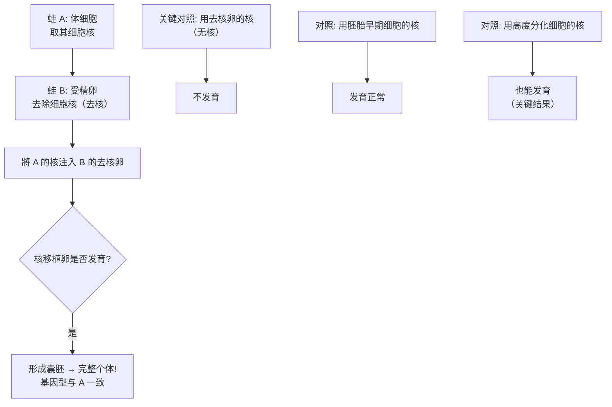
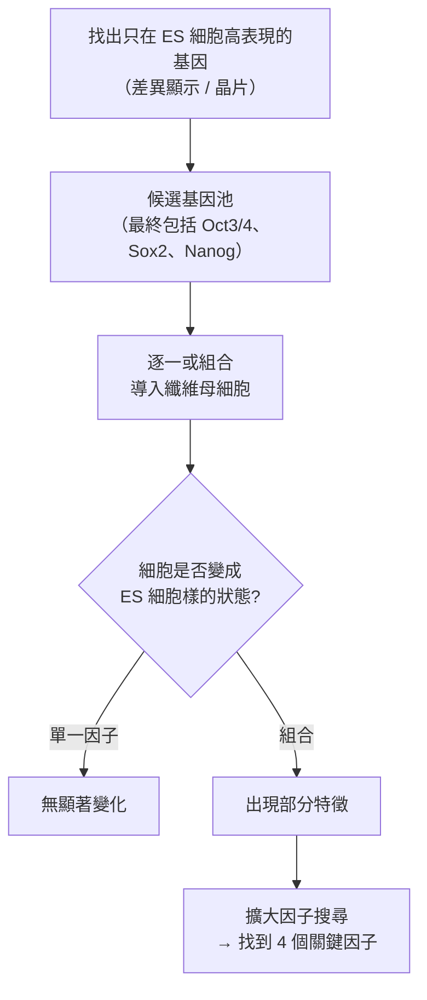

# 2012 · 成熟細胞的重編程：格登與山中伸彌讓皮膚細胞回到幹細胞

> **2012 諾貝爾生理學 or 醫學獎**（共享）：約翰·伯特蘭·格登爵士（Sir John B. Gurdon，英國）— 表彰「發現成熟細胞可被重寫成多功能細胞」；山中伸彌（Shinya Yamanaka，日本）— 同上。

## 懸案（案情提要）

2000 年代初，生物學界有一個被視為「神聖不可侵犯」的教條：

1. **細胞的命運一旦決定，就不可逆**——一個皮膚細胞不能變成神經元，一個神經元不能變成肌肉；
2. **「分化」的極性**是發育生物學的基本教條：**越分化的細胞，能力越窄**（「**分化越久，潛能越小**」）；
3. 唯一的「例外」是**生殖系**：**生殖細胞在受精後可以重新產生整個個體**——**這意味著，細胞的「全能性」並沒有真正消失，而是被「封存」了**。

**格登與山中伸彌的答案**：**這種「封存」是可以被解除的**——**只要提供正確的因子，已分化的細胞可以被「重編程」回多能狀態。**

這樁案子是 20 世紀生物學最重要的「不可能」被打破的一刻。

## 前因

| 年份 | 事件 |
| --- | --- |
| 1952–1962 | **John Gurdon** 在牛津以**蛙的核移植實驗**展開偵查：把一個體細胞的**細胞核**移植入**去核的卵細胞**中，觀察是否能發育出完整的個體。 |
| 1962 | **Gurdon 的突破性結果**：**用已分化的（如腸或皮膚）體細胞核，產生了完整的蝌蚪！** |
| 1962 | Gurdon 的結論：**「每個細胞的基因組都含有全套發育成完整個體所需的基因」——分化不是基因的改變，而是基因表現的改變**。 |
| 1970s–1980s | Gurdon 轉向**青蛙卵母細胞（oocyte）中 mRNA 的功能研究**——**這段「卵母細胞的分子生物學」訓練，後來成為山中伸彌逆轉錄方法的關鍵**。 |
| 1980s | **山中伸彌**在京都開始研究**胚胎幹細胞（ES 細胞）**的分子基礎——他想知道：**是什麼分子讓胚胎細胞「保持全能」？** |
| 1987 | **山中伸彌在小鼠 ES 細胞中分離出三個「維持多能性」的基因**：**Oct3/4、Sox2、Nanog**。 |
| 1999–2000 | 山中伸彌以**逆轉錄病毒**將這三個基因導入**纖維母細胞**，觀察細胞是否轉變為胚胎幹細胞樣的狀態——**實驗結果為陰性**（他曾認為是病毒載體的問題）。 |
| 2000–2001 | **山中伸彌改用腺病毒載體**，並加入**抑制 mRNA 降解的基因（ryndomycin?）** —— 最終他發現 **24 個因子（其中 4 個關鍵因子：Oct3/4、Sox2、Klf4、c-Myc）** 足以把纖維母細胞轉變為**誘導性多能幹細胞（iPS 細胞）**。 |
| 2006 | **山中伸彌的第一篇 iPS 論文**發表（*Cell*），提出四因子：**Oct3/4、Sox2、Klf4、c-Myc**（其中 **Klf4 是山中自己找到的關鍵因子**）。 |
| 2006–2007 | iPS 技術迅速擴展：**山中伸彌與 Kazutoshi Takahashi** 在 2007 年以四因子導入**人類纖維母細胞**，成功產生**人類 iPS 細胞**——**這是本案最重要的臨床延伸**。 |
| 2012 | 兩人共享諾貝爾生理學 or 醫學獎。 |
| 2010s–2020s | **iPS 細胞的應用**：**細胞替代療法**（**2014 年，日本京都大學的 iPS 細胞移植治療黃斑部病變**；**2017 年，芝加哥大學以 iPS 細胞治療黃斑部病變的臨床試驗**）；**疾病模型**（由病人的細胞製成的 iPS 細胞，可研究其特有病理）；**藥物篩選**；**「類器官（organoid）」**技術（2013 年 Huch 與 Sato 等以 iPS 細胞培養出腸類器官、肝類器官）；**2012 年山中伸彌的「細胞風格（cell style）」概念**（**不同來源的 iPS 細胞會保留其來源細胞的表觀遺傳記憶**）。 |

## 調查

### 第一幕：格登的核移植實驗——「細胞核記得一切」

格登的實驗設計是 20 世紀發育生物學最乾淨的一次「同一性」證明：

**格登 1962 年的結果轟動世界**：**用腸上皮細胞的核，成功培育出完整的蝌蚪**——**且該蝌蚪的細胞核內全是移植來的核的 DNA**（用「核移植後的 DNA 沒有蛙自身的標記分子」來證明）。

**這個實驗的三重意義**：

1. **基因組的等同（genomic equivalence）**：**所有體細胞的基因組都是全能的**；
2. **分化的本質**：**分化不改變基因，而是改變基因表現**；
3. **「封存」的問題**：既然核裡的資訊足以造出整個個體，那麼**是什麼阻止了它自己去做這件事？**

**格登隨後追問的正是這個問題**——他 1970 年代轉向**卵母細胞的 mRNA 功能**：**卵母細胞中儲存了什麼分子，能讓受精卵啟動整個發育程式？**（**這正是山中伸彌日後要研究的問題**——兩個實驗室在不同的路徑上逼近同一個答案。）

### 第二幕：山中伸彌的提問——「是什麼讓細胞記得自己是胚胎細胞？」

山中伸彌的問題極為精準：

1. **胚胎幹細胞**（ES 細胞）在培養中能維持**未分化狀態**，且**能形成所有類型的細胞**；
2. 它與已分化細胞的**基因組幾乎相同**（ES 細胞是正常的二倍體）——**差別只在基因表現**；
3. 因此：**必然存在一組「維持多能性」的因子**——它們不製造新的基因，而是**持續開啟那些讓細胞保持未分化的基因**。

**他的策略**：

### 第三幕：1999–2006 年的關鍵實驗——「24 個因子」

山中伸彌的實驗歷程是科學史上最艱辛的「否定性結果」的累積過程：

1. **1999–2000 年的第一次嘗試**：用**逆轉錄病毒**導入三個因子（Oct3/4、Sox2、Nanog）→ **陰性**；
2. **他先懷疑是載體的問題**（逆轉錄病毒可能導致細胞衰老或 DNA 損傷），改用**腺病毒**重做 → 仍部分陰性；
3. **關鍵的策略轉變**：他**不再依賴「挑出因子」的直覺**，而是採取「**廣撒網**」策略——**從 1,000 多個已知與「細胞命運」相關的基因中，逐一導入**；
4. **1999 年的關鍵文獻**：**山中伸彌閱讀了 Stuart Schreiber 與其它人發表的「短期表觀遺傳重編程（transdifferentiation）」文獻**，並在**線蟲中做了一個實驗**：**用**「4-短暫干擾 RNA」**下調一組與細胞命運相關的基因**，**結果纖維母細胞轉變成了肌肉樣細胞**；
5. **他由此提出關鍵假說**：

   > **「或許分化不是不可逆的；或許只要把『維持分化狀態』的那些基因暫時壓制下去，細胞就會回到某種更原始的狀態。」**

6. **實驗設計的決定性改變**：他**不再要求細胞「永久」改變命運**，而是允許它**「暫時」改變**，並使用**抑制 mRNA 降解的基因（ryndomycin?）**——他擔心細胞會把外來 mRNA 降解掉，所以讓它降解不掉；
7. **結果**：**24 個因子**足以把纖維母細胞轉成「胚胎幹細胞樣」的狀態；**篩選後的核心四因子**為：

   $$\boxed{\text{Oct3/4 (Pou5f1)},\ \text{Sox2},\ \text{Klf4},\ \text{c-Myc}}$$

8. **2006 年的《Cell》論文**：**iPS（induced pluripotent stem cells，誘導性多能幹細胞）正式誕生**——**纖維母細胞被重編程為可以形成三胚層所有細胞的狀態**。

**這四個因子的功能分工**：

| 因子 | 全名/性質 | 功能 |
| --- | --- | --- |
| **Oct3/4（Pou5f1）** | 同源異形域轉錄因子 | **核心**：維持多能性、開啟自身與Nanog |
| **Sox2** | HMG 盒轉錄因子 | 與 Oct3/4 協同，維持多能性 |
| **Klf4** | 鉀離子通道相關轉錄因子 | **山中自己找到的關鍵因子**；早期被認為是抑制分化，後發現它是**活化分化**的關鍵（因 Klf4 可激活 c-Myc） |
| **c-Myc** | 廣泛存在的原致癌基因 | 促進增殖、開啟其他因子 |

**這四個因子中，有兩個（c-Myc、Klf4）是原致癌基因**——**「把細胞推向增殖與去分化」的因子，同時也是「把細胞推向癌化」的因子**。這是 iPS 技術的內在風險，也是今日「**iPS 細胞的腫瘤風險**」成為安全性核心議題的原因。

### 第四幕：山中伸彌的「細胞風格」——記憶的幽靈

山中伸彌在 2012 年的諾貝爾演講中提出了一個極為深刻的概念：

1. **觀察**：由不同來源細胞製成的 iPS 細胞，**在分化後會保留來源細胞的「偏見」**——例如由**B 細胞**製成的 iPS 細胞，在分化為 T 細胞時會**傾向表現 B 細胞的基因**；
2. **原因**：**細胞的「表觀遺傳記憶」（epigenetic memory）**——DNA 甲基化與組蛋白修飾的「印記」在重編程後並未完全清除；
3. **意義**：**「細胞命運的重編程不是完全的抹除」**——**過去留在細胞身上**。

**這個概念的延伸**（2020 年代的「化學重編程」研究）：

$$\text{iPS（基因重編程）} \xrightarrow{\text{進一步化學重編程}} \text{「化學胚胎」}$$

**山中伸彌的「化學重編程」實驗**：用**特定的化學物質**（而非導入基因），**直接把體細胞轉成 iPS 細胞**——**這證明「重編程」不必然需要改變 DNA 序列**，而可以是**化學表觀遺傳的重新標記**。這是 2020 年代「表觀遺傳學工程」的開端。

### 第五幕：為什麼 iPS 細胞比核移植更有前景？

**格登的核移植需要受精卵（且在人類中涉及道德與技術障礙）**；**iPS 細胞技術只需體細胞**——這在科學與倫理上都是關鍵差異：

| 面向 | 核移植（克隆） | iPS 細胞 |
| --- | --- | --- |
| 起始材料 | 受精卵 | **任何體細胞**（血液、皮膚） |
| 倫理爭議 | **涉及製造胚胎與複製人** | **不涉及胚胎**（用體細胞與培養基） |
| 醫療可行性 | 極低 | **高**（可為個別病人製備「自體」細胞） |
| 基因組 | 來自卵細胞（不一定是病人的） | **來自病人本人**（免疫相容） |
| 技術 | 極難 | 相對可行 |

**「自體」的意義**：若用病人自己的細胞製備 iPS 細胞，再分化成所需細胞並移植回去，**免疫排斥的問題被最小化**（雖然今日研究顯示 iPS 細胞仍可能有免疫原性差異）。

## 理論裁決

1. **重編程的數學模型**：山中伸彌的四因子實驗可以理解為一個**「吸引子（attractor）」的操控**：

   $$\frac{d\mathbf{s}}{dt} = f(\mathbf{s}; \text{factors})$$

   原本的纖維母細胞狀態 $\mathbf{s}_{\text{fibroblast}}$ 是一個**穩定吸引子**；加入四因子後，系統的**吸引子結構改變**，新的吸引子 $\mathbf{s}_{\text{pluripotent}}$ 變得占優——**細胞「滑」到了新的穩定態**。

   **這個「吸引子」觀點的重要意義**：**重編程不是「回到過去」，而是「跳到另一個本來就存在的穩定態」**——這解釋了為什麼 iPS 細胞一旦形成就非常穩定，且**不需要持續表達那四個因子**（它們被內源網絡取代）。

2. **「基因組等同」的嚴格陳述**：格登實驗證明的不是「所有細胞的核都一樣」，而是：

   $$P(\text{完整發育} \mid \text{任一體細胞核}) \approx 1$$

   但**效率**隨分化程度下降（**哺乳動物中效率極低，需特殊技術如 **SCNT**——**核轉移**——才有效）。**這解釋了為什麼 iPS 途徑在哺乳動物中如此重要**：它**绕過了「核重置」的瓶頸**。

3. **表觀遺傳的「擦除不完整」**：山中伸彌的「細胞風格」可用**染色質狀態的數學模型**描述：

   $$\text{重編程效率} \approx P(\text{關鍵基因的甲基化被清除}) \times P(\text{沉默基因被重新活化})$$

   **而「記憶」的殘留**來自**未被完全擦除的抑制性標記**——這正是化學重編程（用小分子調整表觀遺傳標記）能提升效率的原因。

4. **多能性的「可塑性梯度」**：iPS 細胞技術揭示了一個重要規律——**並非所有重編程都容易**：

   | 起點細胞 | 重編程效率 | 原因 |
   | --- | --- | --- |
   | **纖維母細胞** | 高（山中最初的選擇） | 表觀遺傳較「年輕」、增殖快 |
   | **神經元** | 較難 | 已高度特化，染色質緊密 |
   | **造血細胞** | 需 **p53 抑制** | p53 會阻止重編程 |

   **p53 的發現是重要線索**：**p53 是「阻止細胞回到 pluripotent」的守門人**——它在 DNA 損傷時促進細胞週期停滯與凋亡（見 [2001-細胞週期](2001-細胞週期.md)）。**抑制 p53 可大幅提高重編程效率，但代價是增加了「癌化」的風險**——這是 iPS 細胞安全性問題的分子根源。

## 追查支線（未結之謎）

- **格登的科學生涯**：他在 1960 年代完成核移植實驗後，**因「過於激進」而被學界冷落**——他的實驗被認為「技術上不可能、無實用價值」，他轉而研究**卵母細胞的分子生物學**（這段經歷意外地成為山中伸彌的關鍵對話對象的來源）；他在 2012 年獲獎時已 79 歲，並在演講中強調「**技術的發展最終會讓不可能變成可能**」；
- **山中伸彌的科學道路**：他原是**臨床醫師**（骨科醫師），因為想解決「不能用移植治療神經退化疾病」而轉向基礎研究；他的 iPS 論文發表於 2006 年，**兩年內即成為生物學引用最多的論文之一**；他於 2012 年獲獎後**大力推動 iPS 細胞的臨床應用與倫理規範**（他主持了日本的 iPS 細胞倫理委員會）；
- **iPS 細胞的臨床應用里程碑**：
  - **2014 年**：日本京都大學眼科，成功以 iPS 細胞移植治療**老年黃斑部病變**（世界上第一例 iPS 細胞的人體移植）；
  - **2017 年**：美國芝加哥大學，完成同類手術的臨床試驗；
  - **2020 年**：**iPS 細胞來源的角膜上皮移植**在美國獲准；
  - **2021 年**：**iPS 細胞衍生的**「β 細胞」（胰島細胞）用於 1 型糖尿病**的臨床試驗啟動——**這是「再生醫學」最接近「治療」的時刻之一**；
- **倫理的新問題**：iPS 細胞解決了胚胎幹細胞的倫理問題，卻產生了新問題——**胚胎幹細胞用於生殖系改造的倫理紅線**（2015 年美國的「道德爭議」）與**iPS 細胞的基因組不穩定性**（重編程過程可能引入突變，導致移植後的腫瘤風險）。
- **山中伸彌的「化學重編程」**：2011 年他發表了以**化學物質**（而非基因）將纖維母細胞轉為 iPS 細胞的實驗——**這是「表觀遺傳學可以化學操控」的關鍵證明**，並直接啟動了 2020 年代「**化學重編程**」研究（用以製造**「化學胚胎（chemically induced pluripotent stem cells, CIPs）」**，用於研究胚胎發育而不需真的胚胎）。

## 證物與數據（偵查卷宗摘錄）

| 證物 | 數值／內容 | 偵查意義 |
| --- | --- | --- |
| 格登的核移植（1962） | 腸細胞核 → 完整蝌蚪 | **基因組等同的直接證明** |
| 對照: 無核卵 | 不發育 | 排除干擾 |
| 對照: 胚胎早期核 | 正常發育 | 基準 |
| ES 細胞特異基因 | Oct3/4、Sox2、Nanog | 多能性的分子標記 |
| 首次嘗試（1999–2000） | 逆轉錄病毒 + 3 因子 | **陰性結果的累積** |
| 線蟲實驗 | 短暫下調命運因子 → 肌肉化 | 「命運可暫時改變」的證據 |
| 廣撒網策略 | 1,000+ 候選基因 | 系統性篩選 |
| **最終因子數** | **24 個**（含 4 核心） | 重編程的最小集合 |
| 四核心因子 | Oct3/4、Sox2、Klf4、c-Myc | iPS 的定義 |
| 人類 iPS（2007） | Takahashi 與山中 | **臨床可行性** |
| p53 的作用 | 抑制 p53 提高效率但增加癌化風險 | 安全性的分子根源 |
| 化學重編程（2011） | 化學物質即可誘導 | 表觀遺傳可化學操控 |
| 臨床里程碑 | 2014 京都、2017 芝加哥 | 再生醫學進入人體 |

## 後果

| 領域 | 影響 |
| --- | --- |
| 再生醫學 | 病人自己的細胞可被製備成任何類型的細胞；器官移植的可能替代路徑。 |
| 疾病模型 | 由病人細胞衍生的 iPS 細胞，使「罕見病的模型」成為可能。 |
| 藥物開發 | iPS 細胞衍生的類器官，用於藥物篩選與毒性測試。 |
| 表觀遺傳學 | 「化學重編程」證明命運可被化學操控。 |
| 生物學 | 「分化可逆」打破半世紀的教條；「細胞風格」揭示表觀遺傳記憶。 |
| 其他諾獎 | 與 [2007-胚胎幹細胞](2007-胚胎幹細胞.md)（幹細胞技術）、[1995-胚胎發育基因](1995-胚胎發育基因.md)（命運的分子基礎）、[2010-試管嬰兒](2010-試管嬰兒.md)（技術交會）構成幹細胞與發育主線。 |

## 關聯

- [2007-胚胎幹細胞](2007-胚胎幹細胞.md) — 胚胎幹細胞與基因操作技術，是 iPS 的技術前提。
- [1995-胚胎發育基因](1995-胚胎發育基因.md) — 命運決定的分子機制。
- [2010-試管嬰兒](2010-試管嬰兒.md) — 臨床取卵與胚胎培養技術的共享。
- [2001-細胞週期](2001-細胞週期.md) — p53 阻止重編程的機制。
- [2023-mRNA 疫苗](2023-mRNA疫苗.md) — iPS 細胞可作為疫苗生產的細胞來源。
