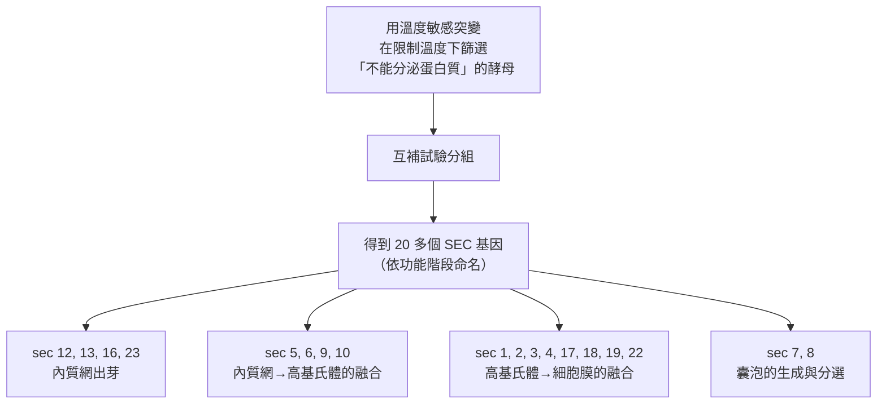
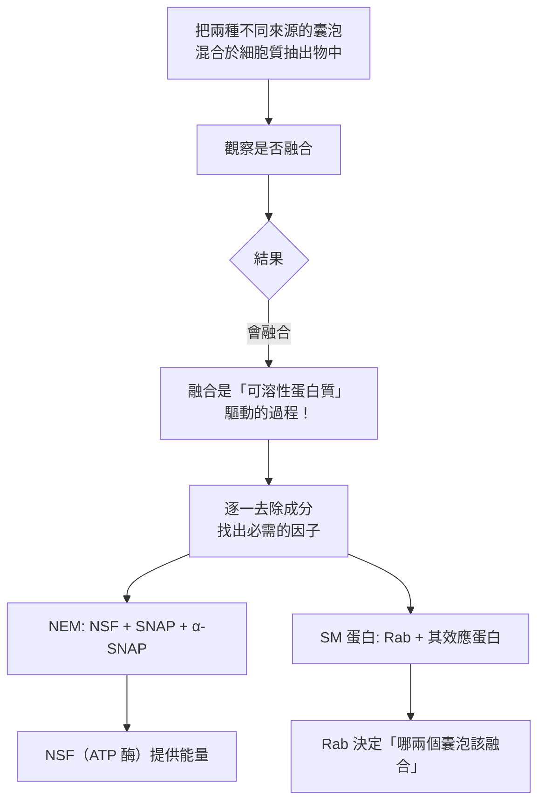
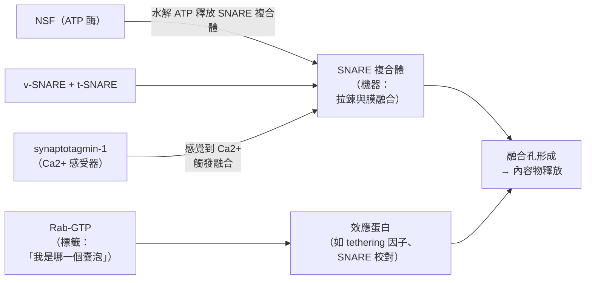

# 2013 · 囊泡運輸：羅斯曼、謝克曼與蘇德霍夫找到細胞的「物流系統」

> **2013 諾貝爾生理學 or 醫學獎**（共享三人）：詹姆斯·E·羅斯曼（James E. Rothman，美國）、蘭迪·謝克曼（Randy W. Schekman，美國）與托馬斯·C·蘇德霍夫（Thomas C. Südhof，德國／美國）— 表彰「發現細胞囊泡運輸的運行與調節機制」。

## 懸案（案情提要）

1970–80 年代的細胞生物學，帕拉德已經畫出了分泌路徑的「地圖」（見 [1974-細胞結構與功能組織](1974-細胞結構與功能組織.md)）——但**地圖上沒有寫「貨車是怎麼跑的」**：

1. 蛋白質從內質網到高基氏體、從高基氏體到細胞膜，**是由什麼「機器」運送的**？
2. **囊泡如何知道該往哪裡去？** 如何「抓住」正確的目標膜並把內容物卸下？
3. 更基本的：**為什麼細胞裡有這麼多「小袋子」？它們如何被正確地**選中**、**錨定**、**融合**？
4. 而在神經科學這一端：**神經末梢如何把「突觸小泡」精確地送到突觸前膜的正確位置，並在正確的時機釋放神經傳遞物質？**

**「Rab 蛋白」這一族小 GTP 酶的發現，為這整個物流系統提供了分子語言。**

## 前因

| 年份 | 事件 |
| --- | --- |
| 1970s | **Randy Schekman** 在 Stanford 以**酵母菌**研究分泌突變體（**sec 突變**）——他的策略是：**篩選「不能分泌」的突變株，然後一個一個找出它們的基因**。 |
| 1980s | Schekman 的實驗室定義了**20 多個 SEC 基因**，編碼囊泡運輸的機器零件（**SEC1、SEC2、SEC3、SEC6、SEC7、SEC8、SEC17、SEC18…**）。 |
| 1984–1990 | **James Rothman** 在 **Stanford**（後為 **Memorial Sloan-Kettering** 與 **Yale**）以**哺乳動物細胞**（以及**倉鼠卵母細胞的細胞質抽取物**）研究「**無細胞的囊泡融合**」——**他發現囊泡的融合可以在試管中重現**，因此可以把它拆解成可分析的成分。 |
| 1980s–1990s | Rothman 的實驗室發現**兩類「識別因子」**：**NEM（NSF 與 SNAP）** 與 **SM 蛋白（Rab 與其效應蛋白）**，並證明 **Rab 蛋白決定囊泡的「身分」**。 |
| 1990s | **Thomas Südhof** 在 **Stanford**（Rothman 的同事，後至 UT Southwestern）以**神經末梢的突觸小泡**為模型，尋找「** docking 與融合的機器**」。 |
| 1990s | Südhof 從**腦膜上分離突變體**，篩選出「**不能釋放神經傳遞物質**」的突變（如 **munc18、synaptobrevin (VAMP)、syntaxin、SNAP-25**）。 |
| 1990s | **Rothman 與 Schekman 的融合研究**與 **Südhof 的遺傳篩選**在 1990 年代後期匯合：**SNARE 蛋白是融合的機器**。 |
| 1993 | **Rothman 與其同事證明 SNARE 蛋白可在体外形成複合體**；**1990 年代末，Rothman 團隊以酵母的 Sec 蛋白與哺乳動物的 SNARE 交叉實驗**，證明**兩種物種的蛋白可以互相替代**——**這是「通用性」的決定性證據**。 |
| 2000s | **2006 年的**：Südhof 團隊以**晶體結構**（1999–2000 年）解出**突觸結合蛋白（synaptotagmin-1）**的結構——它是**鈣離子感受器**；**2000 年**，他們發現 **complexin** 與 **NSF/α-SNAP** 的作用。 |
| 2013 | 三人共享諾貝爾生理學 or 醫學獎。 |
| 2000s–2020s | **SNARE 複合體的結構**（2000s 末的 cryo-EM 結構）；**Rab 蛋白的「分子地圖」**（多位 Rab 的「分子開關」結構）；**囊泡運輸與神經疾病**（**Rab 突變與帕金森病、ALS**；**botulinum toxin 與 tetanus toxin 的靶點正是 SNARE**）；**2019 年** Südhof 因「突觸前自主神經的傳遞機制」再獲 **Wolf 醫學獎**。 |

## 調查

### 第一幕：謝克曼的「篩選不能分泌的酵母」

謝克曼的策略極為純粹——**「以功能為篩選條件」**（與 [1995-胚胎發育基因](1995-胚胎發育基因.md) 的威斯喬斯相同）：



**這張圖的價值**：**它把「分泌路徑」從一張示意圖變成了一張「零件清單」**——**每一個 SEC 基因都是一個具體的機器零件**。

**謝克曼的關鍵洞見**：**所有 SEC 基因都是必要的，但 SEC1 家族（特別是 SEC1）是「通用的」**——**酵母的所有分泌步驟都共用同一套基本機器，只由「 Rab 蛋白」決定具體走哪條路**。

### 第二幕：羅斯曼的「無細胞融合」——把生物學變成生化學

羅斯曼的貢獻，是**建立了一個可以在試管中重現的系統**，使融合過程的每一步都可以被拆解。

**他的關鍵實驗（1980 年代）**：



**兩個發現的深遠意義**：

1. **NSF 是 ATP 酶**——**融合需要能量水解**（與 SNARE 的「zipper」拉動模型配合）；
2. **Rab 蛋白是「身分標籤」**——**這解釋了「一個細胞裡有 60 多種 Rab，但機器只有一套」這個謎題**。

**羅斯曼的「身分標籤」模型**（1990 年代）：

$$\text{Rab-GDP（細胞質，Inactive）} \xrightarrow{\text{GEF 交換為 GTP}} \text{Rab-GTP（膜上，Active）} \xrightarrow{\text{Effector 結合}} \text{特定囊泡被選中} \xrightarrow{\text{GAP 促水解}} \text{Rab-GDP（回收）}$$

**這是一個「分子開關 + 身分標籤」的雙重設計**，是 20 世紀末細胞生物學最漂亮的模型之一。

### 第三幕：蘇德霍夫的「突觸小泡的分子機制」

蘇德霍夫從**神經傳遞物質的釋放**切入，這是最難的版本：

**問題**：神經末梢的突觸小泡必須在**幾毫秒內**、在**精確的位置**、在**正確的時機**（當 $\mathrm{Ca^{2+}}$ 涌入時）釋放內容物。

**他的遺傳學篩選（1990 年代）**：

```mermaid
flowchart TD
    A[篩選小鼠的「神經傳遞物質釋放缺陷」突變] --> B[逐個識別突變基因]
    B --> C1[munc18 (unc-18)<br>→ 突變小鼠無法釋放]
    B --> C2[VAMP / synaptobrevin<br>（突觸小泡蛋白）]
    B --> C3[syntaxin（突觸前膜蛋白）]
    B --> C4[SNAP-25]
    B --> C5[munc13, munc18, complexin…]
    C2 --> D[這三者構成 <strong>SNARE 複合體</strong>]
    D --> E[1993: Rothman 證明 SNARE<br>可在體外形成複合體]
    F[突觸結合蛋白 synaptotagmin-1<br>（1999 結構）] --> G[鈣離子感受器<br>→ 觸發融合]
```

**SNARE 複合體的結構與「拉鍊」機制**：

$$\text{突觸前膜 SNARE（syntaxin + SNAP-25）} + \text{小泡 SNARE（VAMP）} \to \text{四螺旋束 zipper} \xrightarrow{\text{拉近}} \text{膜融合}$$

**蘇德霍夫的關鍵實驗（1990 年代）**：

1. **「拉鍊（zipper）」模型**：他以**重組蛋白與脂質體的體外實驗**證明：**只要 SNARE 蛋白能「拉」在一起，囊泡就能融合**——**融合的機器被證明是「蛋白質的拉鍊」**；
2. **鈣離子感受器**：他發現 **synaptotagmin-1** 是**鈣離子感受器**——**它含有多個 C2 結構域，能結合 5 個以上的 $\mathrm{Ca^{2+}}$**，這解釋了「**為什麼釋放是『全或無』且極快速的**」： $\mathrm{Ca^{2+}}$ 驅動 C2 域插入膜中，破壞膜的「水合層」，促進融合。

**「全或無」的數學**：神經傳遞物質的釋放量：

$$Q_{\text{release}} \approx n_{\text{vesicle}} \cdot \frac{[\mathrm{Ca^{2+}}]^{n}}{K_d^{n} + [\mathrm{Ca^{2+}}]^{n}}$$

**其中 $n > 1$ （Hill 係數）**，這就是「**鈣離子開關的超線性性**」——**它解釋了為什麼細胞內 $\mathrm{Ca^{2+}}$ 從 $10^{-7}$ M 升到 $10^{-6}$ M（十倍）能觸發大規模釋放（數百倍）**。

### 第四幕：三人的匯合——「通用機器 + 專用標籤」

三人的工作合起來，給出了 20 世紀細胞生物學最完整的模型：



**「機器—標籤」模型的核心洞見**：

$$\text{同一套融合機器} + \text{不同的 Rab 標籤} \Rightarrow \text{細胞內數十條不同的運輸路線}$$

**這解釋了**：為何一個細胞裡有數百個不同種類的囊泡，卻只需要一套簡單的融合機器；為何把酵母的 SEC 蛋白與哺乳動物的 SNARE 混在一起，它們仍能互相作用（**保守性**）。

### 第五幕：應用——從肉毒桿菌毒素到神經疾病

**這個機制的應用極為直接**：

| 藥物/毒素 | 靶點 | 機制 | 應用 |
| --- | --- | --- | --- |
| **肉毒桿菌毒素（Botox）** | 切割 **SNAP-25 或 VAMP** | SNARE 複合體被破壞 → 融合被阻斷 | **除皺、肌肉痙攣、多汗症、慢性偏頭痛** |
| **破傷風毒素** | 切割 **syntaxin / SNAP-25** | 抑制抑制性神經元的釋放 → 痙攣 | 破傷風的機制 |

**這些藥物的應用說明了一個驚人的事實**：**「抑制 SNARE 融合」曾經是致命的（破傷風）**，卻能成為**醫學上最有價值的工具之一**（肉毒桿菌毒素是全球應用量最大的藥物之一）。

**神經疾病**：**Rab 蛋白與 SNARE 的突變與神經退化性疾病相關**（如 **Parkinson's disease 中的 SNCA/α-synuclein 與 Rab 互動**；ALS 中的 C9orf72 與 Rab 運輸的關係）——**這條線在 2020 年代成為神經退行性疾病研究的重要方向**。

## 理論裁決

1. **「身分—機器」分離原理**：這是本案最深刻的理論貢獻：

   $$\underbrace{\text{Rab}}_{\text{身分標籤}} + \underbrace{\text{SNARE/NSF}}_{\text{通用機器}} \Rightarrow \text{可擴展的運輸網絡}$$

   **這與「密碼—解碼」原理同源**——**有限的機器 + 可組合的標籤 = 複雜的系統**。這個原理在今日的**細胞生物學、訊號傳遞、神經科學**中無處不在。

2. **分子開關的能階**：Rab 的 GDP/GTP 循環提供了一個**「何時、何地」的雙重編碼**：

   $$\text{空間編碼} = \text{哪個 Rab（哪條路線）} \qquad \text{時間編碼} = \text{何時是 GTP 態（何時啟動）}$$

   **同一個 Rab 在不同時間、不同位置被不同的 GEF 與 GAP 調控**——這解釋了「同一條運輸路線如何被時序調控」。

3. **鈣離子的超線性開關**： $\mathrm{Ca^{2+}}$ 對突觸釋放的調控：

   $$\frac{Q}{Q_{\max}} = \frac{[\mathrm{Ca^{2+}}]^n}{K_d^n + [\mathrm{Ca^{2+}}]^n}, \qquad n \approx 3\text{–} 5$$

   **這與細胞週期的 CDK 開關（見 [2001-細胞週期](2001-細胞週期.md)）在數學上完全同型**——**「超線性開關」是生物系統實現「全或無」決策的通用手段**。

4. **融合的能量收支**：ATP 的水解提供能量，而**SNARE 蛋白的「拉鍊」提供機械功**：

   $$\text{融合} \xrightarrow{\text{ATP 水解}} \text{能量驅動的膜重排} \xrightarrow{\text{拉鍊}} \text{膜融合孔}$$

   **能量與機制的分工**（由 NSF 與 SNARE 分工完成）是 1990 年代生物化學最精確的機制解析之一。

## 追查支線（未結之謎）

- **羅斯曼的科學生涯**：他在 **1980 年代離開 Stanford 前往 Memorial Sloan-Kettering**，因為他認為「基礎科學研究應在醫學中心進行」——**這是科學研究地點的一次重要選擇**；他在 2008–2012 年擔任**耶魯大學醫學院細胞生物學系主任**；**他的《The Cell: A Molecular Approach》教科書**（與 Pollard 合作）影響了全球數代生物學家；
- **謝克曼的科學生涯與公共參與**：他在 1990 年代曾短暫離開學界進入**生技產業**（1993–1995），隨後回到學界；他曾任**《Science》與《PNAS》的主編**；他是**「Schekman 定理」**的提出者（「**蛋白質在細胞內的運輸路徑是高度保守的**」）；
- **蘇德霍夫的科學之路**：他在 1990 年代**因為「不被允許做神經科學」而離開 Rothman 的實驗室**（因為他的雇主對他的科學選擇有意見）——**這樁「科學自由」的個案是學術自由的經典案例**；他在 2019 年獲 **Wolf 醫學獎**，2023 年又獲 **Louisa Gross Horwitz 獎**；
- **從「分泌」到「所有膜運輸」**：2013 年之後，**內體（endosome）系統**的運輸（Rab5→Rab7→Rab11 的「身份轉換」）成為細胞生物學的新前沿；**「內體成熟（endosomal maturation）」**與 **AMPK/TSC 調控的 mTOR 訊號**的連結，揭示了**營養感知與細胞生長**的機制（mTORC1 在內體上的活化）——**這是 2020 年代細胞生物學最熱的方向之一**；
- **神經科學的應用**：**SNARE 與 Rab 的突變**被確認與**帕金森病、ALS、阿茲海默**相關；**2020 年代**的「**α-synuclein 是 Rab 的分子伴侶**」模型，解釋了帕金森病的分子病理。

## 證物與數據（偵查卷宗摘錄）

| 證物 | 數值／內容 | 偵查意義 |
| --- | --- | --- |
| SEC 突變株 | 20 多個互補群 | 分泌路徑的零件清單 |
| SEC 分類 | 出芽／內→高基／高基→膜 | 運輸路徑的階段劃分 |
| 無細胞融合 | 囊泡在抽出物中融合 | 生物學 → 生化學的轉化 |
| NEM | NSF + SNAP + α-SNAP | 融合的能量因子 |
| SM 蛋白 | Rab + 效應蛋白 | **身分標籤** |
| NSF | ATP 酶 | 融合的能量來源 |
| Rab 數量 | 60+ 種（人類） | 身分的多樣性 |
| Rab 循環 | GEF 交換、GAP 促水解 | 分子開關 |
| SNARE | v-SNARE（VAMP）+ t-SNARE（syntaxin、SNAP-25） | **融合機器** |
| 拉鍊模型 | SNARE 拉近 → 膜融合 | 機制的結構基礎 |
| synaptotagmin-1 | C2 結構域，結合 5+ $\mathrm{Ca}^{2}^{+}$ | **鈣離子感受器** |
| 釋放的鈣效應 | $n \approx 3\text{–}5$ （Hill 係數） | 超線性開關 |
| 肉毒毒素 | 切割 SNAP-25/VAMP | 機制的臨床應用 |

## 後果

| 領域 | 影響 |
| --- | --- |
| 細胞生物學 | 囊泡運輸的完整分子模型；「身分—機器」原理成為通用語言。 |
| 神經科學 | 突觸傳遞的分子機制；神經發育時的突觸修剪機制（**synaptotagmin-4 與自噬**）。 |
| 藥理學 | 肉毒桿菌毒素與破傷風毒素的機制完全清楚。 |
| 疾病 | Rab/SNARE 突變與神經退行性疾病；mTOR 訊號與內體成熟。 |
| 諾獎傳統 | 2007、2011、2012、2013 連續四年以「技術」獲獎，反映了生物學方法論的演進。 |
| 其他諾獎 | 與 [1974-細胞結構與功能組織](1974-細胞結構與功能組織.md)（帕拉德的路徑）、[1994-G 蛋白](1994-G蛋白.md)（分子開關的同型設計）、[2001-細胞週期](2001-細胞週期.md)（超線性開關）構成細胞生物學主線。 |

## 關聯

- [1974-細胞結構與功能組織](1974-細胞結構與功能組織.md) — 帕拉德畫出了地圖，本案補上了物流。
- [1994-G 蛋白](1994-G蛋白.md) — Rab 與 G 蛋白同為「分子開關」，設計上同源。
- [2001-細胞週期](2001-細胞週期.md) — 「超線性開關」的另一個實例。
- [2000-神經訊號傳導](2000-神經訊號傳導.md) — 突觸傳遞的整體框架。
- [1936-神經化學傳遞](1936-神經化學傳遞.md) — 化學傳遞物質的釋放機制。
