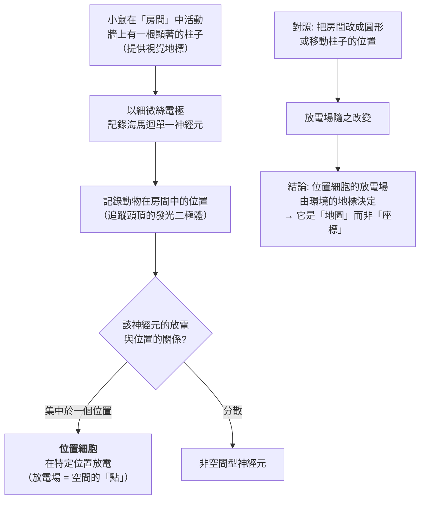
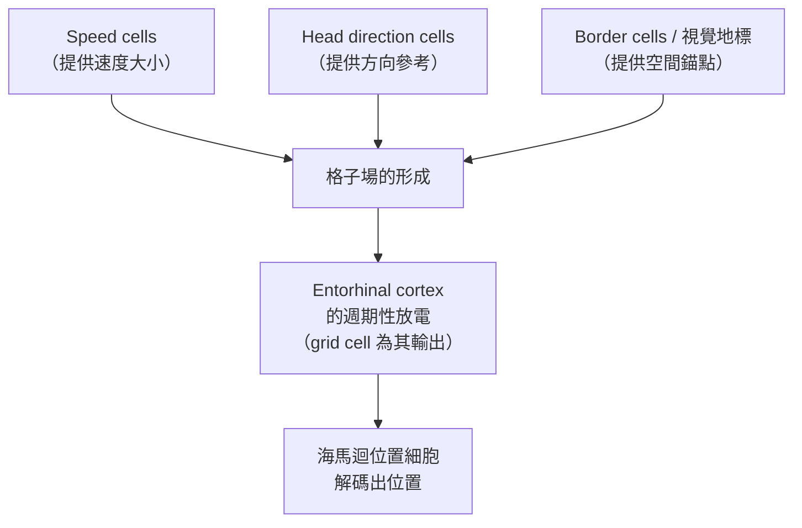

# 2014 · 大腦的定位系統：奧基夫與莫瑟夫婦找到「GPS」的格子細胞

> **2014 諾貝爾生理學 or 醫學獎**（共享三人）：約翰·歐基夫（John O'Keefe，英國／美國）— 表彰「發現大腦的定位系統，構成細胞」；梅-布里特·莫瑟（May-Britt Moser）與艾德瓦德·莫瑟（Edvard Moser，挪威）— 同上。

## 懸案（案情提要）

1970 年代初，神經科學家知道動物能导航——鴿子能回家、蜜蜂能辨識方向、老鼠能記住迷宮的路徑。但有一個極大的空白：

1. **大腦如何「知道自己在哪裡」？** 沒有 GPS 的動物，如何在一片沒有標記的空間裡定位？
2. 更具體地說：**當動物移動時，大腦裡是否有某種神經元在編碼「位置」？**
3. 這難在哪裡？因為「位置」不是一個可以插電測量的物理量——**它必須從感覺輸入（視覺、路徑、邊界）中被「計算」出來**；
4. 而且——**這必然是一種「計算地圖」**：人們已知**海馬迴**在空間記憶中有關鍵作用（見 [1953-檸檬酸循環](1953-檸檬酸循環.md) 同時代的 H.M. 病例與 [2000-神經訊號傳導](2000-神經訊號傳導.md) 的 Morris 水 maze），但海馬迴「下游」的**內嗅皮層（entorhinal cortex）**呢？

**答案：1966 年由奧基夫發現的「位置細胞（place cell）」，與 2005 年由莫瑟夫婦發現的「格子細胞（grid cell）」。**

## 前因

| 年份 | 事件 |
| --- | --- |
| 1930s–1950s | **心理物理學**與**迷宮實驗**建立了「空間學習」的研究傳統；**Tolman 的「認知地圖」（cognitive map）**提出動物內部有空間的表征。 |
| 1930s–1950s | **心理物理學**與**迷宮實驗**建立了「空間學習」的研究傳統；**Tolman 的「認知地圖」**（cognitive map）提出動物內部有空間的表征。 |
| 1950–60 年代 | **海馬迴與記憶的研究**（**Scoville 與 Milner 的 H.M. 病例**；**Morris 的水 maze 實驗**）確立海馬迴在空間記憶中的必要性，但機制仍是黑箱。 |
| 1966 | **O'Keefe**（時任 UCL，後為 Princeton）以**微量電極**記錄**小鼠海馬迴**的神經元活動，並讓動物在**有特製標記的場地**（例如有一根顯著的柱子與牆壁拼成的環境）中活動—— |
| 1971 | **O'Keefe 與 Dostrovsky** 發表《*The hippocampus as a spatial map*》——**發現：某些海馬迴神經元只在動物處於環境中某一特定位置時放電**——**位置細胞（place cell）**。 |
| 1971–2000s | 位置細胞的研究擴展到**辨識「地標」與「空間」的區分**（1970–80 年代）、**「remapping」**（同一細胞在不同環境中表達不同位置）、**「連續吸引子」模型**（1990 年代的 Hasselmo 模型）。 |
| 1996–2005 | **May-Britt 與 Edvard Moser** 在 NTNU（Trondheim）以**微電極記錄小鼠**（小鼠體型適合多通道記錄）與 **O'Keefe 合作**，在大範圍開放環境（117 cm × 74 cm 的「房間」）中記錄**內嗅皮層第 II 層**的神經元—— |
| 2005 | **Moser 夫婦在 *Nature* 發表《*Grid cells in the entorhinal cortex of mice*》**——**格子細胞**：其放電位置形成**規則的六角形（hexagonal）網格**，且多個格子細胞的「網格相位」彼此錯開，**共同覆蓋整個環境**。 |
| 2013 | **Moser 夫婦**發現了更多種類的空間細胞（**border cells、head direction cells、speed cells、vector cells、object vector cells**）——**「定位系統」的完整拼圖**。 |
| 2014 | 三人共享諾貝爾生理學 or 醫學獎。 |
| 2010s–2020s | **格神經元（grid cell）的神經迴路機制**（2020 年，**Moser 團隊**以**光遺傳學（optogenetics）**證明**內嗅皮層的「速度—位置」細胞（speed cells）到格子細胞的抑制性迴路**）；**2020 年《Nature》**的兩篇論文確立了**「網格場（grid field）」形成的迴路機制**；**阿茲海默病的早期表現——「海馬迴—內嗅皮層」的功能異常**——也與定位系統受損相關。 |

## 調查

### 第一幕：奧基夫的「帶標記的房間」實驗

奧基夫的實驗設計極為簡單但極其有效：

**關鍵的對照實驗**：把圓形房間改成有角度的房間、或改變柱子的位置——**位置細胞的放電場隨之重組**。這證明：

$$\text{位置細胞的「地圖」} = f(\text{環境的地標配置})$$

**也就是說，位置細胞編碼的不是絕對座標，而是「相對於環境中地標的位置」**——**這是一個極為關鍵的發現**，它解釋了為什麼動物能在環境改變後仍然保持定位能力（**「重映射（remapping）」**）。

### 第二幕：莫瑟夫婦的「六角格」

莫瑟夫婦的貢獻，是**在更下游的內嗅皮層**找到了**另一種、更精細的編碼方式**。

**實驗設計**：把小鼠放在一個**117 cm × 74 cm 的開放房間**中活動，同時記錄**數十個**內嗅皮層神經元（因小鼠體型小，可容納多個電極），並追蹤其位置。

**結果**：

1. **每個格子細胞的放電位置形成一個規則的六角形網格**（多個放電點，呈六角對稱排列）；
2. **不同的格子細胞，其六角格有「相位差」**——**它們的網格互相錯開**，因此**共同覆蓋整個環境**，形成一個**「連續的、連續變化的神經地圖」**：

$$\text{總放電率}(\mathbf{r}) = \sum_{i} f_i(\mathbf{r} - \phi_i)$$

   **格子密度**約每 $0.4\text{–}0.5\ \mathrm{m}$ 一個放電點（不同動物與腦區略有差異）。

3. **關鍵特性**：
   - **不依賴環境邊界**（不像「border cell」那樣需要牆）；
   - **在動物移動時，放電場會隨之「平移」**——**這意味著格子細胞編碼的是「運動」的資訊**；
   - **方向無關**（格子細胞不偏好某個方向，這與「頭部方向細胞」不同）。

### 第三幕：兩套系統的分工

| 系統 | 位置 | 編碼 | 性質 |
| --- | --- | --- | --- |
| **位置細胞** | **海馬迴（CA1/CA3）** | 特定**位置**的「點」 | **依賴環境地標**；「視覺地標 + 路徑整合」 |
| **格子細胞** | ****內嗅皮層第 II 層** | 規則六角網格 | **不依賴地標**；由**運動**驅動 |
| **頭部方向細胞** | 內嗅皮層 | 頭部方向 | 「指南針」 |
| **border cells** | 內嗅皮層 | 到邊界的距離 | 「牆的偵測」 |
| **Speed cells** | 內嗅皮層 | 速度 | 運動速度 |

**兩套系統如何整合？** 現代模型（**"place cells + grid cells = conjugate coding"**，由 **Fenton 與 Moser** 等人提出）：

$$\text{位置} = \int \text{速度} \times \text{方向} \, dt$$

**「位置 = 速度對時間的積分」**——**速度由 grid cell 提供，方向由 head direction cell 提供，兩者聯立解算出位置**。這是一個漂亮的「**積分器 + 相位參考**」模型，與卡爾松—格林加德—坎德爾的 Hebbian 模型（見 [2000-神經訊號傳導](2000-神經訊號傳導.md)）遙相呼應。

### 第四幕：格子場如何形成——神經迴路的機制（2020 年）

2020 年，Moser 團隊以**光遺傳學**（optogenetics）完成了這樁案件的機制解析：

1. **實驗**：在小鼠的內嗅皮層中，以**光遺傳學**選擇性抑制或激活特定的神經元族群，同時記錄格子細胞的放電；
2. **發現**：
   - **抑制「速度細胞（speed cells）」→ 格子細胞的放電場範圍縮小**；
   - **抑制「head direction / 邊界細胞」→ 格子場的相位發生偏移**；
3. **結論**：**格子場由三種輸入共同產生**：

**這是 21 世紀神經科學最漂亮的一次「機制解剖」**：**一個「位置」並非被直接感知，而是由多種資訊經迴路整合計算出來的**。

### 第五幕：數學——「連續吸引子」的模型

位置細胞與格子細胞的活動，被廣泛認為是**連續吸引子（continuous attractor）**系統的表現——**當動物在環境中移動時，神經活動的「吸引子」沿某個連續流形移動**：

$$\frac{d\mathbf{s}}{dt} = f(\mathbf{s}; \text{input}) - \mathbf{s} \quad (\text{其中 } \mathbf{s} \in \mathbb{R}^{N} \text{ 為神經活動向量})$$

**這意味著**：**位置不是被「儲存」在某個細胞裡，而是被「累積」在一整個網絡的活動狀態中**——**海馬迴就是一個「物理地圖的積分器」**。

**Hasselmo 的模型（1990s）**提出了具體的機制：**「神經群活動的連續吸引子」**——當動物移動時，輸入訊號把吸引子「推」向新的位置，**但吸引子本身具有「黏性」（inertia）**，這解釋了位置細胞放電場的「逐漸重映射」而非瞬間跳變。

## 理論裁決

1. **定位的「兩層計算」**：從物理世界到主觀位置，必須經過兩步：

   $$\text{感覺輸入} \xrightarrow{\text{整合（grid/direction/speed）}} \text{自體運動的估計} \xrightarrow{\text{積分}} \text{位置}$$

   **這與「速度—方向—位置」的三段式完全對應**，也與機器人導航的 dead reckoning（航位推算）完全一致——**這是「生物與工程共享同一原理」的又一例**。

2. **格子密度與環境尺度的關係**：格子的空間周期 $\lambda$ 與神經網絡的規模有關；理論上，若以「傅立葉」的觀點看，**連續吸引子的神經流形被映射到物理空間，就是一組傅立葉基（格子 = 六角形的傅立葉對偶格）**：

   $$\text{格子} = \text{物理空間中, 由三個等角基向量生成的傅立葉對偶格}$$

   **這解釋了為什麼格子是六角形**——它是三維傅立耳基在二維的投影。

3. **位置細胞的「稀疏且分散」編碼**：一個環境可被數百個位置細胞編碼，但**每個位置細胞只覆蓋極小的區域**——這是**稀疏編碼**（見 [1981-視覺皮層](1981-視覺皮層.md)）的另一例：

   $$\text{編碼容量} \approx \frac{\text{空間的體積}}{\text{單一細胞的感受野體積}}$$

4. **認知地圖的生物學實現**：**Tolman 在 1940 年代提出的「認知地圖」終於有了細胞機制**——但它**不是**一張「地圖式的圖像」，而是**一個連續的、神經活動的流形**。

## 追查支線（未結之謎）

- **奧基夫與莫瑟夫婦的「科學接力」**：奧基夫發現位置細胞時，**莫瑟夫婦尚未畢業**；他們在 1990 年代中期於 Trondheim 建立自己的實驗室，並**在 1996 年與 O'Keefe 開始合作**——**三人在 2005 年共同發表格子細胞論文**（O'Keefe、Moser 與 Moser，*Nature*），這是科學史上「師生—夫妻」跨國合作的典範；
- **莫瑟夫婦的科學環境**：他們在 NTNU 建立了「**Moser research environment**」——**一個以年輕研究者為核心的「研究環境（research environment）」而非單一實驗室**——這是 2000 年代神經科學人才培養的一個重要模式，也是他們能持續高產的原因；
- **他們的科學人道主義**：莫瑟夫婦在 2015 年後**以神經科學家的身分投入阿茲海默病的倡議**（May-Britt Moser 是**挪威阿茲海默委員會的主席**），並以大膽的公共倡議（如指責製藥業的失敗）引發爭議——**這是科學家公共參與的另一面**；
- **阿茲海默病與定位系統**：**海馬迴與內嗅皮層是阿茲海默病最早受損的區域**（Braak 分期），而定位系統的受損可解釋**早期症狀：迷路、方向感喪失**——**這條線把本案與 1904 年阿茲海默的臨床描述、以及今日的「神經網路疾病」觀點直接接上**；
- **2024 年的另一條線**：**Moser 團隊**在 2024 年發表了**「網格編碼不只服務空間」的證據**（在嗅覺、社交等非空間任務中也出現網格樣放電）——**這挑戰了「格子 = 空間」的傳統觀點**，是本案的最前沿延伸。

## 證物與數據（偵查卷宗摘錄）

| 證物 | 數值／內容 | 偵查意義 |
| --- | --- | --- |
| 帶標記的房間 | 一根柱子作視覺地標 | 位置細胞的實驗系統 |
| 位置細胞（1971） | 只在特定位置放電 | 第一個「空間神經元」 |
| 環境改變 | 放電場隨之重組 | **地圖而非座標** |
| 格子細胞（2005） | 規則六角形放電陣列 | 下游的網格編碼 |
| 格子密度 | 約每 0.4–0.5 m 一個放電點 | 空間周期 |
| 相位錯開 | 不同格子細胞網格互相位移 | **連續覆蓋整個環境** |
| 六角形的來源 | 三個等角基的傅立耳對偶格 | 幾何學的解釋 |
| 位置 = ∫ 速度×方向 dt | 速度由 grid 提供 | 兩套系統的整合模型 |
| 連續吸引子 | 活動狀態在流形上移動 | 定位的動力學模型 |
| 2020 光遺傳學 | 抑制 speed/head/border cell → 格子場縮小/相位偏移 | **機制的解剖** |
| 速度細胞（2013） | 編碼速度 | 積分器的輸入 |
| 邊界細胞（2013） | 編碼到邊界的距離 | 空間錨點 |

## 後果

| 領域 | 影響 |
| --- | --- |
| 神經科學 | 「大腦如何知道自己在哪裡」被回答；位置細胞成為神經科學的標誌性發現之一。 |
| 認知科學 | 「認知地圖」有了細胞機制；空間記憶與艾普薩姆失症（topographical disorientation）的理解。 |
| 神經疾病 | 阿茲海默病的早期神經迴路受損與「迷路」症狀。 |
| 機器人與 AI | 從生物的定位系統獲得「速度—方向—位置」的架構靈感（SLAM 的神經啟發版本）。 |
| 科學制度 | 「研究環境」模式與跨國合作。 |
| 其他諾獎 | 與 [2000-神經訊號傳導](2000-神經訊號傳導.md)（Hebb 與學習）、[1932-神經元功能](1932-神經元功能.md)（神經元的編碼）、[1981-視覺皮層](1981-視覺皮層.md)（稀疏編碼）構成神經科學主線。 |

## 關聯

- [2000-神經訊號傳導](2000-神經訊號傳導.md) — Hebbian 學習與位置細胞的 Hebbian 建模。
- [1932-神經元功能](1932-神經元功能.md) — 放電率編碼的生理學基礎。
- [1981-視覺皮層](1981-視覺皮層.md) — 稀疏編碼的原則。
- [1963-離子機制](1963-離子機制.md) — 記錄神經元活動的電生理方法。
- [2024-微RNA](2024-微RNA.md) — 同一科學圈在分子層的平行成就。
