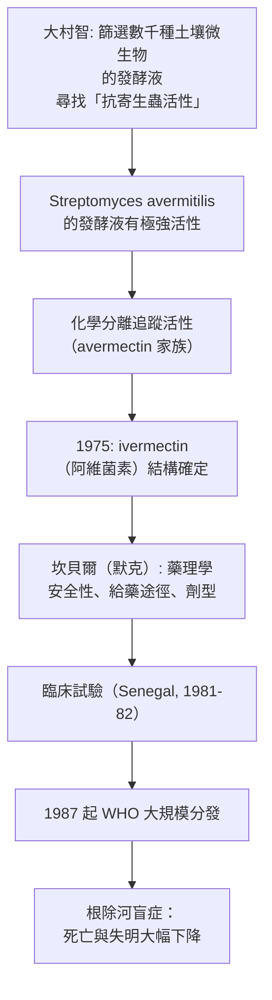

# 2015 · 青蒿素與阿維菌素：屠呦呦與大村智的兩種「對抗寄生蟲」的答案

> **2015 諾貝爾生理學 or 醫學獎**（共享三人）：屠呦呦（Tu Youyou，中國）— 表彰「發現治療瘧疾的新療法」；威廉·C·坎貝爾（William C. Campbell，愛爾蘭／美國）與大村智（Satoshi Ōmura，日本）— 共享另一半，表彰「發現治療線蟲寄生蟲的新療法」。

## 懸案（案情提要）

2015 年的諾獎表彰了兩種完全不同的「對抗寄生蟲」的武器，它們分屬兩個不同的科學傳統：

**案子甲（瘧疾）**：1960–70 年代，**氯喹（chloroquine）**曾是瘧疾的「奇蹟藥」——但**氯喹抗性瘧原蟲迅速擴散**，1960 年代末起，瘧疾的死亡率在全球重新上升。WHO 估計：**每年有數億人罹患瘧疾，逾 60 萬人因此死亡（多為非洲的 5 歲以下兒童）**。藥理學家需要找到**結構完全不同、作用機制不同的新藥**。

**案子乙（線蟲）**：**河盲症（onchocerciasis）**——由**蟯尾絲蟲（Onchocerca volvulus）**引起，**黑色蠅（黑蠅）**傳播；病人因蟲體死於皮下而產生的**劇烈搔癢與皮膚損傷**（"River Blindness"），且**眼部病變導致失明**——估計有數百萬人受影響，其中數十萬人失明。**現有的藥物（ diethylcarbamazine）**會引發**致命的 Maze 症（Massive Encephalitic Reaction）**——所以無法使用。

**答案：屠呦呦找到了青蒿素；坎貝爾與大村智找到了阿維菌素。**

## 前因

| 年份 | 事件 |
| --- | --- |
| 1880s–1930s | 奎寧（從金雞納樹皮提取）與之後的合成抗瘧藥（**氯喹 1930 年代**、**阿米苷 amine 1940 年代**、**息疟定 pyrimethamine 1950 年代**）陸續問世。 |
| 1940s | **大村智**在日本的北里研究所，開始研究 **Streptomyces avermitilis**（一種放線菌）發酵液中的**活性成分**——他建立了一套「**發酵液活性物質的分離與生物測定**」的系統方法。 |
| 1970–1975 | **大村智**從發酵液中分離出**avermectin**（後命名為**阿維菌素 ivermectin**），並**邀請默克（Merck）的 William Campbell 加入**以進行藥理與臨床前開發。 |
| 1970s | **屠呦呦**被任命為中國「五二三」研究項目（**中醫研究院中藥研究所**）的負責人，任务是**篩選中藥中的抗瘧成分**——這是**1967 年「全國抗瘧研究會議」**設定的任務。 |
| 1971 年 10 月 | **屠呦呦的團隊**（含**李當**與**鍾立揚**）從**中藥「青蒿」（Artemisia annua，黃花蒿）**的乙醚提取物中，獲得對瘧原蟲抑制率達 **100%** 的**中性提取物（第 191 號樣品）**——**這是青蒿素發現的關鍵時刻**。 |
| 1972 | 屠呦呦團隊**分離並鑑定了青蒿素（artemisinin）**，其結構被中國科學家於 1975 年於《*Acta Chimica Sinica*》發表（英文摘要於 1977 年）。 |
| 1973 | 屠呦呦的方法被整理成《**《青蒿素提取物對瘧原蟲的抑制作用與臨床觀察》**》的中文手冊，並以**「青蒿乙醚提取物」**為名向全國發出（**「523 號資產」**）。 |
| 1981–1982 | **WHO 召開「傳統醫藥研討會」**，屠呦呦以《**「青蒿素提取物對瘧原蟲的抑制作用與臨床觀察」**》發表，引起國際注意（**她因而被稱為「青蒿素之母」**）。 |
| 1982–1983 | **大村智與坎貝爾**完成阿維菌素的**臨床試驗**（**1981 年在 Senegal 的眼科學家**進行）；**1987 年 WHO 開始大規模分發**；**1990 年 Merck 捐藥**（「as a gift, forever」）——這是人類史上最長的一次藥品捐贈計畫。 |
| 2015 | 三人共享諾貝爾生理學 or 醫學獎。 |
| 2010s–2020s | **青蒿素類藥物（ACT，artemisinin-based combination therapy）**成為瘧疾的一線治療；**WHO 將青蒿素列為「抗瘧藥的耐藥性重點監測對象」**；**「瘧疾基因組計畫」（Malaria Atlas Project）**追蹤抗藥性的地理分布；**「基因驅動」技術**被提出作為對抗帶蟲蚊的當代延伸。 |

## 調查

### 第一幕：屠呦呦的「低溫提取」——破解「青蒿為何無效」的謎團

這樁案件的科學推理極為漂亮，因為**它是一次「從失敗中學到東西」的過程**：

1. **最初的困惑**：早期研究（含中國與其他國家的科學家）發現，**青蒿的水煎液與乙醇提取物在體外對瘧原蟲的抑制作用不穩定、有時完全無效**；
2. **關鍵的懷疑**：屠呦呦的推理是——**「中藥是用水煎的，但有效成分可能不溶於水；用乙醇高溫提取，卻會破壞它。」**（**當時的普遍做法是用乙醇浸泡加熱**）；
3. **191 號樣品的轉折**：1971 年 10 月，她的團隊改用**乙醚低溫提取**（乙醚的沸點只有 $34.6\ \mathrm{C}$ ），結果：

$$[\text{青蒿乙醚提取物}]_{\text{抑制率}} = 100\% \quad (\text{對瘧原蟲})$$

4. **後續的驗證**：她們改用**低溫乙醚提取法**製備臨床藥物，**在 1971 年 10 月至 1972 年 10 月間，以自身與患者的志愿者進行了 191 號樣品的臨床試驗**，全部有效——**這是「青蒿素」邁向藥物的第一步**；
5. **結構的確定**：1971–72 年，屠呦呦團隊分離出**青蒿素（artemisinin）**，並以**過氧化氫脫去過氧鍵**得到**雙氫青蒿素（dihydroartemisinin）**——**這個化學操作在後來成為製備衍生物的關鍵**。

**「低溫提取」的方法學意義**：

$$\text{有效成分} \xrightarrow{\text{熱}} \text{分解}, \qquad \text{有效成分} \xrightarrow{\text{低溫乙醚}} \text{保留}$$

**這是一個「物理化學直覺」改變命運的案例**——**如果只用乙醇高溫提取，青蒿素的發現可能被推遲數十年**。

### 第二幕：青蒿素的藥理學——「最有效的抗瘧疾藥」

**青蒿素的結構特徵**：

- **過氧橋（endoperoxide bridge）**：這是**藥效的關鍵**——而也是**所有現代青蒿素衍生物的改造核心**；
- **內酯環**：可形成**水溶性衍生物（青蒿琥酯 artesunate）**；
- **沒有抗瘧疾的同類物質具有這種結構**——**它的作用機制是全新的**。

**作用機制**（1970–80 年代確立，2010 年代更精細）：

```mermaid
flowchart TD
    A[青蒿素進入感染紅血球<br>（選擇性富集: 感染紅血球內<br>青蒿素濃度可達正常血漿的千倍] --> B[在 $\mathrm{Fe}^{2}^{+}$ 存在下<br>被還原活化<br>產生自由基]
    B --> C[自由基與<strong>血基質中的鐵</strong>反應]
    C --> D[產生活性氧物種<br>（ROS）]
    D --> E[氧化並破壞<strong>瘧原蟲的蛋白質</strong><br>（尤其是 PfATP6）]
    E --> F[瘧原蟲死亡<br>（紅血球內期被清除）]
```

**關鍵的「選擇性富集」**：**青蒿素在感染紅血球內的濃度遠高於正常**——這解釋了為何它對肝臟、心臟等器官的毒性較低，**而對瘧原蟲（住在紅血球裡）特別有效**。

**耐藥性的問題**（這是 2015 年諾獎後最關注的議題）：

| 區域 | 耐藥狀況 | 分子機制 |
| --- | --- | --- |
| **大湄公河地區（柬埔寨、緬甸、泰國）** | 顯著 | **K13（PfATP6）的突變**——青蒿素對 PfATP6 的作用被削弱 |
| **非洲、蓋加拉）** | 較少 | 多為**藝術品蟲基因的多基因性耐藥**（**K13、**BCR1、**MDF1** 等） |

**WHO 的應對**（2015 年後）：

1. **ACT 聯合療法**：**青蒿素 + 其他抗瘧藥（多為有較長半衰期的）**——**藝術品蟲的殘留被清除**，防止復燃；
2. **「抗瘧藥耐藥性全球計畫」**（2016 年啟動）：**監測標記基因的地理分布**；
3. **「單一劑量普惠」（single-dose ACT）**的研發——**縮短用藥時間以減少選擇壓力**。

### 第三幕：大村智與坎貝爾的「發酵篩選」——阿維菌素

這是 20 世紀藥物發現的另一條典範路徑：



**大村智的方法論**：

- **篩選標準極為實際**：他篩選的不是「抗細菌」而是「**抗蠕蟲**」的活性——**以寄生蟲的蟲卵孵化率作為生物測定**；
- **他建立了一套「追蹤活性」的分離流程**：每一步純化後都重測活性，**始終跟著活性走**（**「bioassay-guided fractionation」**）——這是 20 世紀天然產物藥物發現的標準方法；
- **他把樣品送給默克**（在史丹福的 **大村智把樣品寄給默克公司（當時在史丹福的研發主管 William Campbell 接觸）**——這是一個「**學術發現與產業開發跨國分工**」的經典案例。

**阿維菌素的機制**：

$$\text{阿維菌素} \xrightarrow{\text{結合谷氨酸-gated Cl}^- \text{通道}} \text{Cl}^- \text{通透性} \uparrow \to \text{神經肌肉傳遞被抑制} \to \text{寄生蟲麻痺}$$

**特別之處**：**阿維菌素對哺乳動物極安全**，因為**線蟲的谷氨酸門控氯通道與哺乳動物的 GABA_A 受體在結構上差異甚大**——**這是「選擇性毒性」的結構層次解釋**（見 [1939-磺胺藥物](1939-磺胺藥物.md) 的化學選擇性、與 [1908-免疫雙雄](1908-免疫雙雄.md) 的側鏈理論）。

**阿維菌素的動物界影響**（2010 年代的重要發現）：

- 對**牛、羊**的糞便中含有極低濃度的阿維菌素 → 進入環境 → 影響** dung beetles（蜣螂）與其他分解者**；
- **這被認為是「對牛使用阿維菌素會傷害分解者生態」的科學依據**，並促成 2023 年美國 FDA 的一道禁令（限制 livestock 使用阿維菌素）；
- **這是本案在 2015 年之後最重要的延伸**：**「一張諾獎級藥物的全球生態足跡」**。

### 第四幕：兩條路徑的對比——科學方法的雙峰

| 面向 | 青蒿素 | 阿維菌素 |
| --- | --- | --- |
| 起點 | **傳統醫藥的系統性再篩選**（「523 計畫」查閱 2,000 餘中藥方） | **土壤微生物的大規模篩選** |
| 篩選邏輯 | 「先找已知有效的方劑，再分離成分」 | 「先找有活性的菌株，再追蹤活性物質」 |
| 關鍵技巧 | **低溫乙醚提取** | **生物測定引導的分級** |
| 產業化 | 中國 + WHO（**青蒿琥酯**由諾華授權生產） | 默克 + WHO（**免費捐贈**） |
| 公共衛生意義 | 降低了全球瘧疾死亡率，尤其兒童 | 幾乎根除了河盲症作為公共衛生問題 |

**共同的方法論原則**：

$$\text{「傳統」或「天然」不是科學的對立面 ——  它是<strong>假說的來源</strong>；}$$

$$但「有效成分」必須經過<strong>現代的分離、鑑定、隨機試驗與藥理學</strong>的檢驗。$$

**這正是 2015 年諾獎委員會的措辭重點**：委員會特別讚揚了屠呦呦**「在傳統中醫中發現青蒿並在現代科學框架中提取其活性成分」**。

## 追查支線（未結之謎）

- **屠呦呦的科學生涯與時代**：她出生於 1930 年的寧波，名字「呦呦」取自《诗經》的「呦呦鹿鳴，食野之蒿」——**她自幼即與青蒿（Artemisia annua）結緣**；1962 年她被調入「523 計畫」（因 1967 年全國抗瘧會議而成立）；1979 年她被WHO 邀請在北京開辦「中醫藥傳統研討會」，向國際學界介紹青蒿；**2011 年，Lasker 獎**；**2015 年 12 月，她以 84 歲高齡出席斯德哥爾摩的領獎典禮**——**她是諾獎史上最年長的領獎者之一，也是第一位獲此獎的中國公民**；2017 年，她因「青蒿素研究」獲頒**「影響中國科技的十大事」**之一與**最高科學榮譽**；2019 年 9 月，**中華人民共和國授予她「共和國勳章」**。
- **屠呦呦的「523 資料」**：2016 年，她將其研發歷程的檔案**捐贈給中國中醫科學院**，並出版《青蒿素的發現——中醫藥研究的一次傳奇》——**這是「科學史料保存」的典範**。
- **青蒿素的專利與商業化**：諾華（Novartis）在 1970 年代取得青蒿琥酯的專利並在中國生產；**2015 年諾獎後，關於「青蒿素是中國的、但 WHO 應如何對待」的討論**成為國際科學治理的議題；屠呦呦曾表示「青蒿素是中國的，但應惠及全人類」；
- **阿維菌素的「免費」模式**：默克從 1987 年起**無限期免費捐贈阿維菌素**（作為公共衛生計畫的一員），**這一模式後來被用於**：
  - **阿苯達唑（albendazole）**用於蛔蟲與包蟲病（被稱為「穀物癌的疫苗」）；
  - **依維菌素（ivermectin）**用於淋巴絲蟲病；
  - 這被稱為「**藥品慈善模式**」，是 20 世紀公共衛生最重要的機制創新之一。
- **抗藥性的未來**：**藝術品蟲抗藥性**是 2015 年後最令人擔憂的問題之一——WHO 的 2023 年報告指出**大湄公河地區的藝術品蟲失敗率已達約 20%**；對策包括**「疫苗 + 藥物 + 蚊媒控制」的整合策略**，以及**基因驅動**（見 [1983-轉座子](1983-轉座子.md) 的轉座子技術）。
- **屠呦呦與大村智的對照**：兩位得主的科學路徑形成完美對照——**一位從人類的傳統智慧出發，一位從土壤中的微生物出發**；**兩人都以「生物測定引導的分離」為核心方法**；**兩人的藥物都改變了全球公共衛生**。

## 證物與數據（偵查卷宗摘錄）

| 證物 | 數值／內容 | 偵查意義 |
| --- | --- | --- |
| 「523 計畫」 | 查閱 2,000+ 中藥方 | 傳統智慧的系統性再篩選 |
| **191 號樣品** | 乙醚低溫提取，抑制率 100% | **青蒿素的關鍵時刻** |
| 乙醚沸點 | $34.6\ \mathrm{C}$ | 低溫提取的物理基礎 |
| 臨床試驗（1971–72） | 191 號樣品，人體試驗有效 | 從提取物到藥物 |
| 過氧橋結構 | 青蒿素的藥效核心 | 自由基生成機制 |
| PfATP6 | 抗性突變的主要標的 | K13 抗性 |
| 紅血球內富集 | 濃度可達血漿的千倍 | **選擇性毒性的解釋** |
| ACT 療法 | 青蒿素 + 長半衰期藥 | 防止復燃 |
| 阿維菌素發現 | Streptomyces avermitilis | 放線菌的篩選 |
| 機制 | 谷氨酸門控 $\mathrm{Cl}^{-}$ 通道 | 對哺乳動物安全的結構原因 |
| WHO 分發（1987 起） | 免費捐贈 | 公共衛生的慈善模式 |
| 河盲症 | 失明人數與死亡率大幅下降 | 疾病的根除 |
| 生態足跡 | 牛糞中的殘留影響蜣螂 | 2010 年代的意外發現 |

## 理論裁決

1. **抗瘧疾藥的「效應力學」與選擇壓力**：以血漿中藥物濃度 $C$ 對寄生蟲的殺傷作用描述：

$$\text{殺傷率} = k_{\text{kill}} \cdot C \quad (\text{一階）} \qquad \text{vs} \qquad \text{清除率} = k_{\text{clear}} \cdot C$$

**青蒿素是高效率的「殺傷型」藥物**（短半衰期、迅速降低寄生蟲量），因此**必須與長半衰期的藥物（ACT 中的其他成分）併用**：

$$\text{清除曲線：} \quad C(t) = C_0 e^{-k_{\text{clear}} t}$$

**ACT 之所以必須包含長效藥，正是為了避免治療後的反彈（recrudescence）**——這是抗藥性選擇壓力的直接對策。

2. **過氧橋的「自由基產率」數學**：青蒿素的抗瘧活性取決於其過氧鍵在細胞內的還原速率：

$$\mathrm{Fe}^{2+} + \text{青蒿素} \xrightarrow{} \mathrm{Fe}^{3+} + \text{自由基} + \cdots$$

$$\frac{d[\mathrm{ROS}]}{dt} = k_{\text{act}} [\text{青蒿素}][\mathrm{Fe}^{2+}] - k_{\text{scav}}[\mathrm{ROS}]$$

**由於寄生蟲的紅血球內**同時有**高濃度的血基質鐵**與**低濃度的抗氧化酵素**，其「ROS 閾值」比人體細胞低——**這就是「選擇性毒性」的量化解釋**。

3. **抗藥性的選擇數學**：在藥物選擇壓力下，敏感性等位基因 $S$ 與抗性等位基因 $R$ 的頻率變化：

$$\frac{dp_R}{dt} = p_R(1 - p_R)\left(\frac{s_R - s_S}{s}\right)$$

**每一個治療療程都是一次選擇事件**——這解釋了為何 **「Monotherapy（單藥治療）」會加速抗藥性**，而 **ACT 的聯合療法**能大幅延緩：

$$P(\text{同時抗性}) \approx p_1 \times p_2 \times p_3 \approx 10^{-15}$$

4. **阿維菌素的「選擇性毒性」結構基礎**：線蟲與哺乳動物的谷氨酸門控氯通道在結構上差異極大：

$$\text{線蟲：} \ \mathrm{Cl}^{-}\\text{通透增加} \\to \\text{麻痺} \\qquad \\text{哺乳動物：} \\ \\text{受體不結合} \\to \\text{無作用}$$

$$\text{治療指數} = \\frac{\\mathrm{LD}_{50}}{\mathrm{ED}_{50}} \\text{（阿維菌素} \\gg 10\\text{）}$$

**這是「以受體差異為基礎的選擇性毒性」的教科書範例**，與 [1939-磺胺藥物](1939-磺胺藥物.md) 的「代謝途徑差異」形成對照。

5. **「傳統智慧 → 假說 → 藥物」的數學**：本案的方法論可用一個四步模型表述：

$$\text{文獻/經驗} \\xrightarrow{\\text{大範圍篩選}} \\text{活性粗品} \\xrightarrow{\\text{追蹤活性分離}} \\text{純化合物} \\xrightarrow{\\text{臨床驗證}} \\text{藥}$$

**每一箭頭的「命中率」決定了成本**——**191 號樣品（191 號乙醚提取物）的意義在於：它把「數千次失敗」壓縮成了一次正確的物理化學選擇**。

## 後果

| 領域 | 影響 |
| --- | --- |
| 抗瘧疾 | ACT 療法成為一線標準；兒童死亡率大幅下降；「以傳統智慧為起點的現代藥物」的典範。 |
| 抗寄生蟲病 | 阿維菌素使河盲症從公共衛生問題中消失；「藥品慈善」模式的開創。 |
| 天然產物藥理 | 「生物測定引導分離」成為藥物發現的標準方法。 |
| 抗藥性管理 | 全球抗藥性監測網與整合策略。 |
| 傳統醫學 | 「傳統醫藥是假說的來源，現代科學是驗證的工具」——這是 2015 年諾獎最重要的公共訊息。 |
| 其他諾獎 | 與 [1902-瘧疾傳播鏈](1902-瘧疾傳播鏈.md)（病原）、[1939-磺胺藥物](1939-磺胺藥物.md)（化療藥）、[1983-轉座子](1983-轉座子.md)（基因驅動的病媒控制）構成抗感染主線。 |

## 關聯

- [1902-瘧疾傳播鏈](1902-瘧疾傳播鏈.md) — 瘧疾的病原與傳播，本案的疾病背景。
- [1939-磺胺藥物](1939-磺胺藥物.md) — 化學治療的第一個里程碑與「選擇性毒性」的開端。
- [1983-轉座子](1983-轉座子.md) — 基因驅動技術對抗帶蟲蚊的當代延伸。
- [1952-鏈黴素](1952-鏈黴素.md) — 天然產物藥理學的另一個典範。
- [1988-藥物治療原理](1988-藥物治療原理.md) — 合理藥物設計的現代框架。
