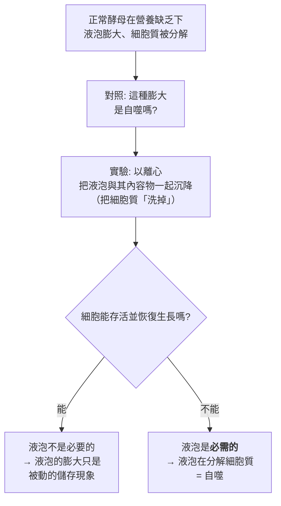
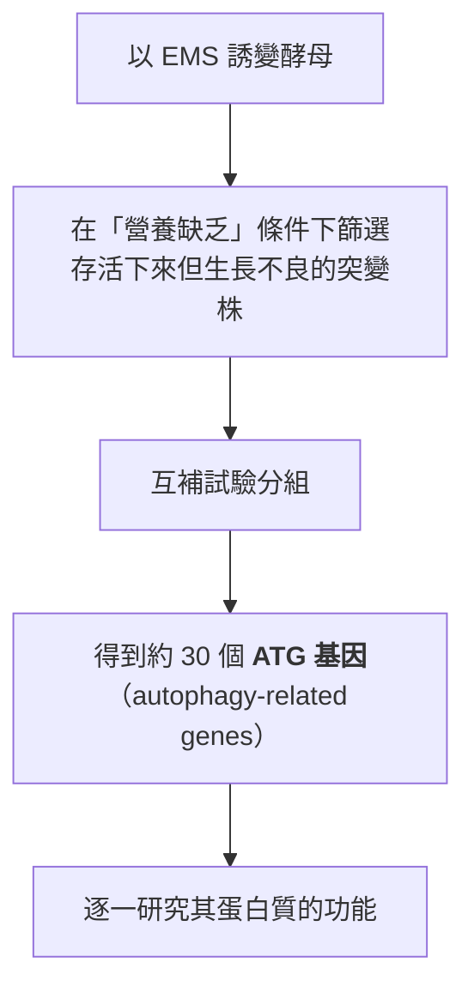
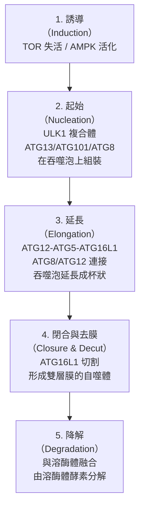
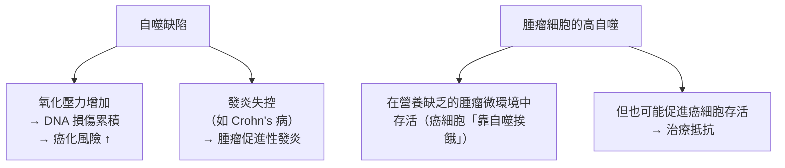

# 2016 · 細胞自噬：大隅良典找到細胞的「回收與焚化爐」

> **2016 諾貝爾生理學 or 醫學獎**：大隅良典（Yoshinori Ohsumi，日本）— 表彰「對細胞自噬機制的發現」（"for his discoveries of mechanisms for autophagy"）。

## 懸案（案情提要）

1970 年代，細胞生物學已知道細胞會不斷地「自我消化」——但機制是黑箱。核心疑點：

1. **細胞內的蛋白質與胞器是如何被分解的？** 它們被送進哪裡？由什麼酵素拆解？
2. 這種分解是**偶發的**（像「翻垃圾」），還是**受嚴格調控的**？
3. 若受調控——**什麼訊號在調控？** 細胞在什麼時候需要「自我焚化」？
4. 最重要的問題：**如果關掉這個機制，會發生什麼？** 與疾病有什麼關係？

**大隅良典在酵母菌中的系统性工作，回答了這全部問題。**

## 前因

| 年份 | 事件 |
| --- | --- |
| 1950s–60s | **Christian de Duve** 發現**溶酶體**並證明它是細胞的「消化酵素庫」（見 [1974-細胞結構與功能組織](1974-細胞結構與功能組織.md)）；但溶酶體如何接收要消化的物質，仍不清楚。 |
| 1970s | 細胞生物學中的「**自噬（autophagy）**」概念被提出：**「self-eating（自食）」**——細胞把自身的胞器包裹進膜性囊泡，送入溶酶體分解。 |
| 1974 | **去甲腎上腺素能神經末端**中發現「微小的小囊泡含有多種神經傳遞物質」——後來知道那是**突觸小泡**（見 [2013-囊泡運輸](2013-囊泡運輸.md)）。 |
| 1970s–80s | **大隅良典**在東京大學研究**酵母菌（*Schizosaccharomyces pombe*）**——**他選酵母是因為它「簡單」（單細胞、可做基因操作）但又是「真核生物」（有細胞骨架、有液泡）**。 |
| 1988–1991 | **大隅良典的顯微策略**：他用**染色技術**——開發了以**酸性磷酸酶（acid phosphatase）**為標記來追蹤液泡（vacuole）的方法，並且——**最關鍵的一步**——他**把酵母細胞的細胞質「洗」掉**（用一次離心把液泡的內容物連同細胞質一起沉降掉），再觀察細胞能否存活並重新生長。 |
| 1990s | 他篩選出**無法在「營養缺乏」（starvation）條件下存活的突變株**——**這正是「自噬缺陷」的篩選設計**。 |
| 1997 | **大隅良典發表《***Accumulation of Autophagic Vacuoles with a Novel Mechanism for Bulk Protein Degradation***》**——**首次提出「自噬體（autophagosome）」這個結構，並證明它們的形成與降解**。 |
| 2000s–2010s | **ATG 基因的系統性鑑定**（約 30 個基因）；**TOR 對自噬的抑制**與**AMPK 對自噬的促進**被確立（**「TOR—AMPK 的對偶調控」**）；自噬在**免疫、神經、脂肪代謝與癌症**中的角色被逐一釐清。 |
| 2016 | 大隅良典獲諾貝爾生理學 or 醫學獎（**諾貝爾委員會特別指出他是自噬研究領域的先驅**）。 |
| 2010s–2020s | **自噬與疾病**：**自噬缺陷與神經退行性疾病（阿茲海默、帕金森、ALS）、Crohn's 病、癌症、糖尿病**的關聯；**「藥理誘導自噬」的藥物**（**氯喹、二甲雙胍、雷帕黴素**）；**2020 年代**的自噬研究延伸至**免疫細胞代謝**與**腫瘤微環境**。 |

## 調查

### 第一幕：為什麼選酵母？

大隅良典的選擇理由極為清晰，值得完整記錄——因為它體現了「選對生物」的價值（見 [1958-一基因一酶](1958-一基因一酶.md)、[1995-胚胎發育基因](1995-胚胎發育基因.md)、[2002-程式性死亡](2002-程式性死亡.md)）：

| 條件 | 酵母 | 哺乳動物 |
| --- | --- | --- |
| 單細胞 | ✓ | ✗ |
| 有真核的膜性胞器（液泡 ≈ 溶酶體） | ✓ | ✓ |
| 容易做基因操作 | ✓ | 較難 |
| 可做**營養缺乏**實驗（停餓誘導自噬） | ✓ | 可但較難 |
| 世代快 | ✓ | 慢 |
| **綜合** | **完美的模型** | 難以做大規模遺傳學篩選 |

**關鍵洞察**：**酵母的液泡（vacuole）就是溶酶體的同源構造**——因此在酵母中研究「自噬」，等於在單細胞系統中研究哺乳動物的自噬。

### 第二幕：關鍵的實驗工具——「洗掉細胞質」

大隅良典的偵查方法極為大膽：

**這個「洗掉細胞質」的實驗，是判定「自噬是否真在發生」的極其精準的對照**——**它把「液泡膨大」與「液泡在執行分解」這兩件事分開了**。

**另一個關鍵工具——「染色技術」**：以**酸性磷酸酶**為標記物追蹤液泡的數量與大小。因為在**營養缺乏時液泡會膨大**，若同時觀察到**液泡數量增加**，就表示**新的自噬體正在形成**——這把「結構的數量」變成可測量的生化讀值。

### 第三幕：遺傳學篩選——「停餓時活不下去的酵母」

大隅良典的篩選設計極為漂亮：

**ATG 基因的產物形成了自噬的四個步驟**：

**「杯狀吞噬泡（phagophore）」的形狀**：在電子顯微鏡下，自噬體形成的過程像一個**杯狀結構在延伸、彎曲、閉合**——**這是 2010 年代 cryo-ET 研究最漂亮的結構影像之一**。

### 第四幕：調控的「對偶開關」——TOR 與 AMPK

自噬的開關是一組「營養感測器」：

$$\text{營養充足} \xrightarrow{\text{TOR 活化}} \text{抑制自噬} \qquad \text{營養缺乏} \xrightarrow{\text{TOR 失活, AMPK 活化}} \text{啟動自噬}$$

| 因子 | 狀態 | 對自噬的作用 |
| --- | --- | --- |
| **mTORC1** | 營養充足時活化 | **抑制**（磷酸化 ULK1 與 ATG13） |
| **AMPK** | 能量不足時活化 | **促進**（磷酸化 ULK1 與 mTORC1，間接解除抑制） |

**這是一個「雙重感測器」系統**——**同時感知「有沒有養分」與「有沒有能量」**，只有兩者都告急時才啟動自噬。**這是 20 世紀末最精確的細胞能量調控模型之一**。

**與細胞週期的關係**：mTORC1 也是**細胞生長與蛋白質合成的中央調控者**（見 [2001-細胞週期](2001-細胞週期.md)）——**因此 mTORC1 是「生長」與「回收」之間的樞紐**：

$$\text{mTORC1 活化} \to \begin{cases} \text{蛋白質合成} \uparrow \\ \text{自噬} \downarrow \end{cases}$$

**這解釋了為何「過度營養」會抑制自噬**——而這正是今日**代謝性疾病的分子核心**。

### 第五幕：自噬的四種「類型」與其生理角色

| 類型 | 機制 | 生理角色 |
| --- | --- | --- |
| **巨自噬（macroautophagy）** | 自噬體 → 溶酶體 | 胞器與長壽命蛋白的回收；**本案的對象** |
| **微自噬（microautophagy）** | 溶酶體直接吞噬細胞質 | 小分子蛋白的回收 |
| **伴侣介導自噬（CMA）** | HSP70 辨認並運送蛋白入溶酶體 | 特定蛋白的選擇性降解 |
| **異噬（xenophagy）** | 對外來病原的定向自噬 | **抗感染的防線** |

**自噬的生理角色**：

1. **營養缺乏時的「節約」**：細胞靠自噬分解自身的蛋白質與胞器以維持能量與胺基酸的供應（**在酵母中，這是唯一的存活方式**）；
2. **品質管制**：清除折疊錯誤的蛋白質（**與阿茲海默、帕金森的神經退行性疾病直接相關**）；
3. **清除受損胞器（線粒體自噬，mitophagy）**：受損的線粒體若不清除，會釋放 ROS 造成氧化傷害；
4. **抗感染**：**異噬作用**（xenophagy）將胞內細菌送給溶酶體消滅——**這解釋了為何「ATG 基因缺陷」會增加感染風險**（**如 **ATG16L1 與 Crohn's 病**的關聯**）；
5. **免疫與發炎**：自噬參與**抗原呈現**與**發炎小體（inflammasome）**的調控（**2016 年的諾貝爾演講中，大隅特別提到自噬與發炎的關聯**）。

### 第六幕：自噬與癌症——「雙刃劍」

自噬與癌症的關係是**雙向的**，這是今日腫瘤生物學的重要命題：

**因此「抑制自噬」有雙重風險**：一方面抑制腫瘤存活，另一方面增加正常細胞的癌化風險與發炎。**這是 2020 年代「自噬藥理學」的核心張力**。

## 理論裁決

1. **自噬的「決策」數學**：自噬是**全有全無**的閥門（不像細胞凋亡可以有中間態），其閾值由 mTORC1 與 AMPK 的相對活性決定：

   $$\frac{\text{自噬啟動速率}}{\text{最大速率}} = \frac{\text{AMPK 活性}}{\text{AMPK 活性} + K \times \text{mTORC1 活性}}$$

   **這是一個「雙輸入的邏輯閘門」**——與細胞週期的 CDK 閘門（見 [2001-細胞週期](2001-細胞週期.md)）同型。

2. **自噬通量的測量難題**：**判斷「自噬活性」不能只看自噬體的數量**——因為自噬體的數量同時反映「生成速率」與「降解速率」：

   $$\text{自噬體數} = \text{生成速率} \times \text{降解時間}$$

   **因此需要「動態通量測定（flux assay）」**：比較處理前後的自噬體數量，或使用 **mCherry-GFP-LC3 雙標記**（溶酶體酸性使 GFP 脫色）。**這是 2020 年代自噬研究方法學的重要進步**。

3. **自噬的「經濟學」**：在饑餓狀態下，自噬使細胞能存活更久：

   $$\text{存活時間}_{\text{自噬 ON}} \gg \text{存活時間}_{\text{自噬 OFF}}$$

   **這是酵母中最乾淨的實驗證據**——ATG 突變株在營養缺乏下迅速死亡。

4. **選擇性自噬的「標籤」機制**：**受體介導的自噬**（selective autophagy）——**p62/SQSTM1、BNIP3、NIX** 等受體帶著待分解的物質（受損線粒體、聚集蛋白）到自噬體——**這與囊泡運輸的「Rab 標籤」模型完全同型**（見 [2013-囊泡運輸](2013-囊泡運輸.md)）：

   $$\text{自噬受體} = \text{「要吃什麼」的標籤}, \qquad \text{ATG 複合體} = \text{「怎麼吃」的機器}$$

## 追查支線（未結之謎）

- **大隅良典的科學之路**：他原是**植物生理學家**（研究植物的營養生理），1990 年代轉向酵母細胞生物學；他在 2010 年代**大力推動「自噬研究社群」的形成**（組織國際自噬會議、推動研究方法的標準化）——**他在獲獎後特別強調「方法學標準化」的重要性**，這是科學社群的建設性工作；
- **大隅的科學信念**：他反覆強調「**觀察的力量**」——「**如果你用顯微鏡好好看，你會看到很多東西**」；**他與 2018 年諾貝爾獎（化學）的阿爾弗雷德·艾爾貝克共享了「敢於觀察」的傳統**；
- **自噬與免疫**：**ATG16L1 突變與 Crohn's 病**的關聯是自噬研究最重要的臨床發現之一（2007–2010 年）；**自噬在 M1/M2 巨噬細胞極化中的作用**是免疫代謝的核心課題（2020 年代）；
- **自噬與神經退行性疾病**：**阿茲海默病中的 autophagosome 數量在患者腦中顯著增加**——但這究竟是「自噬失效」還是「代償性反應」仍爭論不休；
- **藥理誘導自噬**：**雷帕黴素（抑制 mTOR → 啟動自噬）**、**氯喹（阻斷溶酶體酸化 → 阻斷自噬降解）**、**二甲雙胍（激活 AMPK）**——**這三個藥在神經退行性疾病的臨床試驗中已有數十年歷史，2020 年代它們以「自噬調節劑」的新身份重新被評估**；
- **「自噬體」的結構解析**：2010 年代的 cryo-EM 研究逐步解析了**ATG8 的「C 形」結構如何與 LIR（受體）結合並彎曲**，以及**ATG12-ATG5-ATG16L1 複合體如何形成「細胞支架」**（2020 年）——**這是 21 世紀自噬研究的結構生物學黃金期**。

## 證物與數據（偵查卷宗摘錄）

| 證物 | 數值／內容 | 偵查意義 |
| --- | --- | --- |
| 模型選擇 | 酵母（單細胞 + 真核胞器） | 「選對生物」的典範 |
| **細胞質洗除實驗** | 離心沉降液泡後細胞能否存活 | **區分「液泡膨大」與「分解作用」** |
| 酸性磷酸酶染色 | 液泡數量與大小的定量 | 追蹤自噬體生成 |
| 營養缺乏篩選 | 停餓下生長不良的突變株 | **自噬缺陷的篩選設計** |
| ATG 基因 | 約 30 個 | 自噬的四步驟 |
| 吞噬泡 | 杯狀 → 閉合成雙層膜自噬體 | 結構的動態 |
| TORC1 | 營養充足時抑制自噬 | 「有沒有養分」的感測 |
| AMPK | 能量不足時促進自噬 | 「有沒有能量」的感測 |
| 酵母存活 | ATG 突變株在停餓下迅速死亡 | **自噬必要性的最乾淨證據** |
| ATG16L1 | 與 Crohn's 病相關 | 免疫與自噬的連結 |
| mCherry-GFP-LC3 | 通量測定 | 方法學的進步 |

## 後果

| 領域 | 影響 |
| --- | --- |
| 細胞生物學 | 自噬從「模糊的現象」變為「有分子機器、有調控開關的過程」。 |
| 營養與代謝 | mTORC1 成為「生長—回收」的核心樞紐；理解代謝病的機制。 |
| 免疫學 | 異噬作用與發炎調控；ATG16L1 與 Crohn's 病。 |
| 神經科學 | 蛋白質聚集與自噬失效的關聯（阿茲海默、帕金森）。 |
| 腫瘤生物學 | 自噬的「雙刃劍」性質；腫瘤微環境中的代謝韌性。 |
| 藥理學 | 「藥理誘導自噬」成為藥物開發的策略之一。 |
| 其他諾獎 | 與 [2001-細胞週期](2001-細胞週期.md)（mTORC1 與細胞週期）、[1974-細胞結構與功能組織](1974-細胞結構與功能組織.md)（溶酶體）、[2013-囊泡運輸](2013-囊泡運輸.md)（選擇性自噬的標籤）構成細胞生物學主線。 |

## 關聯

- [1974-細胞結構與功能組織](1974-細胞結構與功能組織.md) — 溶酶體的發現，自噬的舞台。
- [2001-細胞週期](2001-細胞週期.md) — mTORC1 與 AMPK 的調控語言。
- [2013-囊泡運輸](2013-囊泡運輸.md) — 選擇性自噬的「標籤」機制與囊泡運輸同型。
- [2012-iPS 細胞](2012-iPS細胞.md) — 細胞命運重編程中的自噬角色。
- [2017-晝夜節律](2017-晝夜節律.md) — 細胞的「時間」與「資源回收」的週期性耦合。
