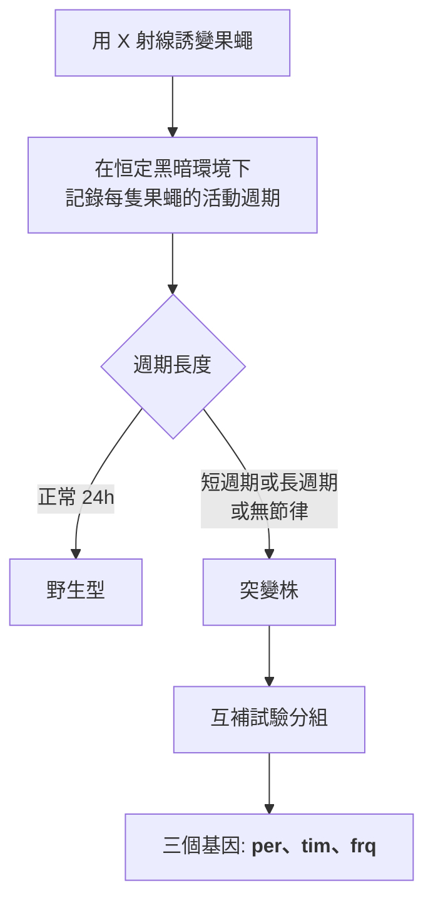
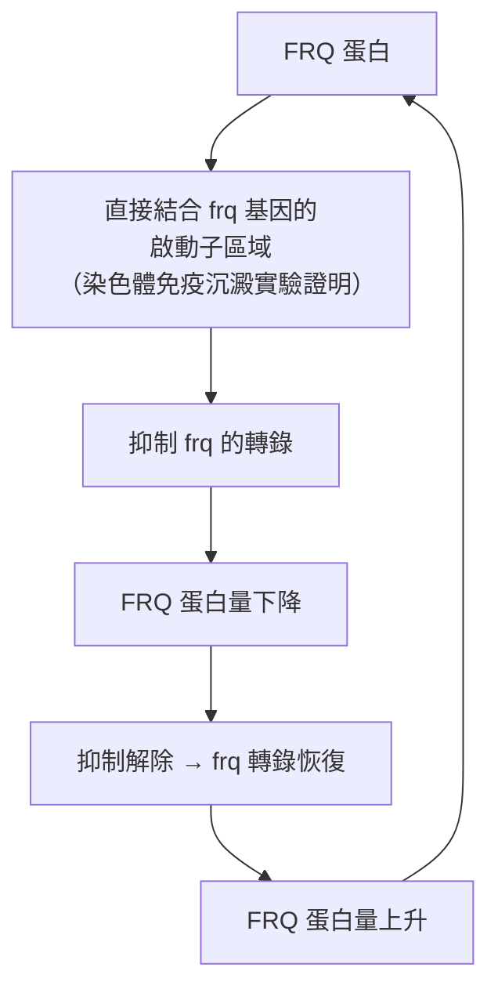
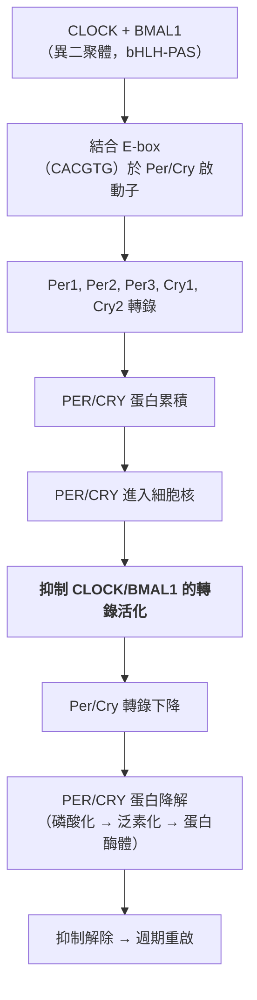

# 2017 · 晝夜節律的分子機制：霍爾、羅什巴什與楊找到生物鐘的齒輪

> **2017 諾貝爾生理學 or 醫學獎**：傑弗里·C·霍爾（Jeffrey C. Hall，美國）、麥可·W·羅什巴什（Michael W. Rosbash，美國）與麥可·W·楊（Michael W. Young，美國）— 表彰「發現控制晝夜節律的分子機制」（"for their discoveries of molecular mechanisms controlling the circadian rhythm"）。

## 懸案（案情提要）
幾乎所有生物都有「日週期」：植物在白天開夜合、人的睡眠—清醒週期約 24 小時、果蠅在特定時間活動。核心疑點：
1. **生物鐘的「振盪器」是什麼？** 它必須能在**沒有外界時間線索**的情況下自發運轉（否則每天重置，就不會記得時間）；
2. 它必須**自我維持**（即使沒有信號，也持續運轉）；
3. 它必須**可以被環境校準**（光線要能調整它——否則「晝夜節律」會與實際的白天黑夜脫節）；
4. 而最根本的：**一個週期的振盪，需要什麼樣的「分子齒輪」才能持續運轉？**
**答案：一個「延遲負回饋迴路」——一個蛋白質抑制自己的基因表現。**
## 前因
| 年份 | 事件 |
| --- | --- |
| 1700s–1800s | **de Mairan** 的向日葵實驗（1729）：植物在暗中仍保持晝夜節律——**「內生性計時器」的第一個證據**。 |
| 1930s–40 年代 | 生理學家確定了哺乳動物的晝夜節律，並發現**視交叉上核（SCN）**是「中央時鐘」；它對光刺激的反應是經由視網膜的 **ipRGC（內含黑視素的視網膜神經節細胞）**。 |
| 1970–1984 | **Ronald Konopka** 在加州理工以果蠅做「週期長度突變」的篩選，找到三個關鍵基因：**per（period）**、**tim（timeless）**、**frq（frequency）**；**他於 1970 年發表的這篇論文，長期被學界忽視**（**Konopka 是 Michael Young 的學生**）。 |
| 1981–1984 | **羅什巴什**（在 Brandeis）與其同事開始以「**多聚化的 cDNA 篩選**」尋找與 per mRNA 雜交的基因。 |
| 1984 | **羅什巴什團隊克隆出 per 基因，並發現其 mRNA 的量在一天中呈週期性漲落**——**這是生物鐘的分子證據**。 |
| 1984–1991 | **Michael Young** 與其團隊（先後在 Rockefeller 與 UT Southwestern）克隆出**第二與第三個生物鐘基因：tim（timeless）與 frq（frequency）**；並以**酵母菌（*Neurospora crassa*）**為材料，發現 **frq 的產物 FRQ 是一種負調控因子**。 |
| 1991 | **羅什巴什提出「轉錄—轉譯負回饋迴路（TTFL）」模型**：CYC 活化 per/tim 的轉錄，產生的 PER、TIM 蛋白再抑制同一基因的轉錄。 |
| 1997 | **Young 團隊發現 CRY（cryptochrome）是負調控因子**——**TTFL 模型完成**。 |
| 1997–2010s | **哺乳動物的分子鐘被完全破解**：**CLOCK、BMAL1、PER1/2/3、CRY1/2**；**2017 年的「同源異形選擇性剪接」（exon skipping）機制**（**「pan-protein isoforms」的發現，2024 年由 Young 團隊發表**）。 |
| 2017 | 三人共享諾貝爾生理學 or 醫學獎。 |
| 2010s–2020s | **生物鐘的醫學應用**：**時差症候群**、**睡眠障礙**、**癌症與晝夜節律**（**2017 年的諾貝爾科學背景會議「Circadian Rhythms and Medicine」**）、**免疫系統的晝夜節律**（**2022 年諾貝爾獎的 IL-6/glymph 軸**）；**2020 年代的「時間生物學（chronobiology）」成為醫學的重要分支**。 |

## 調查

### 第一幕：科諾普卡的「三個突變」——被忽視的奠基論文
康諾普卡 1970 年的實驗設計極為簡單卻具有決定性：

**這篇論文在發表後十餘年幾乎無人問津**——因為當時的生物學界認為「果蠅的晝夜節律大概不是個有趣的機制」，而且「週期長度突變」的表型難以解釋。
**1984 年，羅什巴什在讀到這篇論文時受到啟發**——他把「per 突變株的 mRNA 量是否有週期性」作為問題，這直接導向分子時代。
### 第二幕：羅什巴什的「雜交追蹤」——把基因抓出來
羅什巴什的實驗方法極為巧妙：
```mermaid
flowchart TD
    A[篩選 per 基因的 cDNA<br>（用已知 mRNA 的序列<br>做部分雜交）]
    A --> B[在一天的不同時間<br>從野生型果蠅提取 mRNA]
    B --> C[把 mRNA 與 cDNA 雜交<br>（或以 Northern blot）]
    C --> D{雜交訊號的強度<br>隨時間變化嗎?}
    D -- 是 --> E["<strong>發現: per mRNA 的量呈晝夜週期性</strong><br>（白天高、夜間低）]
    E --> F[1984 年發表<br>《Per mRNA 的晝夜振盪》]
```
**1984 年的《Cell》論文《*Two separate but coupled circadian oscillators regulate the level of per mRNA in the Drosophila melanogaster*》**，是生物鐘分子生物學的起點。
### 第三幕：楊的「酵母菌模型」——把機制從果蠅搬到真菌
楊（Michael W. Young）的貢獻，是**找到了一個更簡單、更可操作的系統**：**粗糙鏈孢黴（*Neurospora crassa*）**。
**他的關鍵實驗**：用**frq 突變株**（週期嚴重紊亂）進行**互補試驗**——他發現 **frq 基因的產物（FRQ 蛋白）能抑制其自身的基因表現**：

**這個負回饋迴路，是本案的核心發現**——**它解釋了「振盪」如何可能**。
**1997 年，楊團隊發現 CRY（cryptochrome）是第二個負調控因子**，並證明 **CRY 直接結合 PER**——**TTFL（轉錄—轉譯負回饋迴路）模型完整建立**：
$$\text{CYC} \xrightarrow{\text{活化}} \text{per/tim (果蠅) 或 frq (真菌) 的轉錄} \to \text{負調控蛋白} \xrightarrow{\text{抑制}} \text{同一基因的轉錄}$$
**「同樣的邏輯，不同的分子」**——**果蠅用 PER/TIM，真菌用 FRQ/FCP，哺乳動物用 PER/CRY**——這是**演化保守性的強烈證據**。
### 第四幕：哺乳動物的分子鐘
1990 年代末至 2000 年代，哺乳動物的分子鐘被完全破解：

**附加的調控層**：
1. **CK1（casein kinase 1）**：對 PER 磷酸化，設定其降解速率——**這決定了生物鐘的「週期長度」**（**人類的 CK1δ 突變造成家族性睡眠相位提前症 FASP）**；
2. **CRY 的光解**：在哺乳動物中，**CRY 是真正的「光感受器」**（**2018 年 Hao 等人的研究顯示，CRY 可被光直接分解**）——**這解釋了哺乳動物（非網膜）如何感知光**；
3. **ipRGC（intrinsically photosensitive retinal ganglion cells）**：**含黑視素（melanopsin）的視網膜神經節細胞**——**它們直接把光訊號傳給視交叉上核（SCN）**，是「光 → 生物鐘」的主路徑；
4. **2017 年的「同源異形選擇性剪接」**：Young 團隊發現**果蠅的 CLK 蛋白經由選擇性剪接（exon skipping）產生多種同工型**，且**這些同工型構成一個 24 小時的「剪接階梯」**——**這解釋了生物鐘如何以「分子計時器」的方式在一天中產生不同的輸出**。
### 第五幕：生物鐘的數學——振盪的產生條件
一個負回饋迴路要能**持續振盪**（而非收斂到定點），必須滿足若干條件：
1. **延遲（delay）**：轉錄→轉譯→核轉位→結合 DNA 的時間總和，必須大於某個臨界值——**在酵母中約 4–8 小時**；
2. **正反饋的存在**：即使在負回饋系統內，也需局部正反饋（如 **BMAL1 的去抑制後自我活化**）來產生銳利的開關行為；
3. **非線性（Hill 係數 > 1）**：使系統能產生「全或無」的振盪：
$$x(t) \text{ 遵循} \quad \dot{x} = \alpha \frac{x^n}{K^n + x^n} - \beta x \quad (n > 1)$$
**這與細胞週期的 CDK 振盪（見 [2001-細胞週期](2001-細胞週期.md)）在數學上完全同型**——**這是生物學中「振盪器」的通用設計原理**。
**周期長度的調控**：
$$\tau \approx \tau_{\text{轉錄}} + \tau_{\text{轉譯}} + \tau_{\text{核轉位}} + \tau_{\text{降解}}$$
**因此 CK1 對 PER 的磷酸化速率，直接決定週期長度**——**人類的 PER 蛋白若被磷酸化較慢，週期就變長（易發晚睡眠相位綜合症）；若磷酸化過快，週期變短（易發早睡眠相位綜合症）**。
### 第六幕：生物鐘與醫學
**晝夜節律在醫學中的地位在 2010 年代急速上升**：
| 領域 | 關聯 |
| --- | --- |
| **癌症** | 腫瘤細胞常劫持生物鐘以促進增殖；**時間化給藥**（circadian timing of chemotherapy）可提高療效、降低毒性（**2014 年 Science 的試驗**） |
| **免疫** | 細胞激素的分泌有晝夜節律；**2022 年諾貝爾獎的 IL-6/glymph 軸**即與此相關 |
| **感染** | 疫苗反應與給藥時間的關係（**「免疫時間學」**） |
| **代謝** | 進食時間、胰島素敏感性的晝夜節律（**「 chrononutrition」**） |
| **睡眠** | 時差症候群、輪班工作障礙、不規律作息與糖尿病/心血管病 |
| **肝臟** | **肝臟是生物鐘的主器官**（2010 年代「肝臟時鐘」的研究顯示，進食時間可重置肝臟的時鐘） |
## 追查支線（未結之謎）
- **三人與康諾普卡的「接力」**：康諾普卡（Michael Young 的學生）1970 年的論文被冷落 14 年，1984 年被羅什巴什「重新發現」——**這是科學史上「被埋沒的種子終於發芽」的最著名案例之一**；**康諾普卡本人於 1997 年因長期抑鬱症去世，未能分享 2017 年的諾獎**；
- **Michael Young 的科學生涯**：他是 **Ronald Konopka 的博士導師**；他在 1980 年代離開 Rockefeller 到 **UT Southwestern** 建立自己的系；**2017 年獲諾獎後，他與團隊在 2024 年發表了「同源異形選擇性剪接」的機制**，被視為生物鐘研究的「第二幕」；
- **羅什巴什的公共角色**：他在 1980–90 年代是**HHMI 的總裁**（帶領 HHMI 從小型基金會成為醫學研究的最大私人資助者）；他也是**Brandeis 校長（2011–2021）**；
- **傑弗里·霍爾**：他與 **Michael Rosbash**、**Michael Young** 是**同班同學（1970 年於 Case Western 取得博士學位）**，三人共同獲獎且共享諾獎金——**這是諾獎史上最動人的友誼故事之一**（他們被媒體稱為「The trio」）；**霍爾在 2013 年罹患癌症後，以「科學家的責任」發表了一篇長文《Borderline》，呼籲科學家參與公共政策辯論**；
- **「糖化血紅蛋白」與生物鐘**：**2017 年的《Science》論文中，霍爾等人指出「生物時鐘的相位」是解讀糖化血紅蛋白（HbA1c）檢測的重要變項**——**這是生物鐘直接影響臨床決策的一個實例**；
- **「時間治療學（chronotherapy）」**：**給藥時間依生物鐘調整**，在癌症化療、心臟病用藥與疫苗接種上已有臨床證據——**2020 年代「時間生物學」正在成為醫療的一個新專科**。
## 證物與數據（偵查卷宗摘錄）
| 證物 | 數值／內容 | 偵查意義 |
| --- | --- | --- |
| de Mairan 的向日葵（1729） | 暗中仍保持晝夜節律 | **內生性計時器的第一證據** |
| per/tim/frq 突變（1970） | 三個週期長度突變基因 | **被忽視 14 年的奠基論文** |
| per mRNA 的週期性（1984） | 白天高、夜間低 | **分子鐘的第一個證據** |
| FRQ 的自抑制（1991） | FRQ 結合自己的啟動子 | **負回饋迴路的發現** |
| CRY 的發現（1997） | 第二個負調控因子 | TTFL 模型完成 |
| 哺乳動物分子鐘 | CLOCK/BMAL1/PER/CRY | 保守的迴路結構 |
| CK1 磷酸化 | 決定 PER 的降解速率 | **週期長度的分子決定者** |
| 迴路延遲 | 約 4–8 小時 | 振盪的必要條件 |
| Hill 係數 | $n > 1$ | 「全或無」的振盪 |
| CRY 的光解（2018） | 光直接分解 CRY | 哺乳動物如何感光 |
| ipRGC | 含黑視素的視網膜神經節細胞 | 光 → SCN 的主路徑 |
| 剪接階梯（2024） | CLK 的多種同工型 | 分子計時器的輸出分化 |
| FASP | CK1δ 突變造成週期縮短 | **生物鐘基因與睡眠疾病** |
## 理論裁決

1. **振盪的必要條件**：一個負回饋迴路要能持續振盪（而非收斂到定點），必須滿足三個條件：

$$\text{（1）足夠的延遲：} \\quad \\tau_{\\text{總}} = \\tau_{\\text{轉錄}} + \\tau_{\\text{轉譯}} + \\tau_{\\text{核轉位}} + \\tau_{\\text{降解}} \\gtrsim 4\\text{–} 8\\ \\mathrm{h}$$

$$\text{（2）非線性：} \\quad n > 1 \\quad （\\text{Hill 係數）$$

$$\text{（3）局部正反饋：} \\quad \\text{以產生銳利的開關行為}$$

**這三條與細胞週期的 CDK 振盪完全同型**（見 [2001-細胞週期](2001-細胞週期.md)）——**「負回饋 + 非線性 + 延遲」是生物振盪器的通用設計**。

2. **迴路的振盪方程**：把 TTFL 簡化為一個振盪器：

$$\dot{x} = \\alpha \\frac{x^n}{K^n + x^n} - \\beta x$$

當 $\alpha > \\beta K$ 時，此式有**兩個穩定定點與一個不穩定定點**——這是**「開關式」的數學條件**，也解釋了生物鐘為何能在「高表現」與「低表現」之間快速切換。

3. **週期長度的可調性**：由於 $\tau_{\\text{總}}$ 是各步驟時間常數之和，而 **CK1 對 PER 的磷酸化速率決定 $\\tau_{\\text{降解}}$**，因此：

$$\\frac{\\partial \\tau}{\\partial k_{\\text{CK1}}} < 0$$

**也就是說：磷酸酶 CK1 磷酸化得越快，週期就越短**。**這解釋了人類 PER 的 CK1δ 突變造成「家族性睡眠相位提前症」（週期縮短），而 CK1δ 的功能缺失型突變則造成「延後型」**。

4. **相對性與「全或無」的感知**：生物鐘的「相位」是相對的（相對於光照時間），這在數學上是一個**相位—頻率耦合（phase response curve, PRC）**的系統：

$$\\Delta \\phi = f(\\Delta t_{\\text{light}})$$

**這解釋了為何光線在「生物時間的下午」與「生物時間的深夜」對體溫節律的影響方向相反**——**也是「時差症候群」與「光照治療」的理論基礎**。

5. **時間生物學的醫學意義（給藥時機的數學）**：若某藥物的療效與其血中濃度與靶點的「時間窗口」重疊程度有關，則：

$$\text{療效} \\propto \\max_t \\left( [D](t) \\cdot \\text{ReceptorAvail}(t) \\right)$$

**因此「何時給藥」是一個可最佳化的變數**——**這正是 2014 年《Science》「時間化化療」試驗的理論基礎**（該試驗顯示，在一天中特定的時段給藥可顯著提高療效並降低毒性）。

## 後果
| 領域 | 影響 |
| --- | --- |
| 生理學 | 生物鐘的分子機制完全清楚；「時間生物學」成為獨立的學科。 |
| 睡眠醫學 | 家族性睡眠相位提前／延後症、輪班工作障礙、時差的分子解釋。 |
| 腫瘤學 | 腫瘤劫持生物鐘；時間化給藥提高療效。 |
| 免疫學 | 免疫反應的晝夜節律（疫苗接種時機）。 |
| 代謝 | 進食時間、胰島素敏感性的晝夜節律；肝臟時鐘。 |
| 公共衛生 | 「時間生物學」進入醫療教育與政策。 |
| 其他諾獎 | 與 [2001-細胞週期](2001-細胞週期.md)（振盪器的同型設計）、[1992-蛋白質磷酸化](1992-蛋白質磷酸化.md)（CK1 的磷酸化）、[1971-第二信使](1971-第二信使.md)（cAMP 在時鐘中的角色）構成生理調控主線。 |
## 關聯
- [2001-細胞週期](2001-細胞週期.md) — 振盪器的數學同型：負回饋 + 非線性。
- [1992-蛋白質磷酸化](1992-蛋白質磷酸化.md) — CK1 對 PER 的磷酸化決定週期長度。
- [2016-細胞自噬](2016-細胞自噬.md) — mTORC1 與 AMPK 在生物鐘中的角色。
- [1986-生長因子](1986-生長因子.md) — 訊號傳遞與週期的交會。
- [1963-離子機制](1963-離子機制.md) — 細胞的電生理節律。