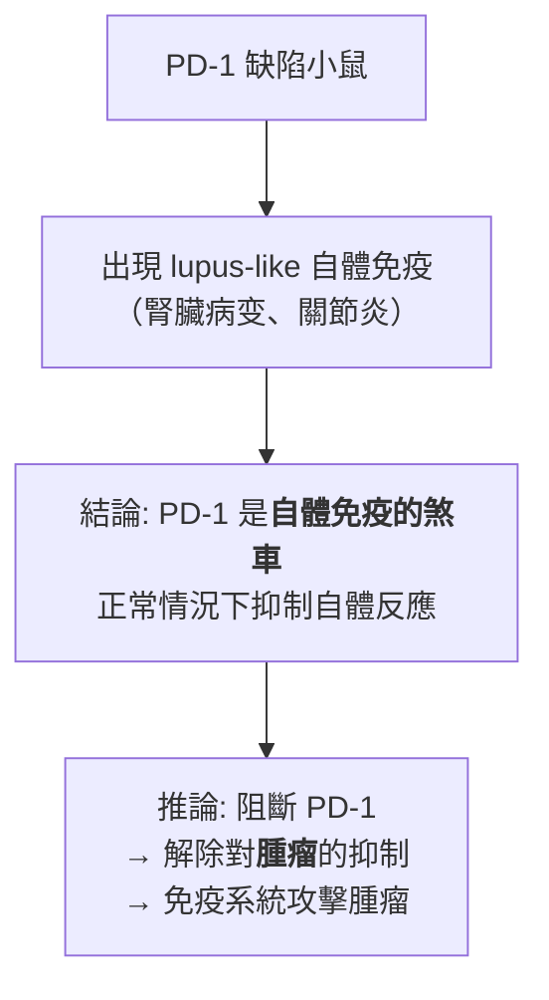
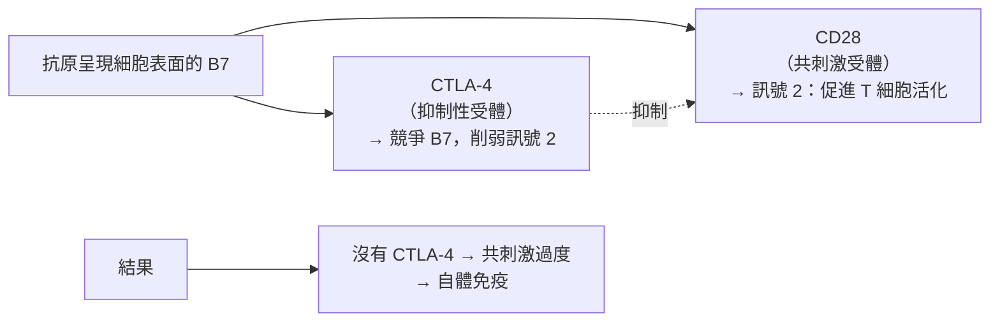
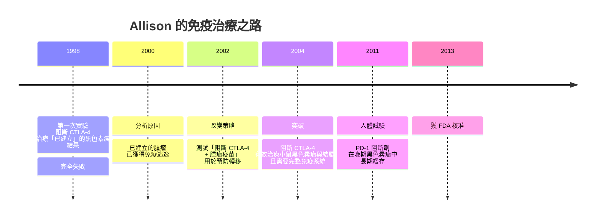

# 2018 · 免疫檢查點：艾利森與本庶佑找到「解除煞車」以治療癌症

> **2018 諾貝爾生理學 or 醫學獎**（共享）：詹姆斯·P·艾利森（James P. Allison，美國）— 表彰「發現以抑制負性免疫調節治療癌症的方法」；本庶佑（Tasuku Honjo，日本）— 同上。

## 懸案（案情提要）

癌症治療在 20 世紀經歷了「化療」（殺死快速分裂的細胞）與「標靶治療」（攻擊特定分子）兩波攻勢。兩者都受同一條規則的限制：

$$\text{療效} \propto \text{藥物對腫瘤的直接毒性}$$

也就是說，藥物主要靠「殺傷」起效。而免疫治療開啟了第三條路——**不是攻擊腫瘤，而是解除免疫系統對腫瘤的「抑制」**。

但核心問題極為艱深：

1. 免疫系統明明能殺死病毒與細菌，**為什麼殺不掉腫瘤？**
2. 腫瘤細胞是「自身的細胞」，因此**免疫系統應該不會攻擊它**——但免疫系統**偶爾**確實能攻擊腫瘤（**「免疫監控」**）——那為什麼多數腫瘤能逃脫？
3. 有沒有什麼「分子開關」，是**用來踩住免疫系統的煞車**的？如果把它鬆開，免疫系統就能重新攻擊腫瘤？

**答案：檢查點（checkpoint）——CTLA-4 與 PD-1。**

## 前因

| 年份 | 事件 |
| --- | --- |
| 1957 | **Burnet 與 Medawar** 的「**免疫監控（immunosurveillance）**」理論：免疫系統持續清除新生的異常細胞（見 [1960-後天免疫耐受](1960-後天免疫耐受.md)）。 |
 在 1970 年代以小鼠模型證明：**腫瘤細胞具有「抗原性」（能被免疫系統辨識）**——這是「癌免疫學」的起點。 |
| 1980s | **本庶佑**在京都大學以**免疫球蛋白基因重排的發現**（見 [1987-抗體多樣性](1987-抗體多樣性.md)）成名，後轉向免疫調節分子的研究。 |
| 1980s–1990s | **本庶佑的實驗**：他發現 **PD-1** 在活化後的 T 細胞上表現，**抑制受體的抗體可促進 T 細胞的活化**——**這是「負性免疫調節因子」存在的直接證據**。 |
| 1991 | **本庶佑團隊克隆出 PD-1 基因**，並證明其缺陷小鼠會出現**自體免疫**（**lupus-like 綜合症**）——**證明 PD-1 是免疫的「煞車」**。 |
| 1994 | **James Allison**（在 UC Berkeley）研究 **CTLA-4**——他發現 **CTLA-4 缺陷小鼠會出現致命的淋巴增殖性 disorders**——**再次證明煞車的存在**。 |
| 1996 | **Allison 在《Science》發表**：論證 CTLA-4 與 CD28 競爭結合 B7，**並由此提出「檢查點（checkpoint）」的概念**。 |

| 1998–2005 | Allison 的團隊在**小鼠模型**上測試「阻斷 CTLA-4」是否能治療腫瘤——**結果失敗**（對已建立的腫瘤無效）。 |
| 2001 | **本庶佑團隊證明**：PD-1 缺陷小鼠**對抗腫瘤的能力增強**（**L51/6、p815 移植模型**）——**「阻斷檢查點可以治療腫瘤」的第一個體內證據**。 |
| 2002–2003 | Allison 改變策略：與 **Cancer Research Institute** 合作，測試「**阻斷 CTLA-4 能否預防轉移與治療已建立的腫瘤**」； |
| 2004 | **關鍵實驗**：Allison 的團隊證明，**阻斷 CTLA-4 能有效治療小鼠的黑色素瘤與結腸癌模型**——**而且療效需要「免疫系統存在」**（** Rag2 缺陷的免疫缺陷小鼠治療無效**）——**這是「免疫治療」而非「直接殺傷」的決定性證據**。 |
| 2005 | **本庶佑的團隊**證明**阻斷 PD-1 也能治療腫瘤**（在小鼠模型中）；**隨後的「PD-1 與腫瘤細胞的表觀遺傳」研究**（2016 年，**Rutledge 等人**）顯示：**PD-1 途徑是腫瘤免疫逃逸的主要機制**——**這解釋了為何 PD-1 阻斷劑在人類中效果如此顯著**。 |
| 2011 | **第一個 PD-1 阻斷劑**（**nivolumab（Opdivo）與 pembrolizumab（Keytruda）**）在晚期黑色素瘤的臨床試驗中展現**空前效果**——**長期緩存、多數患者存活超過數年**（在黑色素瘤中，這是數十年來第一次）。 |
| 2013 | 首例 PD-1 藥物獲 FDA 核准（晚期黑色素瘤）。 |
| 2014–2020s | **PD-1 阻斷劑的適應症大幅擴展**：**非小細胞肺癌、腎細胞癌、頭頸癌、膀胱癌、霍奇金淋巴瘤、Merkel 細胞癌**等——**今日的免疫檢查點抑制劑是全球最暢銷的藥物類別之一**（2020 年 pembrolizumab 的全球銷售額逾 140 億美元）。 |
| 2018 | 兩人共享諾貝爾生理學 or 醫學獎。 |
| 2020s | **細胞治療的興起**：**CAR-T**（見 [2018 年後的 CAR-T 浪潮](2018-免疫檢查點.md)）；**雙特異性抗體**；**ADC**；以及**「免疫檢查點 + 標靶治療」的聯合**成為腫瘤治療的新標準。 |

## 調查

### 第一幕：本庶佑的「自己打自己」的發現

本庶佑的偵查起點是一個極為個人化的謎題：

1. 他在研究**免疫球蛋白基因重排**時（見 [1987-抗體多樣性](1987-抗體多樣性.md)）發現了一個奇怪的重複基因序列，後來知道它就是 **PD-1（programmed death-1）**；
2. 他提出一個大膽的猜想：**免疫系統可能有一種「自我抑制」的機制**——**否則，為什麼免疫系統不會攻擊自身的細胞？**
3. **關鍵實驗**：他製作了 **PD-1 的阻斷性抗體**，加入 T 細胞的培養系統，觀察 T 細胞的活化是否被促進——**答案是肯定的**；
4. **1991 年的克隆與 1992 年的「缺陷鼠」實驗**是決定性的：



**這是本案最核心的推理**：**若煞車的存在是為了防止攻擊「自己」，那麼腫瘤（也是「自己」）也會被這同一個煞車所抑制**——**鬆開煞車，免疫系統就會攻擊腫瘤。**

### 第二幕：艾利森的「CTLA-4 與兩訊號模型」

艾利森的工作在「檢查點」概念上更早、更根本。

**背景——「兩訊號模型」**：T 細胞的活化需要兩個訊號——

$$\text{訊號 1：抗原-MHC/TCR} + \text{訊號 2：共刺激（如 B7-CD28）}$$

**艾利森的實驗**：

1. 他發現 **CTLA-4** 在活化的 T 細胞上表現；
2. **CTLA-4 缺陷小鼠會發生致命的淋巴增殖性疾病**——**證明 CTLA-4 是必需的抑制分子**；
3. **1996 年的關鍵論文**：他論證**CTLA-4 與 CD28 競爭結合 B7**：



**這是一個精巧的「分子競爭（molecular competition）」模型**——**同一個配體（B7），兩個受體，一個促進、一個抑制**。

### 第三幕：1998–2004 年的轉折——「失敗之後的重新思考」

**這是科學史上最動人的情節之一**：



**1998 年失敗的原因**（Allison 事後的分析）：**已建立的腫瘤已經長出了「免疫逃逸」的機制**——因此必須在**腫瘤尚未建立、或與抗原疫苗併用**的早期階段阻斷檢查點。

**2002 年的關鍵實驗**：**「阻斷 CTLA-4 + 疫苗（完整細胞疫苗或 DNA 疫苗）」**能有效清除已建立的小鼠黑色素瘤。

**2004 年的決定性對照**：**Allison 證明治療效果需要「有功能的免疫系統」**——在 **Rag2 缺陷（無 T 細胞與 B 細胞）的小鼠**中，阻斷 CTLA-4 **完全無效**。

**這是「這是免疫治療而非直接殺傷」的決定性證據**——**它把機制釘死了**。

### 第四幕：為什麼 PD-1 比 CTLA-4 效果更好且副作用更輕？

**PD-1 與 CTLA-4 的差異**：

| 面向 | CTLA-4 | PD-1 |
| --- | --- | --- |
| 表現時機 | T 細胞**活化早期** | T 細胞**活化後、持續表現在周邊** |
| 位置 | 主要在**細胞內**（與 CD28 競爭 B7） | 主要在**細胞表面**（配體 PD-L1 在組織中廣泛表達） |
| 作用 | 阻斷「啟動訊號」 | 阻斷「持續訊號」 |
| 副作用 | 較重（**CTLA-4 阻斷劑常引起嚴重免疫相關不良事件**） | 較輕（**但仍有免疫相關毒性**） |
| 效應 | 主要在**啟動階段**（淋巴結） | 主要在**周邊組織**（腫瘤微環境） |

**「PD-1 是周邊的煞車，CTLA-4 是中央的煞車」**——這是理解兩者差異的關鍵。

**而腫瘤為何能逃逸？** 2016 年的關鍵研究（**Rutledge 等人**）回答了這個問題：

$$\text{腫瘤的免疫逃逸} \approx \text{PD-L1 的過度表達} + \text{基因組的穩定突變（抗原逃逸）} + \text{T 細胞耗竭}$$

**「抗原逃逸（antigen escape）」**——腫瘤突變使 MHC 呈現的抗原改變，**T 細胞認不出來了**——這解釋了為何即使有檢查點阻斷劑，仍有相當比例的患者無效。

### 第五幕：免疫檢查點阻斷劑的臨床影響

**數字上的震撼**：

| 腫瘤 | 傳統治療的中位存活 | 免疫檢查點阻斷劑 |
| --- | --- | --- |
| **晚期黑色素瘤（ipilimumab, 2011）** | 中位存活約 8–11 個月 | **中位存活約 20 個月以上**；**約 20% 的患者長期存活**（此前從未有超過 5% 的長期存活率） |
| **PD-1 抑制劑於黑色素瘤** | — | **客觀緩解率 40%–50%**（此前約 10%）；**部分患者完全緩解** |
| **非小細胞肺癌（PD-1/PD-L1）** | 五年生存率 < 5% | 顯著提升 |

**「10%–20% 的長期存活率」是這樁案子最重要的臨床意義**：**在晚期黑色素瘤這種過去「幾乎等於死刑」的疾病上，出現了第一批可以被稱為「治癒」的病人**。

**副作用的圖景**：免疫檢查點阻斷劑會引起**免疫相關不良事件（irAE）**——皮疹、大腸炎、甲狀腺炎、肺炎等（**因為免疫系統被「鬆開」後，可能攻擊自己的組織**）。這是一種**「治療的價格」**，也是免疫治療與化療在哲學上的根本差異：

$$\text{化療：} \quad \text{毒性} \propto \text{殺傷強度} \qquad \text{免疫治療：} \quad \text{毒性} \propto \text{免疫解除的廣度}$$

### 第六幕：理論——「免疫系統的三個閘門」

把本案與既有的免疫學整合，可以得到一個「**三重閘門模型**」：

```mermaid
flowchart TD
    A[1. 抗原識別閘門<br>MHC/TCR 特異性<br>（見 1996 諾獎）] --> B[2. 共刺激閘門<br>CD28/B7<br>被 CTLA-4 競爭]
    B --> C[3. 周邊抑制閘門<br>PD-1/PD-L1<br>在組織中踩煞車]
    C --> D[T 細胞的完整啟動]
    A -.腫瘤的抗原逃逸阻斷.-> D
    B -.CTLA-4 搶奪 B7.-> D
    C -.PD-L1 表達阻斷.-> D
    E[檢查點阻斷劑<br>Ipilimumab (CTLA-4)<br>Nivolumab / Pembrolizumab (PD-1)] --> F[鬆開閘門<br>→ 腫瘤被免疫系統攻擊]
```

**這個模型解釋了三個臨床事實**：

1. **為何需要「腫瘤抗原」存在？** 若腫瘤完全沒有抗原被呈現（如某些低免疫原性的腫瘤），鬆開煞車也沒用；
2. **為何 PD-1 阻斷劑的療效如此依賴腫瘤類型？** 因為不同腫瘤的「抗原逃逸」與「PD-L1 表達」程度不同——**這正是「生物標記導向治療」**；
3. **為何會有免疫相關毒性？** 因為煞車不只作用於腫瘤，也作用於正常組織——**這是「解除全身性抑制」的必然代價**。

## 追查支線（未結之謎）

- **艾利森的科學生涯與「轉向」**：他是**德州人**，在 UC Berkeley 從事基礎免疫學研究；他的實驗室曾長期不被主流腫瘤學界接受（「你的機制很漂亮，但小鼠的腫瘤不是人的腫瘤」）；**他於 2018 年獲獎後，把諾獎金的一部分捐給了癌症研究基金會**；
- **本庶佑的科學貢獻不止 PD-1**：他也是**1987 年抗體多樣性發現（V(D)J 重排）**的共同獲獎者之一（與利根川進，見 [1987-抗體多樣性](1987-抗體多樣性.md)）——**這是同一位科學家在相隔 31 年後兩度獲諾獎**，極為罕見；他的實驗室還發現了 **PD-1 的另一條路徑（PD-L1）**與許多相關分子；
- **兩人的科學道途**：**本庶佑**的PD-1 發現是「**從免疫學的基本問題出發**」（為什麼免疫系統不攻擊自己）；**艾利森**的路徑是「**從腫瘤治療的實際問題出發**」；**兩條路在 1990 年代中期匯合**——**這是「基礎研究」與「目標導向研究」可以匯流的最佳案例**；
- **「免疫逃逸」理論的完整建立**：**2016 年，Weissman 與 Rosenberg 在《Science》發表「腫瘤免疫逃逸的三種方式」的系統研究**（**抗原逃逸、 antigen processing 缺陷、 JAK1/2 或 B2M 突變導致的 IFN-γ 訊號失效**）——**這為「為何檢查點阻斷劑對某些患者無效」提供了答案**，並導向「**雙重檢查點阻斷 + 腫瘤疫苗**」的策略；
- **CAR-T 細胞的興起（2010 年代）**：**CAR-T 是「免疫檢查點」之外的另一條路**——它不解除煞車，而是**直接提供一個帶有抗體結合域的 TCR 的人工受體**（見 [2013-囊泡運輸](2013-囊泡運輸.md) 的突觸工程），把 T 細胞直接導向腫瘤。**但 CAR-T 需要一個「靶抗原」，而檢查點阻斷劑不需要**——這解釋了兩者的臨床定位差異；
- **「冷腫瘤」與「熱腫瘤」**：2020 年代的免疫腫瘤學核心概念：

$$\text{「熱」腫瘤} = \text{腫瘤內有 T 細胞浸潤} \quad\Longrightarrow\quad \text{檢查點阻斷劑可能有效}$$
$$\text{「冷」腫瘤} = \text{無 T 細胞浸潤} \quad\Longrightarrow\quad \text{需先把它「加熱」}$$

**「把冷腫瘤變熱」**（溶瘤病毒、放射線、疫苗）是 2020 年代最活躍的研究方向之一。

## 證物與數據（偵查卷宗摘錄）

| 證物 | 數值／內容 | 偵查意義 |
| --- | --- | --- |
| Lloyd Old 的抗原性實驗（1970s） | 腫瘤具有免疫原性 | 癌免疫學的起點 |
| **PD-1 阻斷抗體** | 促進 T 細胞活化 | 負性調節因子的發現 |
| **PD-1 缺陷小鼠** | 出現 lupus-like 自體免疫 | **煞車存在的證明** |
| CTLA-4 缺陷小鼠 | 致命的淋巴增殖症 | 同上 |
| B7 的分子競爭 | CTLA-4 搶走 CD28 的配體 | 兩訊號模型的修正 |
| **1998 年治療失敗** | 阻斷 CTLA-4 對已建立腫瘤無效 | **科學失敗的診斷** |
| **2002–04 年策略轉向** | CTLA-4 阻斷 + 疫苗 | 治療窗口的重新定位 |
| **Rag2 缺陷小鼠對照** | 無免疫系統則治療無效 | **免疫治療的直接證明** |
| 黑色素瘤五年生存 | 從 <5% 提升至部分病人 >20% | 臨床的震撼性改變 |
| PD-1 緩解率 | 約 40%–50%（黑色素瘤） | 遠高於傳統免疫治療 |
| PD-L1 過度表達 | 腫瘤逃逸的主要機制 | 2016 年的系統研究 |
| irAE | 皮疹、大腸炎、肺炎等 | 解除全身抑制的代價 |

## 理論裁決

1. **「雙重鑰匙」數學**：T 細胞活化的完整條件：

$$\\text{活化} \\leftarrow \\text{訊號 1（抗原-MHC/TCR）} + \\text{訊號 2（共刺激）} + \\text{訊號 3（細胞激素）}$$

**缺任一訊號 → 不活化（耐受）**。這解釋了：

| 情境 | 訊號 1 | 訊號 2 | 結果 |
| --- | --- | --- | --- |
| 正常感染 | ✓ | ✓（由樹突細胞提供） | **活化** |
| 腫瘤 | ✓ | ✗（腫瘤細胞多表達 PD-L1、不表達 B7） | **逃逸** |
| 自身組織 | ✓（自身抗原） | ✗（無危險信號） | **耐受** |
| 疫苗 | ✓ | ✓（佐劑活化樹突細胞） | **活化** |

2. **檢查點的競爭性抑制**：CTLA-4 與 PD-1 的作用可用「配體競爭 + 訊號衰減」表達：

$$\\text{有效共刺激} = \\frac{[\\mathrm{B7}]}{1 + [\\mathrm{CTLA4}]/K_{\\text{CTLA4}}} \\cdot \\text{efficiencies}$$

$$\\text{有效 T 細胞訊號} = \\frac{[\\mathrm{PD1}]}{1 + [\\mathrm{PD1}]/K_{\\text{PD1}}} \\cdot \\text{signaling}$$

**當 PD-1 的表達量超過其抑制閾值時，即使有充足的抗原與共刺激，訊號也會被壓到閾值以下**——**這就是「免疫逃逸」的量化定義**。

3. **檢查點阻斷的數學效果**：阻斷率為 $f$ 時，腫瘤生長的改變可建模為：

$$\\frac{dT}{dt} = r_{\\text{growth}}(1 - \\alpha\\,f) T - r_{\\text{death}} T$$

**阻斷使有效殺傷率上升，但僅在「腫瘤能被辨認」的前提下**——這解釋了為何抗原逃逸的腫瘤（無訊號 1）對檢查點阻斷劑**完全無效**。

4. **「免疫逃逸」的三種模式（2016 年）**：

$$\\text{逃逸率} \\approx P(\\text{抗原逃逸}) + P(\\text{抗原處理缺陷}) + P(\\text{IFN-}\\gamma \\text{訊號失效})$$

**這解釋了為何即使最好的檢查點阻斷劑，仍有約 30%–40% 的患者無效**——**並直接導向「雙重阻斷 + 疫苗」的策略**。

5. **治療的收益—毒性結構**：檢查點阻斷劑的毒性來自「全身性解除抑制」：

$$\\text{irAE 發生率} \\propto \\text{解除的抑制廣度} \\quad \\text{vs} \\quad \\text{療效} \\propto \\text{腫瘤內解除的抑制}$$

**這個取捨解釋了為何 PD-1（周邊作用）比 CTLA-4（中央作用）副作用更輕**，也解釋了為何「局部給藥」（腫瘤內注射）可能是未來的改進方向。

## 後果

| 領域 | 影響 |
| --- | --- |
| 腫瘤學 | 免疫治療成為四大治療模式之一；「長期生存」首次出現在晚期黑色素瘤。 |
| 藥理學 | 「鬆開煞車」成為藥理學的新策略；生物標記（PD-L1）導向用藥。 |
| 免疫學 | 「負性免疫調節」的完整圖景（CTLA-4、PD-1、PD-L1、TIM-3、LAG-3 等）。 |
| 產業 | 免疫檢查點抑制劑成為全球最暢銷的藥物類別之一。 |
| 科學方法 | 「從基礎問題出發」與「從治療問題出發」兩條路線匯流的典範。 |
| 其他諾獎 | 與 [1996-MHC 限制性](1996-MHC限制性.md)（訊號 1）、[2011-先天免疫與樹突細胞](2011-先天免疫與樹突細胞.md)（樹突細胞的啟動作用）、[2013-囊泡運輸](2013-囊泡運輸.md)（CAR-T 的突觸工程）構成免疫腫瘤學主線。 |

## 關聯

- [1996-MHC 限制性](1996-MHC限制性.md) — 三訊號模型中的第一個閘門。
- [2011-先天免疫與樹突細胞](2011-先天免疫與樹突細胞.md) — 樹突細胞提供的共刺激與抗原呈現。
- [2013-囊泡運輸](2013-囊泡運輸.md) — CAR-T 細胞的受體工程與突觸機制。
- [1960-後天免疫耐受](1960-後天免疫耐受.md) — 「不攻擊自己」的理論源頭。
- [1989-原癌基因](1989-原癌基因.md) — 腫瘤逃逸與抗原呈現缺陷的分子背景。
