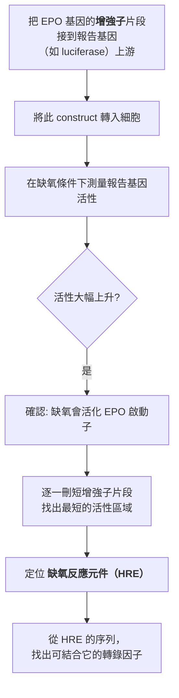
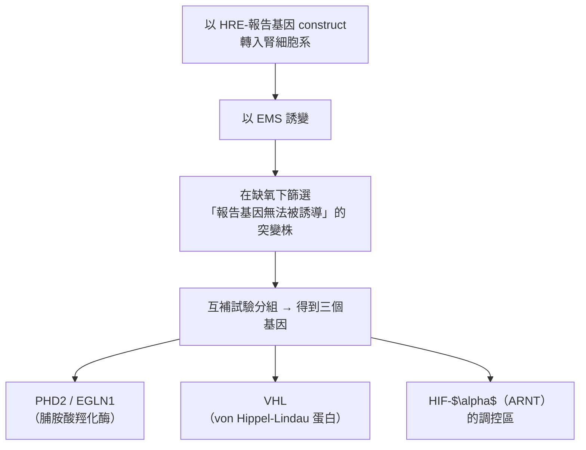
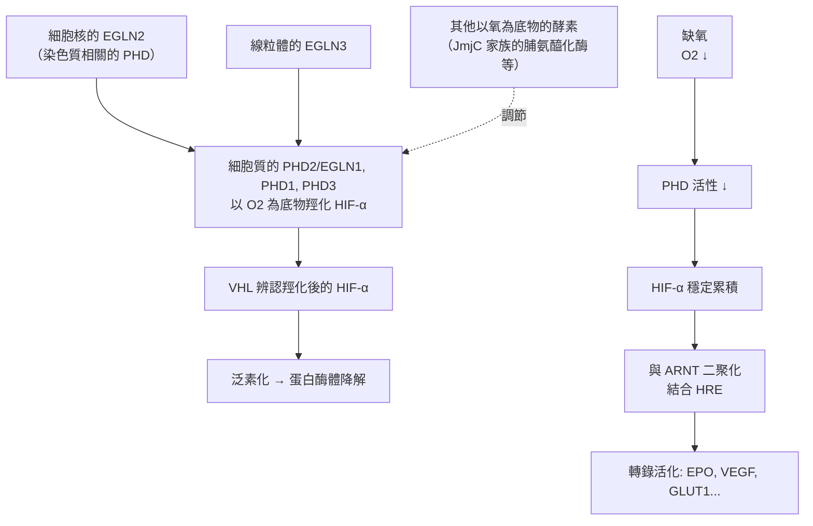

# 2019 · 氧氣的感知：凱林、拉特克利夫與塞門扎找到細胞的「缺氧感測器」

> **2019 諾貝爾生理學 or 醫學獎**（共享三人）：威廉·G·凱林（William G. Kaelin Jr.，美國）— 表彰「發現細胞感知和適應氧氣供應的機制」；彼得·J·拉特克利夫爵士（Sir Peter J. Ratcliffe，英國）與格雷格·L·塞門扎（Gregg L. Semenza，美國）— 同上。

## 懸案（案情提要）

氧氣對動物是必需的，但**過量的氧氣也是有毒的**（活性氧）。因此生物必須**同時感知「氧太多」與「氧太少」**。核心疑點：

1. 細胞如何測量氧氣的濃度？
2. 基因如何「知道」缺氧，並做出反應？
3. 為什麼**缺鐵性貧血**（血紅素不足 → 組織缺氧）會讓**紅血球生成素（EPO）**大量分泌，而**某些癌症患者的 EPO 卻完全不升高**——明明更缺氧，為什麼不升？

第三個問題尤其詭異——**它暗示「缺氧感測」不是單純的化學測量，而是有「結構性」元件的**。

**答案：HIF（缺氧誘導因子，hypoxia-inducible factor）與其分解酵素 PHD，以及 VHL 蛋白。**

## 前因

| 年份 | 事件 |
| --- | --- |
| 1957 | **Burnet 與 Medawar** 的「**免疫監控（immunosurveillance）**」理論（與氧氣無關，但同屬「細胞如何感知環境」的經典問題）。 |
| 1970s | **Lloyd Old** 在 1970 年代以小鼠模型證明：**腫瘤細胞具有「抗原性」**——這是癌免疫學的起點（見 [2018-免疫檢查點](2018-免疫檢查點.md)）。 |
| 1980s | **本庶佑**在京都大學以**免疫球蛋白基因重排的發現**（見 [1987-抗體多樣性](1987-抗體多樣性.md)）成名，後轉向免疫調節分子的研究。 |
| 1990–1994 | **凱林**在哈佛研究 **von Hippel–Lindau 病**——這是一種遺傳性腫瘤症候群（**腎癌、腦部血管母細胞瘤、視網膜母細胞瘤**），其致病基因 **VHL** 於 1995 年被定位。 |
| 1990s | **塞門扎**在 Johns Hopkins 研究**缺氧時紅血球生成素（EPO）基因的表現**——他發現 **EPO 基因的轉錄在缺氧時被強烈活化**，並在 1995–1997 年以**報告基因（reporter gene）**技術定位了**缺氧反應元件（HRE）**（位於 EPO 基因的增強子上）。 |
| 1990s | **拉特克利夫**在 Oxford 以**腎細胞系**進行遺傳學篩選，發現**在缺氧下不能誘導 HRE 的突變株**，並於 1997–1999 年定位了相關基因：**PHD2（EGLN1）**、**VHL**、以及 **HIF- $\alpha$**。 |
| 1995–1997 | **凱林**證明 **VHL 基因的產物（pVHL）** 是**泛素—蛋白酶體系統的受體**——**它把 HIF- $\alpha$ 送去被降解**。這建立了「**VHL–HIF 軸**」的分子框架。 |
| 1997–1999 | **三人的發現匯合**：① **塞門扎與拉特克利夫**：缺氧時 HIF- $\alpha$ 的轉錄因子活性大幅上升；② **凱林**：VHL 缺失的細胞中，**HIF- $\alpha$ 即使在有氧時也不被降解** → HIF 過度活化 → 腫瘤；③ **PHD2 的發現**：**拉特克利夫證明 HIF- $\alpha$ 的脯胺酸羥化需要氧、鐵與 $\alpha$ -酮戊二酸**——**這就是「氧氣感測器」的化學機制**。 |
| 2019 | 三人共享諾貝爾生理學 or 醫學獎。 |
| 2010s–2020s | **HIF 藥理學**：**Roxadustat**（2019 年獲 FDA 核准，用於腎性貧血）、**Vadadustat、Daprodustat**；**HIF-PHD 抑制劑**的廣泛應用；**HIF 與免疫、代謝、癌症**的研究；**2021 年 belzutifan 獲 FDA 核准用於 VHL 腎癌**——這是「瞭解機制→反過來用藥」的完整閉環。 |

## 調查

### 第一幕：塞門扎的「啟動子報告基因」——找到氧氣反應的「開關」

塞門扎的偵查方法極為標準而有力：

**HRE 的序列（核心為 RCGTG）**是 **HIF-1 $\alpha$ / HIF-2 $\alpha$** 的結合位點。

### 第二幕：拉特克利夫的「不能被誘導的突變株」——遺傳學的篩選

拉特克利夫的篩選設計極為漂亮：

**關鍵的實驗邏輯**：篩選「感測器壞掉」的突變株，而不是「反應器壞掉」的——**因為反應器（HRE 報告基因）是外加的，不會突變**。這是「**篩選缺陷的感測器**」的經典設計。

### 第三幕：PHD2 的化學——氧氣感測器的真正機制

這是本案最核心的化學發現（拉特克利夫團隊，1999–2000 年）：

$$\text{HIF-}\alpha\text{ 的脯胺酸殘基} + \mathrm{O_2} + \alpha\text{-酮戊二酸} + \mathrm{Fe}^{2+} \xrightarrow{\text{PHD2}} \text{羥脯氨酸殘基} + \text{琥珀酸} + \mathrm{CO_2}$$

**這個反應的四個關鍵特徵**：

1. **需要氧**： $\mathrm{O_2}$ 是反物之一——**氧越少，反應越慢**；
2. **需要鐵（ $\mathrm{Fe}^{2+}$ ）**：鐵是催化中心；
3. **需要 $\alpha$ -酮戊二酸**（即維生素 C 依賴性羥化酶的典型輔因子，見 [1937-生物氧化與維生素C](1937-生物氧化與維生素C.md)）；
4. **產物是羥脯氨酸**：而**羥脯氨酸正是 HIF- $\alpha$ 被 VHL 辨認的訊號**。

**因此，一個雙關的調控系統出現了**：

$$\text{缺氧} \xrightarrow{\text{PHD2 活性下降}} \text{HIF-}\alpha \text{ 未被羥化} \xrightarrow{\text{VHL 無法辨認}} \text{HIF-}\alpha \text{ 累積} \to \text{轉錄活化}$$

**「氧氣感測器」的本質**：**PHD2 是一個「以氧氣為底物的酵素」**——**它的反應速率直接就是氧氣濃度的讀值**。**這是生物體中「直接以氧為感測機制」的經典範例**。

**而 VHL 是「開關的鎖」**：

$$\text{HIF-}\alpha \text{ 被羧化} \xrightarrow{\text{被 VHL 辨認}} \xrightarrow{\text{泛素化}} \xrightarrow{\text{蛋白酶體}} \text{降解}$$

**這解釋了 VHL 病的兩面性**：

- **VHL 缺失的細胞**：HIF- $\alpha$ 持續累積 → **VEGF 過度表達** → **血管母細胞瘤、腎癌**（**這正是凱林的觀察**）→ **「假性缺氧（pseudohypoxia）」**；
- **紅血球增多症（polycythemia）**：**EPOR（EPO 受體）的自體顯性活化突變**——**這是 Ratcliffe 後來證明的第二個機制**，也解釋了為什麼 VHL 病患者的 EPO 反而低下（因為 HIF 活化確實促進 EPO，但 VHL 病的紅血球增多另有原因）。

### 第四幕：HIF 的靶基因——「缺氧時要幹什麼」

HIF 活化後，啟動一批「缺氧反應基因（hypoxia-responsive genes）」：

| 靶基因 | 功能 | 缺氧時的意義 |
| --- | --- | --- |
| **EPO（紅血球生成素）** | 促進紅血球生成 | 血液的氧輸送能力↑ |
| **VEGF（血管內皮生長因子）** | 促進血管新生 | **把氧「送」到組織**（見 [1986-生長因子](1986-生長因子.md)） |
| **GLUT1（葡萄糖運輸蛋白）** | 增加葡萄糖攝取 | 改用**糖酵解**（見 [1931-呼吸酶](1931-呼吸酶.md) 的瓦爾堡效應） |
| **LDHA（乳酸脫氫酶 A）** | 糖酵解 | 同上 |
| **IGF-1** | 生長 | 細胞適應 |
| **PGK1、HK2** | 糖酵解酵素 | 代謝重編程 |

**這組靶基因的邏輯極為清晰**：

$$\text{缺氧} \to \begin{cases} \text{增加氧的供給} & \text{(EPO, VEGF)} \\ \text{減少氧的需求} & \text{(糖酵解而非氧化磷酸化)} \\ \text{增強耐受} & \text{(IGF-1, 抗氧化)} \end{cases}$$

**這就是「細胞適應缺氧」的完整生理學**。

### 第五幕：氧氣感測的多層系統

現代的「氧氣感測網絡」不只一條路徑：

**「以氧氣為底物的酵素」這個原理，被反覆使用**：

- **PHD1/PHD2/PHD3/EGLN2/EGLN3**：全都是脯胺酸羥化酶；
- **JmjC 家族的脯氨醯化酶與去氧核糖核酸酶**：同樣以氧為底物（**染色質調控領域的「氧氣感測」**）；
- **核糖體蛋白羥化酶 PHD3**：連接氧氣感測與核糖體生物合成。

**「以氧氣為底物」是 20 世紀末生物學新發現的一個普遍原理**——**氧不只是呼吸鏈的最終電子接受者，更是細胞資訊系統中的「環境讀值」。**

### 第六幕：數學——「氧氣感測」的非線性

PHD2 的反應速率對氧氣的依賴可用 Michaelis–Menten 描述：

$$v_{\text{PHD}} = \frac{V_{\max}\,[\mathrm{O_2}]}{K_m^{\mathrm{O_2}} + [\mathrm{O_2}]} \times \frac{[\alpha\text{-KG}]}{K_m^{\mathrm{KG}} + [\alpha\text{-KG}]}$$

**其生理意義**：

1. **「氧感測」的響應是非線性的**——**在氧氣正常時，PHD 活性很高、HIF 被大量降解；只有在氧氣明顯下降時，HIF 才會累積**。這解釋了為什麼 EPO 的上升只在**嚴重缺氧**時才顯著；
2. **$\alpha$ -酮戊二酸的依賴**意味著**維生素 C 缺乏會妨礙 HIF 的羥化** → HIF 累積 → **壞血病患者會出現 HIF 介導的血管新生與骨髓抑制**——**這把 1929 年的維生素 C 發現（見 [1929-維生素](1929-維生素.md)）與 2019 年的諾獎直接接上了**；
3. **PHD2 的抑制（代償性）**：**PHD3** 與 **EGLN2** 被認為是 PHD2 的「備援」，在 PHD2 缺失時發揮作用——**這解釋了為何 PHD2 敲除小鼠可以存活**；
4. **HIF 的「雙重性」**：**HIF-1 $\alpha$** 對急性缺氧反應（數分鐘）重要，**HIF-2 $\alpha$** 對慢性缺氧（數週至數月，如慢性肺病、高原適應）重要——**兩者的時程分工**是 2010 年代的重要發現。

## 追查支線（未結之謎）

- **塞門扎的科學生涯**：他是**約翰霍普金斯**的教授，長期研究 HIF；他在 1999–2000 年代是「**hypoxia 領域**」的推動者，並在 2000 年創辦了 **Vascular Biology Initiative**；他在 2010 年代關注**全球健康中的缺氧議題（高海拔適應）**；
- **拉特克利夫的科學道路**：他是**牛津的臨床醫生出身**，兼具臨床與科學訓練；他與 Semenza、Kaelin 共享 2019 年諾獎，但**三人從未共同發表過論文**——**諾獎委員會在公告中特別指出「他們各自獨立工作，但彼此的結果相互支持」**；
- **凱林的科學影響**：他是**哈佛的腫瘤內科醫師**；**VHL 病是他研究腎癌的入口**；他在 1990 年代**第一個把 VHL 的功能與泛素系統連上**，並在 2010 年代關注「**HIF 抑制劑**」是否可用於治療 VHL 腎癌**（答案是肯定的，成為 2021 年 FDA 核准 **belzutifan** 的基礎）——**這是一個「從罕見遺傳病到常用藥」的完整故事**；
- **高原適應與「Sherpa 基因」**：2020 年代的研究發現**藏族（Sherpa）的 EPAS1 基因**有獨特變異，使 HIF- $\alpha$ 通路更有效——**「演化出的人類氧氣感測變異」**是 2019 年諾獎的另一個分支；
- **HIF 與免疫**：**HIF-1 $\alpha$ 對免疫細胞的分化與功能至關重要**（特別是**巨噬細胞**的代謝重編程），這條線連到 2022 年的諾獎（**巨噬細胞的 IL-6/glymph 軸**）——**同一位科學家（塞門扎）在 2019 與 2022 年連續跨越兩條免疫學主線**；
- **HIF 與癌症**：**HIF-PHD 抑制劑**目前正被研究用於**血液腫瘤（骨髓增生症）**，而**HIF 抑制劑**用於**腎癌**——**同一個開關，兩種相反的藥理方向**。

## 證物與數據（偵查卷宗摘錄）

| 證物 | 數值／內容 | 偵查意義 |
| --- | --- | --- |
| HRE 序列 | 核心 RCGTG | HIF 的結合位點 |
| EPO 啟動子報告基因 | 缺氧下活性大幅上升 | 氧氣反應的第一個證據 |
| 篩選的突變株 | 「缺氧下無法被誘導」 | **感測器缺陷的篩選設計** |
| 三個基因 | PHD2、VHL、HIF- $\alpha$ | 分子框架的完成 |
| **PHD2 反應** | $\mathrm{O_2} + \alpha\text{-KG} + \mathrm{Fe}^{2+}$ | **氧氣感測的化學機制** |
| VHL 的作用 | 辨認羥化 HIF-α → 泛素化 → 降解 | 「鎖」的機制 |
| VHL 病 | 腎癌、血管母細胞瘤 | 「假性缺氧」的疾病 |
| EPOR 突變 | 自體顯性活化 | 紅血球增多症的機制 |
| HIF 靶基因 | EPO、VEGF、GLUT1、LDHA、IGF-1 | 適應缺氧的完整清單 |
| 非線性 | $v = \frac{V_{\max}[O_2]}{K_m + [O_2]}$ | 感測的閾值行為 |
| 維生素 C 依賴 | $\alpha$ -KG 為輔因子 | 與 1929 年維生素 C 的連結 |
| Roxadustat（2019） | 腎性貧血 | 感測機制的藥理應用 |
| belzutifan（2021） | VHL 腎癌 | 「從罕見病到藥」 |

## 理論裁決

1. **「以氧為底物」的感測原理**：PHD2 的反應速率直接正比於氧氣濃度（在低氧區近似線性）：

$$v_{\\text{PHD}} = \\frac{V_{\\max}[\\mathrm{O_2}]}{K_m + [\\mathrm{O_2}]} \\times \\frac{[\\alpha\\text{-KG}]}{K_m' + [\\alpha\\text{-KG}]}$$

**因此細胞內「氧氣濃度」被直接轉換成「HIF 降解速率」**——**這是一個酵素層級的類比計（analog meter）**，而不是一個「分子開關」。

2. **HIF 濃度的累積曲線**：由於 HIF- $\\alpha$ 的合成速率大致恆定而降解速率隨氧氣變化：

$$\\frac{d[HIF]}{dt} = k_s - k_d([\\mathrm{O_2}]) [HIF]$$

$$\\Longrightarrow [HIF](t) \\approx \\frac{k_s}{k_d}\\left(1 - e^{-k_d t}\\right) \\quad \\text{（缺氧時的累積）}$$

**這解釋了為何 EPO 的上升在「嚴重」缺氧時才顯著**——因為需要時間累積到足以啟動轉錄的濃度。

3. **雙重感測器（TOR–AMPK）的邏輯閘門**：自噬的啟動需要「缺養分」與「缺能量」兩個條件同時成立：

$$\\text{自噬啟動率} \\propto \\underbrace{\\left(1 - \\frac{\\mathrm{mTORC1}}{\\mathrm{mTORC1} + K_1}\\right)}_{\\text{缺養分}} \\times \\underbrace{\\left(1 - \\frac{\\mathrm{AMPK}_{\\text{act}}}{\\mathrm{AMPK}_{\\text{act}} + K_2}\\right)}_{\\text{缺能量}}$$

**「雙輸入的邏輯閘門」**——只有兩者都告急才啟動回收，是資源分配的合理策略。

4. **基因滲入（introgression）的選擇數學**：若一個等位基因源自尼安德特人，其在現代族群中的頻率為 $p$ ，則：

$$\\frac{dp}{dt} = p(1-p)\\left(\\frac{s}{\\bar{w}}\\right)$$

**當 $s > 0$ （有利）時，該片段在數千至數萬世代中快速擴散**——**這正是「適應性基因滲入」的判準**：**觀察到的頻率遠高於中性期望（ $4N_e\mu$ ）者，即為正向選擇的痕跡**。

5. **維生素 C 的隱藏角色（跨案的理論閉環）**：因為 $\alpha$ -酮戊二酸是脯胺酸羥化酶的必需輔因子：

$$\\text{維生素 C 缺乏} \\Longrightarrow \\downarrow [\\alpha\\text{-KG}] \\Longrightarrow \\downarrow v_{\\text{PHD}} \\Longrightarrow \\uparrow [HIF]$$

$$\\Longrightarrow \\text{壞血病患者出現血管新生、骨髓抑制與牙齦出血}$$

**這把 1929 年的維生素 C 發現與 2019 年的諾獎縫在了一起**——**維生素 C 的「第二位受體」原來是 HIF**。

## 後果

| 領域 | 影響 |
| --- | --- |
| 生理學 | 「氧氣如何被感測」得到完全答案；「以氧為底物」成為通用原理。 |
| 腫瘤生物學 | VHL–HIF 軸解釋了腎癌與血管母細胞瘤；HIF 抑制劑成為新療法。 |
| 血液學 | EPO 的調控機制；腎性貧血的治療革命（HIF-PHD 抑制劑）。 |
| 高原醫學 | Sherpa 的 EPAS1 變異與高原適應。 |
| 藥理學 | 「以氧氣為底物的酵素」成為可藥物化的靶點家族。 |
| 其他諾獎 | 與 [1931-呼吸酶](1931-呼吸酶.md)（氧的終點）、[1937-生物氧化與維生素C](1937-生物氧化與維生素C.md)（ $\alpha$ -酮戊二酸輔因子）、[1986-生長因子](1986-生長因子.md)（VEGF）構成氧氣與代謝主線。 |

## 關聯

- [1931-呼吸酶](1931-呼吸酶.md) — 氧氣在呼吸鏈中的最終地位，與本案互補。
- [1937-生物氧化與維生素C](1937-生物氧化與維生素C.md) — $\alpha$ -酮戊二酸與維生素 C 的羥化酶機制。
- [1986-生長因子](1986-生長因子.md) — VEGF 是 HIF 的核心靶基因。
- [1929-維生素](1929-維生素.md) — 壞血病與 HIF 的隱藏連結。
- [2018-免疫檢查點](2018-免疫檢查點.md) — HIF 與免疫代謝的交會。
