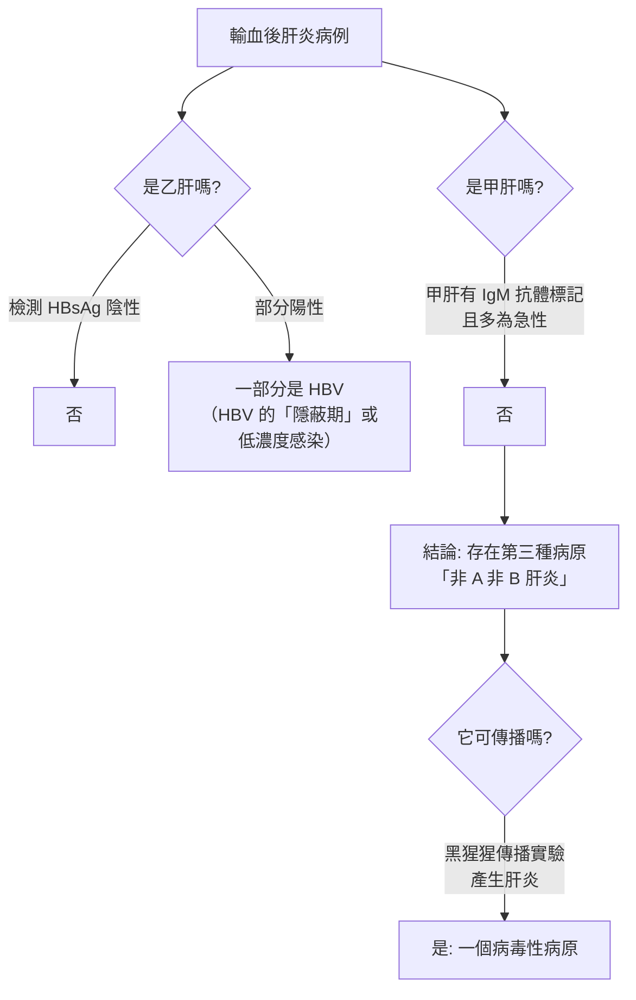
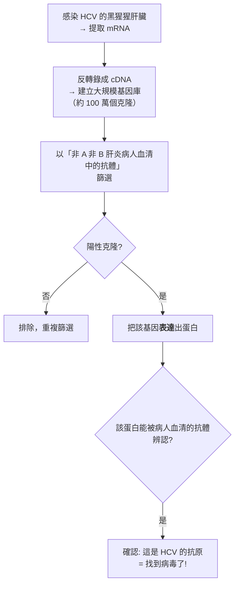
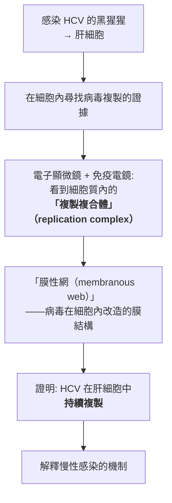
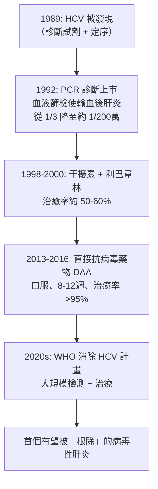
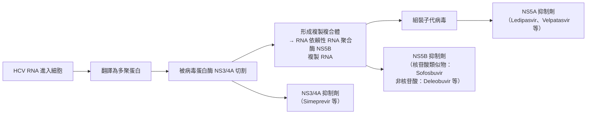

# 2020 · C 型肝炎病毒：艾爾特、霍頓與賴斯完成「非 A 非 B 肝炎」的三十年追兇

> **2020 諾貝爾生理學 or 醫學獎**（共享三人）：哈維·J·艾爾特（Harvey J. Alter，美國）— 表彰「發現 C 型肝炎病毒」；麥可·霍頓爵士（Sir Michael Houghton，加拿大／英國）與查爾斯·M·賴斯（Charles M. Rice，美國）— 同上。

## 懸案（案情提要）

1970 年代末，醫學界發現了一樁令人不安的事實：

1. **輸血後肝炎**（post-transfusion hepatitis）發生率極高——在當時的血液製品中，**每單位血有 1/3 的機會造成肝炎**；
2. 已知有**甲型肝炎**（HAV，口服傳播，短暫）與**乙型肝炎**（HBV，血液傳播，可慢性化，見 [1976-B肝病毒與庫魯病](1976-B肝病毒與庫魯病.md)）；
3. 但篩檢測後發現：**多數輸血後肝炎病例，既不是 A 也不是 B！**——它們被稱為「**非 A 非 B 肝炎（non-A, non-B hepatitis）**」；
4. 而更奇怪的是：**這些肝炎有明顯的「可傳播性」**（能經血液傳播、能造成慢性肝炎、能導致肝硬化與肝癌），卻**找不到病原體**。

**核心疑點**：一個能造成慢性肝炎、肝硬化與肝癌的病原體，**為什麼 30 年都找不到？**

## 前因

| 年份 | 事件 |
| --- | --- |
| 1940s–1960s | 輸血後肝炎被認為是「HBV 的另一種表現」或「尚未發現的病毒（hepatitis agent）」；**「肝炎相關抗原」（HAA，後被證明是 HBV 的表面抗原）**的發現使部分病例被歸入 HBV。 |
| 1971–1975 | **艾爾特**（NIH 的輸血醫學部門）證明：**多數輸血後肝炎病例不具備 HBV 的標記**（HBsAg 陰性），且**其病毒學特徵與 HBV 明顯不同**——**「非 A 非 B 肝炎」正式被命名**。 |
| 1975–1978 | **艾爾特**與 FDA 的 **Edward Tabor** 分別以**黑猩猩傳播實驗**證明：**「非 A 非 B 肝炎」的病原體是可傳播的**（能從病人傳給黑猩猩並引起肝炎），**且它不是甲肝也不是乙肝**。 |
| 1978–1980s | 艾爾特的團隊**開發了 HCV 的第一代診斷試劑**（以非 A 非 B 肝炎病人的血清為抗原來源）——但因為尚未找到病毒，**這些試劑只能用於篩檢血液，不能用來找出病毒本身**（**「盲篩（blind screening）」**）。 |
| 1985 | **Houghton**（在 Chiron 公司）決定：**不用病人血清去找病毒，而是用「抗體篩選」的方法**。 |
| 1986 | **Houghton 的團隊**（與 **Qui-Lim Choo、George Kuo、Daniel Bradley** 合作）建立了一個**巨大的 cDNA 基因庫**（以黑猩猩肝臟的 mRNA 製成），並**以「非 A 非 B 肝炎病人的血清抗體」篩選**——**他們篩了 100 多萬個克隆**。 |
| 1987–1988 | **1988 年 5 月**，**霍頓團隊從約 100 萬個克隆中篩出一個陽性克隆**——它**只與少數非 A 非 B 肝炎病人的血清反應**——並**完成了其序列**。 |
| 1989 | **HCV 基因組被完整定序**——**一個正股單股 RNA 病毒**，約 9,600 nt，屬**黃病毒科（Flaviviridae）**。 |
| 1989–1990s | **查爾斯·賴斯**（在 Washington University，後為 Rockefeller）完成了關鍵的機制研究： |
| | 1. **HCV 的 RNA 依賴性 RNA 聚合酶**——**HCV 是 RNA 病毒，卻能在肝細胞中長期存在**（這在當時被認為違反「RNA 病毒不能複製」的共識）； |
| | 2. **HCV 感染的黑猩猩，其肝細胞中可見「複製複合體」**（replication complex）——**這是 RNA 病毒在細胞內持續複製的直接證據**； |
| | 3. 他證明**干擾 HCV 複製的「干擾素」機制**——為干擾素治療提供了理論依據。 |
| 1990s–2000s | **HCV 診斷試劑**（PCR）上市，血液安全性大幅提升；**干擾素 + 利巴韋林**成為標準治療（有效率約 50%–60%）。 |
| 2013–2016 | **直接抗病毒藥物（DAA）**：以 **NS5A、NS5B（核苷酸類似物與非核苷酸）、NS3/4A（蛋白酶）** 為靶點的組合療法——**口服、療程 8–12 週、治癒率 > 95%**。 |
| 2020 | 三人共享諾貝爾生理學 or 醫學獎。 |
| 2020s | **WHO 的 HCV 消除計畫**（2015 年啟動）：透過大规模檢測與 DAA 治療，目標是 2030 年消除 HCV 公共衛生問題——**這是首個有望被「根除」的病毒性肝炎**；**2020 年代的噬菌體展示與基因治療**也在探索。 |

## 調查

### 第一幕：艾爾特的「排除法」——確認存在一個「未知的第三人」

艾爾特的偵查方法極為講究——**不是找病原，而是先排除已知者**：

**艾爾特的方法學精髓**：「**用已知的標記把已知排除掉，剩下的就是未知的**」——這是流行病學中最基本的邏輯，但在本案中它需要極大的樣本量與嚴謹的標記選擇。

### 第二幕：黑猩猩傳播實驗——「它是真的傳染」

這是本案最具決定性、也最具倫理爭議的一步：

1. **艾爾特**與 **Tabor** 分別以**黑猩猩（chimpanzee）**做傳播實驗；
2. 結果：**把「非 A 非 B 肝炎」病人的血清注入黑猩猩，會在黑猩猩身上產生肝炎**，且**可反覆傳播**；
3. 這證明了：**病原體存在於病人血液中、且能在新宿主中複製**。

**這一步的科學必要性**：若不做這個實驗，人們完全有理由懷疑「非 A 非 B 肝炎」只是「HBV 的變異株」或是「多因素造成的肝損傷」（如藥物性、酒精性、自身免疫性）。**傳播實驗把它從「統計現象」變成了「感染性疾病」。**

**倫理註記**：黑猩猩實驗在 1970 年代是當時能被接受的研究手段，但**這類研究在 1980 年代後受到嚴格限制**——**這是科學倫理演進的一個真實案例**（今日的「3R 原則」：Replacement、Reduction、Refinement）。

### 第三幕：霍頓的「抗體篩選」——不用病人血清找病毒

霍頓面對的核心難題是：**病人血清裡有抗體，但抗體對應的抗原是什麼？** 只有兩個方向：

- **方向一（艾爾特的路線）**：用病人血清找抗原 → 找到了很多候選蛋白，但**無法確認哪一個是病原體**（因為血清中含有針對各種蛋白的抗體）；
- **方向二（霍頓的路線）**：**用病人血清的抗體，去篩選「病原體的基因庫」**——**反向操作**。

**「表達—再確認」的關鍵步驟**：僅僅篩選出陽性克隆還不夠（可能是「巧合反應」），必須**把該基因表達成蛋白，再用病人的抗體確認能結合**——**這個雙向確認是本案方法論的核心**。

**規模**：**約 100 萬個克隆**的篩選——**這是 1980 年代生物技術能力的一次壯舉**（正是重組 DNA 與基因庫技術的成熟，使這件事成為可能）。

### 第四幕：賴斯的「RNA 病毒為何能長期存在」

賴斯的貢獻極為獨特——他回答了一個「違反當時共識」的問題：

**問題**：**所有已知的 RNA 病毒都是急性感染**（例如流感、麻疹）——因為 RNA 病毒的複製需要**RNA 依賴性 RNA 聚合酶**，而**宿主細胞沒有這種酵素**，所以 RNA 病毒無法長期持續複製。**那麼 HCV 為何能造成慢性感染（數十年）？**

**賴斯的實驗（1989–1991）**：

**賴斯的第二項貢獻**：**干擾 HCV 複製的機制**——他證明**干擾素透過**誘導**細胞的抗病毒蛋白（PKR 等）來抑制病毒複製**，並證明 **HCV 的蛋白 NS3A（後稱 NS5A）能拮抗 PKR**——**這解釋了為什麼 HCV 能抵抗干擾素治療**。**這項發現直接導向 NS5A 抑制劑的藥物開發**（2010 年代的 ledipasvir、velpatasvir 等革命性 DAA 藥物）。

### 第五幕：從診斷到根除——HCV 的三重轉折

**艾爾特團隊開發的診斷試劑的影響數字**（諾獎委員會引述）：

$$\text{輸血後 HCV 感染率}: \quad \frac{1}{3} \longrightarrow \frac{1}{2{,}000{,} 000}$$

**估計每年因此避免的新感染**：**美國約 4 萬例，全球更多**。

**為什麼 HCV 可以被根除？** 這與其他病毒不同：

$$\text{HCV 的特殊條件：} \begin{cases} \text{沒有慢性帶因狀態（多數感染者可被治癒）} \\ \text{無中間宿主（人類是唯一宿主）} \\ \text{已有有效且安全的治療} \\ \text{已有可行的診斷} \end{cases}$$

**這四項條件同時滿足，是人類史上第一次有可能根除一種病毒性肝炎**。

### 第六幕：藥理學的目標——「病毒生活史的每一步都是靶點」

**HCV 的複製循環與可用藥物**：

**這是 2010 年代藥物設計最漂亮的一個案例**——**病毒生活史的每一個環節都成為一個藥物類別**。**Sofosbuvir** 是一種**核苷酸類似物前藥**，其活性形式（GS-461203）被嵌入病毒 RNA，導致**鏈終止**——**這是「以核酸為基礎的抗病毒藥」的巔峰**。

**2015 年 Sofosbuvir 與 Ledipasvir 的組合療法**在《New England Journal of Medicine》的試驗中展現 **95%–100% 的治癒率**——**人類醫學史上對慢性病毒性肝炎最重大的進展**。

## 理論裁決

1. **「複製複合體」的結構生物學**：賴斯的電子顯微鏡研究揭示，**HCV 在細胞內建立了一個由膜重塑而成的「複製工廠」**：

$$\text{病毒蛋白（NS3/4A、NS5A 等）} \xrightarrow{\text{重塑內質網膜}} \text{「膜性網」} \xrightarrow{} \text{複製複合體}$$

   **這解釋了為什麼 HCV 能在細胞內持續存在**——**它把複製工廠「藏」在膜系統裡**，以躲避先天免疫的偵測（見 [2011-先天免疫與樹突細胞](2011-先天免疫與樹突細胞.md)）。

2. **基因組的「極簡經濟學」**：HCV 的基因組僅約 9,600 nt，是**最小的 RNA 病毒之一**——因為它把大部分功能外包給了宿主的細胞機器：

$$\text{HCV 基因組} \approx 9.6\ \mathrm{kb} \quad \text{（對比：流感} \approx 13\ \mathrm{kb}\text{；流感病毒基因組約 13.6 kb）}$$

   **HCV 是已知最小的 RNA 病毒**——它的多數功能由宿主的核糖體、病毒酵素與**內質網膜**共同完成。

3. **選擇性毒性的分子基礎**：DAA 的設計原理是**「病毒特有、人類沒有」的酵素**：

| 靶點 | 為何可選擇性 |
| --- | --- |
| **NS3/4A 蛋白酶** | HCV 專有的絲胺酸蛋白酶，人類無對應物 |
| **NS5B RdRp** | HCV 的 RNA 聚合酶（人類只有 DNA 聚合酶） |
| **NS5A** | HCV 特有的支架蛋白（功能仍不完全清楚） |

4. **慢性感染的免疫學**：HCV 的持續存在與 **T 細胞耗竭**、**Treg 失衡**有關——**這解釋了為何免疫治療（以 PD-1 阻斷劑提升免疫）在 HCV 中反而有害**（會誘發嚴重肝炎），**也解釋了「免疫清除與免疫致病並存」的悖論**。

## 追查支線（未結之謎）

- **艾爾特的科學生涯**：他在 NIH 的**輸血醫學部門**工作了數十年——**這是一個「臨床服務部門」裡做出諾獎級發現的案例**；他獲得了**美國公共衛生服務的最高非軍職勳章（Distinguished Service Medal）**；
- **霍頓的科學與堅持**：他曾形容找到 HCV 的過程是**「十年 grind（一種地獄般的苦工）」**；他在 2017 年的演講中說，**「你必須先相信有一個答案存在，否則你就找不到它」**；他於 2020 年受封爵士；
- **查爾斯·賴斯的科學**：他是**「RNA 病毒可以持續複製」的第一個證明者**；他的實驗室後來成為 HCV 疫苗與抗病毒藥的重要搖籃。
| 1989–1990s | **查爾斯·賴斯**（在 Washington University，後為 Rockefeller）完成了關鍵的機制研究：**HCV 的 RNA 依賴性 RNA 聚合酶**；**HCV 感染的黑猩猩，其肝細胞中可見「複製複合體」**——**這是 RNA 病毒在細胞內持續複製的直接證據**；他證明**干擾素可抑制 HCV 複製**——為干擾素治療提供了理論依據。 |

| 1997 | **Houghton** 的團隊**開發了第一個 HCV 疫苗候選物**（在黑猩猩上顯示保護性），但因缺乏有效的臨床終點與商業動力而未能上市——**這是「科學可行但產業無力」的典型案例**。 |
| 2020s | **WHO 消除 HCV 計畫**：目標在 2030 年前消除 HCV 公共衛生問題——**需要全球約 3,000 萬人接受 DAA 治療**，這是史上最大規模的「以藥物根除病原體」的公共衛生工程之一。 |
| **耐藥性**：**HCV 是少數對 DAA 產生耐藥的病毒**（SOfosbuvir 的耐藥突變在 NS5B 的 C316Y 等位點）——這在 2020 年代引起關注，並促使「泛基因型（pangenotypic）抑制劑」的開發。 |

## 證物與數據（偵查卷宗摘錄）

| 證物 | 數值／內容 | 偵查意義 |
| --- | --- | --- |
| 輸血後肝炎 | 每單位血約 1/3 造成肝炎 | 問題的規模 |
| HBsAg 陰性 | 多數病例不是乙肝 | 「第三種病原」的存在 |
| 黑猩猩傳播（1975–78） | 產生肝炎、可反覆傳播 | **證明它是感染性病原** |
| 抗體篩選 | 約 100 萬個 cDNA 克隆 | 「反向篩選」的壯舉 |
| 1988 年 5 月 | 篩出陽性克隆 | **發現的瞬間** |
| 表达—再確認 | 蛋白能被病人抗體辨認 | 因果性的雙向確認 |
| 基因組大小 | 約 9,600 nt（單股正鏈 RNA） | 已知最小的 RNA 病毒 |
| 複製複合體 | 肝細胞內的膜性網 | **慢性感染的機制** |
| 血液安全 | 1/3 → 1/2,000,000 | 診斷試劑的影響 |
| 每年避免感染 | 美國約 4 萬例 | 公共衛生的量化影響 |
| DAA 治癒率 | > 95%（8–12 週口服） | 醫學史上的重大突破 |
| 靶點 | NS3/4A、NS5B、NS5A | 病毒生活史的全面打擊 |

## 後果

| 領域 | 影響 |
| --- | --- |
| 血液安全 | 輸血傳播的 HCV 幾乎被消除（美國每年避免約 4 萬例感染）。 |
| 消化肝臟學 | 慢性 C 型肝炎從「無法治療」變為「可治癒」；DAA 成為全球使用量最大的抗病毒藥之一。 |
| 公共衛生 | 首個有望被「根除」的病毒性肝炎；WHO 消除計畫。 |
| 藥理學 | 以病毒生活史為靶點的藥物設計範式；核苷酸類似物抗病毒藥。 |
| 分子生物學 | RNA 病毒持續複製的機制；「複製複合體」概念。 |
| 其他諾獎 | 與 [1976-B肝病毒與庫魯病](1976-B肝病毒與庫魯病.md)（另一種肝炎病毒）、[1989-原癌基因](1989-原癌基因.md)（病毒與腫瘤）、[2018-免疫檢查點](2018-免疫檢查點.md)（HCV 與免疫治療的悖論）構成病毒學主線。 |

## 關聯

- [1976-B肝病毒與庫魯病](1976-B肝病毒與庫魯病.md) — 同一「肝炎」家族中的另一種病毒，以及「非常规病毒」的案例。
- [1989-原癌基因](1989-原癌基因.md) — 病毒與癌症的關聯。
- [1954-脊髓灰質炎病毒](1954-脊髓灰質炎病毒.md) — 病毒學的另一個「發現病原」的里程碑。
- [2018-免疫檢查點](2018-免疫檢查點.md) — HCV 的免疫耗竭與免疫治療的悖論。
- [1939-磺胺藥物](1939-磺胺藥物.md) — 「化療藥物」時代的另一個起點。
