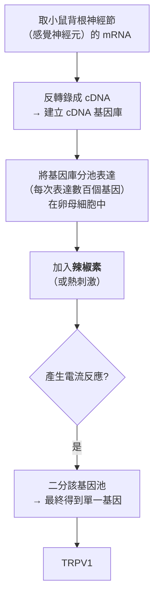
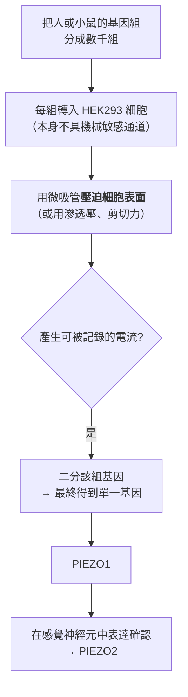

# 2021 · 溫度與觸覺的受體：朱莉烏斯與帕塔普提安找到身體的「溫度計」與「壓力計」

> **2021 諾貝爾生理學 or 醫學獎**（共享）：大衛·朱莉烏斯（David Julius，美國）— 表彰「發現溫度與觸覺的受體」（"for their discoveries of receptors for temperature and touch"）；阿德姆·帕塔普提安（Ardem Patapoutian，黎巴嫩／亞美尼亞裔美國人）— 同上。

## 懸案（案情提要）

感覺生理學在 2000 年代末有一個奇怪的「空白地帶」：

1. 人們已經知道**視覺**（視紫紅質）、**嗅覺**（約 1000 個受體，見 [2004-嗅覺受體](2004-嗅覺受體.md)）、**味覺**（5 種受體）等的分子機制；
2. 但對於**溫度與觸覺（壓力）**，情況很奇怪：
   - **TRPV1** 已被發現是「辣椒素受體」（1997 年），**TRPM8** 是「薄荷醇受體」（2002 年）；
   - **但它們「為什麼是溫度受體」？** 辣椒素與薄荷醇只是「恰好能結合它們的化學物質」；**它們真正感測的物理量是什麼？** ——**這個問題在 2020 年代之前幾乎無人能回答**；
   - 而**觸覺與壓力**（輕觸、壓迫覺、伸展覺）**完全沒有分子層次的解釋**——**機械力如何被轉成電訊號？**
3. 核心謎題：**一個「化學感受器」如何成為「物理感受器」？**

**答案：TRP 通道是一個「溫度—化學雙重門控」的分子；而觸覺靠的是完全不同的分子——PIEZO 通道。**

## 前因

| 年份 | 事件 |
| --- | --- |
| 1960s–70s | 感覺生理學以**心理物理學**建立「強度—頻率」編碼原則：**感覺不是由「什麼」決定，而是由「放電頻率」與「募集的神經元數」決定**（見 [1932-神經元功能](1932-神經元功能.md)、[1981-視覺皮層](1981-視覺皮層.md)）。 |
| 1980s–1990s | **TRP（transient receptor potential）通道家族**被分離並克隆，**朱莉烏斯**是這一家族命名與功能研究的主要貢獻者之一。 |
| 1990s | **朱莉烏斯**在 UCSF 以**表達克隆（expression cloning）**的策略尋找「辣椒素受體」——他的方法極為大膽： |
| 1997 | **朱莉烏斯用「表達克隆」找到了 TRPV1（capsaicin receptor）**——**一個能被辣椒素活化、並在感覺神經元中表現的通道**。 |
| 2002 | **TRPM8（薄荷醇受體）**被發現——**另一個「化學感受器」**。 |
| 2000s | 問題懸而未決：TRPV1 與 TRPM8「感測溫度」的說法**缺乏直接的證據**——它們究竟感測的是**溫度**、還是**某些化學物質**？ |
| 2009–2010 | **朱莉烏斯團隊**進行決定性實驗，證明 TRPV1 與 TRPM8 的**溫度敏感性可與其化學敏感性解耦**——**這是「它們真的是溫度感受器」的直接證明**。 |
| 2010 | **朱莉烏斯團隊**證明：**TRPV1 在生理溫度下即有活性，並能被溫度直接活化**（**用野生型 vs 突變型受體的「鈣離子通透性」在精確控制溫度下的比較**）；**TRPM8 則在低溫（< 25 °C）下被活化**。**這首次把「化學感受器」還原為「溫度感受器」。** |
| 2010–2014 | **帕塔普提安**（在 Scripps）用**完全不同的策略**尋找機械感受器： |
| 2010 | **帕塔普提安以「全基因組功能篩選」尋找機械敏感通道**：他讓**細胞表達數千種通道蛋白**，然後用**微吸管（micropipette）壓迫細胞表面**，量測是否產生電流——**這是一個極為大膽的「 brute-force 篩選」**。 |
| 2010 | **PIEZO1 被發現**——**第一個機械敏感通道**。 |
| 2013 | **PIEZO2 被發現**——**在觸覺與本體感覺神經元中表達**，是**觸覺與壓迫覺的主要機械感受器**。 |
| 2021 | 兩人共享諾貝爾生理學 or 醫學獎。 |
| 2020s | **PIEZO1** 被證明是**紅血球與血小板上的機械感受器**——**血流剪切力 → 一氧化氮產生 → 血管擴張**（**2021 年「血流感應性血管舒張」**）；**PIEZO2 與機械性痛覺、Touchscreen 的整合**；**2023 年「PIEZO2 與觸覺」**的研究。 |

## 調查

### 第一幕：朱莉烏斯的「表達克隆」——用辣椒素當釣餌

朱莉烏斯的方法極為大膽而聰明：

**「以化學物質為釣餌」的策略極為有效**——因為辣椒素是一種**非常專一的刺激**（它只作用於 TRPV1）。**這個方法本身是「用化學探針釣出受體」的典範**，日後被廣泛應用於 GPCR、離子通道的搜尋。

### 第二幕：朱莉烏斯的「溫度 vs 化學」實驗——本案最關鍵的證明

**問題**：TRPV1 被稱為「辣椒素受體」，也常被稱為「熱感受器」——**但它到底感測什麼？**

**朱莉烏斯的決定性實驗（2010 年）**：

1. 他製造了 **TRPV1 的突變體**，改變其**溫度敏感性的閾值**（例如把閾值從 42 °C 提高到 49 °C，或降低）；
2. 他在**精確控制溫度**的條件下測量反應：
   - **野生型**：在 42 °C 開始產生電流；
   - **突變型**：在更高（或更低）的溫度才產生電流；
3. **結論**：**TRPV1 的活化溫度與它的序列（突變）直接相關**——**它確實是一個「溫度感受器」，而辣椒素只是「恰好能打開它」的化學物質**。

**更關鍵的對照**：**TRPV1 的溫度敏感性可以與辣椒素敏感性「解耦」**（有些突變體對溫度敏感但對辣椒素不敏感，反之亦然）——**這明確證明「溫度感測」與「化學感測」是受體上兩個可分離的機制**。

**TRPM8 的對稱實驗**：TRPM8 對薄荷醇與對低溫的敏感性，也可以被突變解耦——**它同樣是一個真正的溫度感受器**。

**「雙重門控」的分子模型**：

$$\text{TRPV1 的開啟} = f\big(\underbrace{T}_{\text{溫度}}, \underbrace{[\text{辣椒素}]}_{\text{化學}}, \underbrace{pH, \text{前列腺素 E2}}_{\text{其他調控}}\big)$$

**這解釋了為什麼 TRP 通道是「多模態（polymodal）」的受體**——它們把**物理刺激（溫度）與化學刺激整合在同一個分子上**。

**TRP 家族的溫度劃分**：

| 通道 | 活化溫度 | 天然配體 | 感覺 |
| --- | --- | --- | --- |
| TRPV1 | > 42 °C | 辣椒素 | 灼熱、痛覺 |
| TRPV2 | > 43 °C | — | 極熱 |
| TRPV3 | > 33 °C | menthol（薄荷醇） | 溫感 |
| TRPV4 | > 27 °C | — | 溫暖感 |
| TRPM8 | < 25–28 °C | menthol | 涼感 |
| TRPA1 | 冷刺激／刺激性氣體 | 芥子油異硫氰酸酯 | 刺激痛 |

**這就是「溫覺的分子地圖」**——**它把「冷」與「熱」的體感分別歸給了特定的通道分子**。

### 第三幕：帕塔普提安的「暴力篩選」——壓一壓細胞看看

帕塔普提安的方法與朱莉烏斯截然相反——他**不使用化學釣餌，而是使用「機械力」**：

**這個「壓一壓」的篩選，是 20 世紀末「全基因組功能篩選」時代的典型策略**（與 [1995-胚胎發育基因](1995-胚胎發育基因.md) 的表型篩選、與 [2001-細胞週期](2001-細胞週期.md) 的「停在哪個階段」篩選同源）。

**關鍵的驗證**：PIEZO1/2 在**觸覺神經元中高度表達**，而**敲除 PIEZO2 的小鼠**會出現**觸覺喪失但本體感覺與溫覺保留**的表型——**這是「分子—感覺」對應的直接證明**。

### 第四幕：PIEZO 的結構——「機械敏感的閘門」

**2014 年的 cryo-EM 結構**（PIEZO1 的原子結構由多個團隊於 2014 年相繼解析）：

**PIEZO 的結構特徵**：

1. **極大型的三聚體**：**每個 PIEZO 複合體由三個次單元組成**，且**每個次單元包含 38 個跨膜螺旋**——**這是已知最大的膜蛋白之一**；
2. **「葉片（blade）」「支撐柱（beam）」「帽子（cap）」三域結構**；
3. **機械力的傳導路徑**：

**「葉片—支撐柱」機制的精妙之處**：**機械張力可以從膜的平面直接傳遞到通道的閘門**——**不需要任何化學訊號**。**這是「機械轉導」最直接的物理實現**。

**對比：TRPV1 的「熱—化學雙重門控」是「內在的、序列決定的」**，而 **PIEZO 的機械門控是「外在的、力學的」**——**兩種完全不同的「物理—化學轉導」策略**，這正是 2021 年諾獎表彰的核心對比。

### 第五幕：PIEZO 的生理角色

| 受體 | 表達位置 | 感覺 | 敲除表型 |
| --- | --- | --- | --- |
| **PIEZO1** | 感覺神經元、**紅血球**、血小板 | **壓迫覺**、**血流剪切力** | 紅血球無法感知血流 |
| **PIEZO2** | **觸覺神經元（Meissner、Pacini 等）**、脊髓觸覺通路 | **輕觸覺、壓迫覺、深層機械痛覺** | 觸覺喪失、亦有骨骼與關節發育異常 |

**PIEZO1 與紅血球的發現尤其精彩（2021 年）**：

1. 紅血球在血管中經歷**剪切力**，而紅血球會藉此**產生一氧化氮（NO）**以促進血管舒張；
2. **2021 年的研究證明：PIEZO1 是紅血球的機械感受器**——**機械力 → $\mathrm{Ca}^{2}^{+}$ 內流 → eNOS 活化 → NO 產生 → 血管舒張**；
3. **這把「血流→血管張力」的調控回路補上了**（與 [1998-一氧化氮](1998-一氧化氮.md) 對接）——**這是一個從「機械力—化學訊號—血管張力」的完整鏈條**。

### 第六幕：數學——「強度編碼」的兩種實現

**回顧感覺編碼的通用原理**（見 [1932-神經元功能](1932-神經元功能.md)）：

$$\text{感覺強度} \to \begin{cases} \text{放電頻率} \\ \text{募集的神經元數} \end{cases}$$

**TRPV1 的溫度編碼**：**溫度越高，通道開啟的比例越大**：

$$\frac{I}{I_{\max}} = \frac{[\mathrm{TRPV1}]_{\text{open}}}{[\mathrm{TRPV1}]_{\text{total}}} = \frac{1}{1 + e^{-\frac{T - T_{1/2}}{k}}}$$

**這是一個 sigmoid——一個「溫度計」的分子形式**。不同 TRP 通道的 $T_{1/2}$ 不同（TRPV1 為 42 °C、TRPM8 為 25 °C），**它們的集合就構成了「溫覺」的完整生理標度**。

**PIEZO2 的力編碼**：機械刺激的強度對應**通道開啟的比例與放電頻率**——**同一套「強度—頻率」原理，只是輸入的物理量不同**。

**這個對比是 2021 年諾獎最深的美學意義**：

$$\underbrace{\text{同一個神經編碼原理}}_{\text{放電頻率}} \times \underbrace{\text{完全不同的分子策略}}_{\text{內在的溫度閘門 vs 外在的機械閘門}}$$

## 追查支線（未結之謎）

- **朱莉烏斯的科學生涯**：他是**古巴裔美國人**（父親是古巴移民），在 UCSF 從事化學感受研究；**他曾獲得 2020 年的突破獎（Breakthrough Prize，300 萬美元）**——這在 2021 年諾獎之前；他的實驗室在 2020 年代成為「感覺分子生物學」的世界中心；
- **帕塔普提安的科學生涯**：他是**黎巴嫩裔美國人**（亞美尼亞血統），在 Scripps 研究**機械感受**；他在 2016 年獲 **Gruber 神經科學獎**；他與朱莉烏斯**共享 2021 年諾獎與 1500 萬瑞典克朗的獎金**；
- **感覺研究的未解之謎**：**本體感覺（proprioception）**——**自己身體的姿勢感覺**——在 2020 年代仍**沒有被完全分子化**（雖然 **PIEZO2** 參與其中，但**肌梭（muscle spindle）與關節的機械感受器**的分子身分仍有爭議）；
- **PIEZO2 與發育**：**PEEZO2 缺陷會造成骨骼畸形與關節攣縮**——**機械感測不只參與感覺，也參與身體的形態建構**（這條線連到 [1995-胚胎發育基因](1995-胚胎發育基因.md) 的機械轉導信號）；
- **PIEZO1 與血液疾病**：**PIEZO1 缺陷與鐮刀型貧血（hereditary xerocytosis）相關**（紅血球形狀異常）；**2020 年代**研究者正探索「以 PIEZO1 為靶的血液稀釋療法」；
- **觸覺的「數位化」**：**PIEZO2 的發現為「觸覺的類比式編碼」**提供了基礎——**這是理解「觸覺為何能像電腦一樣處理」的神經科學基礎**，並與機器人觸覺感測器的設計直接相關。

## 證物與數據（偵查卷宗摘錄）

| 證物 | 數值／內容 | 偵查意義 |
| --- | --- | --- |
| 表達克隆（1997） | 從感覺神經節 cDNA 找出 TRPV1 | 「以化學探針釣受體」 |
| 辣椒素 | TRPV1 的專一配體 | 釣餌的選擇 |
| **溫度—化學解耦實驗（2010）** | 突變體的活化溫度隨序列改變 | **溫度感受器的直接證明** |
| TRPV1 閾值 | > 42 °C | 灼熱的分子 |
| TRPM8 閾值 | < 25 °C | 涼感的分子 |
| TRPV2 / TRPV3 / TRPV4 | > 43 / 33 / 27 °C | 溫覺的完整分子地圖 |
| **微吸管壓迫篩選（2010）** | 表達數千基因後壓迫細胞表面 | 「暴力篩選」的典範 |
| **PIEZO1 / PIEZO2** | 2010 / 2013 年發現 | 機械感受的分子 |
| PIEZO 結構（2014） | 三聚體，每次單元 38 個跨膜螺旋 | **已知最大的膜蛋白之一** |
| 葉片—支撐柱機制 | 膜張力直接傳到閘門 | 機械轉導的物理實現 |
| PIEZO2 敲除 | 觸覺喪失 | 分子—感覺的對應 |
| PIEZO1 與紅血球 | 剪切力 → $\mathrm{Ca}^{2}^{+}$ → NO → 血管舒張 | 2021 年的新發現 |
| 編碼原理 | 放電頻率 + 募集 | 感覺的通用法則 |

## 理論裁決

1. **兩種「物理—化學轉導」策略的對照**：

| | **TRPV1 / TRPM8（溫覺）** | **PIEZO1 / PIEZO2（觸覺）** |
| --- | --- | --- |
| 輸入 | 溫度（物理量）與化學配體 | **機械力** |
| 門控位置 | **內在**（序列決定的閾值） | **外在**（膜張力傳遞） |
| 分子大小 | 一般通道（約 800 個胺基酸） | **超大**（每次單元 38 個跨膜螺旋） |
| 選擇性 | 中度（ $\\mathrm{Ca}^{2+}$ 、 $\\mathrm{Na}^{+}$ ） | 非選擇性陽離子通道 |

$$\\text{TRPV1 開啟} = f(T, [\\text{辣椒素}], \\mathrm{pH}) \\qquad \\text{PIEZO2 開啟} = f(\\text{膜張力})$$

**兩者是同一個問題（如何把物理量轉成離子流）的兩種截然不同的分子解**。

2. **強度編碼的兩個層次**：所有感覺的通用原則：

$$S = f(\\underbrace{r(\\text{放電頻率})}_{\\text{單一神經元}}, \\underbrace{N(\\text{募集神經元數})}_{\\text{族群}})$$

**TRPV1 的溫度編碼是「連續的分子比例」**：

$$\\frac{I}{I_{\\max}} = \\frac{1}{1 + e^{-(T - T_{1/2})/k}}$$

**這是一個 sigmoid——一個分子層級的「溫度計」**，其 $T_{1/2}$ 由 TRP 家族的成員各自設定。

3. **「多模態受體」的資訊學**：由於同一個通道可被多個物理與化學輸入開啟：

$$I = I(T) + I([\\text{配體}]) + I([\\mathrm{pH}]) + \\cdots$$

**這是一個「加性的多輸入積分器」**——**它讓一個受體可以整合多種環境訊號**，這在演化上極為經濟（**一個受體，多種功能**）。

4. **PIEZO 的力學傳導**：機械張力由「葉片—支撐柱」結構傳至閘門：

$$\\text{膜張力} \\to \\text{葉片構形改變} \\to \\text{帽子閘門開啟} \\to \\text{非選擇性陽離子流}$$

**注意這條鏈條中「沒有任何化學步驟」**——**這是機械轉導最純粹的實現**，與內耳的機械轉導（見 [1961-耳蝸行波](1961-耳蝸行波.md)）策略不同（後者透過液體的慣性與剪切）。

5. **血流—血管張力的閉環**：PIEZO1 在紅血球上把剪切力轉為 NO：

$$\\text{剪切力} \\xrightarrow{\\text{PIEZO1}} \\mathrm{Ca}^{2+} \\uparrow \\xrightarrow{\\text{eNOS}} \\mathrm{NO} \\uparrow \\to \\text{血管舒張} \\to \\text{血流阻力} \\downarrow$$

**這是一個「負回饋」閉環**——血流阻力下降會降低剪切力，形成自穩定（**這個閉環是 2021 年才被完整畫出的**）。

## 後果

| 領域 | 影響 |
| --- | --- |
| 感覺生理學 | 溫覺與觸覺首次被分子化；「感覺受體」的清單大幅擴充。 |
| 疼痛研究 | TRPV1/TRPA1 是** nociceptor（傷害感受器）**的核心——**理解慢性疼痛（尤其「痛覺過敏」）的分子基礎**。 |
| 臨床 | 通道病變（**PEEZO2 與骨骼畸形、PIEZO1 與血液病**）；**TRPV1 拮抗劑的鎮痛開發**（目前仍在試驗階段）。 |
| 機器人與義體 | 觸覺感測器的設計原則。 |
| 生物物理 | 「機械轉導」的結構機制。 |
| 其他諾獎 | 與 [2004-嗅覺受體](2004-嗅覺受體.md)（化學感受）、[1961-耳蝸行波](1961-耳蝸行波.md)（機械轉導的另一種實現）、[1932-神經元功能](1932-神經元功能.md)（強度編碼原理）構成感覺生理學主線。 |

## 關聯

- [2004-嗅覺受體](2004-嗅覺受體.md) — 化學感受的分子地圖，與溫覺同屬「TRP／GPCR 感官」。
- [1961-耳蝸行波](1961-耳蝸行波.md) — 內耳的機械轉導，與 PIEZO 的策略比較。
- [1932-神經元功能](1932-神經元功能.md) — 「強度—頻率」編碼的通用原理。
- [1994-G 蛋白](1994-G蛋白.md) — TRP 通道下游的訊號傳遞。
- [1998-一氧化氮](1998-一氧化氮.md) — PIEZO1—紅血球—NO 的血流調控鏈條。
