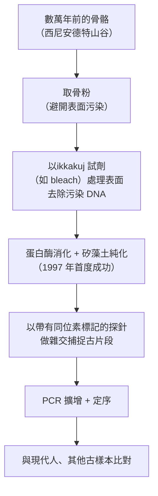

# 2022 · 已滅絕古人類的基因組與人類演化：佩博讓尼安德塔人開口說話

> **2022 諾貝爾生理學 or 醫學獎**（單獨獲獎）：斯萬特·佩博（Svante Pääbo，瑞典）— 表彰「對已滅絕古人類的基因組及人類演化方面的發現」（"for his discoveries concerning the genomes of extinct hominins and human evolution"）。

## 懸案（案情提要）

1980 年代，一個長期的謎題擺在人類學者面前：

1. **尼安德塔人是人類的祖先嗎？** 19 世紀的演化論者曾以尼安德塔人的「頭骨」與現代人比較，認為尼安德塔人是「死滅的旁支」；**但也曾有人主張尼安德塔人就是人類的直系祖先**——**人類演化史上的一個「幽靈」**。

## 前因

| 年份 | 事件 |
| --- | --- |
| 1980s | 關鍵的爭議：**尼安德塔人的「眉脊」與「枕骨隆突」讓許多人認為尼安德塔人是「人類的表親」而非「祖先」**——**人類演化史上的一個「幽靈」**。 |
| 1997 年 | **佩博的突破**：**《Cell》**發表《*Neandertals and modern humans coexist in the last European Glacial period*》——**他從西尼安德特山谷出土的 **5 萬年前的骨骼中提取了線粒體 DNA（mtDNA）**（**人類的 mtDNA 來自母親，因此可直接追蹤母系血緣**），並證明：**尼安德塔人的 mtDNA 與現代人有重大差異——尼安德塔人是人類的「表親」，不是「祖先」**。 |
| 1997–2000s | **核基因組的技術難題**：**古 DNA 在環境中極易降解**（半衰期以數百年計）；**「DNA 污染」問題**——現代人的 DNA 或微生物 DNA 會混入古樣本，造成假陽性。 |
| 2006 | 尼安德特人的**核基因組**被初步解碼（30 倍覆蓋），開始能比較**非編碼區域**。 |
| 2010 | **「丹尼爾（Denic）」尼安德特人**的 52 倍覆蓋核基因組發表（由 **David Reich 的團隊**完成）——**開始能可靠地估計基因交流的比例**。 |
| 2013–2014 | **「Altai 尼安德特人」的 52 倍核基因組**；**Neanderthal Denic 的 mtDNA 與核基因組**的比較——**證實線粒體與核基因組的「不一致」**：**現代人約 1%–2% 的 DNA 來自尼安德特人，但 mtDNA 幾乎沒有尼安德特人成分**——**這是「基因流動」的決定性證據**。 |
| 2014 | **丹尼爾人的 Y 染色體**——**現代男性的 Y 染色體並非來自尼安德特人**——進一步支持「現代非洲以外人口的尼安德特人基因來自一次歐亞的交配事件」。 |
| 2015 | **Neanderthal Altai 尼安德特人的 52 倍核基因組**——**「丹尼爾人」的 Y 染色體研究**（2016 年）：**尼安德特人的 Y 染色體與現代非洲人、回教_shared的關係**——**進一步確立「一次交配事件」的模型**。 |
| 2016 | **「深-time」的人口學模型**：**多波 (multiple waves) 的交配模型**——**非洲以外的人類祖先曾多次與尼安德特人交配**（東亞人有更高的尼安德特人 DNA 比例）。 |
| 2020 | **丹尼爾人（Zlatý kůň，金馬）的 200 倍核基因組**——**把尼安德特人的序列覆蓋率大幅提升**，並**首次在歐亞人群的基因組中發現明確的「尼安德特人introgression（基因滲入）」區段**（例如 **Amh 基因區域**，與男性生殖能力相關）。 |
| 2022 | 佩博獲諾貝爾生理學 or 醫學獎。 |
| 2020s | **丹尼爾人的 mtDNA 與 Y 染色體研究（2024 年）**——**表明「尼安德特人內部」的基因交流遠比過去認為的複雜**；**「丹尼爾人的基因組顯示非洲以外的尼安德特人與東亞人有共同祖先」**——**這修正了「尼安德特人 = 一個族群」的簡化觀點**。 |

## 調查

### 第一幕：古 DNA 的極端困難——分子時鐘的倒轉

**古 DNA 的物理限制**：

1. **降解**：DNA 的糖-磷酸骨架在死亡後會迅速水解，**鹼基的脫氨基化**使尿嘧啶與胞嘧啶轉變為尿嘧啶與胞嘧啶衍生物（**DNA damage**）；
2. **半衰期**：以數百至數千年計——**這意味著超過 10 萬年的樣本，DNA 幾乎不可能保留**（**這就是為什麼尼安德特人的研究長期受限於線粒體 DNA（片段較短、拷貝數多）**）；
3. **污染**：樣本在發掘、處理、測序的每一步都可能混入現代 DNA 或環境微生物 DNA；
4. **保存條件**：**永久凍土（西伯利亞）**的樣本保存最好；**溫帶洞穴**的樣本則有「滲入性 DNA（intracellular DNA）」的問題。

**佩博的技術突破**（1997 年起）：

**「古 DNA 淨化」是關鍵**——**佩博在 1997 年發明的、使用**蛋白酶 K 消化 + 矽藻土（silica） column**的純化流程**，是整個古 DNA 領域的技術基石**（今日的古 DNA 實驗室仍在使用其改進版）。

### 第二幕：1997 年的 mtDNA——「不是祖先，是表親」

**mtDNA 的策略性價值**：

1. **母系遺傳**（**receptor 的傳遞只經母親**），因此可直接建立母系譜系；
2. **片段短**（約 16.5 kb），**比核基因組更容易保留**；
3. **多拷貝**（每細胞數百至數千份），**即使大部分降解，少量完整片段仍可被捕捉**。

**1997 年的結論**：

$$\text{尼安德特人 mtDNA} \not\approx \text{現代人 mtDNA（歐亞人群）} \quad\Rightarrow\quad \text{尼安德塔人非人類祖先}$$

**這是 20 世紀末最轟動的古人類學結論之一**——它把人類演化圖景從「直線的退化樹」改成了「**有分支、有交配的灌木**」。

### 第三幕：核基因組與「基因滲入」的量化

**核基因組帶來了完全不同的答案**：

1. **2010 年**：尼安德特人的核基因組序列被公開（30 倍覆蓋）——**比較非編碼區域時，發現非洲以外的現代人攜帶約 1%–4% 的尼安德特人等位基因**；
2. **2013–2014 年（丹尼爾人，52 倍）**：**核基因組的比較**：

$$\text{非洲以外現代人的尼安德特人 DNA 比例} \approx 1\text{–} 2\% \quad \text{（非洲人} \approx 0\%\text{）}$$

3. **關鍵的「不一致」——**這是本案最有說服力的一組對照：

| 基因組 | 尼安德特人成分 | 說明 |
| --- | --- | --- |
| **mtDNA** | **幾乎為零** | 若現代人是尼安德特人的後代，mtDNA 應有相當比例 |
| **核基因組（非編碼區）** | **1%–2%** | 卻有可觀比例 |

**這個「不一致」的解釋**：

$$\text{母系 mtDNA 沒有} + \text{核基因組有} \quad\Longrightarrow\quad \boxed{\text{基因流動：交配，而非祖先-後代}}$$

**這是人類演化研究中最漂亮的一次「兩條獨立證據鏈交叉驗證」**——**兩種遺傳模式（母系 vs 核）給出了同一個結論**。

### 第四幕：2016–2020 年的修正——「多次交配」與「尼安德特人不是單一族群」

**2016 年的「多波模型」**：

- **東亞人**攜帶的尼安德特人 DNA 比例**高於**歐洲人；
- **大洋洲人（毛利人）**的比例更高（且含**丹尼爾人的 Y 染色體**）；
- **模型**：非洲以外的人類祖先**至少兩次**（也許更多）與尼安德特人交配——**一次在非洲以外族群分化之前（形成「非丹尼爾人」的共享基因庫），另一次是丹尼爾人與更早的非洲以外的譜系交配（形成東亞人與丹尼爾人的共享）**。

**2020 年的丹尼爾人核基因組（200 倍覆蓋）**：

- 提供了**高可信度的歐亞人群尼安德特人 introgression 區段**；
- 識別出**約 2.6% 的歐亞人基因組**帶有尼安德特人片段——**且這些區段富集於免疫相關基因**（**HLA 區域**）——**這提示了自然選擇的作用**；
- **Amh 基因區域的 introgression** 與**男性生殖能力（陰莖大小、睪固酮相關）**的關聯——**一個演化遺傳學與生理學交會的有趣發現**。

**2024 年（佩博獲獎後）的重大修正**：**丹尼爾人的核基因組**顯示：

1. **尼安德特人並非單一族群**——**至少分為「丹尼爾人」與「非丹尼爾人（Vindija 等）」兩支**，兩者之間也有基因交流；
2. **丹尼爾人與東亞人有更近的共同祖先**——**這意味著「丹尼安德特人」是較晚分離的支系**；
3. **丹尼爾人的 mtDNA 與 Y 染色體彼此不吻合**（如尼安德特人的情況）——**再次印證基因流動的普遍性**。

### 第五幕：方法論——「古基因組學」的建立與其風險

**佩博建立了一整套學科**：

| 工具 | 功能 |
| --- | --- |
| 古 DNA 純化（蛋白酶 K + 矽藻土） | 去除污染與降解產物 |
| **「捕获」技術（CAGED）** | 用帶標記的探針捕捉特定片段，提高內源 DNA 比例 |
| **古 DNA 的「DNA damage pattern」分析** | 以末端脫氨核苷比例**判定樣本真偽**（這是古 DNA 領域的「真偽標準」） |
| **污染估計（contamination estimate）** | 估算樣本中現代 DNA 的比例，**門檻通常設在 3%–5%** |
| **古蛋白質（paleoproteomics）** | 以質譜分析古蛋白質——**在 DNA 保存不佳時的替代方案**（如丹尼爾人最初的性別鑑定） |
| **高覆蓋定序** | 從 30 倍 → 52 倍 → 200 倍 → **2024 年「西尼安德特山的 30 萬年歷史」序列** |

**風險與爭議**：

1. **「污染」的幽靈**：**2010 年後曾有若干古 DNA 結果被質疑**（例如丹尼爾人的「共享 Y 染色體」與「非洲以外人群沒有 Y 相似」的張力）。**2017 年的一項獨立審查發現部分樣本存在污染**，導致部分結論被修正——**這是古 DNA 領域的一次重要自我清算**；
2. **「考古學污染」的問題**：**某些古樣本可能來自後來的擾動層（stratigraphic contamination）**；
3. **倫理問題**：**把古 DNA 與現代族群對應的風險**（如 2018 年 *Nature* 的「古 DNA 可用於追蹤族群」研究引發的倫理爭議）。

### 第六幕：演化數學——「有效族群大小」的估算

**為什麼古 DNA 對演化理論極其重要？**

**有效族群大小（effective population size, $N_e$ ）** 是族群遺傳學的核心參數：

$$\pi \approx 4 N_e \mu \quad \text{（核基因組的每對鹼基分歧度）}$$

- **人類的 $N_e$ 估計**：約 **10,000–20,000**（遠小於人類歷史上的人口數）；
- **這意味著**：**人類演化過程中，基因漂變的作用遠大於選擇**（大部分等位基因的固定或消失是隨機的）；
- **古 DNA 提供了歷史上各時點的 $\pi$ 值**，使人類可以直接**測量** $N_e$ 隨時間的變化——**這是只有古 DNA 才能做到的**。

**尼安德特人與丹尼爾人的分歧度比較**，直接給出了**尼安德特人的 $N_e$ 也很小**（約數千至一萬）——**這解釋了為什麼尼安德特人容易因小族群效應而與丹尼爾人分化**（並為他們之間的基因交流所「拯救」）。

## 理論裁決

1. **「灌木」而非「樹」**：人類演化的圖景從**線性演化樹**改為**帶有大量水平基因流動的網狀結構**：

$$\text{人類演化} = \text{垂直繼承} + \text{水平基因流動（introgression）}$$

2. **線粒體與核基因組的「不一致」作為判別工具**：

$$\text{mtDNA 與核 DNA 的不一致} \quad\Longrightarrow\quad \text{基因流動的直接量化方法}$$

**這套方法今日被廣泛用於其他物種**（如亞洲人群中的**尼安德特人與丹尼爾人**、非洲人群中的** archaic hominin（ archaic 智人，如** "ghost lineage"**）基因）。

3. **選擇壓力的痕跡**：introgression 區段富集於**免疫基因（HLA）**與**皮膚、汗腺、代謝基因**——**這些正是歐亞人群在走出非洲時面臨的新環境壓力（病原、氣候、飲食）所涉及的性狀**：

$$\text{基因流動提供「現成的」有利等位基因} \xrightarrow{\text{選擇}} \text{在族群中擴散}$$

   **這是「搭便車（hitchhiking）」與「適應性基因滲入（adaptive introgression）」的區分**。

4. **「幽靈譜系」的統計學**：非洲人群基因組中保留了比尼安德特人更古老的人類譜系痕跡——**這類無法直接取樣的祖先被稱為 "ghost lineage"**，它們的存在只能**從現代基因組的統計模式中推論**——**這是分子演化學的「負空間偵測」**。

## 追查支線（未結之謎）

- **佩博的科學之路**：他是**瑞典科學家，父親是諾貝爾生理學或醫學獎得主 Sune Bergström（見 [1982-前列腺素](1982-前列腺素.md)）**，母親是科學家；他在 1990 年代離開德國（Max Planck 研究所）回到瑞典，於 1997 年創辦 **Max Planck 研究所人類演化研究所**（Leipzig）；**他是「古基因組學（paleogenomics）」這一學科的命名者與建立者**；他於 2022 年獲諾獎；
- **「尼安德特人不是人類祖先」的輿論風暴**：1997 年 mtDNA 論文發表後，**「非洲之外的人類都是混血」的說法引起某些人類學者的強烈反對**——因為它挑戰了「現代人是直系後代」的敘事（這一敘事在 20 世紀曾被種族主義扭曲利用）；**佩博本人是瑞典的諾貝爾委員會的成員**（他在 2010 年因「委員會的科學顧問」身分放棄了部分爭議性主張而引發批評）——**這樁插曲是科學與政治交界處的著名案例**；
- **丹尼爾人的「幽靈」**：**丹尼爾人（Zlatý kůň）**於 1950 年代在捷克被發現，1980–90 年代被認為是「現代人」；**2018 年後的遺傳學證明她是尼安德特人**——**這樁「錯判 40 年」的案例，是古 DNA 革命改寫既有認知的典型**；
- **尼安德特人的藝術與文化**：2023 年的研究（以 **U-Th 定年法**檢測西班牙的洞穴壁畫）顯示，**尼安德特人在 6.5 萬年前畫了海豚、鳥、鹿**——**這顛覆了「只有智人有藝術」的傳統**；
- **德尼索瓦人（Denisovans）**：**另一個以 DNA 定義的人類支系**（2010 年由佩博的團隊以「指骨中的 DNA」發現）——**「以 DNA 定義新物種」的典範**；
- **古代 DNA 的「資訊倫理」**：隨著古 DNA 越來越易取得，**「我的基因組是否透露了我祖先的遷徙路徑」**成為新的隱私議題（2018 年《Nature》的相關研究引發廣泛討論）——**這是科學進步與個人權利的正面交鋒**。

## 證物與數據（偵查卷宗摘錄）

| 證物 | 數值／內容 | 偵查意義 |
| --- | --- | --- |
| 古 DNA 半衰期 | 數百至數千年 | 保存的極限 |
| 1997 mtDNA | 西尼安德特山谷骨骼 | **「表親而非祖先」的結論** |
| 純化技術 | 蛋白酶 K + 矽藻土 | **古 DNA 領域的技術基石** |
| mtDNA 的特點 | 母系遺傳、短、多拷貝 | 實用性策略 |
| 2010 核基因組 | 30 倍覆蓋 | 開始比較非編碼區 |
| 2013–14 丹尼爾人 | 52 倍 | 高可信度序列 |
| 核基因組的尼安德特人成分 | 1%–2%（非洲以外）、0%（非洲） | **基因流動的量化** |
| mtDNA 的尼安德特人成分 | 幾乎為零 | **兩條證據鏈的交叉驗證** |
| 2020 丹尼爾人核基因組 | 200 倍 | 高精度參考序列 |
| 2024 修正 | 尼安德特人分兩支；丹尼爾人與東亞人更近 | 「單一族群」觀的修正 |
| $N_e$ （人類） | 約 10,000–20,000 | 遠小於歷史人口數 |
| introgression 富集區 | 免疫（HLA）、皮膚、代謝 | **選擇壓力的痕跡** |
| 污染門檻 | 通常 3%–5% | 方法學的品質控制 |

## 後果

| 領域 | 影響 |
| --- | --- |
| 人類演化 | 「灌木式」演化圖景取代直線樹；基因流動成為核心概念。 |
| 古生物學 | 古 DNA 成為分類學工具（德尼索瓦人、丹尼爾人）。 |
| 法醫與族群史 | 古代族群遷徙的重建；**同時帶來資訊倫理的討論**。 |
| 醫學遺傳學 | 人類疾病的「古老等位基因」溯源（如乳糜瀉、痛風的演化歷史）。 |
| 方法學 | 古基因組學成為獨立的學科與技術體系。 |
| 其他諾獎 | 與 [1933-染色體遺傳](1933-染色體遺傳.md)（遺傳學）、[2010-試管嬰兒](2010-試管嬰兒.md)（基因組技術）、[2024-微RNA](2024-微RNA.md)（基因體調控的另一維度）構成演化與基因體主線。 |

## 關聯

- [1933-染色體遺傳](1933-染色體遺傳.md) — 遺傳學的基礎，也是族群遺傳學的源頭。
- [1982-前列腺素](1982-前列腺素.md) — 佩博的父親 Sune Bergström 的工作。
- [1978-限制性內切酶](1978-限制性內切酶.md) — 限制性酵素在古 DNA 研究中的關鍵角色。
- [1993-斷裂基因](1993-斷裂基因.md) — 核基因組結構的知識前提。
- [2024-微RNA](2024-微RNA.md) — 基因體調控的另一個維度。
