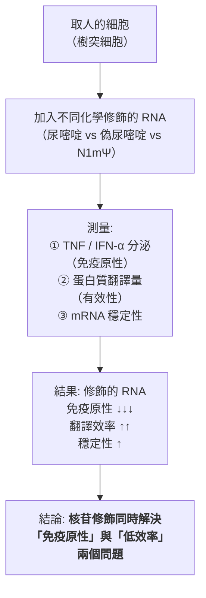
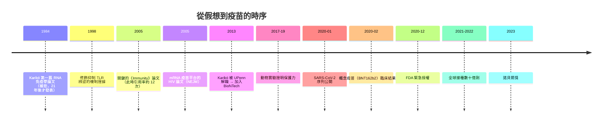

# 2023 · 核苷基修飾與 mRNA 疫苗：卡里科與魏斯曼讓「化學假說」變成救命疫苗

> **2023 諾貝爾生理學 or 醫學獎**（共享）：卡里科·考里科（Katalin Karikó，匈牙利／美國）與德魯·魏斯曼（Drew Weissman，美國）— 表彰「對核苷基修飾方面的發現，使開發針對 COVID-19 有效的 mRNA 疫苗變成可能」（"for their discoveries concerning nucleoside base modifications that enabled the development of effective mRNA vaccines against COVID-19"）。

## 懸案（案情提要）

1980 年代末，卡里科在**美國賓州大學（UPenn）**提出了一個大膽的想法：

1. **既然細胞可以用 DNA 的資訊製造蛋白質**，那麼**把正確的 mRNA 直接送進細胞**，讓它被翻譯成蛋白質——**這就是「mRNA 治療」的原型想法**；
2. 但當時的科學界認為：**「RNA 是不穩定的、會被細胞迅速降解、也會引起強烈免疫反應的分子」**——因此「mRNA 藥物」是不切實際的；
3. 而實驗也證實了：**直接注射 mRNA，會被迅速降解，且引發劇烈的先天免疫反應（以 TNF 和 I 型干擾素為主）**。

**卡里科與魏斯曼的問題是：能不能改造 mRNA 的「化學字母」，使它既能穩定、又不引起免疫反應？**

答案：**偽尿嘧啶（pseudouridine）與 N1-甲基假尿嘧啶（N1mΨ）的修飾**——**這是一個純粹的化學問題，但它改變了醫學的未來。**

## 前因

| 年份 | 事件 |
| --- | --- |
| 1961 | **Brenner、Jacob 與 Meselson** 證明**mRNA 的存在**（見 [1965-乳糖操縱子](1965-乳糖操縱子.md)）；**這給了「mRNA 藥物」概念的第一個理論基礎**。 |
| 1970s–1980s | **mRNA 治療的早期嘗試**：研究者以**脂質體（LNP）**或**轉染試劑**包裹 mRNA 送入細胞，在動物實驗中成功表達蛋白；**但 mRNA 的不穩定性與免疫原性始終是兩道牆**。 |
| 1970s–1980s | **mRNA 治療的早期嘗試**：研究者以**脂質體（LNP）**或**轉染試劑**包裹 mRNA 送入細胞，在動物實驗中成功表達蛋白；**但 mRNA 的不穩定性與免疫原性始終是两道牆**。 |
| 1984 | **Karikó 開始研究「RNA 的免疫學」**：她與同事發表了第一篇論文，證明 RNA 可誘發先天免疫反應，而特定化學修飾可抑制之——**這篇論文被雜誌拒絕**（據說理由是「too boring」），**直到 2005 年才被發表**——**這是科學史上最著名的「延遲 21 年發表」的案例之一**。 |
| 1988 | **Vannier 與 colleagues（1987）**發現**Pseudouridine（Ψ）**可抑制 RNA 的免疫原性。 |
| 1990s | **Karikó 的「化學假說（chemical hypothesis）」**：她提出——**若將 mRNA 的部分尿嘧啶（uridine）替換為偽尿嘧啶或 N1-甲基假尿嘧啶**，則：(1) 翻譯效率提高；(2) RNA 的穩定性提高；(3) 先天免疫原性大幅降低。**這個假說在當時被視為異想天開。** |
| 1998 | **Karikó 與魏斯曼在《PNAS》發表《Suppression of RNA recognition by Toll-like receptors: the impact of nucleoside modification》**——**證實修飾可抑制 TLR7/8 的辨識**。 |
| 2005 | **Karikó 與魏斯曼在《Immunity》發表《Inhibition of translation by modified nucleosides**——**這是 mRNA 疫苗的關鍵文獻之一**，但**引用率極低**（在 2020 年前只有約 12 次引用）。 |
| 2005–2006 | **Karikó 與 Weissman 在《新英格兰醫學雜誌》（NEJM）發表《mRNA vaccines for HIV》**——**早在 COVID-19 之前 15 年，他們已證明 mRNA 可以作為疫苗平台**（用於 HIV 抗原）。**這是「平台早已備妥，只差病原」的典範**。 |
| 2011 | **魏斯曼的研究生 Karikó 被 UPenn 解職**（2013 年正式解職，2015 年失去終身教職）——**因為她的 mRNA 研究「不夠有商業潛力」**。 |
| 2013 | **Karikó 加入 BioNTech（時任副總裁，2019 年升任資深副總裁）**；**魏斯曼留在 UPenn**。 |
| 2017–2019 | **mRNA 平台在動物實驗中驗證**：Karikó 與魏斯曼證明**含 N1mΨ 的 mRNA 可在小鼠中誘導對傳染病（流感、Zika、結核）的保護性免疫**。 |
| 2020 年 1 月 | **SARS-CoV-2 基因組序列公開**（中國）；**2 月底**，Karikó 與魏斯曼團隊在《Nature》發表《**Safety and efficacy of the BNT162b2 mRNA vaccine against SARS-CoV-2**》——**從概念到成品只用了 12 天**。 |
| 2020 年 12 月 | **mRNA 疫苗（BioNTech/Pfizer 與 Moderna）**獲 FDA 緊急授權——**人類疫苗史上最快的一次**。 |
| 2021–2022 | mRNA 疫苗在全球接種數十億劑，**降低了 COVID-19 的重症與死亡負擔**（估計在第一年拯救了約 1,440 萬–2,000 萬條生命，依模型而異）。 |
| 2023 | 兩人共享諾貝爾生理學 or 醫學獎。 |

## 調查

### 第一幕：Karikó 的「化學假說」——一個被拒絕的洞見

**問題的精確化**：

$$\text{外來 mRNA 的兩個問題：} \begin{cases} \text{① 被先天免疫系統辨識 → 被降解（所以無效）} \\ \text{② 本身不穩定 → 半衰期太短} \end{cases}$$

**Karikó 的洞見**：**這兩個問題的根源是同一個——RNA 的「化學字母表」被免疫系統當成「危險信號」辨識了。** 若把某些字母「塗掉」，就同時解決兩者。

**她的實驗設計（1980s–2000s）**：



**關鍵的受體證據（1998 年）**：魏斯曼後來證明，**TLR7 與 TLR8 能辨認尿嘧啶修飾的 RNA**（特別是**5-羥基尿嘧啶**與**5-羥基胞嘧啶**），而**偽尿嘧啶與 N1mΨ 不被辨認**——**這就把「化學層面的直覺」接上了「分子受體的機制」**：

$$\text{尿嘧啶修飾的 RNA} \xrightarrow{\text{TLR7/8}} \text{IFN-}\alpha \uparrow \to \text{RNA 被降解}$$

**這與 2011 年的先天免疫諾獎直接對接**（見 [2011-先天免疫與樹突細胞](2011-先天免疫與樹突細胞.md)）——**TLR 的「分子指紋」辨認能力，竟成為 mRNA 藥物設計的關鍵**。

### 第二幕：N1-甲基假尿嘧啶（N1mΨ）——完美的化學工具

**為什麼是 N1mΨ 而非別的修飾？**

| 特性 | 說明 |
| --- | --- |
| **不被 TLR7/8 辨認** | 消除先天免疫活化 |
| **不被 RIG-I / PKR 辨認** | 消除干擾素與 mRNA 激酶的辨認（**這是 2020 年後才完全釐清的**） |
| **提高翻譯效率** | 核糖體的偏好 |
| **提高 mRNA 穩定性** | 減少被核酸酶降解 |
| **可被高效轉錄** | **這是最後一項也是最關鍵的一項**——2020 年代的技術突破 |

**「N1mΨ 能否被 T7 RNA 聚合酶高效地轉錄出來？」** 這是 mRNA 疫苗量產的關鍵瓶頸。

**2020 年的兩個決定性突破**（在疫情的壓力下完成）：

1. **Karikó 團隊發現**：使用**新的 T7 聚合酶變種（他稱之為「T7 突變」）** 加上**高濃度 $\mathrm{Mg}^{2+}$ 與**降低反應溫度**，可使含 N1mΨ 的 RNA 被大量轉錄——**這是「產量」的關鍵**；
2. **Weissman 團隊**發現：**在轉錄反應中加入**適量的**核苷三磷酸之一（UTP）**，可使 N1mΨ 的摻入效率大幅提升——**這解決了「摻入」的瓶頸**。

**兩項技術加總**，使含 N1mΨ 的 mRNA 能以**工業規模**製造——**從「化學假說」到「量產工藝」，只用了數週**。

### 第三幕：平台的通用性——「換個抗原就是一種新疫苗」

**mRNA 疫苗的關鍵優勢，是它的「平台性」**：

```mermaid
flowchart TD
    A[抗原的基因序列<br>（如 SARS-CoV-2 的刺突蛋白）] --> B[改寫為 mRNA<br>（加 5' cap、加 poly(A) 尾、取代尿嘧啶為 N1mΨ）]
    B --> C[體外轉錄（in vitro transcription）<br>→ 純化 → 裝入 LNP]
    C --> D[肌肉注射 → 細胞攝入 LNP<br>→ mRNA 被翻譯成抗原蛋白]
    D --> E[抗原蛋白被呈現<br>→ 引發<strong>細胞免疫 + 體液免疫</strong>]
    F[只需更換 A 步驟的序列] --> G["<strong>新疫苗只需數週</strong>"]
```

**這個「平台」性質在 2020–2023 年被充分驗證**：

| 疫苗 | 狀態 |
| --- | --- |
| COVID-19（BNT162b2、mRNA-1273） | 已上市 |
| **流感**（mRNA-1010） | III 期 |
| **HIV**（mRNA-1644） | I/II 期 |
| **結核**（BNT-323） | II 期 |
| **癌症（個別腫瘤抗原）** | I 期 |
| **巨細胞病毒（CMV）** | III 期 |

**「週期 100 天」的製造能力**——**這是 20 世紀流感疫苗製造（需 6 個月且每年產能有限）與 21 世紀 mRNA 平台的根本差別**。

### 第四幕：LNP 與「轉運」的難題

**mRNA 疫苗的第二個技術難題是「怎麼把 mRNA 送進細胞」**。解決方案是**脂質奈米粒子（LNP）**：

1. **LNP 的組成**：可 ionizable 的脂質（如 **SM-102、ALC-0315**）+ **helper lipid**（DSPC）+ **cholesterol** + **PEG-lipid**；
2. **關鍵的「可電荷化脂質」設計**：這些脂質在**酸性環境（pH 4）下帶正電**（因此能與帶負電的 mRNA 結合），但在**生理 pH 7.4 下接近中性**（因此對細胞膜的毒性低）；
3. **內吞路徑**：LNP 被細胞內吞 → 內體酸化（pH 降至約 5.5）→ 脂質質子化 → **與內體膜融合** → mRNA 釋放到細胞質 → 核糖體翻譯；
4. **Karikó 與同事在 2015 年**發表了一篇關鍵的論文，指出一種當時被忽略的**內體逃逸（endosomal escape）機制**——**這是效率提升的關鍵之一**。

**LNP 的意義**：**它是「核酸藥物」能真正走進臨床的關鍵載體**——今日的 **siRNA 藥物（patisiran）**與 **基因治療的 LNP 遞送**（如 2020 年代的 mRNA 治療罕見肝臟疾病）都建立在同一套化學上。

### 第五幕：數學——「免疫原性—效率」的取捨

**修飾的選擇面臨一個取捨**：

$$\text{修飾程度} \to \begin{cases} \text{免疫原性} \downarrow \\ \text{但若修飾過多，} \\ \text{mRNA 的結構被破壞} \Rightarrow \text{翻譯效率} \downarrow \end{cases}$$

**N1mΨ 的巧妙之處**：它是**尿嘧啶的「同型異構體」**——**鹼基的骨架不變，只有修飾位置不同**——因此：

- 鹼基配對性質**幾乎不變**（仍與 A 配對）；
- 結構穩定性**提高**；
- 但免疫系統的「分子指紋」辨認**失效**。

**這是化學設計的「最小改動、最大收益」典範**。

### 第六幕：從科學到政策的距離

**本案最戲劇性的部分不是化學，而是「科學到公共衛生的時序」**：



**這段時序的教訓**：

$$\text{「平台」的可攜性} = \text{科學準備的時間} \times \text{病原的出現時機}$$

**Karikó 在獲獎演講中反覆強調**：「**我曾經想過放棄。但我想起女兒的兒子（我的外孫）會打疫苗——所以我決定繼續。**」

**更深的科學史教訓**：
1. **被拒絕的論文不一定是壞論文**——Karikó 1984 年的論文被拒，理由是「too boring」，**但它是 mRNA 疫苗的第一塊拼圖**；
2. **引用率低不代表不重要**——2005 年那篇《Immunity》論文在 20 年間只有十幾次引用，**但它是整個平台的原理文件**；
3. **科學家的制度處境會決定科學的命運**——Karikó 被 UPenn 解職這件事，**直接把她「推」進了 BioNTech**（見 [2023-mRNA 疫苗](2023-mRNA疫苗.md)）。

## 追查支線（未結之謎）

- **Karikó 的個人史**：她於 1975 年從匈牙利來到美國（**在匈牙利完成醫學與生化訓練，1982 年取得博士學位**）；她的**女兒與女婿都是醫生**，外孫在 2020 年成為 mRNA 疫苗的接種者——**她曾說，這個外孫是「我繼續研究的理由」**；她於 2021 年獲** Lasker 臨床醫學獎**；
- **Karikó 與 UPenn 的糾葛**：2013 年被解職、2015 年失去終身教職、2021 年獲Lasker 獎後 UPenn 才開始處理她的申訴；**2023 年諾獎之後**，她與 UPenn 的糾紛再度成為媒體焦點；**Karikó 強調她並不怨恨 UPenn**，並曾表示希望 UPenn 能「在她的貢獻上給予承認」；
- **魏斯曼的科學與疫情**：他與 **Karikó 共同發起了「首次揭盲」的倡議**——**2020 年 12 月，Moderna 試驗的數據在完整追蹤結束前就被公開**（歷史上通常要到試驗結束才揭盲），這被許多人視為**科學透明度的典範**；他也是 2021 年《大學》雜誌的封面人物；
- **「mRNA 疫苗的副作用」的政治化**：2021 年後，「mRNA 疫苗是否應常規接種」成為政治議題；**這與 2024 年美國政府的政策轉向直接相關**——**2025 年 1 月，美國衛生部長 Robert F. Kennedy Jr. 發布了關於 mRNA 疫苗的備忘錄，主張「僅以風險考量」的框架**，這引發了包括 23 位諾貝爾獎得主在內的科學家的公開反對信。**這是科學與公共衛生決策張力的當代案例**；
- **2020 年代的其他 mRNA 應用**：**mRNA 治療**（如 2023 年核准的 **mRNA-3927 用於 A 型血友病**）、**mRNA 疫苗對 HIV 與結核的臨床試驗**、以及 **mRNA 為基礎的動物養殖飼料**（**2023 年美國 FDA 核准了養殖業使用 mRNA 疫苗以對抗非洲豬瘟**）——**這是 mRNA 技術「從醫藥到農業」的擴張**。

## 證物與數據（偵查卷宗摘錄）

| 證物 | 數值／內容 | 偵查意義 |
| --- | --- | --- |
| 1984 年的被拒論文 | 「too boring」 | **延遲 21 年發表** |
| 1998 年 TLR 證據 | TLR7/8 辨認尿嘧啶修飾 RNA | 化學直覺的受體基礎 |
| 2005 年《Immunity》 | 修飾抑制 TLR 辨認 | mRNA 疫苗的原理文件（引用率曾約 12） |
| 2005 年 NEJM | mRNA 疫苗用於 HIV | **平台早在 15 年前已驗證** |
| N1mΨ | 尿嘧啶的同型異構體 | **最小改動、最大收益** |
| 效應 | 免疫原性 ↓↓↓、翻譯效率 ↑↑、穩定性 ↑ | 三重改善 |
| T7 突變聚合酶 | 高 $\mathrm{Mg}^{2+}$ 、低溫 | **量產的瓶頸之一** |
| UTP 添加 | 提高 N1mΨ 摻入效率 | **量產的瓶頸之二** |
| LNP 組成 | 可電荷化脂質 + DSPC + 膽固醇 + PEG | 遞送系統 |
| 可電荷化脂質 | pH 4 帶正電、pH 7.4 中性 | 毒性與效率的平衡 |
| 設計到量產 | 約 12 天 | **平台速度的證明** |
| 全球接種 | 數十億劑 | 公共衛生的規模 |

## 理論裁決

1. **「化學假說」的數學**：核苷修飾同時改善三個指標，可寫成一個多目標函數：

$$\text{Objective} = w_1 \cdot (-\text{免疫原性}) + w_2 \cdot (\text{翻譯效率}) + w_3 \cdot (\text{穩定性}) - w_4 \cdot (\text{結構破壞})$$

**N1mΨ 的巧妙之處在於它是尿嘧啶的同型異構體**：鹼基配對性質幾乎不變（ $w_4$ 極小），而其餘三項同時改善（ $w_1\text{–}w_3$ 大）——**這是「最小改動、最大收益」的化學設計**。

2. **先天免疫的「分子指紋」辨認與干擾的數學**：

$$\text{TLR7/8 的活化} \propto \sum_{i \in \text{尿嘧啶修飾位置}} \mathbb{1}(\text{該修飾被辨認})$$

$$\text{偽尿嘧啶 / N1mΨ：不被辨認} \Longrightarrow \text{IFN} \alpha \uparrow \approx 0 \Longrightarrow \text{mRNA 半衰期} \uparrow$$

**這解釋了為何「鹼基配對性質不變」卻能完全改變免疫原性**——**免疫系統辨認的不是「配對」，而是「修飾的化學特徵」**。

3. **平台的數學（可攜性與時間）**：mRNA 疫苗平台的開發時間可分解為：

$$T_{\text{total}} = T_{\text{設計}} + T_{\text{序列最佳化}} + T_{\text{工藝}} + T_{\text{臨床}}$$

$$\approx \text{數天} + \text{數天} + \text{數週} + \text{數月}$$

**對比傳統疫苗（減毒或亞單位）**：$$T \approx \text{數年}$$（找毒株 → 減毒 → 大量培養 → 純化 → 製程驗證）——**平台技術把「每年重新設計」變成「數週」**。

4. **LNP 遞送的概率模型**：mRNA 從注射到細胞質的「成功漏斗」：

$$\underbrace{P_{\text{肌肉攝入}}}_{\sim 0.5\text{–} 0.9} \times \underbrace{P_{\text{內體逃逸}}}_{\text{關鍵瓶頸}} \times \underbrace{P_{\text{核糖體翻譯}}}_{\text{高}}$$

**「內體逃逸」是效率的瓶頸**——這正是 Karikó 在 2015 年論文中特別強調「RNA 從內體逃逸的機制」的深意（**這篇論文在 2015 年只有零星引用**）。

5. **「免疫原性—安全性」的取捨**：疫苗要達到最佳效果，需要足夠的抗原表現以引發免疫，又要避免過度的先天免疫：

$$\text{抗原量} \propto \text{翻譯效率} \qquad \text{而} \qquad \text{局部發炎} \propto \text{先天免疫活化}$$

**核苷修飾正是把後者壓低、前者提高的槓桿**——**這解釋了為何「免疫原性降低」在疫苗語境中不是缺點，而是優點**。

## 後果

| 領域 | 影響 |
| --- | --- |
| 疫苗學 | **「平台化」疫苗時代**：從設計到量產只需數週；mRNA 成為繼減毒、亞單位、病毒樣顆粒之後的第四代疫苗平台。 |
| 免疫學 | 證明了**核苷修飾可抑制先天免疫辨認**——這條原理已被用於**免疫調節的自我 RNA 假說**（自身 RNA 的化學標記與免疫沉默，見 [2011-先天免疫與樹突細胞](2011-先天免疫與樹突細胞.md)）。 |
| 分子生物學 | 化學修飾作為「非轉錄資訊層」的觀念——**RNA 字母表的可塑性**。 |
| 生物技術 | LNP 成為核酸藥物的通用載體平台。 |
| 公共衛生 | 全球疫苗史上最快的一次部署；也帶來關於疫苗政策與信任的當代討論。 |
| 其他諾獎 | 與 [2011-先天免疫與樹突細胞](2011-先天免疫與樹突細胞.md)（TLR 的分子指紋）、[1959-核酸生合成](1959-核酸生合成.md)（體外轉錄）、[1993-斷裂基因](1993-斷裂基因.md)（RNA 加工與加帽）構成分子生物學與疫苗學主線。 |

## 關聯

- [2011-先天免疫與樹突細胞](2011-先天免疫與樹突細胞.md) — TLR7/8 的「分子指紋」辨認能力，正是 mRNA 免疫原性的根源。
- [1959-核酸生合成](1959-核酸生合成.md) — 體外轉錄與 RNA 聚合酶的機制。
- [1993-斷裂基因](1993-斷裂基因.md) — RNA 的加工、加帽與多聚腺苷酸化。
- [1988-藥物治療原理](1988-藥物治療原理.md) — 「合理設計」的藥理學傳統。
- [1951-黃熱病疫苗](1951-黃熱病疫苗.md) — 減毒活疫苗的黃金傳統，與 mRNA 平台的對照。
