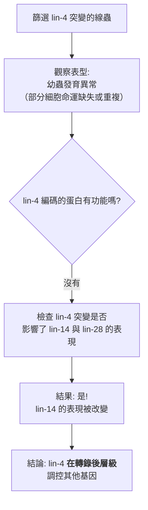
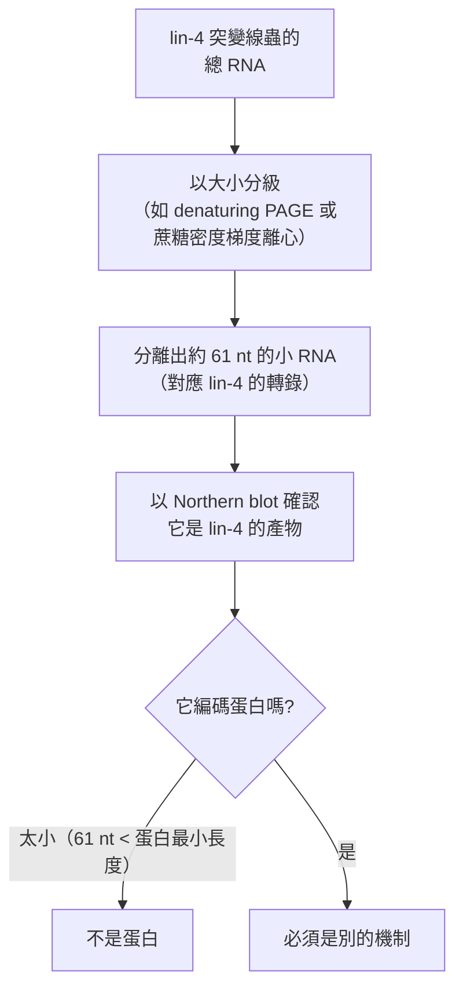
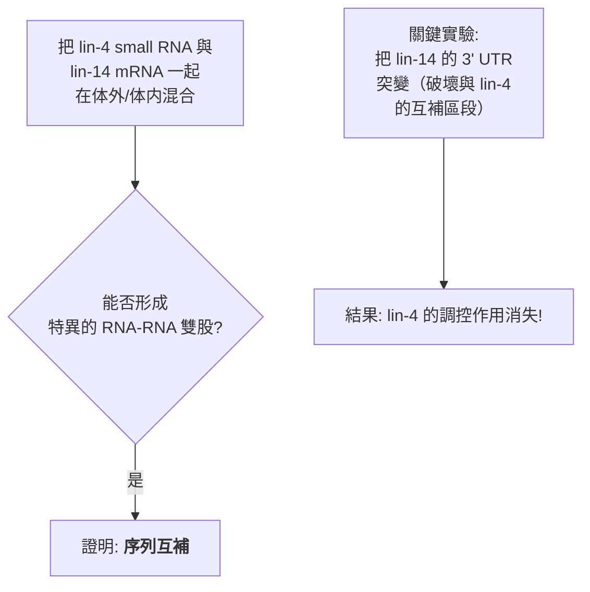
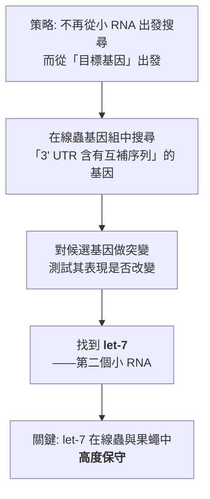

# 2024 · 微小 RNA 與轉錄後基因調控：安布羅斯與魯夫昆找到基因表現的「隱形調音師」

> **2024 諾貝爾生理學 or 醫學獎**（共享）：維克托·安布羅斯（Victor R. Ambros，美國）— 表彰「發現微小 RNA 及其在轉錄後基因調控中的作用」；加里·魯夫昆（Gary B. Ruvkun，美國）— 同上。

## 懸案（案情提要）

1980–90 年代，基因表現調控的研究有兩個「已知世界」：

1. **轉錄層級**：轉錄因子（如 [1995-胚胎發育基因](1995-胚胎發育基因.md) 的 Hox 基因）決定「某個基因是否被轉錄」——**開／關**；
2. **轉錄後層級**：mRNA 的剪接（[1993-斷裂基因](1993-斷裂基因.md)）、RNA 干擾（[2006-RNA 干擾](2006-RNA干擾.md)）、以及蛋白質的降解（泛素系統）。

但有一個現象一直無法解釋：

> **線蟲的 lin-4 基因，卻能控制另外兩個基因（lin-14、lin-28）的表現——而且 lin-4 本身並不編碼蛋白質。**

這樁「不相干基因之間的調控」的懸案，在 1993 年被破解，並在 1993–2000 年間發展成一個全新的調控層級：**微小 RNA（microRNA, miRNA）**。

## 前因

| 年份 | 事件 |
| --- | --- |
| 1987–1990 | **Victor Ambros**（在 Harvard 醫學院）與 **Robert Horvitz**（在 MIT）研究**線蟲的 lin-4 突變**：發現 lin-4 突變會讓線蟲的**幼蟲發育（larval development）異常**（部分重複、部分缺失），**但不是因為 lin-4 編碼的蛋白有功能**，而是因為 **lin-4 影響了 lin-14 與 lin-28 的表現**。 |
| 1990 | **Ambros 與 Horvitz** 發表《*Mutations in the lin-4 gene of C. elegans affect the expression of lin-14 and lin-28*》——**第一次證明「一個基因可以調控另一個基因的表現，而前者不編碼蛋白質」**。 |
| 1992–1993 | **Ambros 的實驗室**分離出一個**約 61 nt 的小 RNA**（lin-4 的轉錄產物）——**它太小，不可能是 mRNA；它也不是蛋白**。Ambros 將它命名為 **lin-4 small RNA**。 |
| 1993 | **加里·魯夫昆**（在 Harvard 醫學院）證明：**lin-4 small RNA 與 lin-14 的 3' UTR 互補配對**——**這就是「小 RNA 以序列互補的方式抑制目標 mRNA」的證據**。魯夫昆當時的結論極為克制：「**『負向調控』的機制是存在的，但我們不知道它是如何運作的。**」 |
| 1993–1998 | 「lin-4 究竟是什麼」的追問：**它是一個獨特的反常，還是一整類分子的成員？** |
| 1998–2000 | **魯夫昆**以**「從目標基因出發」的策略**（而非從小 RNA 出發），在線蟲基因組中搜尋與 lin-4 互補的序列——**找到了第二個成員：let-7**。 |
| 2000 | **「let-7 在線蟲與果蠅中高度保守」**的發現（**Ruvkun 與 Pasquinelli 等**）——**這是關鍵的線索**：如果它在極遠的演化距離上保守，**它必定具有重要的功能**，不只是線蟲的特例。 |
| 2001 | **「miRNA」這個名字正式誕生**（**Ambros 與 Ruvkun** 的共識）——**microRNA**。 |
| 2002–2004 | **第三、第四個成員被發現**（**miR-1、miR-206** 等），並證實**在動物中 miRNA 的數量隨演化距離而增加**（**「miRNA 組的擴張與身體複雜度的關聯」**）。 |
| 2004–2010s | **Ruvkun 的實驗室**揭示了 miRNA 機制的細節：miRNA 與靶 mRNA 的 3' UTR 配對 → **招募 RISC（RNA 誘導沉默複合體，見 [2006-RNA 干擾](2006-RNA干擾.md)）** → **在哺乳動物中是「抑制翻譯 + 去穩定化」**（而非像 siRNA 那樣直接切割）。 |
| 2009 | **miRNA 與疾病的關聯**：**miR-155** 的過度表現與**淋巴瘤**相關；**miR-21** 與多種癌症相關；**2012 年，** miRNA 與**心臟疾病、癌症、糖尿病**的關聯被系統整理。 |
| 2010s–2020s | **细胞外 miRNA（exosomal miRNA）**作為**細胞間通訊的分子**（血液中的 miRNA 作為生物標記）；**mRNA 疫苗的添加物**（如 2020 年代的 **mRNA-1273 中添加 N1-甲基假尿嘧啶之外， Moderna 的候選疫苗以「自擴增 RNA（saRNA）與 miRNA 設計」為特色**）；**基於 miRNA 的治療**（如以 **miRNA 擬似物（miRNA mimics）與拮抗劑（antagomirs）** 治療疾病，**2018 年首個 miRNA 治療（MRG-106／cobomarsen，用於血友病）進入臨床**）。 |
| 2024 | 兩人共享諾貝爾生理學 or 醫學獎。 |

## 調查

### 第一幕：Ambros 與 Horvitz 的「不相干基因」實驗

**線蟲（*C. elegans*）作為模型的優勢**：

- **透明**，可觀察細胞命運（見 [2002-程式性死亡](2002-程式性死亡.md)）；
- **細胞命運完全已知**（959 個體細胞）；
- **突變體易篩選**；
- **遺傳操作簡單**（RNAi 可快速做功能篩選，見 [2006-RNA 干擾](2006-RNA干擾.md)）。

**Ambros 與 Horvitz 的實驗設計**：

**關鍵的對照**：
1. **lin-4 突變不改變 lin-14 的轉錄速率**，但**改變了 lin-14 mRNA 的量**——**這是「轉錄後」的判準**；
2. **lin-4 的作用具有「劑量效應」**——**一個基因產物的量，能以連續的方式調節另一個基因的產物**——**這是遺傳學中從未見過的現象**。

### 第二幕：61 nt 的神秘產物

**Ambros 的分離與鑑定**：

**61 nt 這個長度極為關鍵**——**它正好是「一個 pri-miRNA 被 Drosha 與 Dicer 切割後」的產物長度**：

$$\text{pri-miRNA} \xrightarrow{\text{Drosha（核內）}} \text{pre-miRNA} \xrightarrow{\text{Dicer（細胞質）}} \text{miRNA} + \text{miRNA^*}$$

### 第三幕：魯夫昆的「配對」證明——序列互補

**魯夫昆的實驗是本案最關鍵的一步**：

**E 步是因果性的鐵證**——**破壞配對，調控就消失**。**這是 1993 年的關鍵圖像**。

**魯夫昆在 1993 年論文中的結論極為克制**：

> 「**負向調控確實存在，但我們尚不知道它是怎麼運作的。**」

**這個「坦白的未知」正是科學的美德**——**他們沒有急著命名一個機制，而是把它留給後人**。**這個「克制」本身是 2024 年諾獎敘事中最動人的部分之一**。

### 第四幕：「let-7」的發現——從目標反查小 RNA

**問題**：lin-4 是孤例還是一類的成員？

**魯夫昆的策略極為巧妙——反向搜尋**：

**let-7 的保守性是決定性的線索**：

$$\text{如果 let-7 在演化距離極遠的物種中保守} \Rightarrow \text{它必有重要的功能}$$

**2000 年的這項發現，讓「miRNA」從「線蟲的特例」變成「**動物界普遍的調控層級**」。**

### 第五幕：miRNA 家族與「基因組的複雜度」

**安布羅斯與魯夫昆在 2001–2004 年的工作建立了一幅全景圖**：

| 特性 | 內容 |
| --- | --- |
| **數量** | 哺乳動物約 **1000–2000 個** miRNA 座位；線蟲約 100 個；果蠅約 400 個 |
| **結構** | 典型的 **pri-miRNA → pre-miRNA → miRNA + miRNA\*** 的加工路徑（Drosha、Dicer、DGCR8） |
| **基因組組織** | **多數 miRNA 基因以「簇（cluster）」存在並被共同轉錄**（如「miR-17-92 簇」） |
| **靶點數** | 保守估計**每個 miRNA 調控數百個目標 mRNA** |
| **演化** | **miRNA 的數量隨身體複雜度而增加**（這是「miRNA 組擴張假說」，1990 年代末由安布羅斯與魯夫昆提出） |

**「miRNA 數量與複雜度相關」的假說，至今仍是發育生物學與演化遺傳學的熱門議題**。

### 第六幕：機制的兩種版本——「切割」與「抑制」

**這是本案在機制層次最重要、也最容易被忽略的區分**：

| 面向 | **siRNA** | **miRNA** |
| --- | --- | --- |
| 前驅物 | 長的 dsRNA | pri-miRNA（髮夾結構） |
| 產物 | 21–23 nt siRNA | 約 22 nt miRNA |
| 與靶的配對 | **完全互補** | **不完全互補**（尤其**種子區（位置 2–8）**） |
| 哺乳動物中的結果 | **直接切割**（Argonaute  slicing） | **抑制翻譯 + 去穩定化**（切割效率低） |
| 作用範圍 | 一對一 | **一對多**（數百個靶） |

**魯夫昆實驗室 2000 年代的重要發現**：在**線蟲**中，lin-4 與靶 mRNA 的配對**高度互補**（近於完全配對）→ **引發切割**；而在**哺乳動物**中，miRNA 與靶的配對**通常只是種子區互補** → **只抑制翻譯並促進去穩定化**。

**這解釋了一個演化上的有趣事實**：

$$\text{線蟲：miRNA 的作用像 siRNA（切割）} \qquad \text{哺乳動物：miRNA 的作用像「溫和的抑制」}$$

**「miRNA 與 siRNA 是同一個機制的兩種模式」**——**這是 2020 年代最被低估的生物學統一之一**。

### 第七幕：數學——「一對多」調控的資訊結構

**miRNA 的資訊學意義極為深刻**：

**若一個 miRNA 調控 $m$ 個基因，每個基因有 $n$ 個可能的 miRNA 結合位點**：

$$N_{\text{可能的調控組合}} \approx m \times n \times N_{\text{miRNA}}$$

**但更關鍵的是「錯誤配對容忍度」**：

$$\text{種子區只需 7 個鹼基互補} \Rightarrow \text{允許「近似配對」} \Rightarrow \text{一個 miRNA 可命中數百個 mRNA}$$

**這與 siRNA 的「完全互補」形成對比**：

$$\underbrace{\text{完全互補}}_{\text{siRNA：精準打擊}} \qquad \text{vs} \qquad \underbrace{\text{種子區互補}}_{\text{miRNA：廣譜調節}}$$

**這正是「miRNA 適合做『微調器（rheostat）』，而 siRNA 適合做『關卡（knockout）』」的原因**——**一個是連續可調的音量旋鈕，一個是開關**。

**「噪音容忍」的數學**：若一個基因的 3' UTR 含有多個 miRNA 位點，則單一 miRNA 的作用會被「緩衝」：

$$\text{輸出} \propto \prod_i \left(1 - \text{repression}_i\right)$$

**這解釋了為什麼單一 miRNA 的功能敲除常無明顯表型**（而 siRNA 敲除則常有）——**這是基因功能研究中的重要實務教訓**。

### 第八幕：從線蟲到人類——miRNA 的疾病與治療

**miRNA 與疾病**：

| 疾病 | 相關 miRNA | 機制 |
| --- | --- | --- |
| **B 細胞淋巴瘤（CLL）** | **miR-15/16 缺失** | 失去對 BCL2 的抑制 → 凋亡受阻 |
| **肝癌、肺癌** | miR-21 上調 | 抑制抑癌基因 |
| **心血管疾病** | miR-1、miR-133a 下調（心肌） | 肌鈣蛋白與鈣離子處理異常 |
| **糖尿病** | miR-9、miR-32（胰島素分泌） | 胰島素分泌受損 |
| **阿茲海默病** | miR-9、miR-146a | 與 tau、TLR 的交互作用 |
| **自體免疫** | miR-155、miR-21 | 免疫細胞分化 |

**治療的兩條路**：

1. **mimic（擬似物）**：合成雙股 RNA，模擬 miRNA → 用於**抑制**過度活化的 miRNA（如 **MRG-106** 用於血友病的出血）；
2. **antagomir（拮抗劑）**：用 LNP 包裹反義寡核苷酸封鎖特定 miRNA → 用於**抑制**過度活化的 miRNA。

**2020 年代的延伸**：**以 miRNA 為基礎的癌症疫苗**（**mRNA-4156（V940，BioNTech）**，以 miRNA 靶向免疫抑制為原理的癌症疫苗，進入臨床試驗）——**這把 2023 年的 mRNA 平台與 2024 年的 miRNA 機制接在了一起**。

## 追查支線（未結之謎）

- **兩人的科學關係**：**魯夫昆與安布羅斯是哈佛醫學院的老同事**（魯夫昆曾在安布羅斯的實驗室做博士後），但**兩人各自獨立發現了兩端的機制**（魯夫昆做「配對與機制」，安布羅斯做「生物學與數量」）；**2024 年的諾獎公告特別指出他們是「多年好友」**——**這是諾獎史上最溫暖的一則頒獎詞之一**；
- **「let-7 從線蟲到人類」的旅程**：let-7 現已知是**所有脊椎動物中最保守的 miRNA 之一**，在**心臟、肌肉、肺**的發育中不可或缺；**2020 年代**的研究顯示 let-7 與**心臟再生**、**肌肉再生**與**抗癌**相關；
- **miRNA 的數量悖論與「非編碼區的意義」**：人類基因組中 **約 60%–70% 的序列是不編碼蛋白質的**——**miRNA 的發現讓這部分序列第一次有了具體的意義**（**雖然 miRNA 只占其中的一小部分**，但它的「一對多」調控方式提示了非編碼序列的深遠潛力）——**這條線最終通向 2020 年代的「功能性基因組學」**；
- **外泌體與細胞間通訊**：**細胞外 miRNA（exosomal miRNA）**可透過血液傳遞訊號，被認為參與**腫瘤—免疫系統的對話**（2020 年代的研究顯示，腫瘤細胞可透過外泌體 miRNA「教育」免疫細胞）——**這是「miRNA 從細胞內調控走向細胞間通訊」的延伸**；
- **諾貝爾委員會的措辭**：2024 年的公告特別提到**「lin-4 與 let-7 的發現，開啟了一個全新的調控層級」**，並指出**「這種微小的 RNA 在基因調控中的作用，與它自身的尺寸極不相稱」**——**這是對「小分子、大作用」這一科學美學的完美表達**。

## 證物與數據（偵查卷宗摘錄）

| 證物 | 數值／內容 | 偵查意義 |
| --- | --- | --- |
| lin-4 突變表型 | 幼蟲發育的細胞命運異常 | 調控的線索 |
| **轉錄速率 vs mRNA 量** | 轉錄不變、mRNA 量變 | **轉錄後調控的判準** |
| **61 nt 的產物** | 太短，不能編碼蛋白 | 「第三類分子」 |
| **lin-4 與 lin-14 3'UTR 的配對** | 序列互補 | **機制的證明** |
| **突變 lin-14 的 3'UTR** | lin-4 的調控消失 | **因果性的鐵證** |
| 1993 年的結論 | 「負向調控存在，機制未知」 | **科學的克制** |
| **反向搜尋策略** | 從目標基因找小 RNA | 方法論的轉折 |
| **let-7（2000）** | 在線蟲與果蠅中保守 | 「這是一個家族」的證據 |
| miRNA 數量 | 哺乳動物約 1000–2000 個座位 | 調控層級的規模 |
| 一對多 | 每個 miRNA 調控數百個靶 | **廣譜調節** |
| 種子區 | 位置 2–8，共 7 個鹼基 | **近似配對的容忍度** |
| 與 siRNA 對比 | 完全互補 vs 種子區互補 | 兩種模式 |
| miR-15/16 缺失 | CLL 中的 BCL2 去抑制 | 疾病機制的典範 |
| MRG-106 | 首個 miRNA 治療進入臨床 | 治療的起點 |

## 理論裁決

1. **一對多調控的數學**：若一個 miRNA 有 $m$ 個靶基因，每個靶基因的 3' UTR 含 $n$ 個該 miRNA 的結合位點：

$$N_{\text{調控關係}} = m \times n \times N_{\text{miRNA}}$$

**但更關鍵的是「近似配對」的數學意義**：種子區只需 7 個鹼基互補（位置 2–8）：

$$P(\text{隨機命中}) \approx \left(\frac{1}{4}\right)^{7} \approx 6\times 10^{-5}$$

**這正是「一個 miRNA 可調控數百個基因」的統計學基礎**（若只算 7 鹼基，一個種子只命中少數基因；但由於**保守的種子區的選擇偏好**與**3' UTR 的進化擴張**，實際命中數遠高於隨機期望）。

2. **「精準 vs 廣譜」的數學對照**：

$$\underbrace{\text{siRNA：完全互補}}_{\text{切割率} \approx 100\%} \qquad \text{vs} \qquad \underbrace{\text{miRNA：種子區互補}}_{\text{哺乳動物中切割率} \approx 0}$$

$$\text{因此：} \qquad \text{siRNA} = \text{「關卡（knockout）」}, \qquad \text{miRNA} = \text{「音量旋鈕（rheostat）」}$$

**這個區分解釋了為何單一 miRNA 的敲除常無明顯表型，而單一 siRNA 的敲除常有**——**微調器被移除時，系統可被其他機制補償；開關被移除時，系統無從補償**。

3. **「噪音容忍」的乘積模型**：多個 miRNA 對同一基因的調控：

$$\text{輸出} \propto \prod_{i=1}^{k} \left(1 - \text{repression}_i\right)$$

**若某基因的 3' UTR 含有多個 miRNA 位點，單一 miRNA 的缺失只造成輕微的影響**（其餘 miRNA 提供緩衝）——**這是演化上的「穩健性（robustness）」設計**。

4. **miRNA 靶點的演化經濟學**：一個基因若被多個 miRNA 調控，則它在演化上**更可能被保留**（因為調控緩衝降低了有害突變的影響）：

$$P(\text{保守}) \uparrow \qquad \text{當} \qquad |\{\text{miRNA 靶點}\}| \uparrow$$

**這解釋了為何許多疾病相關基因的 3' UTR 特別長**（**長的 3' UTR = 更多的 miRNA 結合位點 = 更精細的調控**）。

5. **從「一對一」到「一對多」的資訊學意義**：蛋白質編碼基因約 2 萬個，而 miRNA 座位約 1000–2000 個：

$$\text{調控矩陣的大小} \approx 20000 \times 1500 \approx 3\times 10^{7} \qquad \text{（潛在的調控關係）}$$

**這說明非編碼序列的「產出」可以極為巨大**——**miRNA 的發現，是「基因體大部分不是白費的」這一命題的第一個硬證據**。

## 後果

| 領域 | 影響 |
| --- | --- |
| 分子生物學 | 基因表現調控的「第三層級」確立；非編碼序列的功能意義。 |
| 演化生物學 | miRNA 數量與身體複雜度的關聯；保守性的意義。 |
| 醫學 | miRNA 作為疾病生物標記與治療標的；癌症疫苗的新原理。 |
| 藥理學 | miRNA mimic 與 antagomir 兩類藥物的開發；LNP 遞送的通用性。 |
| 技術 | 「由小到大」的篩選策略（從目標基因反查調控者）。 |
| 其他諾獎 | 與 [2006-RNA 干擾](2006-RNA干擾.md)（miRNA 的「姊妹機制」）、[1993-斷裂基因](1993-斷裂基因.md)（RNA 加工）、[2023-mRNA 疫苗](2023-mRNA疫苗.md)（miRNA 設計的疫苗）構成分子調控主線。 |

## 關聯

- [2006-RNA 干擾](2006-RNA干擾.md) — miRNA 與 siRNA 共享 RISC 與 Argonaute，卻有完全不同的配對策略。
- [1993-斷裂基因](1993-斷裂基因.md) — pri-miRNA 的加工路徑中的 Drosha 步驟。
- [2023-mRNA 疫苗](2023-mRNA疫苗.md) — miRNA 設計的癌症疫苗在臨床試驗中。
- [1986-生長因子](1986-生長因子.md) — 「生長因子」在 2020 年代被重新解讀為「基因表現的微調網絡」。
- [1994-G 蛋白](1994-G蛋白.md) — 訊號傳遞的另一個層級。
