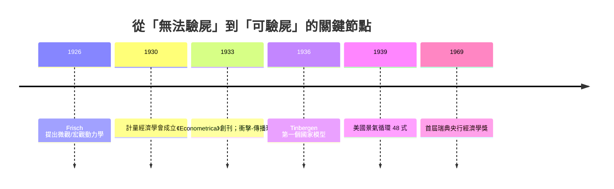

# 1969 · 第一案：誰把經濟學變成「可以驗屍」的科學？

> **1969 諾貝爾經濟學獎（瑞典央行紀念獎）：朗納·弗里施 Ragnar Anton Kittil Frisch（挪威，1895–1973）與簡·丁伯根 Jan Tinbergen（荷蘭，1903–1994）— 表彰他們「發展並應用動態模型以分析經濟過程」（for having developed and applied dynamic models for the analysis of economic processes）。**

---

## 懸案（案情提要）

1929 年的華爾街崩盤把整個經濟學界推進案發現場：數百萬人失業、產出腰斬，可是當時的經濟學幾乎只能**事後敘事**——報紙有無數解釋，卻沒有一個能用數據反覆檢驗、能事先算出「若政府支出增加十億元，國民所得會變多少」的工具。

疑點有三：

1. 經濟現象千絲萬縷，如何從**混亂的統計序列**中分離出因果（政策效果、外部衝擊、隨機擾動）？
2. 古典理論只有**靜態均衡**，可是景氣循環分明是**動態過程**——波動如何被「引發」（impulse）又被「傳播」（propagation）？
3. 理論與數據之間隔著一條鴻溝：誰來架橋？

本案的兩位偵探，用同一套「偵查術」分別在奧斯陸與海牙建立了橋樑——這門偵查術後來被稱為**計量經濟學（econometrics）**。

---

## 前因

| 年份 | 事件 |
|---|---|
| 1668 | 瑞典央行成立（世界上最早的中央銀行）——273 年後它將捐設本獎 |
| 1810s | 對象：配第與魁奈的「政治算術」傳統，首度以數字記錄國富 |
| 1886 | Walras 一般均衡：理論完整，卻無從驗證 |
| 1913 | Wesley Mitchell《景氣循環》：海量數據、理論稀薄——「無理論的計量」這一極端 |
| 1926 | Frisch 發表純理論論文，證明 Walras 體系的解存在，並首度使用「micro-dynamics／macro-dynamics」術語 |
| 1930 | Cleveland 會議：經濟學家、統計學家、數學家三方結盟，成立**計量經濟學會（Econometric Society）**，Frisch 是推手之一 |
| 1933 | Frisch 創辦會刊《Econometrica》並任首任主編；同年發表〈傳播問題與衝擊問題〉（Propagation Problems and Impulse Problems） |
| 1936 | Tinbergen 建成世界第一個國家級宏觀計量模型（荷蘭經濟，24 條方程式） |
| 1939 | Tinbergen 受國際聯盟委託出版《1919–1932 年美國景氣循環》，用 48 條方程式「重演」美國經濟 |
| 1940s | Koopmans 對 Tinbergen 方法論展開批判性檢驗（1947），迫使計量經濟學嚴格化——伏筆直通 1989 年 Haavelmo |

---

## 調查

### 第一條線索：Frisch 的「衝擊—傳播」解剖

Frisch 的問題意識來自一個疑點：如果經濟體系是穩定的擺錘，波動理應逐漸衰減；如果是不穩定的，波動理應爆炸。但現實的循環**既不衰減也不爆炸**，年復一年持續震盪。

他的裁決是把問題一刀兩斷：

- **衝擊（impulse）**：外生的隨機擾動，如技術創新、豐歉、貨幣意外；
- **傳播（propagation）**：經濟體系自身的結構，把一次性衝擊攤成持續多年的波動。

他以單擺做比喻後給出最簡模型——一個帶隨機衝擊的線性差分方程：

$$
y_t = a y_{t-1} + b y_{t-2} + u_t
$$

其中 $u_t$ 是白噪聲衝擊，$a$、$b$ 是傳播機制的結構參數。他證明：即使 $u_t$ 毫無規律，只要傳播機制具有適當的結構（例如資本財的建造期長，導致滯後的 $b$ 項），$y_t$ 就會呈現近似正弦的、持續的循環。**波動的規律性來自傳播，而非衝擊**——這一診斷直通 2004 年的實際經濟週期模型。

### 第二條線索：Tinbergen 的「方程式偵查法」

Tinbergen 把一國經濟寫成**聯立差分方程組**。以簡化的國民所得決定為例：

$$
C_t = c_0 + c_1 Y_{t-1}, \qquad I_t = i_0 + i_1 Y_{t-1} + i_2 r_t
$$

$$
Y_t = C_t + I_t + G_t
$$

代入消去 $C_t$、$I_t$，得到一階動態系統：

$$
Y_t = (c_1 + i_1) Y_{t-1} + i_2 r_t + c_0 + i_0 + G_t
$$

他再以**統計資料估計參數** $c_1$、$i_1$、$i_2$——這就是「計量」二字的含義：給理論參數實測數值。1939 年的美國模型用了 48 條方程式，把 1919–1932 年的景氣循環逐年「重演」出來，堪稱經濟史上第一次對整體經濟的**偵查報告重建**。

### 第三條線索：乘數的數值化

凱恩斯乘數在理論書上是 $k = \dfrac{1}{1 - c_1}$，但政府要的是一個**數字**。Tinbergen 用荷蘭與美國數據估出的邊際消費傾向 $c_1$，使乘數從概念變成可執行的政策計算——例如估得 $c_1 = 0.6$，則

$$
k = \frac{1}{1 - 0.6} = 2.5
$$

政府支出每增 10 億，國民所得預期增加 25 億。政策第一次擁有了「預算表」。

### 偵查中的破綻（自我挑錯）

Tinbergen 方法問世即遭同行檢舉：Koopmans（1947）指出**聯立性偏差**——方程式右邊的變數可能與誤差項相關，普通最小平方法估出來的參數是有偏的。這一「內部瑕疵」沒有推翻案件，反而催生了識別理論、兩階段最小平方法等更精密的鑑識技術，最終由 Haavelmo（1989 年得主）奠定概率基礎。

---

## 理論裁決

**裁決一：經濟學的對象可以劃分為微觀動力學與宏觀動力學。** Frisch 造詞「macroeconomics／microeconomics」，把個體加總與總體波動分屬兩個研究層級。

**裁決二：循環 = 衝擊 $\times$ 傳播。** 二階線性差分方程的特徵根決定傳播形態：

$$
\lambda^2 - a \lambda - b = 0, \qquad y_t \sim \lambda^t
$$

當共軛複根 $\lambda = r e^{\pm i \theta}$ 且 $r < 1$ 時，系統是衰減的振盪；持續的 $u_t$ 衝擊則把振盪「再點火」。穩定與波動的辯證第一次有了嚴格刻畫。

**裁決三：經濟結構可由聯立方程組表述並用數據估計。** 一般形式：

$$
\mathbf{B} \mathbf{y}_t + \mathbf{\Gamma} \mathbf{x}_t = \mathbf{u}_t
$$

其中 $\mathbf{y}_t$ 為內生變數向量、$\mathbf{x}_t$ 為外生變數（含政策工具）向量。估計出 $\mathbf{B}$、$\mathbf{\Gamma}$，即可做政策模擬：

$$
\Delta \mathbf{y}_t = -\mathbf{B}^{-1} \mathbf{\Gamma} \, \Delta \mathbf{x}_t
$$

這是**現代政策模擬的母公式**——1980 年 Klein 的大型世界模型、央行的預測系統，全是這一式的高維版本。

---

## 後果

| 領域 | 影響 |
|---|---|
| 政策應用 | 各國政府與國際組織（OECD、IMF）普遍建立宏觀計量模型做政策模擬與預測；中央銀行的經濟預測部門成為標配 |
| 經濟學發展 | 計量經濟學成為經濟學教育的核心科目；識別、估計、檢定的全套鑑識學由 Koopmans、Haavelmo 等後續法官完善 |
| 後續諾獎 | 1975 Koopmans（活動分析與配置）、1980 Klein（宏觀計量模型）、1989 Haavelmo（概率基礎）、2003 Engle–Granger（時間序列）、2011 Sargent–Sims（宏觀實證方法）——全都在延續或修正本案的方法論 |
| 學科文化 | 「理論—數據—模型」三位一體成為經濟學的科學認證標章；首獎頒給方法論，等於宣布：經濟學以「可以驗屍」為立國之本 |
| 挪威／荷蘭傳統 | Frisch 培育出 Haavelmo 等奧斯陸學派；Tinbergen 轉向發展規劃與最優稅制（其弟子 Mirrlees 於 1996 年得獎） |

---

## 關聯

- [1970-Samuelson數學化革命](1970-Samuelson數學化革命.md)：Frisch 的微觀／宏觀動力學二分，由 Samuelson 對應原理接手數學化。
- [1971-Kuznets國民帳戶與增長長卷](1971-Kuznets國民帳戶與增長長卷.md)：計量模型需要輸入數據，國民帳戶就是數據的供應商。
- [1975-Kantorovich與Koopmans資源配置](1975-Kantorovich與Koopmans資源配置.md)：Koopmans 既是計量鑑識的檢察官，又是配置理論的建築師。
- [1980-Klein宏觀計量模型](1980-Klein宏觀計量模型.md)：Tinbergen 48 式的直系孫輩——世界模型 LINK。
- [1989-Haavelmo概率論基礎](../經濟學獎/1989-Haavelmo概率論基礎.md)：計量經濟學的概率化公審（相鄰獎項年，本書續寫中）。
- [2004-Kydland與Prescott實際經濟週期](../經濟學獎/2004-Kydland與Prescott實際經濟週期.md)：衝擊—傳播二分的現代重審：衝擊（技術）也能當主角。
