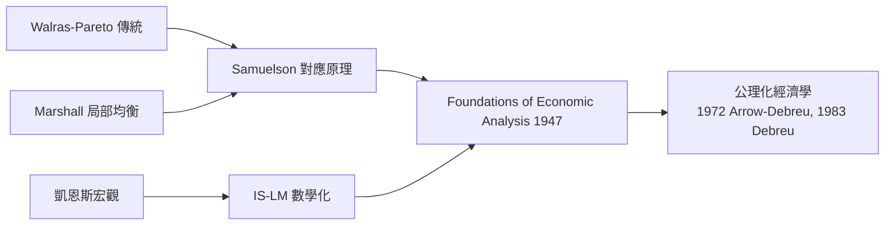

# 1970 · 懸案：經濟學能否變成「社會物理學」？

> **1970 諾貝爾經濟學獎（瑞典央行紀念獎）：保羅·薩繆爾森 Paul Anthony Samuelson（美國，1915–2009）— 表彰他「以科學工作發展了靜態與動態經濟理論，並積極提升了經濟科學的分析水準」（for the scientific work through which he has developed static and dynamic economic theory and actively contributed to raising the level of analysis in economic science）。**

---

## 懸案（案情提要）

1930 年代的經濟學是一片「方言林」：馬歇爾的局部均衡、凱恩斯的就業理論、張伯倫的壟斷競爭、赫克歇爾–俄林的貿易理論——每套理論各說各話，圖形推演、文字辯論，**沒有統一的語法**。更麻煩的是：

1. 同一問題常有多種「圖解」，哪一種有數學根據？
2. 比較靜態分析（「參數變了，均衡怎麼變」）長期靠直覺畫圖，**何時能保證結論成立**？
3. 靜態均衡與動態穩定是兩張皮：一個均衡「有趣」是否取決於它「穩定」，而穩定又是動態問題——兩者如何掛鉤？

薩繆爾森 1947 年的《經濟分析基礎》（Foundations of Economic Analysis）是本案的起訴書：他要把經濟學**公理化、統一化**，讓「經濟學家」與「科學家」在同一語言下說話。

---

## 前因

| 年份 | 事件 |
|---|---|
| 1838 | Cournot 雙占模型：經濟學的數學第一次出擊 |
| 1890 | Marshall《經濟學原理》：局部均衡與彈性分析 |
| 1892 | Fisher 的數學博士論文《價值與價格理論的數學考察》 |
| 1914–1918 | Walras 傳統經 Pareto 精煉，但仍是「描述性」數學 |
| 1927 | Frisch 提出比較靜態的初步數學框架 |
| 1930s | Hicks 的《價值與資本》（1939）開始數學化一般均衡（1972 年與 Arrow 同獲） |
| 1936 | 凱恩斯《通論》：宏觀理論大爆發，急需微觀基礎的數學梳理 |
| 1938 | Hicks 提出 IS–LM 圖解（兩年後由 Samuelson 推廣命名） |
| 1941 | Samuelson 博士論文出版為《經濟分析基礎》（哈佛大學，1941 年通過、1947 年出版） |
| 1948 | 教科書《Economics》首版，全球暢銷至今——經濟學的「語法教科書」 |

---

## 調查

### 線索一：比較靜態的「偵查法則」

薩繆爾森的偵查口訣只有一句：**比較靜態結論必須由極大化條件（或穩定條件）推出**。設經濟主體在參數 $\alpha$ 下極大化目標函數 $f(x_1, \dots, x_n; \alpha)$。一階條件為：

$$
\frac{\partial f}{\partial x_i} = 0, \qquad i = 1, \dots, n
$$

對參數 $\alpha$ 全微分並以海塞矩陣 $H = \left[ \dfrac{\partial^2 f}{\partial x_i \partial x_j} \right]$ 求解：

$$
\frac{d \mathbf{x}}{d \alpha} = -H^{-1} \mathbf{f}_{\alpha}
$$

結論的「方向」（$d x_i / d \alpha$ 的正負）取決於海塞矩陣的性質——而海塞矩陣在極大點必為**負定**，即

$$
\mathbf{z}^{T} H \mathbf{z} < 0 \quad \text{對所有非零 } \mathbf{z}
$$

於是大量比較靜態「剪影」被一次寫成定理：需求法則、要素替代、廠商對工資的反應……全部成為負定性（凹性）的推論。

### 線索二：顯示偏好——從觀測行為反推偏好

傳統需求理論假設偏好存在，再推導行為。薩繆爾森反其道而行：**只看消費者的實際選擇，不問其內心**。定義：若消費者在價格 $\mathbf{p}^0$ 下選了商品束 $\mathbf{x}^0$ 而不選 $\mathbf{x}^1$，且

$$
\mathbf{p}^{0T} \mathbf{x}^{0} \geq \mathbf{p}^{0T} \mathbf{x}^{1}
$$

則稱 $\mathbf{x}^0$ **顯示偏好**於 $\mathbf{x}^1$。基本公理（弱公理）：價格變動後消費者不得反轉選擇；在預算約束下這等價於

$$
\mathbf{p}^{0T} \mathbf{x}^{0} \geq \mathbf{p}^{0T} \mathbf{x}^{1} \;\; \Rightarrow \;\; \mathbf{p}^{1T} \mathbf{x}^{1} \geq \mathbf{p}^{1T} \mathbf{x}^{0}
$$

不成立即「行為矛盾」。由此可**不假設效用函數**而直接證明需求法則、無異曲線的凸性——偏好從「假設」降格為「可檢驗的觀測」，這是偵查術上的一記漂亮逆推。

### 線索三：對應原理——靜態與動態聯姻

懸案的第三點由**對應原理（correspondence principle）**解決：靜態均衡的比較靜態性質，與該均衡的動態穩定性**互為條件**。考慮簡單動態調整：

$$
\frac{d x}{d t} = \alpha \left[ x^{*}(\alpha) - x \right]
$$

其中 $x^{*}(\alpha)$ 是均衡。局部穩定要求

$$
\alpha \left[ x^{*}(\alpha_1) - x^{*}(\alpha_0) \right] < 0 \quad \text{（偏離後回歸）}
$$

而在 Walras 需求體系 $\mathbf{z}(\mathbf{p}; \alpha) = 0$ 的情形下，穩定性（動態）與比較靜態（靜態）用的是**同一組矩陣的符號條件**。薩繆爾森的宣判：研究靜態比較時**先假定**動態穩定，反過來靜態條件又幫助篩選「合理的」動態模型——兩法合璧，缺一不可。

### 線索四：動態經濟學的多樣成果

- **IS–LM 的推廣與命名**（1939）讓凱恩斯體系有了可教、可算的座標系；
- **乘數—加速數模型**：投資的加速數原理與消費乘數疊加，$Y_t = c Y_{t-1} + v (Y_{t-1} - Y_{t-2}) + G$，產生衰減、爆炸或持續波動三種結局，直接連回 1969 年 Frisch 的衝擊—傳播框架；
- **公共支出純理論**（1954）：公共財最優條件為

$$
\sum_{i=1}^{n} \mathrm{MRS}_{GX}^{(i)} = \mathrm{MRT}_{GX}
$$

即「邊際替代率之和等於邊際轉換率」——公共財理論的第一塊基石。

---

## 理論裁決

**裁決一：經濟理論的公理化。** 《基礎》的體系是：**均衡條件（一階）＋ 最適條件（二階）＋ 穩定條件（動態）**三位一體。任何經濟命題要成立，必須指明它來自這三層中的哪一層。這一「起訴—舉證—裁決」的格式，成為此後半世紀經濟學論文的標準體例。

**裁決二：顯示偏好理論。** 偏好不是前提而是推論；消費理論第一次獲得可否證的形式。後續由 Afriat、Varian 發展成「可檢驗效用」的全套鑑識。

**裁決三：對應原理。** 靜態與動態不是兩張皮：

$$
\text{比較靜態結論} \;\; \Longleftrightarrow \;\; \text{動態穩定條件}
$$

**裁決四：領土擴張。** 國際貿易（Stolper–Samuelson 定理：關稅提高稀缺要素報酬）、金融（跨期選擇）、福利（公共財）、宏觀（乘數—加速數）——每一片疆土都被同一套數學語法重新丈量。此後 1972 年 Arrow、1983 年 Debreu 的公理化一般均衡，以及 1990 年金融經濟學、1998 年 Sen 的福利分析，全都在這套語法上施工。

---

## 後果

| 領域 | 影響 |
|---|---|
| 教育與文化 | 《Economics》教科書 19 版、銷量數百萬冊，把凱恩斯—新古典綜合灌輸給全球世代；經濟學的「考試大綱」由此定形 |
| 理論發展 | 公理化浪潮直通 1972 Arrow–Hicks、1983 Debreu；顯示偏好成為微觀理論標配；Stolper–Samuelson 定理仍是貿易政治經濟學的核心工具 |
| 金融經濟學 | 跨期與不確定性框架下孕育了 1990 Markowitz–Miller–Sharpe 與 1997 Merton–Scholes 的期權定價 |
| 公共財 | 1954 年公共支出純理論引導出 1998 Sen（福利）與公共部門經濟學（2008 Krugman 之前的新古典公共財譜系） |
| 後續諾獎 | 學術世系龐大：弟子與徒孫中不乏 1972、1983、1985、1990、2001、2008 等年得主，Samuelson 被稱為「經濟學的亞當」 |
| 爭議 | 「數學化是否過頭」的批評延續至今；Hayek（1974）直言經濟學家不應擁有科學家式的權威——本案正是那種權威的濫觴 |

---

## 關聯

- [1969-Frisch與Tinbergen計量經濟破案術](1969-Frisch與Tinbergen計量經濟破案術.md)：對應原理把 Frisch 的動態學接進靜態理論的法庭。
- [1972-Arrow與Hicks一般均衡與福利](1972-Arrow與Hicks一般均衡與福利.md)：公理化工程的下一段主梁——一般均衡的存在性與福利定理。
- [1976-Friedman貨幣主義與永久收入](1976-Friedman貨幣主義與永久收入.md)：顯示偏好與消費理論的另一分支，對「凱恩斯消費函數」的反訴。
- [1983-Debreu一般均衡公理化](../經濟學獎/1983-Debreu一般均衡公理化.md)：《基礎》之後的公理化極致（本書續寫中）。
- [1990-Markowitz-Miller-Sharpe金融經濟學](../經濟學獎/1990-Markowitz-Miller-Sharpe金融經濟學.md)：跨期選擇與風險定價——薩繆爾森式數學化的另一戰場（本書續寫中）。
- [1973-Leontief投入產出矩陣](1973-Leontief投入產出矩陣.md)：同為哈佛同事，一個做總量動態、一個做部門間結構，合起來就是宏觀的雙眼。
