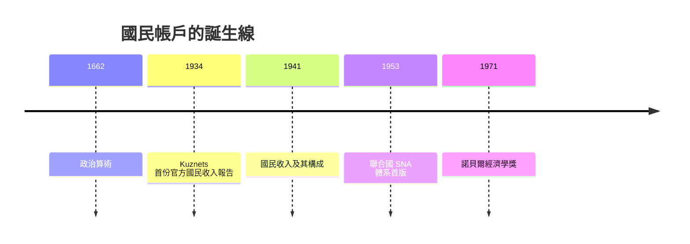

# 1971 · 懸案：一個經濟體一百年來到底「增長」了多少？

> **1971 諾貝爾經濟學獎（瑞典央行紀念獎）：西蒙·庫茲涅茨 Simon Smith Kuznets（美國，俄羅斯帝國出生，1901–1985）— 表彰他「對經濟增長的實證解釋，由此引出對經濟與社會結構及發展過程的新而深刻的洞見」（for his empirically founded interpretation of economic growth which has led to new and deepened insight into the economic and social structure and process of development）。**

---

## 懸案（案情提要）

要偵辦「增長」這樁世紀懸案，警方第一步是**確認死者與現場**：一國的產出到底是多少？如何逐年比較？人均改善了嗎？可是在 1930 年代以前，**沒有任何一國擁有可信的國民所得統計**——政府不知道 GDP 的概念，企業的生產與家戶的收入混成一鍋粥，「總量」根本無法定義。

疑點有三：

1. **加總的合法性**：把鋼鐵、理髮、公債利息相加，什麼算「生產」、什麼算「移轉」？
2. **歷史比較**：19 世紀的美元與 20 世紀的美元如何換算？人口、價格、產業結構都在動，**什麼才是「真實」的增長**？
3. **規律辨識**：長期增長有没有可重複的「指紋」——比如收入分配隨發展先惡化後改善？

Kuznets 一人偵辦了前兩項，並為第三項留下「庫茲涅茨曲線」這份至今仍在爭訟的遺產。

---

## 前因

| 年份 | 事件 |
|---|---|
| 1662 | Petty 的「政治算術」：以賦稅數據估算國民收入的最早嘗試 |
| 1695 | Gregory King 對英格蘭的國民收支估算 |
| 1758 | 魁奈《經濟表》：部門間流通的最早圖式 |
| 1917 | Kuznets 全家從俄國移民美國；他將成為「美國經濟的總量法醫」 |
| 1920s | NBER（國家經濟研究局）成立，掀起收入統計運動 |
| 1929 | Mitchell 主持 NBER 的國民所得研究，Kuznets 為實際執筆者 |
| 1934 | Kuznets 向美國參議院提交《國民收入 1929–1932》：第一份官方國民帳戶 |
| 1941 | 《National Income and Its Composition, 1919–1938》出版：方法論定型 |
| 1944–1947 | 美國商務部據此建立常設國民帳戶；二戰後各國與聯合國普遍採用（1953 年 SNA 首版） |
| 1955 | Kuznets 就任美國經濟學會主席，演說〈經濟增長與收入不平等〉，提出庫茲涅茨曲線 |
| 1966 | 《Modern Economic Growth》總結其三十年增長偵查 |
| 1969/1970 | 首兩屆經濟學獎頒出；Kuznets 於 1971 年成為第三位得主 |

---

## 調查

### 線索一：定義「生產」的邊界

Kuznets 首要工作是排除「虛報」：下列三類**不得**計入國民所得——

1. **中間產品**的重複計算：麵粉的價值已含在麵包裡，只能算**增加值**（value added）；
2. **證券買賣、賭博、救濟**等純粹所有權移轉：沒有新的產出；
3. **二手交易**：商品的「使用」已在其新售時記帳。

留下的是市場化、可驗證的增加值。他承認這一取捨有偏見：家務勞動、自給農業被排除，於是「婦女進入勞動市場」本身會推高帳面所得——他明言統計是**意義受限的測量**，這一誠實的自我批判在今日 GDP 批評中仍被引述。

### 線索二：增加值恆等式（國民帳戶的解剖圖）

增加值法：部門 $j$ 的增加值為

$$
VA_j = X_j - \sum_{i} x_{ij}
$$

其中 $X_j$ 是部門總產出，$x_{ij}$ 是從部門 $i$ 購入的中間投入。全經濟的總所得等於總增加值等於總最終產品——三種記帳角度（**生產法、收入法、支出法**）必須相等：

$$
Y \;=\; \sum_{j} VA_j \;=\; \text{勞動報酬} + \text{資本報酬} + \text{間接稅淨額} \;=\; C + I + G + NX
$$

恆等式兩側相減可推出著名的儲蓄—投資關係：

$$
Y - C - G = I + NX \;\;\Longrightarrow\;\; S = I + (G - T) + NX \quad (\text{開放經濟})
$$

這組恆等式是 Kuznets 留給宏觀經濟學的**解剖學**：1976 年 Friedman 的消費分析、1985 年 Modigliani 的生命週期、1999 年 Mundell 的開放經濟、2022 年的銀行擠兌模型，全都在這具骨架上行走。

### 線索三：真實增長的「除鏽」

名義所得必須先除價格、再除人口。Kuznets 建立了價格指數與人均化的雙重校正：

$$
g_{\text{真實}} = \frac{Y_t / P_t}{Y_0 / P_0} - 1, \qquad y_t = \frac{Y_t}{P_t \cdot N_t}
$$

其中 $P_t$ 為價格指數、$N_t$ 為人口。再以**複利年率**表述長期趨勢：

$$
y_t = y_0 \, (1 + g)^{t} \;\;\Longrightarrow\;\; g = \left( \frac{y_t}{y_0} \right)^{1/t} - 1
$$

他估算美國 1869–1938 年人均真實產出年增約 $1.5\%$–$2\%$——百年人均翻數倍的「現代經濟增長」就此定量化。這個速率後來成為 1987 年 Solow 增長理論「技術進步餘值」的實證靶心。

### 線索四：長波的指紋與庫茲涅茨循環

在剝除短期景氣與十年週期後，Kuznets 在美國建築業與移民資料中辨識出 **15–25 年的中長波**（後稱庫茲涅茨循環）：人口增長率、建設與移民的起伏互相加強，構成一代人尺度的波動。他也對 50–60 年的「長波」（Kondratiev 波）持保留態度，認為證據不足——這種「不讓數據背書過頭」的法醫自律，與今天對各種「長波預言」的警惕一脈相承。

### 線索五：不平等的倒 U 型假說

以截面比較各國，他提出：人均所得與不平等的關係先升後降，形如倒 U：

$$
\text{基尼係數} \;=\; f(y), \qquad f'(y) > 0 \;\; (y < y^{*}), \;\; f'(y) < 0 \;\; (y > y^{*})
$$

機制：農業部門（低所得、低不平等）向工業部門（高所得、高不平等）轉移人口，初期拉大差距；隨後勞動市場整合、社會政策介入而回落。此假說後經大量檢驗，**毀譽參半**——它成為發展經濟學最著名的待驗證偵查假設之一，也直接催生了 1979 年 Lewis 的二元經濟模型與 2015 年 Deaton 對增長—貧困的再審。

---

## 理論裁決

**裁決一：國民收入可以嚴格定義並以三面恆等記帳。**

$$
\text{生產法} \;=\; \text{收入法} \;=\; \text{支出法} \;\;\Longrightarrow\;\; Y = C + I + G + NX
$$

**裁決二：現代經濟增長有其典型事實。** Kuznets 的六項「增長特徵」：人均產出高增長、生產率提升、經濟結構快速轉型（農業比重下降）、社會與意識形態的轉變、國際間傳播、各國增長差異巨大。這份「指紋庫」直接成為 1987 年 Solow 模型與 2018 年 Romer 內生增長理論的檢驗標準。

**裁決三：統計是測量，不是真理。** GDP 度量市場活動而非福祉——這一自我聲明，是 2015 年 Deaton 得獎理由（「消費、貧困與福祉」）的先聲。

---

## 後果

| 領域 | 影響 |
|---|---|
| 政策應用 | 國民帳戶成為所有現代政府與央行的操作系統；聯合國 SNA 至今迭代（1953、1968、1993、2008）；財政、貨幣政策的目標變數全部以 $Y$ 為準 |
| 經濟學發展 | 增長經濟學從敘事變成計量學科；「典型事實」成為理論模型必須複現的靶子 |
| 後續諾獎 | 1984 Stone（SNA 的系統化）、1987 Solow（增長理論）、2015 Deaton（消費與福祉）、2018 Romer（內生增長）、2024 Acemoglu 等（制度與繁榮）——皆以 Kuznets 的數據骨架為前提 |
| 發展經濟學 | 倒 U 假說與結構轉型研究開啟了 1979 Lewis 與 Schultz 的發展經濟學主線 |
| 爭議 | GDP 排除家務與生態成本、無法度量分配——2024 年得主關注的「制度與不平等」正是對 GDP 範式缺口的回應 |

---

## 關聯

- [1969-Frisch與Tinbergen計量經濟破案術](1969-Frisch與Tinbergen計量經濟破案術.md)：計量模型吃掉的第一批「原料」就是 Kuznets 的國民帳戶。
- [1970-Samuelson數學化革命](1970-Samuelson數學化革命.md)：$Y = C + I + G + NX$ 進入理論模型的骨架。
- [1973-Leontief投入產出矩陣](1973-Leontief投入產出矩陣.md)：增加值法與中間投入矩陣是同一解剖學的細部分解。
- [1987-Solow增長理論](../經濟學獎/1987-Solow增長理論.md)：典型事實向增長理論的移交（本書續寫中）。
- [1979-Lewis與Schultz發展經濟學](1979-Lewis與Schultz發展經濟學.md)：結構轉型與二元經濟，直承 Kuznets 的部門移轉線索。
- [2018-Nordhaus與Romer長期增長](../經濟學獎/2018-Nordhaus與Romer長期增長.md)：增長的世紀長卷從國民帳戶一路鋪到氣候與創新（本書續寫中）。
