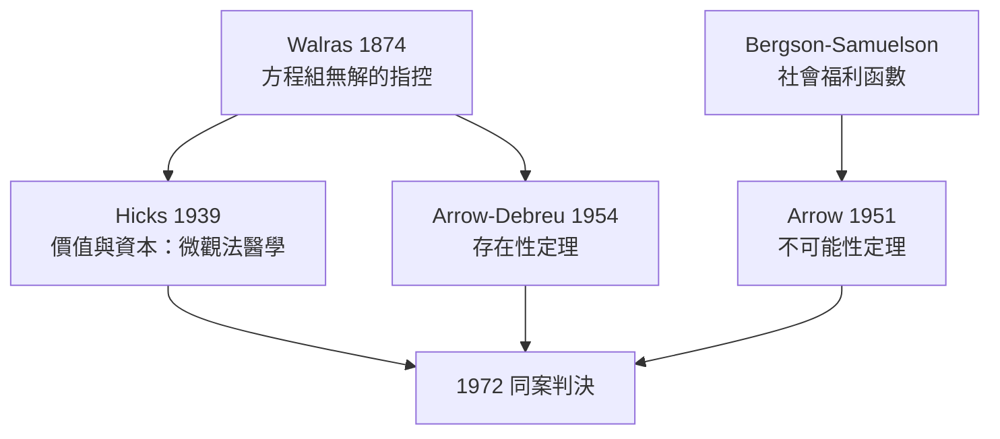

# 1972 · 懸案：市場這台機器，什麼時候是「好的」？

> **1972 諾貝爾經濟學獎（瑞典央行紀念獎）：約翰·希克斯 John Richard Hicks（英國，1904–1989）與肯尼斯·約瑟夫·阿羅 Kenneth Joseph Arrow（美國，1921–2017）— 表彰他們「對一般經濟均衡理論與福利理論的開創性貢獻」（for their pioneering contributions to general economic equilibrium theory and welfare theory）。**

---

## 懸案（案情提要）

本案有兩具「未結之屍」：

**屍體一：一般均衡只畫在黑板上。** Walras 1874 年寫下供需方程組，但誰也沒證明過：這組方程**一定有解**嗎？有解就一定是價格體系嗎？均衡會不會根本不存在——那整個新古典經濟學的地基就是空的。

**屍體二：福利判決沒有法官。** 「市場好」憑什麼？Pareto 標準遇到分配問題就啞火；Bergson–Samuelson 的社會福利函數需要把個人排序「加總」成社會排序——可是阿羅證明：**這種加總在邏輯上可能根本辦不到**（不可能性定理）。

兩位偵探一個在牛津、一個在紐約，分別對兩具屍體出具了驗屍報告：Hicks 用凸性與需求理論整理出一般均衡的**微觀法醫學**；Arrow（與 Debreu）證明均衡**存在**，並在福利理論上同時交出**不可能性定理**與**兩大福利定理**。

---

## 前因

| 年份 | 事件 |
|---|---|
| 1874 | Walras《純粹經濟學要義》：供需聯立方程組，存在性懸而未決 |
| 1934 | Hicks 與 Allen 重建需求理論：以替代／收入效應拆解需求法則 |
| 1936 | Hicks 提出 IS–LL 圖式（後世 IS–LM）解讀凱恩斯 |
| 1939 | Hicks《價值與資本》：一般均衡＋不確定性下的跨期選擇 |
| 1932/1938 | Hotelling 需求理論；Samuelson《基礎》的比較靜態工程（1947） |
| 1942 | Hicks 整理「替代定理」，為投入產出提供微觀根基 |
| 1950 | Bergson–Samuelson 社會福利函數已問世；Arrow 在蘭德公司接下「集體選擇」案子 |
| 1951 | Arrow《社會選擇與個人價值》出版：不可能性定理宣判 |
| 1954 | Arrow 與 Debreu 聯名證明一般均衡存在性；1959 Debreu《價值理論》公理化（1983 年得主） |
| 1963 | Arrow《社會選擇與個人價值》第二版；同年與 Hahn 出版《一般競爭分析》 |

---

## 調查

### 線索一：Hicks 的替代／收入效應解剖

價格 $p$ 下降對需求量的總效應，Hicks（承 Slutzky）拆成兩股：

$$
\underbrace{\frac{\partial x}{\partial p}}_{\text{總效應}} = \underbrace{\left. \frac{\partial x}{\partial p} \right|_{U \text{ 不變}}}_{\text{替代效應} \;<\; 0} \;+\; \underbrace{\left( -x \frac{\partial x}{\partial m} \right)}_{\text{收入效應}}
$$

替代效應**恆為負**（凸偏好下），收入效應正負不定。於是：

- 需求法則對「正常財」必然成立；
- 對劣等財，若收入效應夠大且為正，可能出現違反需求法則的**吉芬財**——Hicks 給了理論上「罪犯的可能畫像」。

補償變動 $CV$、等效變動 $EV$ 等福利測度工具也出自這一解剖——成本效益分析的量尺由此而來。

### 線索二：Arrow–Debreu 存在性定理的偵查路線

把整個經濟寫成**超額需求映射** $\mathbf{z}(\mathbf{p})$（$n$ 種商品、$n$ 個價格），它具備三個「體徵」：

1. **零次齊次**：$\mathbf{z}(\lambda \mathbf{p}) = \mathbf{z}(\mathbf{p})$，可規格化 $\sum p_i = 1$；
2. **Walras 法則**：$\mathbf{p}^{T} \mathbf{z}(\mathbf{p}) = 0$，預算總是花完；
3. **連續與有界**：由凸偏好與凸生產集（生產技術）保證。

Arrow 與 Debreu 求助於拓撲學的**不動點定理**（Kakutani，推廣 Brouwer）：把標準單純形 $\Delta = \{ \mathbf{p} \geq 0 : \sum p_i = 1 \}$ 映到自身、非空、凸值、閉圖的映射必有不動點。取價格調整映射

$$
\phi(\mathbf{p}) = \frac{\mathbf{p} + \max\{0, \mathbf{z}(\mathbf{p})\}}{\mathbf{p}^{T} \mathbf{p} + \mathbf{1}^{T} \max\{0, \mathbf{z}(\mathbf{p})\}}
$$

其不動點 $\mathbf{p}^{*}$ 恰好滿足 $\mathbf{z}(\mathbf{p}^{*}) \leq 0$——配合 Walras 法則即 $\mathbf{z}(\mathbf{p}^{*}) = 0$（自由財可以零價出清）。**Walras 1874 年的懸案就此結案：均衡存在。**

### 線索三：福利經濟學的兩大定理

在凸偏好、凸生產、完全市場與**無外部性**下：

**第一福利定理**：競爭均衡配置是 Pareto 最優。思路：若某配置使所有人都不差且至少一人更好，則其總價值必超過國民所得，與 Walras 法則矛盾——

$$
\sum_i \mathbf{p}^{*T} \mathbf{x}_i \;>\; \mathbf{p}^{*T} \left( \sum_i \omega_i + \sum_j \mathbf{y}_j \right) \;\;\Rightarrow\;\; \text{矛盾}
$$

**第二福利定理**：任何 Pareto 最優配置都能經「總稟賦移轉」由競爭市場實現——市場管效率，移轉管分配，兩者可分。

### 線索四：Arrow 不可能性定理——福利法官的「彈劾」

設社會須把個人偏好序 $R_1, \dots, R_n$ 加總為社會序 $R$。Arrow 要求滿足：

1. **無限制域**（任何偏好組合皆可輸入）；
2. **Pareto 原則**（人人選 $a$ 勝 $b$，社會亦然）；
3. **無關備選獨立性**（社會對 $a, b$ 的排序只取決於個人在 $a, b$ 上的排序）；
4. **非獨裁**（無人一票定乾坤）。

**裁決：四者不相容。** 證明骨架（「決定性集」傳染法）：若集 $V$ 對 $(a, b)$ 決定，構造 $c$ 使 $V$ 內者偏好 $a > c > b$、$V$ 外者偏好 $c > a$ 與 $b > c$；由 Pareto 得 $a > b$，再分情形逼出 $V$ 對 $(a, c)$ 與 $(c, b)$ 亦決定——決定性沿選項鏈傳染，最後收縮到單人集，即**獨裁者**。

推論（Gibbard–Satterthwaite，1973）：任何非獨裁投票規則都可被策略性操縱。民主的「加總機器」存在不可修復的邏輯破洞。

---

## 理論裁決

**裁決一（Hicks）**：一般均衡的微觀地基本是**凸性**（偏好與技術），需求理論、替代定理、福利測度全部由凸性接生。

**裁決二（Arrow–Debreu）**：在凸、連續、完全市場下，競爭均衡**存在**，且是 Pareto 最優——「看不見的手」第一次獲得有日期、有署名的數學證明。

**裁決三（Arrow）**：福利的「加總」在一般條件下**不可能**；任何集體決策都必然在某處違約（獨裁、操縱或違反 Pareto）。福利經濟學從此轉為「條件式」科學：指定假設，指出違約點。

**綜合判決**：市場的優越性是**有條件的定理**而非信條；條件（凸性、無外部性、完全信息、無市場缺失）每一條都是後續研究的作案現場——1983 Debreu 的公理化、1991 Coase 的交易成本、2001 信息不對稱三人組，全是對這些條件的逐一爆破。

---

## 後果

| 領域 | 影響 |
|---|---|
| 政策應用 | 成本效益分析（$CV/EV$ 測度）、競爭政策的「市場失靈」清單、公共經濟學的效率—分配二分 |
| 理論發展 | 一般均衡成為博士必修；IS–LM 成為宏觀教科書核心（Hicks）；機制設計（2007 Hurwicz–Maskin–Myerson）直接發端於不可能性定理的「違約點」 |
| 投入產出 | Hicks 的替代定理為 1973 Leontief 的線性模型提供正當性 |
| 後續諾獎 | 1983 Debreu、1994 Nash（非合作均衡）、1998 Sen（社會選擇的再審）、2007 機制設計三人組、2012 Roth–Shapley（匹配設計）——皆在本案延伸線上 |
| 爭議 | 不可能性定理被政界誤讀為「民主無用」；Arrow 強調它是**設計**的起點而非終點 |

---

## 關聯

- [1970-Samuelson數學化革命](1970-Samuelson數學化革命.md)：比較靜態與凸性技術是存在性證明的工程材料。
- [1973-Leontief投入產出矩陣](1973-Leontief投入產出矩陣.md)：替代定理（Hicks–Samuelson）正是線性投入產出的理論通行證。
- [1983-Debreu一般均衡公理化](../經濟學獎/1983-Debreu一般均衡公理化.md)：同一懸案的終極法醫報告（本書續寫中）。
- [1998-Sen福利與社會選擇](../經濟學獎/1998-Sen福利與社會選擇.md)：不可能性定理的擴充與人道主義重審（本書續寫中）。
- [2007-機制設計三人組](../經濟學獎/2007-機制設計三人組.md)：把「不可能」變成「設計」的下一章（本書續寫中）。
- [1969-Frisch與Tinbergen計量經濟破案術](1969-Frisch與Tinbergen計量經濟破案術.md)：均衡存在性使計量模型的「理論方程式」有了落腳處。
