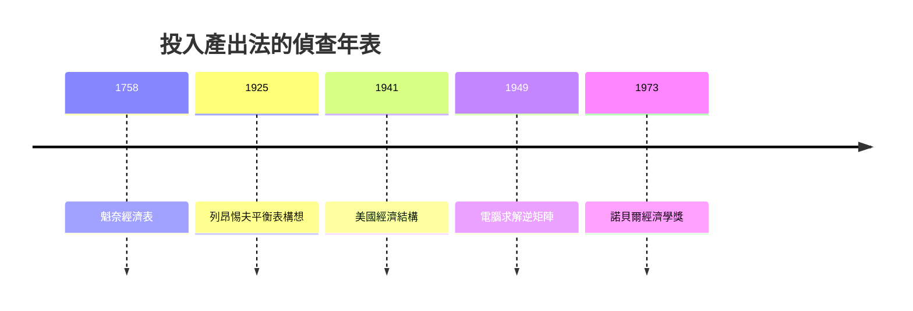

# 1973 · 懸案：一國經濟的「器官圖」上，誰供養著誰？

> **1973 諾貝爾經濟學獎（瑞典央行紀念獎）：華西里·列昂惕夫 Wassily Wassilyevich Leontief（俄羅斯帝國出生／美國籍，1905–1999）— 表彰他「發展了投入產出方法並將其應用於重要經濟問題」（for the development of the input-output method and for its application to important economic problems）。**

---

## 懸案（案情提要）

凱恩斯的 $Y = C + I + G + NX$ 把經濟壓縮成一個總量 $Y$。可是偵辦現實案件時，法官要問的是**具體問題**：鋼鐵減產會波及哪些行業？擴建公路需要多少煤、多少勞動？戰爭動員下鋁與銅如何取捨？

疑點三連：

1. 總量模型**看不見部門**：煤、鋼、電、勞動之間的供養網絡在加總中蒸發；
2. 部門之間互為投入（鋼要煤、煤要鋼），形成**循環依賴**，如何解開？
3. 這張網絡能不能用**實際統計數據**畫出來——而不是理論家閉門造車？

列昂惕夫的裁決：用**矩陣**還原經濟體的器官圖，讓「誰供養誰」成為一組可計算、可求解的線性方程。

---

## 前因

| 年份 | 事件 |
|---|---|
| 1758 | 魁奈《經濟表》：部門間流通的原始草圖 |
| 1925 | 列昂惕夫在列寧格勒／柏林求學，年僅 22 歲即發表國民經濟平衡表構想（承蘇聯 1923–24 年平衡表） |
| 1931 | 移居美國，任職 NBER 後轉哈佛，開始編製 41 部門美國表 |
| 1936 | 首篇投入產出論文發表；1941《美國經濟結構 1919–1929》 |
| 1941 | 美國勞工統計局依其方法編製大表 |
| 1942–1945 | 二戰與戰後動員：投入產出表成為規劃工具 |
| 1948 | 哈佛建立哈佛經濟研究計劃（HERP），投入產出黃金期 |
| 1949/1951 | 使用早期電腦（Mark I）求解大型逆矩陣——經濟學的第一批「大數據計算」 |
| 1953 | 檢驗美國進出口的要素含量（列昂惕夫悖論），直通 1977 貿易理論案 |
| 1966 | 《投入產出經濟學》結集；1970s 聯合國世界模型（未來環境與資源研究） |

---

## 調查

### 線索一：係數矩陣的「指紋採集」

設 $n$ 個部門。採集一張**投入產出表**：行是產出方，列是投入方。由表計算直接消耗係數：

$$
a_{ij} = \frac{x_{ij}}{X_j}
$$

即部門 $j$ 每生產 1 元產出要向部門 $i$ 購買多少元中間品。係數矩陣 $A = [a_{ij}]$ 就是整個經濟的** DNA 指紋**。

### 線索二：主方程式——循環依賴的解法

記總產出向量為 $\mathbf{x}$、最終需求（消費、投資、政府、出口）為 $\mathbf{d}$。每個部門的產出必須同時滿足**中間需求**（被其他部門買走）與**最終需求**：

$$
\mathbf{x} = A \mathbf{x} + \mathbf{d}
$$

看似循環的「鋼養煤、煤養鋼」，其實是線性方程組，移項即解：

$$
(I - A) \mathbf{x} = \mathbf{d} \;\;\Longrightarrow\;\; \mathbf{x} = (I - A)^{-1} \mathbf{d}
$$

$(I - A)^{-1}$ 稱為**列昂惕夫逆矩陣**（Leontief inverse），其 $(i, j)$ 元素 $b_{ij}$ 的經濟含義：部門 $j$ 的最終需求**每增加 1 元**，部門 $i$ 的總產出**需增加多少元**——把直接與全部間接波及一次算清。

### 線索三：逐輪追蹤——逆矩陣的「偵查日誌」

$(I - A)^{-1}$ 可展開為幾何級數（當 $A$ 的譜半徑 $< 1$，即經濟不「自我吞噬」時成立）：

$$
(I - A)^{-1} = I + A + A^2 + A^3 + \cdots
$$

讀法：第 0 輪直接產出 $I \mathbf{d}$；第 1 輪這些產出再消耗 $A \mathbf{d}$ 的中間品；第 2 輪再消耗 $A^2 \mathbf{d}$……**間接波及被一輪一輪記錄在案**，收斂總和就是完整傳染鏈。乘數效應、就業波及、能源彈性，全部由這一級數批量生產。

### 線索四：價格方程——成本傳染的另一面

從列（成本側）讀同一張表，可得價格體系：

$$
\mathbf{p}^{T} = \mathbf{p}^{T} A + \mathbf{v}^{T} \;\;\Longrightarrow\;\; \mathbf{p}^{T} = \mathbf{v}^{T} (I - A)^{-1}
$$

其中 $\mathbf{v}$ 為單位增加值（工資、利潤、稅）。工資或能源價格上漲會**逆著供應鏈**傳染至所有部門——這就是投入產出的通脹傳染模型，至今仍是投入產出表價格分析的核心。

### 線索五：列昂惕夫悖論（1953）

檢驗赫克歇爾–俄林理論（1977 年 Ohlin 得獎的模型）的預測：美國資本充裕，出口應**資本密集**。實測結果相反——美國出口的勞動密集度**高於**進口替代品。悖論開啟了人力資本、技術差異、要素密度逆轉的百年調查，成為貿易理論最重要的「未結舊案」，也是 1979 年 Schultz 人力資本理論的證據鏈之一。

---

## 理論裁決

**裁決一：部門結構可用線性方程組完整表述。** 核心恆等式與解：

$$
\mathbf{x} = A \mathbf{x} + \mathbf{d}, \qquad \mathbf{x} = (I - A)^{-1} \mathbf{d}
$$

**裁決二：逆矩陣存在與經濟意義的條件。** 當 $A$ 非負且譜半徑 $\rho(A) < 1$（Hawkins–Simon 條件保證所有部門增加值為正）時，$(I - A)^{-1}$ 存在、非負，級數展開成立——「經濟可以再生產自身」的數學條件。

**裁決三：理論對現實的忠誠承諾。** 列昂惕夫畢生主張：模型必須**被數據填滿**才能成為科學。這一立場使他不斷對純理論化的主流提出異議（1970 年代〈學術經濟學〉批判），也使投入產出表成為所有國家統計局的常設偵查裝備（今併入 SNA 供給使用表）。

---

## 後果

| 領域 | 影響 |
|---|---|
| 政策應用 | 戰時動員、能源危機（1970s 石油衝擊的部門波及）、環境會計（污染部門納入 $A$）、區域與多國模型；各國 SNA 的供給使用／IO 表為法定裝備 |
| 經濟學發展 | 全球價值鏈研究（增加值貿易）、CGE 可計算一般均衡模型的先祖；生態經濟學的物質流分析 |
| 後續諾獎 | 1977 Ohlin（貿易理論——悖論案主審）、1975 Koopmans（活動分析，同屬線性生產技術）、1984 Stone（國民帳戶與投入產出表的制度化）、1980 Klein（部門計量模型的對照組） |
| 爭議 | 係數不變假設（無替代）被批為僵化；Samuelson 稱投入產出為「案例簿上的驗屍報告」而非活體造影——列昂惕夫則回敬：不接觸數據的理論才是真正的標本 |

---

## 關聯

- [1971-Kuznets國民帳戶與增長長卷](1971-Kuznets國民帳戶與增長長卷.md)：增加值恆等式是投入產出表的總量收縮版。
- [1972-Arrow與Hicks一般均衡與福利](1972-Arrow與Hicks一般均衡與福利.md)：替代定理為線性技術假設提供微觀正當性。
- [1975-Kantorovich與Koopmans資源配置](1975-Kantorovich與Koopmans資源配置.md)：同一「線性生產」世界觀下的最優化分身。
- [1977-Ohlin與Meade國際貿易與資本流動](1977-Ohlin與Meade國際貿易與資本流動.md)：列昂惕夫悖論挑戰的正是 Heckscher–Ohlin 模型。
- [1984-Stone國民帳戶體系](../經濟學獎/1984-Stone國民帳戶體系.md)：投入產出表併入 SNA 的制度化（本書續寫中）。
- [2018-Nordhaus與Romer長期增長](../經濟學獎/2018-Nordhaus與Romer長期增長.md)：氣候—經濟模型的能源投入結構，直承列昂惕夫世界模型（本書續寫中）。
