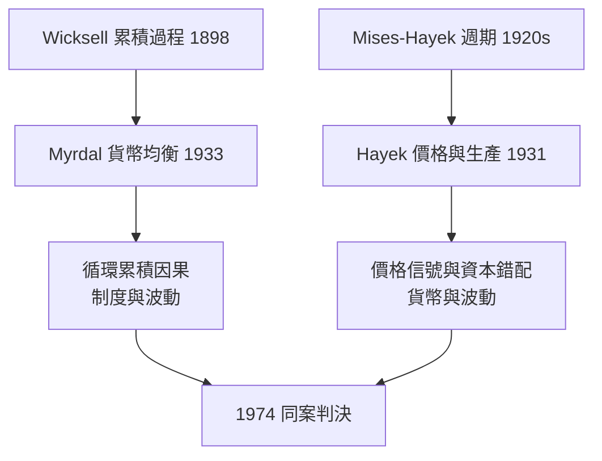

# 1974 · 懸案：波動是貨幣之罪，還是制度之病？

> **1974 諾貝爾經濟學獎（瑞典央行紀念獎）：貢納爾·默達爾 Gunnar Myrdal（瑞典，1898–1987）與弗里德里希·哈耶克 Friedrich August von Hayek（奧地利／英國，1899–1992）— 表彰他們「在貨幣理論與經濟波動理論上的開創性工作，以及對經濟、社會與制度現象相互依存關係的透徹分析」（for their pioneering work in the theory of money and economic fluctuations and for their penetrating analysis of the interdependence of economic, social and institutional phenomena）。**

---

## 懸案（案情提要）

1974 年的案情最為弔詭：兩名嫌犯——不，兩名偵探——**彼此視為死敵**，卻被同一張傳票押上法庭。評獎委員會的操作像一次「意識形態平衡」：把瑞典社會民主陣營的 Myrdal 與自由市場旗手 Hayek 綁在同一判決裡。

兩人偵辦的其實是**同一樁案子**的兩面：**為什麼市場經濟會周期性崩壞？**

- Hayek 的指控：貨幣擾亂了**價格信號**，人為的低利率誤導投資，產生「錯誤的資本結構」，最終以危機清場；
- Myrdal 的指控：市場受**權力與制度**扭曲，歧視、貧困、地理阻隔互相**循環累積**——衰退只是長期結構病的一次發作。

疑點：波動是貨幣現象還是結構現象？修正市場靠「守夜人」還是「工程師」？

---

## 前因

| 年份 | 事件 |
|---|---|
| 1898–1899 | 兩位主角出生，相差僅一歲：Myrdal 生於瑞典，Hayek 生於維也納 |
| 1920s | Mises–Hayek 的商業週期理論（維也納學派）；Wicksell 的累積過程理論（瑞典學派教父） |
| 1931 | Hayek《價格與生產》：奧地利派週期理論的系統表述 |
| 1931 | Myrdal 主持瑞典社會民主黨的《時代之社會政策》；瑞典學派「混合經濟」藍圖成形 |
| 1933 | Hayek 的 LSE–Keynes 之爭開打；Myrdal《貨幣均衡》修訂 Wicksell 體系 |
| 1936 | 凱恩斯《通論》出版，兩人各自對其表態：Hayek 抵制，Myrdal 部分接納 |
| 1944 | Hayek《通往奴役之路》；Myrdal《美國的困境》（種族歧視的循環累積分析） |
| 1957 | Myrdal《國際經濟學》：循環累積因果與「回波效應」 |
| 1960s–1970s | 滯脹降臨：兩人的舊案（貨幣擾動／制度剛性）同時被重新開庭 |
| 1974 | 兩人共享第 4 屆經濟學獎——史上意識形態對比最強烈的得獎組合 |

---

## 調查

### 線索一：Hayek 的「價格信號被劫持」

Hayek 的偵查起點是 Wicksell 的兩個利率：

- **自然利率**：資本市場由儲蓄與投資平衡決定的利率；
- **市場利率**：銀行體系實際收取的利率。

當銀行以**人為低於自然利率**的水準放貸（信用膨脹），投資需求被虛假放大：

$$
i_{\text{市場}} < r_{\text{自然}} \;\;\Longrightarrow\;\; I > S \;\;\Longrightarrow\;\; \text{信貸擴張支撐的過度投資}
$$

關鍵的**資本理論環節**：投資不是一團數字，而是有**時間結構**的資本品序列。低利率使企業採納更「迂迴」（資本更密集、工期更長）的生產方法——用奧地利派的生產期表述，資本價值 $K$ 對利率 $r$ 的敏感度為

$$
\frac{\partial K}{\partial r} < 0
$$

利率一旦回升（信貸不能永遠擴張），長期項目集體破產，危機就是**錯誤資本結構的清算**。因此 Hayek 的裁決：**衰退是療程，不是病症**；藥方是穩定的貨幣規則，而非踩油門。

### 線索二：Hayek 的知識分工與自發秩序

1945 年〈知識在社會中的運用〉把波動問題上升到信息論：經濟體的知識是**分散、隱默、情境性**的，由無數個體持有。價格是壓縮傳遞這些知識的信號系統：

$$
\text{價格} \;=\; \text{知識的統計摘要}
$$

中央計劃者無法彙總這些知識（信息計算問題），因此任何「科學的」宏觀工程都註定失靈。這一「計算與知識」論證，是 1930–40 年代社會主義計算論戰的核心，也是後世信息經濟學的先聲。

### 線索三：Myrdal 的「循環累積因果」

Myrdal 的反訴：市場結果不是均衡的「最優解」，而是**自我強化的漩渦**。以 1944 年《美國的困境》中的歧視案為例：

$$
\text{歧視} \;\rightarrow\; \text{低投資、低教育} \;\rightarrow\; \text{低生產力} \;\rightarrow\; \text{驗證並加深歧視} \;\rightarrow\; \cdots
$$

形式化地說，動力系統具有**正反饋**：$\dot{x}_t = \alpha x_{t-1}$，$\alpha > 1$，任何初始差異都被指數放大。政策含義截然相反於 Hayek：**若放任，差距不會自動收斂**；必須由國家在漩渦形成前切斷正反饋（瑞典的普惠社會政策、美國的反歧視干預）。1957 年的「回波效應／擴散效應」把這一框架推向國際：先進地區吸乾落後地區的人才與資本，區域與國際差距螺旋擴大。

### 線索四：貨幣均衡——Myrdal 修訂 Wicksell

《貨幣均衡》（1933）把 Wicksell 的靜態比較改造成**預期與不確定性**下的分析：貨幣利率是否「均衡」不能只看某一時點，而要看**儲蓄與投資計畫在預期下能否持續一致**。他引入事前（ex ante）／事後（ex post）區分：

$$
S_{\text{ex ante}} - I_{\text{ex ante}} \neq 0 \;\;\Longrightarrow\;\; \text{累積過程啟動}
$$

這一概念工具直接影響了瑞典宏觀模型的會計框架，也是後世事前事後核算（如 1984 Stone 的 SNA）的思想源頭之一。

### 兩份報告的交叉質證

| 爭點 | Hayek | Myrdal |
|---|---|---|
| 波動根源 | 貨幣擾動扭曲價格信號 | 結構性權力失衡、累積漩渦 |
| 均衡觀 | 分散知識下的自發秩序 | 累積因果，無自動收斂 |
| 政策藥方 | 貨幣規則、去干預 | 主動社會工程、再分配 |
| 對凱恩斯 | 敵視 | 部分接納並先行（瑞典預算政策的「Myrdal 反週期」早於《通論》） |

---

## 理論裁決

**裁決一（Hayek）**：經濟波動可由**貨幣擾動 + 資本時間結構**共同生成；價格是分散知識的載體，系統性干預會摧毁信號。其 1974 晚宴致辭更警告：經濟學家不應擁有如物理學家的權威——「經濟學家影響的是政治家與公眾」，錯誤的權威比錯誤的定理更危險。

**裁決二（Myrdal）**：社會現象互相嵌套，因果是**循環累積**的；不存在「純經濟」的問題，制度、種族、性別與經濟變數互為函數。價值判斷不可能被逐出經濟學（他明言《美國的困境》中的「價值前提」法）。

**綜合判決**：委員會把兩份針鋒相對的報告釘在同一卷宗，等於宣告：**波動的病理學至今未有終審**。此後 1976 Friedman（貨幣擾動）續審 Hayek 線；2009 Ostrom–Williamson（制度治理）續審 Myrdal 線——兩條線至今仍在開庭。

---

## 後果

| 領域 | 影響 |
|---|---|
| 政策應用 | Hayek 線：1979 後的貨幣規則、1980s 撒切爾—里根革命、中央銀行獨立性；Myrdal 線：北歐福利國家、美國民權政策（布朗案引述《美國的困境》）、區域發展政策 |
| 經濟學發展 | 奧地利派知識論 $\rightarrow$ 信息經濟學（2001 Akerlof 等）；累積因果 $\rightarrow$ 新經濟地理（2008 Krugman 的核心—邊緣模型）、制度經濟學（2024 Acemoglu 等） |
| 後續諾獎 | 1976 Friedman（貨幣主義）、1995 Lucas（理性預期）、2008 Krugman（空間集聚的正反饋）、2009 Ostrom（制度）、2024 制度與繁榮 |
| 爭議 | Myrdal 事後公開批評委員會把獎頒給「反動分子」（指 Hayek 與其後的 Friedman），並主張廢除經濟學獎；Hayek 亦稱若事先徵詢，他會反對設獎——**得主本人拆得主本人的台**，史上僅見 |
| 意識形態史學 | 1974 被視為評獎「平衡術」的教科書案例；委員會成員與朝聖山學社的關聯也自此被反覆審視 |

---

## 關聯

- [1970-Samuelson數學化革命](1970-Samuelson數學化革命.md)：凱恩斯—新古典綜合正是 Myrdal 陣營與 Hayek 陣營共同的對手。
- [1976-Friedman貨幣主義與永久收入](1976-Friedman貨幣主義與永久收入.md)：Hayek 的貨幣擾動指控由 Friedman 以實證續審。
- [1977-Ohlin與Meade國際貿易與資本流動](1977-Ohlin與Meade國際貿易與資本流動.md)：Myrdal 的「回波效應」在國際經濟學的鄰案。
- [2009-Ostrom與Williamson治理](../經濟學獎/2009-Ostrom與Williamson治理.md)：制度治理的現代重審（本書續寫中）。
- [2024-Acemoglu制度與繁榮](../經濟學獎/2024-Acemoglu制度與繁榮.md)：制度決定繁榮的世紀終審（本書續寫中）。
- [1969-Frisch與Tinbergen計量經濟破案術](1969-Frisch與Tinbergen計量經濟破案術.md)：計量「工程」與 Hayek 的知識批判是同年開庭的兩極。
