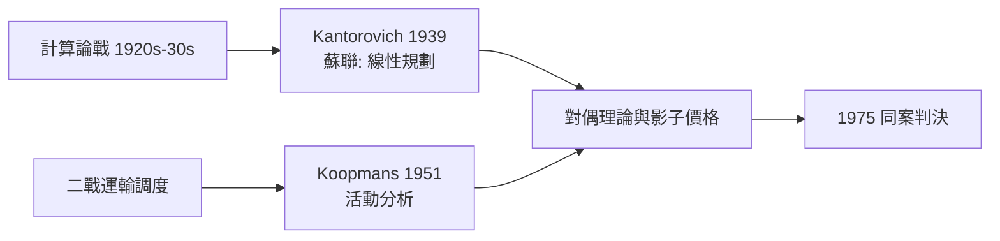

# 1975 · 懸案：資源有限，誰來決定「最好的用法」？

> **1975 諾貝爾經濟學獎（瑞典央行紀念獎）：列昂尼德·坎托羅維奇 Leonid Vitaliyevich Kantorovich（蘇聯，1912–1986）與特亞林·科普曼斯 Tjalling Charles Koopmans（荷蘭出生／美國籍，1910–1985）— 表彰他們「對資源最優配置理論的貢獻」（for their contributions to the theory of optimum allocation of resources）。**

---

## 懸案（案情提要）

1939–1951 年間，兩個陣營在冷戰兩側幾乎同時撞見同一樁案：

- **鐵幕內**：蘇聯膠合板托拉斯的工程師 Kantorovich 被問到一個具體問題——幾台車床、多種零件，怎麼排班產量最大？
- **鐵幕外**：二戰盟軍的運輸船隊調度（Koopmans 參與的「船上裝貨」問題）——有限的船噸，怎麼運最多貨？

表面是工程排班，內裡是一個**經濟學母題**：任何經濟都是「有限資源 $\times$ 多種用途」的矩陣，**最優配置**如何定義、如何求解、價格在其中扮演什麼角色？

更深一層的懸案：**計劃經濟能否算出正確配置？** Kantorovich 的答案（能，用線性規劃）與 Hayek（1974）的「計算不可行」正面相撞——而諷刺的是，兩人先後獲獎，像是委員會自己也承認：這場計算論戰還沒終審。

---

## 前因

| 年份 | 事件 |
|---|---|
| 1874 | Walras：一般均衡的「配置」問題首次系統提出 |
| 1920s–30s | 社會主義計算論戰：Mises、Hayek vs Lange、Lerner |
| 1939 | Kantorovich《生產組織與計劃的數學方法》：線性規劃誕生（蘇聯，以「解乘數」求解） |
| 1942 | Koopmans 戰時運輸調度研究；Tjalling 也在芝加哥考爾斯委員會重建計量經濟學 |
| 1947 | Dantzig 發明單純形法（美國），線性規劃成為通用演算法 |
| 1951 | Koopmans《活動分析》出版：把生產表述為活動向量、效率定義公理化 |
| 1959 | Kantorovich《經濟資源的最優利用》：建議蘇聯以「客觀制約估值」（影子價格）改革計劃 |
| 1960s | 線性規劃、對偶理論進入經濟學標準課程；蘇聯 CEMI 中央數理經濟研究所成立（Kantorovich 派系） |
| 1975 | 兩人共享諾獎——鐵幕兩側的同一套數學同時受勳 |

---

## 調查

### 線索一：問題的原始形態（Kantorovich 的車床案）

$m$ 台機器、$n$ 種零件，$a_{ij}$ 為機器 $i$ 生產零件 $j$ 的效率（每小時件數），要求產品結構比例 $\mathbf{d}$。規劃問題：

$$
\max_{\mathbf{x}} \; \mathbf{c}^{T} \mathbf{x} \quad \text{s.t.} \quad A \mathbf{x} \leq \mathbf{b}, \;\; \mathbf{x} \geq 0
$$

其中 $A \mathbf{x}$ 是各資源（機時、原料）的用量，$\mathbf{b}$ 是資源存量。Kantorovich 的**解乘數法**：對每種資源賦一個估值 $y_i$（影子價格），使活動的「淨利」在最优時全部歸零或為負：

$$
\mathbf{c}^{T} - \mathbf{y}^{T} A \leq 0
$$

這正是線性規劃的**對偶問題**——比 Dantzig 的單純形法早了八年。

### 線索二：對偶定理——價格的「法理身份」

線性規劃的對偶定理（Kantorovich 1939；Farkas–von Neumann 譜系）宣判：

**原始最優值 = 對偶最優值**：

$$
\max \{ \mathbf{c}^{T} \mathbf{x} : A\mathbf{x} \leq \mathbf{b}, \mathbf{x} \geq 0 \} \;=\; \min \{ \mathbf{b}^{T} \mathbf{y} : A^{T}\mathbf{y} \geq \mathbf{c}, \mathbf{y} \geq 0 \}
$$

經濟學含義驚人：**影子價格 $\mathbf{y}^{*}$ 是一個完整的價格體系**——在最優配置上，用價格分散決策（誰的活動賺錢誰就上）與集中求解規劃問題，得到**同一個結果**。這是「價格 = 資源稀缺性的信息」的最嚴格證明，直接回答了計算論戰中 Lange 陣營的訴求，也部分回應了 Hayek 的質疑：價格確實承載稀缺信息，但**算出它們需要解一個全經濟規模的規劃**。

### 線索三：Koopmans 的活動分析——效率的公理化

Koopmans 把生產抽象為**活動向量**：每種活動以技術係數把投入轉為產出，生產可能性集是活動的凸錐：

$$
Y = \left\{ \sum_{k} \lambda_k y^{k} : \lambda_k \geq 0 \right\}, \qquad y^{k} \text{ 為基本活動}
$$

**效率定義**：配置 $y \in Y$ 是（Pareto–Koopmans）有效的，若沒有 $y' \in Y$ 能在所有分量上不差且至少一個分量嚴格更好。然後是核心命題：

$$
y \text{ 有效} \;\;\Longleftrightarrow\;\; \exists \, \mathbf{p} \geq 0, \; \mathbf{p} \neq 0, \; \text{使 } \mathbf{p}^{T} y \geq \mathbf{p}^{T} y' \;\; \forall y' \in Y
$$

即**效率配置必然存在支持它的非負價格**（分離定理）。這把「價格支持最優」從直覺變成定理，是 1972 年福利經濟學兩大定理的線性版本先行章。

### 線索四：運輸問題與線性規劃的「模具」

Koopmans 的運輸問題是最小化總運費：

$$
\min \sum_{i} \sum_{j} c_{ij} x_{ij} \quad \text{s.t.} \quad \sum_{j} x_{ij} = s_i, \;\; \sum_{i} x_{ij} = d_j, \;\; x_{ij} \geq 0
$$

其對偶變數 $u_i, v_j$ 滿足 $c_{ij} - u_i - v_j \geq 0$（最優時最短路線取等）——地區價差 $u_i - u_j$ 就是運費的信息。這一模具後來無限複製：職位指派、水庫調度、能源模型、拍賣設計（2020 年 Milgrom–Wilson 的組合拍賣在數學上是近親）。

### 線索五：跨期版本——最優增長與「霍特林租金」

活動分析的時間軸版本給出跨期最優條件：可耗竭資源的影子價格按利率增長（Hotling 法則的規劃版）：

$$
\frac{\dot{p}_t}{p_t} = r
$$

Koopmans 的跨期配置工作（如「不可重生資源的代際公平」）直通 1987 Solow 增長理論與 2018 Nordhaus 的氣候貼現問題。

---

## 理論裁決

**裁決一**：資源配置問題有統一的數學形態——**約束極大化**；其解存在、可計算，且解的結構由對偶價格完整刻畫。

**裁決二**：影子價格是「稀缺性的官方匯率」；在最優點，**計劃的解 = 市場的均衡**（對偶定理）。

**裁決三**：效率與價格互為表裡——有價格支持者是效率配置，有效率配置必有支持價格（凸性下）。這一「支持價格」思想成為微觀經濟學的公理級工具（1972 Arrow、1983 Debreu 的分離超平面技術同源）。

**歷史注腳**：Kantorovich 的理論在蘇聯長期受意識形態打壓（影子價格被斥為資產階級概念），他本人至死未見計劃體系採納；而西方把它變成了航空公司、煉油廠與軍隊的日常工具。**理論的歸宿，取決於制度而非數學**——這又回到 1974 年 Myrdal 的主場。

---

## 後果

| 領域 | 影響 |
|---|---|
| 政策應用 | 線性規劃成為全球物流、能源調度、農業規劃、軍事運籌的標配；蘇聯解體後的轉軌經濟研究中，「影子價格」成為評估價格扭曲的標尺 |
| 經濟學發展 | 活動分析 $\rightarrow$ 一般均衡的可計算版本（CGE）；對偶理論成為宏觀與公共經濟學的通用語法 |
| 後續諾獎 | 1972 Arrow–Hicks（支持價格的分離定理）、1980 Klein（規劃與計量的合流）、2007 機制設計（配置理論的賽局版）、2012 Roth–Shapley（匹配：離散版的運輸問題）、2020 Milgrom–Wilson（拍賣設計） |
| 計算論戰遺產 | 計劃可行性的數學答案：小規模**可算**，全經濟規模則遭遇信息與激勵雙重瓶頸（1994 Nash 線的 Hurwicz 激勵相容補刀） |
| 冷戰科學史 | 1975 年蘇美得主共享一獎，是經濟學獎最具象徵性的跨鐵幕時刻 |

---

## 關聯

- [1973-Leontief投入產出矩陣](1973-Leontief投入產出矩陣.md)：投入產出是「已知結構求產出」，線性規劃是「結構可選求最優」——同一線性世界的兩面。
- [1972-Arrow與Hicks一般均衡與福利](1972-Arrow與Hicks一般均衡與福利.md)：分離定理與支持價格的一般均衡版。
- [1974-Myrdal與Hayek貨幣波動與制度](1974-Myrdal與Hayek貨幣波動與制度.md)：Kantorovich 的工作是對 Hayek「計算不可行」的正面回應。
- [1970-Samuelson數學化革命](1970-Samuelson數學化革命.md)：約束極大化是 Samuelson 體系的通用格式。
- [2012-Roth與Shapley匹配市場](../經濟學獎/2012-Roth與Shapley匹配市場.md)：運輸—指派問題的離散現代版（本書續寫中）。
- [2020-Milgrom與Wilson拍賣理論](../經濟學獎/2020-Milgrom與Wilson拍賣理論.md)：配置理論的拍賣實戰（本書續寫中）。
