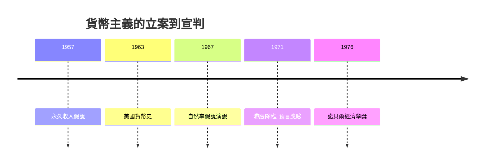

# 1976 · 懸案：通貨膨脹到底誰在點火？

> **1976 諾貝爾經濟學獎（瑞典央行紀念獎）：米爾頓·弗里德曼 Milton Friedman（美國，1912–2006）— 表彰他「在消費分析、貨幣史與貨幣理論領域的成就，以及對穩定政策之複雜性的論證」（for his achievements in the fields of consumption analysis, monetary history and theory and for his demonstration of the complexity of stabilization policy）。**

---

## 懸案（案情提要）

1970 年代的罪案現場一片狼藉：失業率與通脹率**同時**攀升——可是按照戰後主流（菲利普斯曲線），兩者本應此消彼長。法官們的卷宗上有三份互相矛盾的口供：

1. **凱恩斯派**：通脹是需求過熱，壓需求即可；失業是需求不足，花錢即可——「總需求管理」萬能；
2. **現場證據**：1970s 滯脹（stagflation）雙高並存，需求管理的藥方失靈；
3. **歷史檔案**：Friedman 與 Schwartz 的《美國貨幣史（1867–1960）》指出：大蕭條不是市場失靈，而是**央行失職**——貨幣量 1929–1933 年收縮了三分之一。

Friedman 的起訴書圍繞三項指控：消費理論錯了、貨幣責任錯置了、政策規則被低估了。

---

## 前因

| 年份 | 事件 |
|---|---|
| 1930s | 芝加哥學派的貨幣主義傳統（Simons、Knight）已在反駁「貨幣中性」教條 |
| 1936 | 凱恩斯《通論》；「貨幣只影響名義變數」的凱恩斯式假設確立 |
| 1946 | Friedman 加入芝加哥；1950s 與 Schwartz 展開貨幣史工程 |
| 1957 | 《消費函數理論》：永久收入假說出爐 |
| 1960 | 菲利普斯曲線（1958）被薩繆爾森–索洛移植到美國，成為政策菜單 |
| 1963 | 《美國貨幣史（1867–1960）》出版（與 Anna Schwartz 合著）：貨幣主義的實證核心 |
| 1967 | 美國經濟學會主席演說：引入「自然率假說」，預言滯脹 |
| 1968 | 同年概念由 E. Phelps 獨立提出（2006 年 Phelps 因此得獎） |
| 1971–1973 | 布雷頓森林體系崩潰；世界進入浮動匯率＋高通脹時代 |
| 1975 | Friedman 智利之行引發「芝加哥男孩」爭議 |
| 1976 | 得獎；四位諾獎得主聯名投書《紐約時報》抗議——史上抗議聲量最大的授獎 |

---

## 調查

### 線索一：永久收入假說——消費函數的偵查重審

凱恩斯消費函數 $C = a + bY$（平均消費傾向隨所得上升而下降）被橫截面與時間序列數據同時打臉：長期平均消費傾向穩定。Friedman 的裁決：家庭按**永久收入** $Y^P$（長期預期所得）而非當期所得消費：

$$
C = k \, Y^{P}, \qquad Y^{P} \text{ 為長期預期所得的加權}
$$

可操作的適應性估計（權重遞減）：

$$
Y_{t}^{P} = (1 - \lambda) Y_{t-1}^{P} + \lambda Y_{t}, \qquad 0 < \lambda < 1
$$

由此一舉解釋三大疑點：橫截面富人多儲蓄（當期所得含大量暫時性成分 $Y^T$）、時間序列長期 APC 穩定（$C / Y \to k$）、戰後消費未因戰時高收入而暴漲。此案直接衍生 1985 年 Modigliani 生命週期假說的姊妹偵查，並改寫了 2015 Deaton 消費研究的問題清單。

### 線索二：貨幣史鑑識——「通脹在任何時候任何地方都是貨幣現象」

Friedman–Schwarz 用近百年資料重建美國貨幣量 $M$ 與名義所得 $PY$ 的關係。核心鑑識發現：

1. $M$ 的波動**先於**名義所得波動（貨幣是因，產出是果至少短期如此）；
2. 1929–1933 貨幣收縮約三分之一，銀行倒閉潮中聯儲**坐視**貨幣坍塌——蕭條的深度是**政策錯誤**而非市場自毀；
3. 長期看，通脹與貨幣增長率高度同步：

$$
\pi_t \approx \Delta m_t - \Delta y_t \qquad (\text{數量方程的通脹表述})
$$

數量恆等式 $M V = P Y$（Velocity $V$ 長期穩定）成為檢察主張：控制 $M$ 就控制 $P$。

### 線索三：自然率假說——菲利普斯曲線的偽證

Friedman（1967）與 Phelps（1968）的裁決：菲利普斯曲線描述的權衡只是**短期幻象**。失業取決於實際與預期通脹之差：

$$
u_t - u^{N} = -\alpha \left( \pi_t - \pi_t^{e} \right), \qquad \alpha > 0
$$

其中 $u^{N}$ 是**自然失業率**。長期預期跟上現實（$\pi^{e} = \pi$），失業回到 $u^{N}$——**長期菲利普斯曲線垂直**：

$$
u_{\text{長期}} = u^{N}, \qquad \pi_{\text{長期}} = \text{任意（由貨幣增長決定）}
$$

政策含義（加速主義）：若政府企圖把失業壓到 $u^{N}$ 以下，只會讓通脹**加速攀升**而不減少失業。1970s 滯脹正是這一預言的現場重演——本案是經濟學史上極少數「理論預言先於數據應驗」的判決。

### 線索四：政策規則 vs 相機抉擇

既然當局無法同時釘住多個目標，且政策有長而多變的時滯，Friedman 主張**單一規則**取代斟酌行事：

$$
\frac{\Delta M_t}{M_t} = k \;\; (\text{恆定的貨幣增長規則，如 } k = 3\%)
$$

這是「規則 vs 相機抉擇」之爭的現代開庭，直通 2004 年 Kydland–Prescott 的時間不一致性分析與現代央行規則（通脹目標制、Taylor 規則）。

---

## 理論裁決

**裁決一**：消費由永久收入決定；總需求管理的微觀地基（短期邊際消費傾向）被證明比凱恩斯主張的更不穩定。

**裁決二**：長期通脹是貨幣現象；大蕭條的元兇是貨幣收縮（央行失職），「市場自毀」的舊口供被推翻。

**裁決三**：不存在長期通脹—失業權衡；任何企圖利用幻象權衡的政策都將以加速通脹收場。

**裁決四**：穩定政策遠比想像複雜——時滯、預期、政治週期使「精準調控」淪為幻覺，規則勝過斟酌。

**歷史注腳**：1976 年的授獎遭遇空前抗議（智利之行、芝加哥男孩）。Friedman 自辯：學說與政權應分開審判。這樁案外案把「經濟學家的社會責任」永久寫進了本獎的訴訟紀錄——1974 年 Hayek 晚宴致辭的警告在此應驗。

---

## 後果

| 領域 | 影響 |
|---|---|
| 政策應用 | 1979 年後各國央行轉向貨幣量標的；通脹目標制（1990s–）與央行獨立化；2008 年危機後 Bernanke（2022 得主）公開引用《美國貨幣史》檢討聯儲應對 |
| 經濟學發展 | 理性預期革命（1995 Lucas）把自然率與預期推到極致；新古典宏觀、真實經濟週期（2004）皆以本案為出發點 |
| 後續諾獎 | 1985 Modigliani（消費）、1995 Lucas、2004 Kydland–Prescott、2006 Phelps（自然率獨立提出）、2011 Sargent–Sims（宏觀實證）、2022 Bernanke（大蕭條的貨幣鑑識） |
| 爭議 | 貨幣需求的穩定性在 1980s 金融創新後瓦解，貨幣量標的遭棄用；「貨幣單因論」被批過度；智利案成為經濟學倫理的永久案底 |
| 意識形態史 | 與 1974 Hayek 共同構成「市場反擊」的雙主場；對手陣營的回馬槍在 2008 Krugman、2013 Shiller 等案中持續 |

---

## 關聯

- [1974-Myrdal與Hayek貨幣波動與制度](1974-Myrdal與Hayek貨幣波動與制度.md)：貨幣擾動線索的實證續審。
- [1970-Samuelson數學化革命](1970-Samuelson數學化革命.md)：凱恩斯—新古典綜合被本案正面重創。
- [1979-Lewis與Schultz發展經濟學](1979-Lewis與Schultz發展經濟學.md)：同屬「芝加哥傳統」的另一分支（Schultz 的農民理性）。
- [2006-Phelps跨期宏觀權衡](../經濟學獎/2006-Phelps跨期宏觀權衡.md)：自然率假說的獨立發現者受勳（本書續寫中）。
- [2022-Bernanke銀行與金融危機](../經濟學獎/2022-Bernanke銀行與金融危機.md)：《美國貨幣史》的現代驗屍報告（本書續寫中）。
- [1971-Kuznets國民帳戶與增長長卷](1971-Kuznets國民帳戶與增長長卷.md)：貨幣史鑑識所依賴的百年總量數據，正是 Kuznets 建立的帳戶體系。
