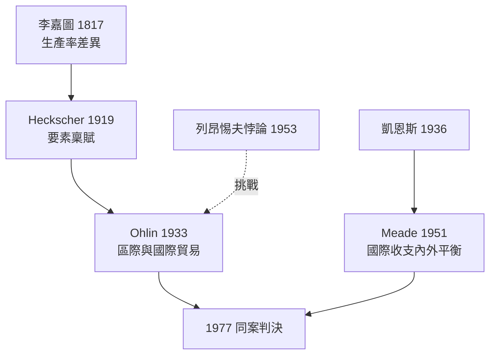

# 1977 · 懸案：國家之間為何交換？交換之後誰受益？

> **1977 諾貝爾經濟學獎（瑞典央行紀念獎）：貝蒂爾·奧林 Bertil Gotthard Ohlin（瑞典，1899–1979）與詹姆斯·米德 James Edward Meade（英國，1907–1995）— 表彰他們「對國際貿易理論與國際資本流動理論的突破性貢獻」（for their pathbreaking contribution to the theory of international trade and international capital movements）。**

---

## 懸案（案情提要）

貿易理論的舊案由李嘉圖 1817 年結案：各國按**勞動生產率**差異分工，人人受益。可是現場證據提出新疑點：

1. **資源稟賦不同的國家**（澳洲有地、德國有技術）之間的貿易，跟生產率差異無關也大量發生——比較優勢的來源到底是什麼？
2. 貿易開放後，**收入分配**在國內如何洗牌？誰贏誰輸？（李嘉圖案對此保持沉默）
3. 貿易之外，**資本**也在跨境流動：貿易帳與資本帳的赤字盈餘如何互相拉扯？一國能否同時「借錢」與「順差」？

奧林與米德分別接管兩條線：奧林把「稟賦」列為主嫌；米德開審「內外平衡」的雙重案件。

---

## 前因

| 年份 | 事件 |
|---|---|
| 1817 | 李嘉圖《政治經濟學及賦稅原理》：比較優勢定案 |
| 1848 | Mill 的相互需求理論：貿易條件的初步分析 |
| 1919 | Heckscher（奧林之師）論文首提「要素稟賦」解釋貿易 |
| 1924 | 奧林博士論文《貿易理論》，系統化稟賦模型 |
| 1933 | 奧林《區際貿易與國際貿易》出版：H–O 模型定型 |
| 1936 | Meade 入場：出身劍橋（凱恩斯圈子），後任職國際聯盟與戰時內閣經濟組 |
| 1951 | Meade《國際收支》：內外平衡的「政策搭配」理論（Tinbergen 法則的經濟內容化） |
| 1952 | Meade《貿易與福利》：次優理論誕生 |
| 1953 | 列昂惕夫悖論（1973 案）挑戰 H–O 模型：美國出口竟偏勞動密集 |
| 1955 | 米德任 OECD 前身組織首任經濟主任；「馬歇爾計劃時代」的貿易自由化設計 |
| 1977 | 兩人共享第 9 屆經濟學獎（奧林於兩年後去世） |

---

## 調查

### 線索一：Heckscher–Ohlin 模型——稟賦即嫌犯

設定：兩國、兩財（$X$ 資本密集、$Y$ 勞動密集）、兩要素（資本 $K$、勞動 $L$），技術相同、偏好相同，唯有**稟賦比**不同。母國為資本豐裕：

$$
\frac{K_{\text{母}}}{L_{\text{母}}} > \frac{K_{\text{外}}}{L_{\text{外}}}
$$

**H–O 定理**：各國出口密集使用其豐裕要素的財貨——母國出口 $X$。證明主幹是「價格 $\rightarrow$ 密度 $\rightarrow$ 產出」的三段推理（利用要素密度不可逆轉與兩國技術相同）。

**要素價格均等化定理（Samuelson 1948 補強）**：貿易使兩國的工資與資本回報趨同：

$$
w_{\text{母}} \to w_{\text{外}}, \qquad r_{\text{母}} \to r_{\text{外}}
$$

貨物貿易**替代**了要素流動——「出口你的豐裕要素」等同間接出口勞動或資本本身。

### 線索二：Stolper–Samuelson 定理——分配的洗牌名單

Samuelson 與 Stolper（1941）的判決：關稅（提高 $Y$ 的相對價格）使**稀缺要素**的報酬上升、豐裕要素的報酬下降：

$$
\frac{\hat{w}}{\hat{r}} \;\text{的變動幅度}\; > \; \frac{\hat{P_Y}}{\hat{P_X}} \;> 0 \;\;\Longrightarrow\;\; \text{放大效應}
$$

即商品價格變動被**放大**傳導至要素報酬。貿易的國內輸家（稀缺要素所有者）由此獲得理論身份——這是今日全球化政治（發達國家低技能勞工反全球化）的理論原點。

### 線索三：列昂惕夫悖論的交叉詰問

1953 年列昂惕夫用美國 1947 年投入產出表（1973 案的證物）驗屍 H–O 模型：美國出口的**資本密集度低於**進口替代品——嫌犯畫像不符。後續偵查提供多份「案外案」解釋：人力資本（出口含大量工程師知識，實為資本）、需求逆轉、貿易壁壘、要素密度逆轉。悖論至今未完全結案，卻把貿易理論逼出了「同一技術」的舒適區。

### 線索四：Meade 的內外平衡——兩目標兩工具

Meade 的戰場是開放經濟的宏觀會計。國際收支恆等：

$$
BP = (X - M) + KA = 0 \quad \text{（外平衡）}
$$

配合國內產出缺口 $Y = Y^{*}$（內平衡）。Meade 的**搭配法則**：兩個獨立目標需要兩個獨立工具（後世稱 Tinbergen 法則，1969 案的延伸）——例如「支出調整」（貨幣財政政策）管內平衡、「支出轉換」（匯率、關稅）管外平衡。工具與目標錯配則兩頭落空：這是布雷頓森林體系「固定匯率＋單一工具」困境的理論確診，也是 1999 年 Mundell 模型（浮動匯率下的政策指派）的直接前案。

### 線索五：次優理論（Meade 1955）

米德還交出一份「認罪書」：若經濟中已存在某種扭曲（如壟斷或關稅）無法移除，則**移除其餘扭曲未必增進福利**：

$$
\text{局部自由化} \;\not\Rightarrow\; \text{福利提升} \quad \text{（次優定理）}
$$

這一謙遜的判決成為發展政策與區域貿易協定分析的理論基石。

---

## 理論裁決

**裁決一（Ohlin）**：比較優勢的現代來源是**要素稟賦差異**；貿易格局、要素報酬與收入分配可由「$2 \times 2 \times 2$ 框架」一次算清。貿易不僅提高效率，還**重新洗牌**國內分配（Stolper–Samuelson）。

**裁決二（Meade）**：開放經濟的政策是**多目標多工具的矩陣匹配**；貿易帳與資本帳、內平衡與外平衡必須同時求解，工具錯配是危機之源。

**裁決三（Meade）**：在非理想世界，「次優」是常態；理論的最優不是政策的擋箭牌。

**綜合判決**：國際經濟學從「是否該貿易」的哲學辯論，轉為「誰贏誰輸、如何補償、政策如何搭配」的工程問題——1999 Mundell、2008 Krugman、2024 Acemoglu 等案的國際分配主線由此鋪設。

---

## 後果

| 領域 | 影響 |
|---|---|
| 政策應用 | GATT／WTO 時代的自由化談判依據；匯率制度選擇（固定 vs 浮動）的分析框架；區域協定（關稅同盟）的福利評估 |
| 經濟學發展 | H–O 框架成為國際貿易必修；新貿易理論（2008 Krugman）在規模經濟方向擴充；「貿易與分配」至今是熱點（2016 起的「中國衝擊」研究） |
| 後續諾獎 | 1973 Leontief（悖論的提出者）、1999 Mundell（Mundell–Fleming 與最優貨幣區）、2008 Krugman（新貿易理論、地理集聚） |
| 爭議 | H–O 模型面對列昂惕夫悖論與實證弱檢驗力，長期被批「優雅但不準」；Stolper–Samuelson 的分配預言在 2010s 全球化反彈中獲得遲來的關注 |
| 瑞典傳統 | 奧林同時是政治家（瑞典自由黨領袖、貿易部長）與 Heckscher 學派傳人；他與 1974 年 Myrdal 共同代表瑞典經濟學的國際影響力 |

---

## 關聯

- [1973-Leontief投入產出矩陣](1973-Leontief投入產出矩陣.md)：投入產出表是列昂惕夫悖論的作案工具與檢驗方法。
- [1976-Friedman貨幣主義與永久收入](1976-Friedman貨幣主義與永久收入.md)：Meade 的內外平衡與 Friedman 的開放經濟貨幣分析互相接軌。
- [1969-Frisch與Tinbergen計量經濟破案術](1969-Frisch與Tinbergen計量經濟破案術.md)：Meade 的「兩工具兩目標」是 Tinbergen 法則的經濟內容化。
- [1999-Mundell最優貨幣區](../經濟學獎/1999-Mundell最優貨幣區.md)：內外平衡框架的直系後案（本書續寫中）。
- [2008-Krugman新貿易與經濟地理](../經濟學獎/2008-Krugman新貿易與經濟地理.md)：稟賦模型之外的新貿易疆域（本書續寫中）。
- [1970-Samuelson數學化革命](1970-Samuelson數學化革命.md)：Stolper–Samuelson 與要素價格均等化的共同作者，把 H–O 推上數學正軌。
