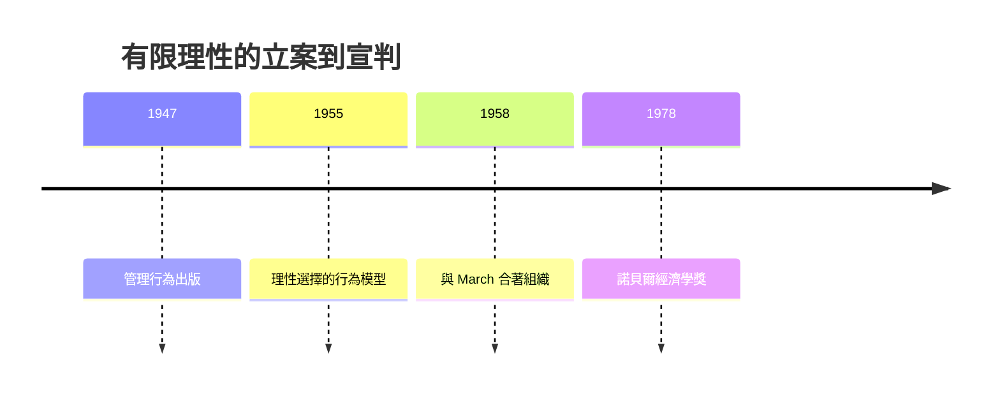

# 1978 · 懸案：經濟學家筆下的「理性人」，真的存在嗎？

> **1978 諾貝爾經濟學獎（瑞典央行紀念獎）：赫伯特·亞歷山大·西蒙 Herbert Alexander Simon（美國，1916–2001）— 表彰他「對經濟組織內決策過程的開創性研究」（for his pioneering research into the decision-making process within economic organizations）。**

---

## 懸案（案情提要）

新古典經濟學的作案現場上，有一具完美的「模特屍體」：**理性經濟人（homo economicus）**——擁有完整偏好、無限計算力、即時取得全部信息，在任何約束下解出最優解。教科書上他無所不能，可是偵辦實際案件時疑點叢生：

1. **企業不是點**：現實公司內部有部門、預算、層級、政治——市場理論把企業壓縮成一個生產函數，**內部黑箱**無人開啟；
2. **人腦不是電腦**：管理者面對的是「勉強滿意」而非「最優」；他們甚至**不知道**全部備選方案；
3. **最優在哪？** Simon 在市政與企業的實地訪談中發現：決策者的目標是**矛盾的**（銷售 vs 成本 vs 人際），他們用「滿意」終止搜尋——這不是「計算失誤」，而是**行為的法則**。

疑案主軸：若「最優化」只是模型的虔誠信仰而非可觀測行為，經濟學的根基是不是需要重鑄？Simon 的答案：用**有限理性（bounded rationality）**替換**全能理性**。

---

## 前因

| 年份 | 事件 |
|---|---|
| 1916 | Simon 生於密爾瓦基；少年受其擔任鋼琴製造商職業經濟顧問的舅舅影響 |
| 1936 | 芝加哥大學政治學博士（論文即後來《管理行為》的種子） |
| 1936–1942 | 任職國際城市管理協會，實地測量公共部門決策——「最優化」模型在現場失靈的第一手證據 |
| 1947 | 《管理行為（Administrative Behavior）》出版：管理組織是決策系統；「滿意準則」首次系統提出 |
| 1949–1955 | 轉至卡內基理工學院（今 CMU）；與 Newell、Shaw 開展人工智能與問題求解研究（1960s 促成 AI 誕生） |
| 1955–1956 | 〈理性選擇的行為模型〉：有限理性的形式化；人腦即「有限序列處理機」 |
| 1958 | 與 March《組織》：組織行為理論的奠基作 |
| 1960s | 卡內基學派成型：Cyert 與 March 的企業行為理論；Williamson（2009 得主）受業於此 |
| 1970s | 與新古典陣營的「理性之戰」白熱化；行為經濟學（Kahneman–Tversky 1979）在此土壤上發芽 |
| 1978 | 獲獎——史上首位「非經濟學博士」得主（政治學博士） |

---

## 調查

### 線索一：現場證據——決策者的「滿意」法則

Simon 的偵查不從公理出發，而從**訪談與觀察**出發。決策過程的四階段（情報$\rightarrow$設計$\rightarrow$選擇$\rightarrow$檢視）中，管理者**不會**：

- 列舉全部備選方案；
- 為每個方案計算全部後果的概率分布；
- 持續搜尋直到找到最優。

他們的停止規則是：**一旦方案達到「渴望水準」（aspiration level），即行動**。形式化：

$$
\text{選 } x \text{ 若 } \; U(x) \geq \bar{U}(\text{渴望水準}) \;\; \text{（而非 } U(x) = \max_{y} U(y) \text{）}
$$

渴望水準本身是**適應性**的：連續達標則上調，連續受挫則下調：

$$
\bar{U}_{t+1} = \bar{U}_t + \delta \left( U_t - \bar{U}_t \right)
$$

這使滿意解成為可觀測、可建模的**行為規則**，而非最優化的缺陷。

### 線索二：計算約束——為什麼最優化「算不動」

Simon 與 Newell 的問題求解理論指出：搜尋空間呈**組合爆炸**。哪怕備選只有 $n$ 個、每個有 $k$ 個屬性，窮舉複雜度即為 $O(k^n)$。人的工作記憶容量約為 $7 \pm 2$ 個組塊，不可能在真實時間內完成企業級的最優化。因此：

$$
\text{有限理性} \;=\; \text{目標函數} + \text{認知約束} + \text{信息約束} + \text{時間約束}
$$

理性不是被否定，而是**被重新定義為「約束下的程序理性」**——判斷好壞的標準從「解是否最優」變為「過程是否恰當」（procedural rationality vs substantive rationality）。

### 線索三：組織的黑箱——企業內部的決策政治

《管理行為》的核心命題：**組織 = 決策的分工系統**。組織之所以存在，是因為它能：

1. 以**例行程序**（routines）儲存決策知識，免於每次重算；
2. 以**層級**分解目標，讓子單位局部理性化；
3. 以**內部溝通網絡**控制信息流。

企業不是「一個大腦」，而是**多個有限理性者的聯邦**——Cyert–March 的企業行為理論把企業建模為聯盟（coalition），組織鬆懈（organizational slack）是其常態產物。這一黑箱開啟工程直通 1986 Buchanan（公共選擇）、2009 Williamson（企業邊界與交易成本）、2016 契約理論。

### 線索四：跨學科的「雙重職業」

Simon 同時是人工智能的父親之一（1956 年達特茅斯會議、1967 年圖靈獎）。這不是巧合：**AI 的搜尋與啟發式（heuristics）正是有限理性的計算模型**。他的「物理符號系統假說」把人腦與電腦置於同一認知框架，也把經濟學的決策理論推向了後來的行為與神經經濟學。

---

## 理論裁決

**裁決一**：決策是「程序理性」而非「實質理性」：評價標準是決策**過程**的合理性，因為最優解在認知上不可得。

**裁決二**：滿意化（satisficing）+ 適應性渴望水準，是替代最優化的行為法則。

**裁決三**：組織是分散決策的制度化裝置；企業內部運作（計劃、預算、信息流）本身是經濟分析的正當對象——微觀經濟學的疆界從「市場」推進到「組織內部」。

**歷史注腳**：新古典陣營的反擊（Friedman 1953 的「好像」論：模型不必真，只要預測準）在 1976 案中已見；而 Simon 的回答是——**預測不準的地方（如組織行為、學習、創新），正是「好像」論破產之處**。2002 年 Kahneman 得獎、2017 年 Thaler 得獎，證明這場辯論的最終裁決偏向有限理性一側。

---

## 後果

| 領域 | 影響 |
|---|---|
| 管理學與組織理論 | 「滿意準則」「程序理性」「組織鬆懈」成為管理學基礎詞彙；企業行為理論、組織生態學由此展開 |
| 經濟學發展 | 行為經濟學（2002、2017）、搜尋理論（2010 Diamond–Mortensen–Pissarides）、企業理論（2009 Williamson）皆受其啟發；有限理性成為 DSGE 之外的異見主流 |
| 人工智能與認知科學 | 啟發式搜尋、符號主義 AI 的源頭；「適應性主體」思想孕育了複雜系統與基於主體的建模（ABM） |
| 後續諾獎 | 1986 Buchanan（公共選擇）、2002 Kahneman（前景理論與啟發式）、2009 Williamson（交易成本、卡內基傳統）、2010 搜尋摩擦、2017 Thaler（助推） |
| 爭議 | 批評者認為滿意化缺乏統一數學結構，難以嵌入一般均衡；辯護者回應：程序理性的「算法化」正是其優勢（可計算、可模擬） |
| 榮譽史 | 首位政治學博士得主；1994 Nash（數學家）得獎後，委員會正式重定義獎項涵蓋社會科學——Simon 是先例 |

---

## 關聯

- [1970-Samuelson數學化革命](1970-Samuelson數學化革命.md)：被重新審判的「最優化」教義的奠基者。
- [1976-Friedman貨幣主義與永久收入](1976-Friedman貨幣主義與永久收入.md)：預期與適應性行為的對照審理（適應性預期 vs 理性預期的前身）。
- [1979-Lewis與Schultz發展經濟學](1979-Lewis與Schultz發展經濟學.md)：農民的「有限理性」是舒爾茨陣營與 Simon 陣營交火的地帶。
- [2002-Kahneman與Smith行為與實驗](../經濟學獎/2002-Kahneman與Smith行為與實驗.md)：有限理性的實證凱旋（本書續寫中）。
- [2009-Ostrom與Williamson治理](../經濟學獎/2009-Ostrom與Williamson治理.md)：組織黑箱的開啟工程（本書續寫中）。
- [2017-Thaler行為經濟學與助推](../經濟學獎/2017-Thaler行為經濟學與助推.md)：滿意化與啟發式的政策應用（本書續寫中）。
