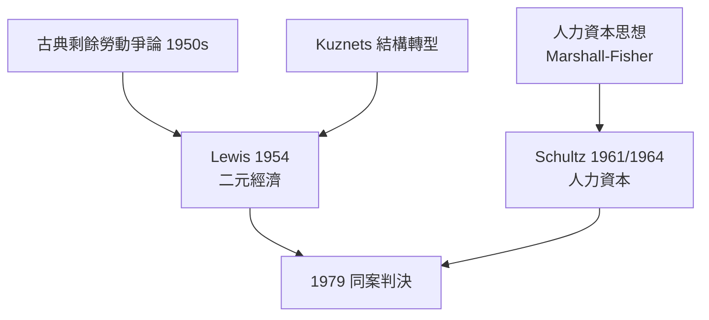

# 1979 · 懸案：貧困國家為什麼窮？答案在「過剩的農民」與「投資於人」？

> **1979 諾貝爾經濟學獎（瑞典央行紀念獎）：威廉·阿瑟·劉易斯 William Arthur Lewis（聖露西亞／英國，1915–1991）與西奧多·舒爾茨 Theodore William Schultz（美國，1902–1998）— 表彰他們「對經濟發展的研究，特別是對發展中國家問題的考量」（for their pioneering research into economic development research with particular consideration of the problems of developing countries）。**

---

## 懸案（案情提要）

1960 年代亞非拉國家獨立潮之後，「發展」成為經濟學的最大新戰場。可是現場證據令主流理論尷尬：

1. **勞動的邊際產品近零？** 大批農業人口的存在似乎是「過剩」的——可是把人抽走，產量幾乎不降；把工資壓到最低，勞動供給卻近乎無限。古典邊際分析在此失效；
2. **農民不是傻子？** 貧窮國家的農民看似「非理性」——不採用新技術、不多投資——主流解釋是「文化落後」。舒爾茨的起訴書主張：**農民在既有的貧窮環境下是完全有效率的**（「貧窮但有效率」）；
3. **增長的引擎在哪？** 資本累積之外，還有什麼決定一國能否起飛？

兩位偵探給出互補的判決：Lewis 揭開**二元經濟**的結構面紗；Schultz 把「人」本身列為最重要的資產。

---

## 前因

| 年份 | 事件 |
|---|---|
| 1932–1934 | Lewis 在倫敦政經學院求學，師承 Hayek（意外的同門）；他是首位獲諾獎的黑人經濟學家 |
| 1938 | Lewis 25 歲即成為 LSE 助理講師（英屬殖民地的歧視阻路，仍一路升至曼徹斯特教授） |
| 1945 | Schultz 任芝加哥大學農業經濟系主任，重建該系為「農業經濟學世界中心」 |
| 1954 | Lewis 〈無限勞動供給下的經濟發展〉：二元經濟模型誕生 |
| 1961 | Schultz 〈人力資本投資〉（美國經濟學會主席演說） |
| 1964 | Schultz《改造傳統農業》：貧窮但有效率的農民 |
| 1950s–60s | 發展經濟學黃金期：Rostow 起飛論、平衡 vs 不平衡增長之爭；結構轉型的 Kuznets 典型事實（1971 案）已是背景板 |
| 1960s–70s | 綠色革命：Schultz 的人力資本框架為其傳播提供理論基礎 |
| 1979 | 兩人共享第 11 屆經濟學獎；Lewis 兼具實務身份（迦納、加勒比開發銀行、聯合國顧問） |

---

## 調查

### 線索一：Lewis 的二元經濟與「無限勞動供給」

Lewis 的偵查假定：發展中國家的經濟分為兩個部門——

- **傳統（生存）部門**：農業與非正式經濟，勞動**過剩**，邊際產品近零，工資由「生存水準」$\bar{w}$ 決定；
- **現代（資本主義）部門**：工業，按 $MPL = w$ 雇用勞動，利潤轉投資。

因為傳統部門有近乎無限的剩餘勞動，現代部門可以在**固定工資** $\bar{w}$ 下無限擴張：

$$
MPL_{\text{現代}} \;=\; \bar{w} \;\;\Longrightarrow\;\; \text{勞動供給曲線水平}
$$

利潤 $= Y - wL - rK$ 隨雇用擴大而累積，再全數轉為資本：

$$
K_{t+1} = K_t + s \pi_t \qquad (s \approx 1)
$$

**起飛的引擎是利潤再投資**——工業部門像一台抽水機，把傳統部門的勞動與現代部門的利潤同時抽進增長迴路。轉折點在**剩餘勞動耗盡**之處（後世稱「劉易斯轉折點」）——2010s 的中國勞動市場辯論（「劉易斯拐點已過？」）正是本案的現代續審。

### 線索二：Lewis 的貿易條件與「劉易斯—熊彼特」結構變遷

Lewis 的後續工作把二元模型推向開放經濟：初級產品與製造品的**貿易條件長期不利**於發展中國家，工資低廉只是暫時優勢。他也提出「增長的結構決定論」：增長率取決於現代部門占總產出的**份額及其擴張速度**——直接承接 1971 年 Kuznets 的結構轉型典型事實。

### 線索三：Schultz 的「貧窮但有效率」

舒爾茨的起訴材料來自大量農業調查：傳統農民在**給定的技術與要素約束**下，資源配置已近最優——

$$
\text{在 } T \text{（技術）與 } K, L \text{（傳統要素）不變下：} \;\; \max \; Y \;\;\text{已達成}
$$

因此貧困的病根**不是**農民愚蠢，而是**約束集太窮**。藥方：向農民**提供更好的約束集**——新技術（良種、化肥）、更好的教育與信息、合理的價格環境。改造傳統農業的核心是「改造約束」而非「改造人」。

### 線索四：人力資本——把「人」記入資產負債表

Schultz（與 Becker 1992）的裁決：教育、培訓、健康是**投資**，其報酬可以計算。以最簡形式，受訓者一生的工資現值增值應超過成本：

$$
\sum_{t=1}^{T} \frac{\Delta w_t}{(1+r)^t} \;>\; C_{\text{教育}}
$$

由此一舉解釋三大謎題：

1. 為何教育報酬率長期為正且高於實物資本（美國估算教育報酬率約 $10\%$ 以上）；
2. 為何「餘值」（Solow 殘差，1987 案）中未被資本與勞動解釋的部分如此巨大——**質量的提升藏在勞動的「量」之內**；
3. 為何戰後德、日能在實物資本盡毀後快速復甦——**人力資本沒有被炸毀**。

### 線索五：兩份報告的交會

| 爭點 | Lewis | Schultz |
|---|---|---|
| 病根 | 結構二元性、資本短缺 | 約束貧乏、人力資本投資不足 |
| 農民畫像 | 過剩勞動的供給者 | 理性投資者與採納者 |
| 藥方 | 工業化、利潤再投資 | 科技推廣、教育、價格改革 |
| 對計劃的態度 | 支持一定程度干預（混雜） | 反對價格扭曲、親市場 |

兩人在「發展的引擎」上分歧，卻共同把發展經濟學從「口号式計劃」推向可檢驗的結構與微觀分析。

---

## 理論裁決

**裁決一（Lewis）**：發展是**結構轉型**：剩餘勞動從傳統部門向現代部門的遷移決定增長路徑；起飛的數學核心是利潤—投資的閉環 $K_{t+1} = K_t + s \pi_t$。

**裁決二（Schultz）**：傳統農業中的農民有效率；發展的槓桿是**人力資本與技術進步**，其投資判據是教育報酬率 $\sum \Delta w_t / (1+r)^t > C$。

**綜合判決**：發展經濟學獲得第一套「內部一致、可檢驗」的理論工具箱。劉易斯轉折點至今仍是新興經濟體的體溫計；人力資本成為整個現代勞動與教育經濟學的資產負債表——2019 年 Banerjee–Duflo–Kremer 的 RCT 反貧困工程、2015 Deaton 的福祉測量，都是本案的現代版法庭。

---

## 後果

| 領域 | 影響 |
|---|---|
| 政策應用 | 各國工業化戰略（進口替代 vs 出口導向）均援引二元模型；教育投資成為世銀等機構的核心建議；綠色革命的理論正當性 |
| 經濟學發展 | 人力資本經濟學（Becker 1992）、新增長理論（Romer 2018：知識即人力資本的外溢）、發展微觀計量（Heckman 2000：幼年投資回報） |
| 後續諾獎 | 1971 Kuznets（結構轉型）、1987 Solow（餘值即人力與技術）、1992 Becker（人力資本）、2015 Deaton、2018 Romer、2019 RCT 三人組 |
| 爭議 | Lewis 模型被批「忽視農業自身的改進潛力」（恰好由 Schultz 補足）；「無限供給」在新古典勞動市場觀下受質疑；人力資本論被批「將社會不平等還原為個體投資」 |
| 歷史意義 | Lewis 是史上首位非白人經濟學獎得主（2024 年 Acemoglu 前的唯一一位出生於非洲—加勒比地區的得主），象徵本獎版圖的第一次擴張 |

---

## 關聯

- [1971-Kuznets國民帳戶與增長長卷](1971-Kuznets國民帳戶與增長長卷.md)：結構轉型與倒 U 曲線的直接前案。
- [1976-Friedman貨幣主義與永久收入](1976-Friedman貨幣主義與永久收入.md)：舒爾茨的芝加哥同門——人力資本與永久收入的理性決策同一語法。
- [1978-Simon有限理性決策](1978-Simon有限理性決策.md)：農民「理性」之辯的另一次庭審。
- [1992-Becker人力資本與經濟分析](../經濟學獎/1992-Becker人力資本與經濟分析.md)：人力資本理論的擴張版（本書續寫中）。
- [2019-Banerjee-Duflo-Kremer RCT反貧困](../經濟學獎/2019-Banerjee-Duflo-Kremer RCT反貧困.md)：發展微觀實驗的現代終審（本書續寫中）。
- [1987-Solow增長理論](../經濟學獎/1987-Solow增長理論.md)：人力資本如何解釋「餘值」的下一段調查（本書續寫中）。
