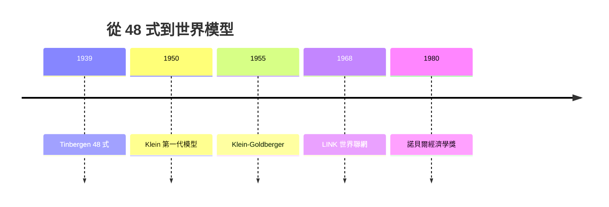

# 1980 · 懸案：政策出爐前，能不能先「彩排」一遍？

> **1980 諾貝爾經濟學獎（瑞典央行紀念獎）：勞倫斯·羅伯特·克萊因 Lawrence Robert Klein（美國，1920–2013）— 表彰他「建立經濟模型並將其應用於經濟波動與經濟政策的分析」（for the creation of economic models and their application to the analysis of economic fluctuations and economic policies）。**

---

## 懸案（案情提要）

1969 年首獎表彰了計量經濟學的方法論，1971 年表彰了數據的解剖學。可是到 1970 年代，最後一塊拼圖仍然懸空：**這些技術能不能拼成一台完整的「經濟預測機」**——讓政府在推政策之前，先在模型裡彩排一遍？

疑點三連：

1. Tinbergen 的 48 式模型（1939）證明了可行性，但單國單期；**多國、多期、連續運行**的模型從未建成；
2. 模型參數從哪來？聯立性偏差（Koopmans 1947 的檢舉）如何處理？
3. 模型好不好，誰來驗收？——預測屢屢出錯的話，整個工程就破產。

Klein 的裁決：用**小型精幹模型起步、逐步擴編、公開檢驗、全球聯網**。他建成的 Brookings 模型、Wharton 模型與 LINK 體系，讓「經濟預測」從學術遊戲變成一門產業。

---

## 前因

| 年份 | 事件 |
|---|---|
| 1939 | Tinbergen 的美國景氣循環模型（48 式）——本案的祖師爺 |
| 1944 | Klein 在 MIT 完成博士論文：Keynes 體系的數學化（Klein–Goldberger 模型的前身） |
| 1947 | 計量經濟學會「考爾斯委員會」的聯立模型方法論成軍（Koopmans 主編） |
| 1950 | Klein《美國經濟波動 1921–1941》：第一代 Klein 模型（12–20 條行為方程式） |
| 1955 | Klein–Goldberger 模型：美國經濟的年度模型，聯立求解成為標準 |
| 1958 | 二階段最小平方（2SLS，Theil–Basmann）問世，直擊聯立性偏差 |
| 1960s | Brookings 超大型模型（200+ 條方程式，Klein 主持）；Wharton 季度模型轉入商業預測 |
| 1968 | Klein 啟動 LINK 計劃：把各國模型「串聯」成世界模型 |
| 1970s | 石油衝擊與滯脹考驗所有模型；Klein 陣營不斷擴編修正 |
| 1980 | 得獎；「模型建造者」首次受勳，宏觀預測產業（WEFA、Data Resources 等）已蔚然成林 |

---

## 調查

### 線索一：模型的解剖圖——結構方程的三個族群

Klein 模型的骨架由三類方程組成：

1. **行為方程**（估計而來）：消費、投資、勞動需求、工資、進出口；例如 Klein–Goldberger 消費函數：

$$
C_t = \alpha_0 + \alpha_1 \left( W_t + P_t \right) + \alpha_2 P_{t-1} + \alpha_3 K_{t-1} + \varepsilon_t
$$

其中 $W$ 工資所得、$P$ 非工資所得、$K$ 期末資產（財富效應）——比簡單凱恩斯函數多出財富與利潤滯後兩味佐料。

2. **恆等式**（定義而來）：

$$
Y_t = C_t + I_t + G_t + X_t - M_t, \qquad K_t = K_{t-1} + I_t
$$

3. **制度方程**：稅收函數、轉移支付等隨稅法變動的項。

### 線索二：聯立求解——模型是「活的系統」

把 $g$ 條行為方程與恆等式寫成聯立系統 $\mathbf{f}(\mathbf{y}_t, \mathbf{y}_{t-1}, \mathbf{x}_t; \boldsymbol{\theta}) = 0$，其中 $\boldsymbol{\theta}$ 為估計參數、$\mathbf{x}_t$ 為外生政策變數（政府支出 $G$、稅率、貨幣量 $M$）。給定政策路徑，模型逐期迭代求解：

$$
\mathbf{y}_1 \rightarrow \mathbf{y}_2 \rightarrow \cdots \rightarrow \mathbf{y}_T
$$

**政策彩排**：跑兩遍——一遍基準（無新政策）、一遍情景（新政策），差分 $\Delta \mathbf{y}_t$ 即政策的預期效果。這就是 Klein 對 1969 年 Tinbergen 偵查術的「工業化量產」。

### 線索三：估計的鑑識難題——聯立性偏差

行為方程右側含有內生變數（如消費函數中的所得 $Y$ 與誤差項 $\varepsilon$ 相關），OLS 有偏。Klein 採用工具變數家族（2SLS、有限信息法 LIML）：

$$
\hat{\boldsymbol{\beta}}_{2SLS} = \left( X^{T} Z \left( Z^{T} Z \right)^{-1} Z^{T} X \right)^{-1} X^{T} Z \left( Z^{T} Z \right)^{-1} Z^{T} \mathbf{y}
$$

其中 $Z$ 為外生工具。這使大型模型的參數估計具有一致性——Koopmans 1947 年檢舉的「證物污染」問題在操作層面結案。

### 線索四：LINK——世界模型的「聯網偵查」

LINK 的構想：各國自建模型（結構由本國經濟學家掌握），以**貿易矩陣**為接口串聯——一國的進口 $\mathbf{m}_i$ 必須等於其他國家的出口加總：

$$
\sum_{i} m_i \;=\; \sum_{j} x_j \qquad \text{（全球貿易結算閉合）}
$$

石油衝擊、美元波動、政策外溢等「跨國案情」，首次可以在一台機器上彩排。LINK 至今由聯合國與賓州大學維護，是世界經濟展望的元老級工具。

### 線索五：模型的驗收——外推檢驗

Klein 堅持模型的「預測履歷」公開受審：以 $T$ 期前數據估計、向 $T+1, T+2, \dots$ 外推，計算均方誤：

$$
\mathrm{RMSE} = \sqrt{\frac{1}{T} \sum_{t} \left( y_t^{\text{預測}} - y_t^{\text{實際}} \right)^2}
$$

與「天真模型」（如隨機遊走）比較。這一驗收程序使模型工程具備可否證性——也正是後來 Lucas（1995）批評的靶心：**參數會隨政策制度改變**（盧卡斯批判），結構方程的「結構」不夠深。

---

## 理論裁決

**裁決一**：經濟可以表述為**大型聯立動態系統**並數值求解；政策效果可以事前模擬（「彩排」）而非事後猜測。

**裁決二**：模型的合法性來自三重工程：**結構理論 + 一致估計 + 公開外推檢驗**。三者缺一，模型就是裝飾品。

**裁決三**：預測與分析是**產業**：Wharton 模型開啟了商業經濟預測服務業，「首席經濟學家」從此成為公司職位。

**歷史注腳**：Klein 的凱恩斯主義工程在 1970s 滯脹中受挫——模型低估了預期與供給衝擊；Lucas 批判（1995 案）進一步質疑其「結構」的深度。但 Klein 的回應是「模型是活的，要持續擴編」——這種工程師式的謙遜，使宏觀模型至今仍是央行與國際組織的日常裝備（現代的 DSGE、半結構模型皆是本案的後裔）。

---

## 後果

| 領域 | 影響 |
|---|---|
| 政策應用 | 美國、日本、歐洲各國政府與央行建立常設模型部門；IMF 的 MULTIMOD、世銀與聯合國的 LINK 系統成為全球政策討論的平台 |
| 經濟學發展 | 大型宏觀模型 $\rightarrow$ 動態隨機一般均衡（DSGE）$\rightarrow$ 混合模型；模型比較與預測評估成為獨立學科 |
| 後續諾獎 | 1989 Haavelmo（估計的概率基礎）、1995 Lucas（對模型的批判）、2004 Kydland–Prescott（校準與時間一致性）、2011 Sargent–Sims（向量自回歸的另一條路） |
| 爭議 | 滯脹期預測失準遭媒體圍剿；盧卡斯批判質疑政策模擬的有效性；「黑箱大模型」與「透明小模型」之爭延續至今 |
| 冷戰人文 | Klein 是 1970s 美蘇經濟學界少數的持續對話者；其諾獎亦被視為「以模型溝通」時代精神的註腳 |

---

## 關聯

- [1969-Frisch與Tinbergen計量經濟破案術](1969-Frisch與Tinbergen計量經濟破案術.md)：本案是首獎方法論的工業化量產。
- [1971-Kuznets國民帳戶與增長長卷](1971-Kuznets國民帳戶與增長長卷.md)：模型的數據供應商與會計骨架。
- [1976-Friedman貨幣主義與永久收入](1976-Friedman貨幣主義與永久收入.md)：規則 vs 相機抉擇之爭的另一面——模型彩排正是「斟酌行事」的技術化。
- [1995-Lucas理性預期](../經濟學獎/1995-Lucas理性預期.md)：盧卡斯批判——對本案結構模型的正面駁回（本書續寫中）。
- [2004-Kydland與Prescott實際經濟週期](2004-Kydland與Prescott實際經濟週期.md)：校準方法對估計方法的改朝換代（本書續寫中）。
- [1973-Leontief投入產出矩陣](1973-Leontief投入產出矩陣.md)：部門結構與總量模型的互補偵查。
