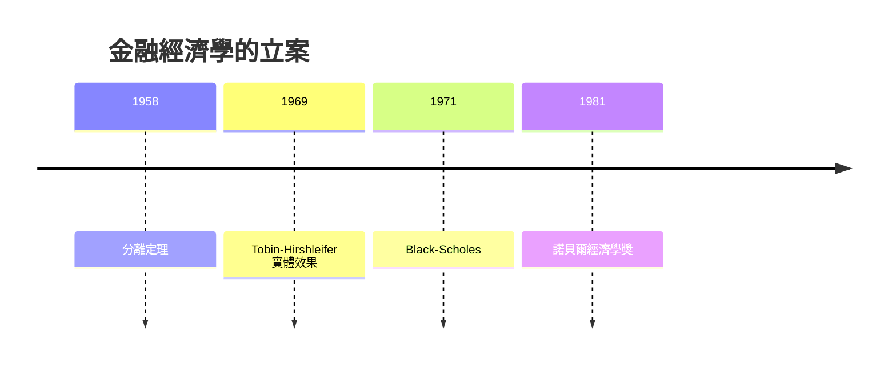

# 1981 · 懸案：金融市場的報價，究竟是在影響現實，還是只是反映現實？

> **1981 諾貝爾經濟學獎（瑞典央行紀念獎）：詹姆斯·托賓 James Tobin（美國，1918–2002）— 表彰他「對金融市場理論的貢獻，以及對金融市場真實效果分析的開創性工作」（for his contributions to the theory of financial markets and for his pioneering work in the analysis of the real effects of financial markets）。**

---

## 懸案（案情提要）

戰後的金融世界發生了巨變：養老金、共同基金、跨國資本市場迅速膨脹，股價成為報紙頭版。這帶來一樁新懸案：

1. **貨幣是不是「面紗」？** 貨幣主義者說，貨幣只是覆在實體經濟上的面紗，長期不影響真實變數（Friedman 1976 案的裁決）。但若金融市場真的只是反映，它為何能在景氣循環中扮演角色？
2. **股價與投資的因果方向**——是股價高才投資，還是投資多所以股價高？這是方向性謎題，觀察資料無法直接回答。
3. **風險如何定價？** 人們對未來的認知有限，理性投資者應要求風險溢價；但「風險」在金融裡到底以什麼形式被交易？
4. **行為的統計幽靈**：為什麼「上大學」這類決策的觀察資料，看起來像是不合理地偏低——明明多數人的潛在傾向是正的？

托賓的偵查團隊（他與 Hirshleifer 的「金融市場的實際效果」計畫）給出四份互相咬合的報告。

---

## 前因

| 年份 | 事件 |
|---|---|
| 1936 | 凱恩斯《通論》：金融市場被降格為「對投資的引導」，但機制未明 |
| 1944 | Metzler《美國所得的穩定性》：說明「收入不確定性」的量級 |
| 1945 | Samuelson 論社會保障的強制儲蓄，開啟戰後基金業 |
| 1951 | Tobin 加入耶魯；1955 年〈風險行為下的流動性偏好〉 |
| 1956 | Baumol 交易餘額模型：貨幣需求有了行為基礎 |
| 1958 | Tobin 分離定理（投資者分為「風險厭惡」與「風險中性」兩類） |
| 1960s | 戰後金融深化：共同基金、養老金、REIT 興起；CAPM 尚未成型 |
| 1965 | Tobin–Hirshleifer「金融市場與實體經濟的一般均衡分析」：資本流動的期限結構 |
| 1969 | Tobin 論證金融市場對真實投資具有**因果**作用（資本的期限結構把長期項目連到長期利率） |
| 1971 | Black–Scholes 論文問世；期權定價成為金融經濟學主战场 |
| 1981 | 得獎——金融市場「真實效果」第一次獲得諾獎級認證 |

---

## 調查

### 線索一：q 理論——資產價格如何「指使」資本形成

托賓的偵查起點是一個再簡單不過的觀察：企業的市值 $P$ 與其重置成本（資本存量 $K$ 的重置價值）之比：

$$
q = \frac{P}{K}
$$

若 $q > 1$，說明「市場認為這套資本能賺到超過重置成本的錢」——**新投資有吸引力**；若 $q < 1$，市場懷疑既有資本的陳舊或錯配，企業便傾向**縮減**產能（散舊買新、出售資產）。因此投資函數取決於 **q 的偏差**：

$$
\frac{I_t}{K_t} = \alpha \left( q_{t-1} - 1 \right), \qquad \alpha > 0
$$

這一行式就是托賓的「q 理論」核心：**股價是資本形成的指揮棒**，金融市場因此具有「真實效果」——回應了本案的第一號疑點。

### 線索二：調整成本與「合議庭的裁決書」

若市場完全無摩擦，$q$ 會瞬間回到 1，投資反應無限期延續。托賓引入**調整成本**（安裝、搜尋、偏好剛性），讓 q 的調整變慢：

$$
q_t - 1 = \lambda \left( q_t^{*} - q_{t-1} \right), \qquad 0 < \lambda < 1
$$

於是 $q$ 對基本面（利潤率、產能利用率）的反應具有**滯後**：

$$
q_{t-1} \approx \text{基本面} \Rightarrow \text{投資有時滯後，且產量與股價同向變動（產出—股價謎題）}
$$

這解釋了為何股價與產出高度同向——不是因果倒置，而是共同的驅動者加上調整成本。

### 線索三：風險的兩類玩家與分離定理

風險從哪裡來？托賓的回答帶有數學sharpness：未來收益有**不確定性**，投資者分為

- **風險厭惡者**（risk-averse）：要求溢價；
- **風險中性者**（risk-neutral）：只關心期望收益。

他的**分離定理**（1958）：風險厭惡者不會直接持有風險資產，而是把錢交給風險中性者（經由共同基金），由後者去承擔風險、只付給前者一個**確定的期望回報**：

$$
\max_{\mathbf{w}} \; \mathbb{E}\left[ \frac{W_1}{W_0} \right] - \frac{A}{2} \sigma^2 \left( \frac{W_1}{W_0} \right)
$$

（均值—方差框架，$\mathbf{w}$ 為資產權重，$A$ 為風險厭惡係數）。由此：**風險由誰承擔是制度安排**，而非個人偏好；金融市場的存在意義正在於把風險從多數人（無能力承擔）轉移給少數專業者（資金池），是社會風險分擔的技術裝置。

### 線索四：Tobin–Hirshleifer 的期限結構——金融市場如何「攜帶」實體

1969 年的合作論文處理一個更硬的問題：貨幣政策透過**利率期限結構**影響實體經濟。長期投資（工廠、研發）由長期利率融資，短期消費由短期利率融資；金融市場把不同期限的資金連接起來。當央行壓低短期利率但**長期利率不動**（預期通脹未受控），長短期利差倒掛：

$$
i_{\text{長期}} > i_{\text{短期}}
$$

長線投資受挫、短期信貸膨脹——「長短期資金配置」成為貨幣政策傳導的具體機制。托賓還指出關鍵條件：短期利率必須**由市場決定**（否則商業銀行在通脹下把存款轉為票據，造成強制儲蓄與配給，即 Baumol–Tobin 的「連鎖反應」）：

$$
\text{商業銀行：} \; \text{存款} \rightarrow \text{短期票據} \rightarrow \text{貸款配給} \quad (\text{流動性危機})
$$

### 線索五：Tobit 模型——被截斷的幽靈資料

托賓在偵查「為何美國大學入學率這麼低」時發現統計上的幽靈：若一個人的**潛在傾向**是入學，但只有負擔得起者才會入學，則觀察到的入學是「被截斷的因變數」。設：

$$
y_i = \max \{0, y_i^{*} \}, \qquad y_i^{*} = \mathbf{x}_i^{T} \boldsymbol{\beta} + u_i
$$

則觀察到 $y_i = 0$ 的機率是 $P(y_i^{*} \leq 0)$，正值的條件期望需要**反覆積分**校正（對數正態情形）：

$$
E[y \mid y > 0, \mathbf{x}] = \mathbf{x}^{T} \boldsymbol{\beta} \cdot \frac{\phi(\cdot)}{\Phi(\cdot)} \quad (\text{以 Mills 比修正})
$$

估計必須用**最大似然**（censored regression），而非 OLS——托賓由此提出 **Tobit 模型**，成為全經濟學最常用的處理「因變數受限於零」的估計工具（也用於家庭購車、退休儲蓄、工時選擇）。

---

## 理論裁決

**裁決一**：資產價格具有**因果**作用，透過 q 機制引導資本形成：

$$
\frac{I_t}{K_t} = \alpha (q_{t-1} - 1), \qquad q = \frac{P}{K}
$$

**裁決二**：風險的定價與承擔是可分離的制度問題；分離定理給出投資組合問題的完整解：

$$
\mathbf{w}^{*} = \frac{1}{A} \boldsymbol{\Sigma}^{-1} (\boldsymbol{\mu} - \mathbf{r}_f)
$$

**裁決三**：金融市場透過**期限結構**把貨幣政策傳導至實體投資；受管制利率會催生商業銀行的流動性連鎖反應。

**裁決四**：受限因變數須以 Tobit 型似然處理——「未發生」與「不願發生」在資料上是不同的兩種零。

**歷史注腳**：q 理論在 1980s 被企業財務學吸收為「投資理論」標準；在宏觀層，q 與股價的關係成為 1990s「股價通膨」與 2008 金融危機研究中「金融加速器」的前身（Bernanke–Gilchrist 1999）。

---

## 後果

| 領域 | 影響 |
|---|---|
| 政策應用 | 貨幣政策須看**資產價格與期限結構**，不能只看短期利率；銀行的流動性風險管理、存款保險的設計都源自連鎖反應分析 |
| 企業財務 | q 理論成為投資與資本存量的教科書模型；托賓 q 成為公司治理與併購估值的常用指標 |
| 經濟學發展 | 風險定價—資本形成—金融市場的統一框架，直通 1990 年 Markowitz–Miller–Sharpe 與 1997 年 Merton–Scholes |
| 統計工具 | Tobit 模型成為截斷／受限因變數的標準解；廣義截斷（censored、hurdle、sample selection）模型的源頭 |
| 後續諾獎 | 1990 Markowitz–Miller–Sharpe（組合選擇）、1997 Merton–Scholes（期權定價）、2022 Bernanke 等（金融加速器與危機） |
| 遺憾 | 托賓 1960s 曾主張設立**国民投資評議會**、1980s 主張「全球稅」（ Tobin tax）以抑制國際資本流動——均未成主流，但其問題意識在 2010s 重新回潮 |

---

## 關聯

- [1976-Friedman貨幣主義與永久收入](1976-Friedman貨幣主義與永久收入.md)：貨幣中性與金融市場真實效果之爭的正面對決。
- [1980-Klein宏觀計量模型](1980-Klein宏觀計量模型.md)：宏觀模型的金融部門（貨幣、利率、信用）需要托賓式的連接理論。
- [1990-Markowitz-Miller-Sharpe金融經濟學](1990-Markowitz-Miller-Sharpe金融經濟學.md)：分離定理與組合選擇的正式化（本書續寫中）。
- [1997-Merton與Scholes期權定價](1997-Merton與Scholes期權定價.md)：把「不確定性」寫成可以定價的對象（本書續寫中）。
- [2022-Bernanke銀行與金融危機](2022-Bernanke銀行與金融危機.md)：q 理論與金融加速器的現代戰場（本書續寫中）。
- [1991-Coase交易成本與產權](1991-Coase交易成本與產權.md)：金融中介的組織邊界（本書續寫中）。
