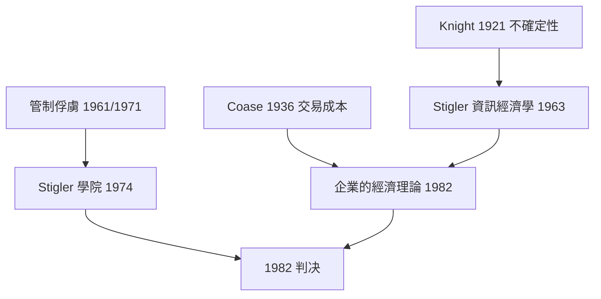

# 1982 · 懸案：管制是誰的煙幕？市場的「看不見的手」到底有多靈？

> **1982 諾貝爾經濟學獎（瑞典央行紀念獎）：喬治·約瑟夫·斯蒂格勒 George Joseph Stigler（美國，1911–1991）— 表彰他「對經濟組織理論的開創性貢獻，以及對產業結構、市場運作與公共管制的實證分析」（for his pioneering contributions to the theory of economic organization and for his empirical analyses of industrial structure and the functioning of markets and public regulation）。**

---

## 懸案（案情提要）

「市場失靈」是 1970s 經濟學最時尚的辯護詞：壟斷、外部性、資訊不對稱、公共品——於是有了管制。但疑點隨之而來：

1. **管制是誰寫的？** 航空、電力、醫療、電視的規則由誰起草、對誰有利？
2. **管制有沒有效果？** 傳統說「管制是為了社會福利」，但管制的效果從未被嚴格檢驗過——直到有人敢於**拿數據去對照制度變動**。
3. **經濟學家自己能解釋市場嗎？** 芝加哥學派的口號是「讓我們看數據」，但要解釋產業結構，得先解釋**企業為何存在、為何改變形態**——這需要一門「企業的經濟學」。
4. **信息在經濟中扮演什麼角色？** 價格是信息、壟斷是對不確定性的保險與不對稱信息的產物——這些都需要模型。

斯蒂格勒的偵查以「用數據檢驗制度」聞名，並自稱「經濟學家的經濟學家」。

---

## 前因

| 年份 | 事件 |
|---|---|
| 1911–1938 | Stigler 於芝加哥大學學習，師承 Frank Knight 與 Henry Simons；1936 年因未獲博士學位轉往威斯康辛 |
| 1936 | Coase《社會成本論》問世（1991 得主） |
| 1938 | Berle–Means《現代公司與私有財產》：公司治理與所有權分離 |
| 1946 | Shubik 與 Stigler 的「壟斷競賽理論」 |
| 1950 | Stigler 論「壟斷的經濟學」：不存在單純壟斷，壟斷市場亦須競爭 |
| 1958 | Stigler《經濟學的諸般流派》；1963 年〈資訊經濟學〉 |
| 1961 | Stigler 與 Friedland 的學院罷工研究：管制俘虜理論的原型 |
| 1964 | Stigler《產業組織的理論與實務》；「壟斷的經濟學」 |
| 1970s | 麥克勞—孔斯的美國管制廢除與 deregulation 浪潮；Stigler 是理論旗手 |
| 1982 | 得獎：經濟學第一次表彰「用經濟學分析經濟學家與管制者」的工作 |

---

## 調查

### 線索一：壟斷的經濟學——沒有單純壟斷這回事

斯蒂格勒的第一份證據推翻「壟斷者」的樸素畫像：進入容易的行業裡，利潤會被競爭磨平；進入困難的行業裡，即使有寡頭，**利潤也不會特別高**——因為「寡頭頭腦」必須花錢維持份額、阻止進入。

他提出一條檢驗準繩：**若某行業利潤異常高，則進入壁壘必定存在**——用經濟學的常識（負的利潤必然招致進入）反推結構。

### 線索二：企業為何存在——Coase 的提問被接下來

Stigler 把 Coase 的問題正式列為「企業的經濟學」：既然市場能協調，分散化的價格機制已經很好，何苦還要公司？答案在**交易成本與不確定性**：

- 生產需要在一段時間內連續取得要素，而價格機制無法保證**供給的連續性**（例如中間投入隨時斷供）；
- 市場談判需要成本，且**信息不對稱**使合約難以簽訂；
- 不確定性下，企業家以**統一指揮**代替反覆磋商。

因此企業的邊界條件是：

$$
\text{市場交易成本} \;\gtrless\; \text{內部組織成本}
$$

「公司的存在是對市場失靈的追索」——這句話把 Coase、Coase–Williamson 傳統一體化，直通 2009 年 Williamson 的交易成本經濟學。

### 線索三：資訊經濟學——壟斷作為對不確定性的保險

Stigler 1963 年的〈資訊經濟學〉把阿羅的資訊經濟學轉成產業組織語言：

- **買方成本**：搜尋好賣家的成本（但拍賣歷史讓搜寻更有效）；
- **賣方成本**：識別好買家的成本（價格歧異、專業化）；
- **保險型壟斷**：壟斷者可能提供**服務品質保證**、承擔退貨風險——這解釋了為何某些產業裡壟斷與高價共存。

於是壟斷的成因從「市場勢力」擴展為三種：**技術規模經濟**、**資源壁壘**、**資訊與不確定性**。這是產業組織學從「哈羅模型」走向「結構—行為— performance」現代版的里程碑。

### 線索四：管制俘虜——規矩是誰的代理人

斯蒂格勒 1971 年〈管制俘虜理論〉是全案最著名的判詞：**管制不是為公共利益而設，而是被管制產業用來保護自己的工具**。機制：

1. 管制者與被管制者之間存在**資訊不對稱**與**旋轉門**；
2. 被管制者能組織起来影响規則起草（律師、工程師、遊說）；
3. 一旦管制存在，被管制者便有動機持續請求更嚴格的管制（**限制潛在競爭者**）；
4. 管制者也有動機擴張權限。

因此他提出「鐵三角」式的現實假設：**消費者、業者、管制者三方，誰的影響最大，政策就往誰的方向偏**。

### 線索五：用制度變動做識別——Stigler 的方法論革命

斯蒂格勒最深的遺產是**方法**：他不接受「模型—結論」的傳統，而是要求**經驗檢驗制度假說**。其代表作是對美國管制史的「自然實驗」式檢驗：

- **航空業**：1934 年《航空郵件法案》造成的壟斷結構，與 1978 年《航空鬆綁法》後的市場結構對照，檢驗「管制造成無效率」的命題；
- **電業**：公用事業的成本結構與競爭的效率比較；
- **教育**：1966 年 Coleman Report 與 1980s 的改革評估。

這套「以制度斷點（regime break）識別因果」的方法，後來在 1990s 被 Angrist、Imbens（2021 案）系統化為因果推斷革命，並在 2021 年 Card 用最低工資研究、移民配給研究時再度發威。

---

## 理論裁決

**裁決一**：壟斷不是市場勢力的同義詞，而是**進入壁壘**（技術、資源、資訊）的結果；用利潤異常反推壁壘，是可操作的鑑識法。

**裁決二**：企業存在是對市場交易成本與不確定性的**反制**，邊界由兩類成本的比較決定：

$$
\text{企業邊界：} \quad \text{內部協調成本} = \text{外部交易成本}
$$

**裁決三**：資訊成本與不確定性是產業結構的**第一性原理**，壟斷可以是「對抗不確定性的制度」。

**裁決四**：管制的效果必須以**制度斷點**檢驗，而理論上最可能的結論是**管制被產業俘虜**——這是一個可檢驗的命題，而非左派陰謀論。

**歷史注腳**：1982 年正值雷根時代管制鬆綁的收官，Stigler 的證詞為「政府失靈」提供了經濟學的正式判決書；同時他也警告：**鬆綁本身也可能被受益產業俘虜**（1990s 電信鬆綁與 2008 金融鬆綁的爭議即是預言）。

---

## 後果

| 領域 | 影響 |
|---|---|
| 政策應用 | 美英 1970s–80s 管制鬆綁、1980s–90s 電信與電力市場自由化的理論背書；公用事業與航空的結構改革 |
| 經濟學發展 | 產業組織學（Oligopoly by IO）成為支柱；「經濟學的經濟學」（經濟學家的行為分析）成為專門領域 |
| 方法論 | 制度斷點識別、事件研究、自然實驗——直通 2021 年因果推斷革命與 Card 得獎 |
| 後續諾獎 | 1991 Coase（交易成本與產權）、2009 Williamson（交易成本與企業邊界）、2014 Tirole（產業組織與管制）、2021 Card–Angrist–Imbens（因果識別） |
| 爭議 | 管制俘虜理論被批為「過度懷疑」；Stigler 本人亦指出政府失靈與市場失靈孰輕孰重的問題無解（這正是 Hayek 1974 案的爭議） |

---

## 關聯

- [1974-Myrdal與Hayek貨幣波動與制度](1974-Myrdal與Hayek貨幣波動與制度.md)：市場失靈 vs 政府失靈的經典對峙，Stigler 站在中間的實證位置。
- [1977-Ohlin與Meade國際貿易與資本流動](1977-Ohlin與Meade國際貿易與資本流動.md)：跨國市場與管制的對照。
- [1991-Coase交易成本與產權](1991-Coase交易成本與產權.md)：Stigler 提出的企業存在問題由 Coase 展開（本書續寫中）。
- [2009-Ostrom與Williamson治理](2009-Ostrom與Williamson治理.md)：企業與制度的邊界（本書續寫中）。
- [2014-Tirole產業組織與管制](2014-Tirole產業組織與管制.md)：產業組織理論的當代綜合（本書續寫中）。
- [2021-Card-Angrist-Imbens因果推斷](2021-Card-Angrist-Imbens因果推斷.md)：制度斷點識別法的現代化身（本書續寫中）。
