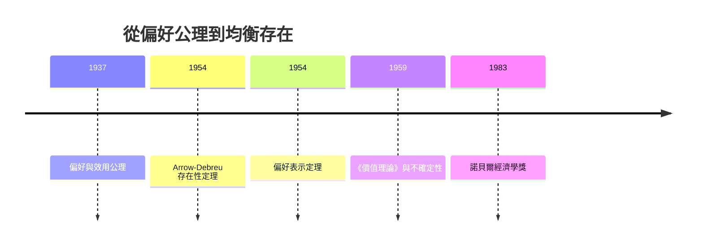

# 1983 · 懸案：能不能寫出一部「不摻雜任何假想世界」的經濟學？

> **1983 諾貝爾經濟學獎（瑞典央行紀念獎）：羅拉爾·德布魯 Gérard Debreu（法國出生／美國籍，1921–2004）— 表彰他「對一般均衡理論的數學貢獻」（for his mathematical contributions to the theory of general equilibrium）。**

---

## 懸案（案情提要）

1950 年代的經濟學像一份證物齊全、卻沒有人能讀懂的卷宗。疑點是**根本性的**：

1. **均衡到底是不是真的？** 經濟學家畫出供給需求交點，卻無人能證明存在這樣一組價格，使所有市場同時出清。若不存在，整套理論只是空中樓閣。
2. **偏好能不能被數學表達？** 「消費者偏好某物」是心理語言，要把它變成可微、可積、可求導的效用函數，需要一套嚴謹的公理。
3. **不確定性怎麼處理？** 昨天的天氣是狀態，卻不是商品；未來的食物是「 contingent claim」（或有權利），它的價格從哪裡來？
4. **理論與現實的距離**——「純粹理論」的極端是否已經走到反噬？

德布魯的偵查報告《價值理論》（1959）被視為經濟學的「幾何原本」：它不描述任何具體經濟，只規定一個經濟**必須滿足什麼**，才配稱為經濟。

---

## 前因

| 年份 | 事件 |
|---|---|
| 1934 | 德布魯移居美國；1935–38 年在巴黎完成研究，師承 Henri Cartan（Fréchet 學派） |
| 1937 | 〈關於價值理論的研究〉：初次整理偏好與效用的公理 |
| 1940s | 二戰期間在美國從事戰時經濟統計（國民收入核算），與 Kuznets（1971 案）同一戰線 |
| 1950 | 芝加哥大學；認識 Arrow |
| 1954 | Arrow–Debreu〈一般均衡的存在性〉：本案第一份決定性報告 |
| 1954 | Debreu〈用數值函數表示偏好序〉：偏好表示定理 |
| 1959 | 《價值理論》：完整公理化；同年〈效用理論中的不確定性〉處理自然狀態與或有權利 |
| 1962 | 遷往加州大學柏克萊分校，創建數學經濟學中心 |
| 1970s | 與 Kenneth Arrow 合編《價值的理論》（1983 年第二版） |
| 1974 | 與 Arrow 同獲「諾貝爾經濟學獎提名」級的稱譽（實際於 1983 年得獎，Arrow 已於 1972 年得獎） |
| 1983 | 得獎；委員會因 Nash（數學家）獲獎在即，把獎項範圍重定義為社會科學 |

---

## 調查

### 線索一：偏好表示定理——把心理語言翻成數學

德布魯的第一個動作是**翻譯**。他列出偏好的技術性條件（完整性、超越性、連續性、單調性、凸性），然後證明存在一個連續、單調、凹的效用函數 $u$ 精確地表達偏好序：

$$
x \succ y \;\;\Longleftrightarrow\;\; u(x) > u(y)
$$

這意味著：一旦接受這組公理，消費者的全部行為（需求、需求函數、消費者剩餘、支出函數）都可以從一個**可微分的實值函數**推導——經濟學於是擁有了與物理學同級的操作語言。

關鍵在**凸性**（對組合的「多多益善」偏好）與**連續性**（無邊際變化的不動點）——正是 1972 年 Arrow–Hicks 案中那條「微觀法醫學」的DNA。

### 線索二：均衡的數學解剖（節省公理）

在完全市場、有限經濟體、連續偏好與凸技術的設定下，德布魯把均衡寫成四個部分：

1. **消費者均衡**（消費者 $i$）：

$$
\max_{x_i} \; u_i(x_i) \quad \text{s.t.} \;\; \mathbf{p}^{T} x_i \leq \mathbf{p}^{T} \omega_i
$$

一階條件：$\nabla u_i(x_i) = \lambda_i \mathbf{p}$——**邊際效用比率等於價格比率**。

2. **生產者均衡**（企業 $j$）：

$$
\max_{y_j \geq 0} \; \mathbf{p}^{T} y_j \quad \text{s.t.} \; y_j \leq f_j(z_j)
$$

3. **市場出清**（向量式）：

$$
\mathbf{z} = \sum_{i} x_i + \sum_j y_j, \qquad \mathbf{p} \geq 0
$$

4. **Walras 法則**（冗餘條件）：$\mathbf{p}^{T} \mathbf{z} = 0$——因為 $n$ 個市場只有 $n-1$ 個獨立。

**均衡的定義**：一組價格 $\mathbf{p}^{*}$，使得在該價格下所有主體的決策彼此相容（各自最優）且所有市場同時出清。

### 線索三：存在性證明的三塊磚

德布魯與 Arrow 的證明被拆成三步（其後由 Arrow 與 Debreu 各自成文）：

1. **表示定理**（把偏好變成效用）：用分離超平面把偏好序嵌入 $\mathbb{R}^L$；
2. **固定點**：構造價格調整映射

$$
\Phi(\mathbf{p}) = \text{投影}_{S} \left[ \mathbf{p} + \mathbf{z}(\mathbf{p}) \right]
$$

其中 $S = \{\mathbf{p} \in \mathbb{R}^n_{++} : \sum p_i = 1\}$。由 Kakutani 不動點定理（Brouwer 的推廣），存在 $\mathbf{p}^{*}$ 使 $\Phi(\mathbf{p}^{*}) = \mathbf{p}^{*}$，即 $\mathbf{z}(\mathbf{p}^{*}) \leq 0$；再由 Walras 法則得 $\mathbf{z}(\mathbf{p}^{*}) = 0$。

3. **結論**：均衡**存在**。

這條鏈條後來被 Debreu 寫成教科書（《價值理論》第 2 章），成為整個現代經濟學的「存在性檢驗標準」。

### 線索四：不確定性與或有權利——「未來的雨」如何定價

1959 年德布魯處理本案的第三號疑點：把「狀態」（state of nature）當作無限的經濟空間維度。每一種商品在每一種狀態下都有**或有權利（contingent claim）**：

$$
\text{商品束} = (x_1, \dots, x_n) \times S
$$

若狀態 $s$ 發生，經濟體得到的是 $x(s)$ 這個特定的「複合商品」。於是**完全市場**意味著：對每一種狀態都有對應的市場，狀態價格 $q_s$ 存在。均衡則要求：狀態 $s$ 發生時，市場出清且價格體系在每一狀態都一致——「或有權利定價」的公理化。保險、期貨、債券在這套框架裡全部是「狀態索取權」的買賣。

後果：這套語言直接支撐了 1997 年 Merton–Scholes 的定價模型與 2005 年 Aumann–Schelling 的狀態依存產權理論。

### 線索五：抽象經濟——把「制度」從模型中抽掉

德布魯在《價值理論》提出的「抽樣經濟（abstract economy）」概念：模型只規定**參與者、策略集合、可行集**，不假定制度、不假定貨幣、不假定計價單位；價格只是用來表示相對稀缺性的**均衡比例**。這是把經濟學「去制度化」的極限操作——它的後果是：

- 好處：定理極其乾淨、可跨制度移植；
- 壞處：制度性事實（貨幣、法律、權力）全部被推到模型之外，而 1970s–90s 的理論戰爭恰恰圍繞這些被推出去的東西（資訊不對稱、交易成本、公共選擇、制度）。

---

## 理論裁決

**裁決一**：經濟學的第一定理——**均衡存在**：在標準假設下，價格體系使所有市場同時出清。

**裁決二**：偏好可由連續凹效用函數表示；消費者均衡是「邊際效用比率 = 價格比率」。

**裁決三**：均衡由**四段結構**定義（偏好表示、企業技術、資源稟賦、均衡價格），任何經濟學理論都可被拆成這四段來檢驗。

**裁決四**：不確定性可用狀態空間與或有權利定價；價格體系在每一狀態下都必須存在。

**裁決五（方法論）**：**均衡是導出概念，不是經驗事實**——它的價值在於給出一組可反駁的命題（價格如何變動、分配的邊際條件）。

**歷史注腳**：1983 年的授獎本身引發制度風波——委員會為此修改章程，把獎項範圍從「經濟科學」重新定義為涵蓋社會科學，並限制委員任期。這是本獎史上因「數學家獲獎」而做出的最大制度調整。

---

## 後果

| 領域 | 影響 |
|---|---|
| 理論發展 | 均衡成為現代經濟學的預設語法；教科書（Arrow–Debreu《價值的理論》）影響數代研究生 |
| 教學 | 「均衡分析」成為進入經濟學的標準訓練；公共經濟學、國際貿易、信息經濟學皆以此為骨架 |
| 政策應用 | 一般均衡框架用於關稅、補貼、關稅配額與 CGE 模型的理論基礎（1975 案配置理論的延伸） |
| 方法論影響 | 「均衡 + 檢驗」成為主流；同時引發「過度一般化」批判（Samuelson 的「zoomed in / zoomed out」之爭） |
| 後續諾獎 | 1994 Nash（均衡的賽局版）、2007 機制設計（制度化的均衡）、2024 制度與繁榮（把制度放回均衡） |
| 制度影響 | 1994 年後獎項範圍改為社會科學，制度與心理學得主增加（2002、2009、2017、2024） |

---

## 關聯

- [1972-Arrow與Hicks一般均衡與福利](1972-Arrow與Hicks一般均衡與福利.md)：存在性與福利兩大定理的共同舞台，Arrow 與 Debreu 的分工。
- [1969-Frisch與Tinbergen計量經濟破案術](1969-Frisch與Tinbergen計量經濟破案術.md)：均衡的存在是計量模型方程式「有解」的保證。
- [1994-Nash-Harsanyi-Selten非合作賽局均衡](1994-Nash-Harsanyi-Selten非合作賽局均衡.md)：把「均衡」從Walrasian 移植到策略互動（本書續寫中）。
- [1997-Merton與Scholes期權定價](1997-Merton與Scholes期權定價.md)：或有權利定價的現代版（本書續寫中）。
- [2024-Acemoglu制度與繁榮](2024-Acemoglu制度與繁榮.md)：把制度放回模型的那一代（本書續寫中）。
- [1975-Kantorovich與Koopmans資源配置](1975-Kantorovich與Koopmans資源配置.md)：線性技術下的均衡與對偶價格的對照（本書續寫中）。
