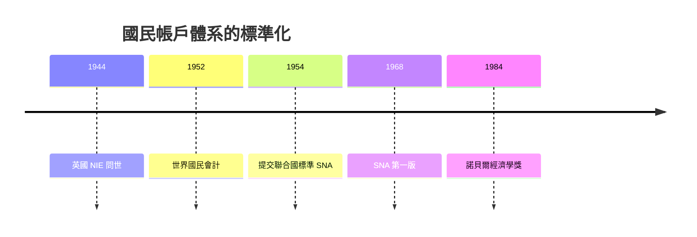

# 1984 · 懸案：全世界的經濟，能裝進同一本帳嗎？

> **1984 諾貝爾經濟學獎（瑞典央行紀念獎）：約翰·理查德·尼古拉斯·斯通 Sir John Richard Nicholas Stone（英國，1913–1991）— 表彰他「在建立會計體系以及制定國民與國際會計準則方面的開創性工作」（for his pioneering work in the construction of accounting systems and the development of national and international accounting standards）。**

---

## 懸案（案情提要）

1970 年代的IMF、世界銀行、OECD 都在問同一個問題：**各國的數字根本不能比較**。美國的 GNP 是怎麼算的？日本為什麼用不同的口徑？跨國資料一攤平，排名立刻失真。更深層的疑點：

1. **「經濟」這個對象如何被一致地測量？** 1940–50 年代各國自訂口徑，同名不同義；
2. **一國的帳要如何與世界其他部分對帳？** 進出口、利息、股利、援助的記帳方向是否一致？世界總和應為零，但實務上從來不是零；
3. **誰來定標準？** 沒有超國家機構的話，標準就是各國談判的產物——這是一場需要制度和外交能力的談判。

斯通的偵查：他不是統計員出身（他是統計學者、國民經濟核算的設計師），他設計的是**帳本的體系**本身，並說服各國使用同一套。

---

## 前因

| 年份 | 事件 |
|---|---|
| 1913 | 斯通生於英國；劍橋 Gonville and Caius 學院，後入 King's College |
| 1930s | 進入「實際經濟學」研究圈，劍橋的「實際經濟學社團」（later 「實際經濟學學會」）的核心人物 |
| 1936 | Keynes《通論》；Stone 協助其資料基礎 |
| 1941 | 加入英國戰時經濟部（Ministry of Economic Warfare），負責佔領區的經濟調查 |
| 1942 | 〈戰時的實際收入〉：提出戰時「可支配收入」概念 |
| 1944 | 《國民收入與支出》（National Income and Expenditure, 1944）：**英國 SNA 的第一版** |
| 1945 | 英國成立中央統計局（CSO），Stone 任首任統計負責人 |
| 1947 | 為戰爭後復原需要提交「國民生產能力衡量」報告 |
| 1951 | 聯合國 OEEC 統計主任，負責國際比較 |
| 1952 | 《世界國民會計》（World National Accounts, 1952）：跨國帳本的統一方案 |
| 1954 | 提交「標準國民帳戶」（Standardized System of National Accounts）給聯合國經濟事務委員會 |
| 1968 | 聯合國《國民帳戶體系》（SNA）首版發表——Stone 是主要設計者 |
| 1993 | SNA 修訂版（1993 SNA）問世，跨國可比性大幅提升 |
| 1984 | 得獎；同時獲封爵士 |

---

## 調查

### 線索一：一致的五大帳——世界的標準語法

Stone 的核心工程是給世界各國一套**同義詞、同口徑**的帳本。SNA 的基本結構是五個對帳的帳目：

1. **生產帳**（GDP by industry）：$Y = \sum_i VA_i$；
2. **收入分配帳**：$Y = W + \text{稅淨額} + \text{營業盈餘}$；
3. **資本形成帳**：$I = \Delta \text{固定資本} + \Delta \text{存貨}$；
4. **對外帳（收支平衡）**：$CA = X - M + \text{淨要素所得} + \text{轉移}$；
5. **物量與價格帳**：把名目值分解為**物量指數**與**價格指數**：

$$
\text{名目變動} \approx \text{物量變動} + \text{價格變動}, \qquad \frac{\Delta V}{V} \approx \frac{\Delta Q}{Q} + \frac{\Delta P}{P}
$$

「聯合國國民帳戶體系」這套語言的目標只有一個：**讓不同國家的數字可以放在同一張表上比較**。這也是 1971 年 Kuznets 案的遺產的制度化（Kuznets 是美國實務，Stone 是全球標準）。

### 線索二：對帳恆等式——世界的「帳要平」

Stone 的偵查核心是一個簡單但極其嚴格的要求：**全球帳目必須閉合**。國民帳戶的四個主體（家庭、企業、政府、國外）之間，每一筆流量都必須有對應的記帳：

$$
S - I = (G - T) + (X - M) + \text{資本移轉淨額}
$$

在世界層面，若所有國家用同一套規則，最終結果必須是：

$$
\sum_{\text{世界}} (S - I) = \sum_{\text{世界}} (G - T) + \sum (X - M) = 0
$$

實務上世界總和從來不是零——因為**統計誤差、跨國金融流量（利息與股利的計價差）、跨國機構（如 IMF 的貸款）、非居民交易**都造成缺口。Stone 設計的「世界國民會計」用**全球對帳（world reconciliation）**來處理：把世界分為「國際機構 + 中心國家 + 其他國家」三塊，並設「統計誤差」項，讓帳目在約定方式下閉合。這是把「髒資料」制度化的經典案例。

### 線索三：宏觀經濟學的財政視角（1942–45）

Stone 在戰時提出的第一個大概念是**可支配收入（disposable income）**：一國的「真實收入」不能只算 GDP，還要看怎麼分配：

$$
Y_d = Y - T + \text{轉移支付}
$$

更關鍵的是他的「個人可支配收入」概念——把配給、戰時物價、稅制都納入，得到一個可以跨期比較的福利指標。這是戰後國民帳戶「**收入**面向」的第一份設計文件，也是 2015 年 Deaton「福祉測量」案的遠祖。

### 線索四：物量與價格的「雙重偵查」

Stone 的另一項硬功夫是**通脹的分解**：把任何名目序列的變化，分解為物量變化與價格變化：

$$
\text{費氏指數} \;\; P_t = \prod_{i} \left( \frac{p_{it}}{p_{i,t-1}} \right)^{w_{i,t-1}}, \qquad \text{拉斯佩耶指數}
$$

以及「現價 vs 不變價」雙表編制（current prices / constant prices），使得跨國跨期的實際增長率可計算。Stone 的「工資指數、零售物價指數」等方法，確定了今天統計局的基本工作語法。

### 線索五：從會計標準到政策對話

SNA 的隱含政治：一旦各國用同一套帳，政策討論就有共同語言。Stone 在 IMF 與 OEEC 的角色，使「可比較性」成為國際經濟政策的技術前提——這在 1970s 石油危機、1980s 債務危機與 1990s 過渡經濟中屢見其效。1993 SNA（更貼近當代經濟：服務業、無形資產、跨國生產）進一步延伸了這套標準。

---

## 理論裁決

**裁決一**：國民經濟必須被記錄成**五個互相對帳的帳目**，任何一筆流量都不得憑空出現。

**裁決二**：世界帳目必須閉合；差距必須以「統計誤差與國際機構交易」明確列出，而不是藏起來：

$$
\sum_{\text{世界}} (X - M) = 0, \qquad \text{誤差} \;=\; \text{可計算的、被承認的殘差}
$$

**裁決三**：真實經濟增長必須與價格變化分離：

$$
g_{\text{real}} \approx g_{\text{nominal}} - \pi
$$

**裁決四**：衡量經濟不只有生產一途，「可支配收入」把分配與福利納入帳本——這是統計從「技術」走向「社會」的轉折。

---

## 後果

| 領域 | 影響 |
|---|---|
| 統計制度 | 聯合國 SNA 成為全球事實標準（1968、1993、2008 修訂）；各國統計局的組織藍圖皆源自此 |
| 政策應用 | IMF 的財政與外部失衡診斷、OECD 的「增長_accounting」、世界銀行的貧國比較——全部建立在可比帳目上 |
| 經濟學發展 | 國民帳戶成為宏觀模型的資料層（1971 Kuznets 案的制度化），也成為「GDP 是否夠用」批判的靶心 |
| 國際治理 | Stone 本人是「統計外交官」：對帳與協調本身就是國際經濟治理的第一道工序 |
| 後續諾獎 | 1971 Kuznets（實證傳統）、1980 Klein（模型吃帳目）、2001 Akerlof 等（資訊）、2015 Deaton（消費與福祉：帳本的邊界） |
| 爭議 | 「GDP 是什麼、不是什麼」的百年爭論：地下經濟、未付費照護、環境耗損、數位免費商品——每一項都是對 SNA 口徑的重新審判（2018 Nordhaus 案正是在 GDP 之外測算氣候成本） |

---

## 關聯

- [1971-Kuznets國民帳戶與增長長卷](1971-Kuznets國民帳戶與增長長卷.md)：Stone 把 Kuznets 的美國實務升格為世界標準。
- [1973-Leontief投入產出矩陣](1973-Leontief投入產出矩陣.md)：SNA 的供給使用表即投入產出表的制度化版本。
- [1980-Klein宏觀計量模型](1980-Klein宏觀計量模型.md)：帳目是模型的血液，模型是帳目的活化。
- [2015-Deaton消費與貧困](2015-Deaton消費與貧困.md)：帳本之外的消費與福祉（本書續寫中）。
- [2018-Nordhaus與Romer長期增長](2018-Nordhaus與Romer長期增長.md)：在 GDP 之外為氣候與創新定價（本書續寫中）。
- [2024-Acemoglu制度與繁榮](2024-Acemoglu制度與繁榮.md)：國民帳目的政治經濟學解讀（本書續寫中）。
